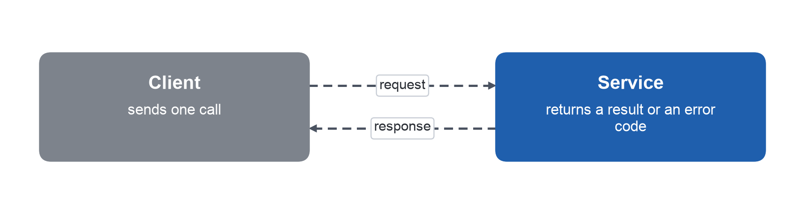

# 2. Analysis

This part analyses the recorded calls. Figure 2.1 shows the path of one call from the client to the service and back, which is the unit that every finding of this part describes.

{width=60%}

Building on this path, the analysis counts the outcomes of Table 1.1 for each kind of call.
