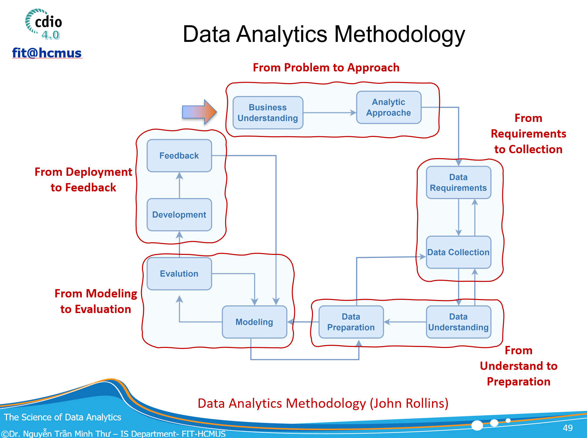

MTH045 – The Science of Data Analytics | Milestone 2

**MILESTONE P2**

# FROM REQUIREMENTS TO COLLECTION TỪ YÊU CẦU ĐẾN THU THẬP DỮ LIỆU

---

_Data Requirements, Open Dataset Discovery & Reproducible Collection_

**Lĩnh vực bắt buộc: GIÁO DỤC**

> **Mục tiêu của Milestone 2**
>
> Chuyển các yêu cầu và Analytical Questions đã xác định ở Milestone 1 thành yêu cầu dữ liệu có thể kiểm chứng; tìm kiếm, đánh giá, lựa chọn và thu thập bộ dữ liệu mở phù hợp để tạo đầu vào khả thi cho các giai đoạn Data Understanding, Data Preparation và Modeling sau này.

| **Thông tin nhóm** | **Nội dung** |
|---|---|
| Tên nhóm |  |
| Thành viên |  |
| Chủ đề / Project title |  |
| Milestone 1 version / ngày duyệt |  |
| Bộ dữ liệu mở được chọn |  |
| Ngày nộp |  |

_Tài liệu hướng dẫn thực hiện đồ án – Student Project Guideline_

## 1. Vị trí của Milestone 2 trong Data Analytics Methodology

Milestone 2 tiếp nối trực tiếp Milestone 1. Ở Milestone 1, nhóm đã xác định **Stakeholder Needs → Business Goal → SMART Goal/KPI → Analytical Questions → Analytics Type**. Milestone 2 không được bắt đầu lại bằng việc “đi tìm một dataset thú vị”; thay vào đó, nhóm phải đi theo chiều ngược lại từ câu hỏi phân tích để xác định dữ liệu cần có, sau đó mới tìm và thu thập dữ liệu mở phù hợp.



_Hình 1. Data Analytics Methodology – Milestone 2 tập trung vào Data Requirements ↔ Data Collection._

> **Nguyên tắc bắt buộc**
>
> Requirement quyết định dữ liệu cần tìm; dữ liệu không được phép “ép” ngược lại để thay đổi mục tiêu dự án một cách tùy tiện. Nếu dữ liệu mở không đủ để trả lời một Analytical Question, nhóm phải ghi nhận data gap và thực hiện controlled revision, không được bịa thêm biến hoặc suy diễn quá mức.

## 2. Mục đích và kết quả cần đạt

- Chuyển từng Analytical Question của Milestone 1 thành Data Requirement cụ thể: population, unit of analysis, measures/targets, dimensions/features, time window, granularity và nguồn dữ liệu mong đợi.
- Phân biệt yêu cầu dữ liệu cho bốn mức analytics: Descriptive, Diagnostic, Predictive và Prescriptive.
- Tìm kiếm có hệ thống ít nhất 03 bộ dữ liệu mở trong lĩnh vực giáo dục từ các nguồn có thể kiểm chứng trên Internet.
- Đánh giá mức độ phù hợp của candidate datasets bằng tiêu chí rõ ràng thay vì chọn dataset vì dễ tải hoặc đã phổ biến.
- Lựa chọn bộ dữ liệu chính (và tối đa một bộ bổ sung nếu thực sự cần), ghi rõ provenance, license, citation, phạm vi sử dụng và ràng buộc đạo đức.
- Thu thập dữ liệu theo cách có thể tái lập: giữ nguyên raw data, lưu nguồn tải, ngày truy cập, version/file name, checksum hoặc bằng chứng tương đương.
- Xác nhận tính khả thi của proposal: Analytical Questions nào được dữ liệu hỗ trợ đầy đủ, hỗ trợ một phần hoặc chưa thể hỗ trợ.
- Chuẩn bị Data Collection Package làm đầu vào cho Milestone tiếp theo: From Understanding to Preparation.

> **Đầu ra cốt lõi**
>
> Milestone 2 phải trả lời được hai câu hỏi: (1) “Để trả lời các Analytical Questions đã cam kết, chúng ta cần dữ liệu gì?” và (2) “Bộ dữ liệu mở đã thu thập có thực sự cung cấp những dữ liệu đó hay không?”

## 3. Đầu vào bắt buộc từ Milestone 1

Trước khi tìm dataset, nhóm phải “freeze” một baseline từ proposal Milestone 1. Tối thiểu phải có các thành phần sau:

| **Thành phần từ Milestone 1** | **Yêu cầu khi chuyển sang Milestone 2** |
|---|---|
| Business Goal | Giữ nguyên business outcome đã được nhóm xác định; chỉ sửa nếu có lý do và ghi Change Log. |
| SMART Goal & KPI | Giữ rõ target, metric, population và time frame. Baseline giả định phải tiếp tục được đánh dấu là assumption. |
| Analytical Question Ladder | Có câu hỏi ở các mức Descriptive, Diagnostic, Predictive và Prescriptive hoặc giải thích vì sao một mức chưa phù hợp. |
| Analytics Type | Mỗi AQ phải được gắn với loại phân tích chính. |
| Preliminary Data Requirements | Dùng làm giả thuyết ban đầu; Milestone 2 sẽ chi tiết hóa và kiểm chứng bằng dataset thật. |
| Decision Supported | Giữ rõ stakeholder/decision nào sẽ sử dụng output. |

### 3.1. Controlled Change Log

Nếu sau khi khảo sát dữ liệu mở, nhóm cần điều chỉnh Milestone 1, phải ghi lại thay đổi thay vì sửa “im lặng”. Mỗi thay đổi phải có lý do dựa trên bằng chứng về dữ liệu.

| **ID** | **Nội dung cũ** | **Nội dung mới** | **Lý do thay đổi** | **Ảnh hưởng đến AQ/KPI/Decision** |
|---|---|---|---|---|
| C01 |  |  |  |  |
| C02 |  |  |  |  |

## 4. Quy trình thực hiện Milestone 2

| **Bước** | **Hoạt động** | **Sản phẩm** |
|---|---|---|
| 1 | Freeze Milestone 1 baseline và kiểm tra traceability hiện tại. | M1 Baseline + Change Log |
| 2 | Chuyển từng AQ thành Data Requirement Specification. | AQ–Data Requirement Matrix |
| 3 | Xây dựng search strategy và tìm ≥ 3 candidate open datasets. | Dataset Search Log |
| 4 | Đánh giá candidate datasets theo tiêu chí thống nhất. | Dataset Screening & Selection Matrix |
| 5 | Lựa chọn dataset, lập kế hoạch thu thập và provenance. | Data Acquisition Plan |
| 6 | Tải/thu thập raw data và kiểm tra cấu trúc tối thiểu. | Raw Data Package + Collection Evidence |
| 7 | Đối chiếu AQ ↔ variables/files/tables thật. | Updated Traceability Matrix |
| 8 | Ghi data gaps, rủi ro và controlled revisions. | Feasibility Statement + Updated Proposal |

## 5. Task 1 – Xây dựng Data Requirement Specification từ Analytical Questions

Với **mỗi Analytical Question (AQ)**, nhóm phải mô tả chính xác dữ liệu nào cần có trước khi biết dataset nào sẽ được chọn. Không dùng tên cột của dataset đang xem để “viết ngược” requirement.

| **Trường cần xác định** | **Câu hỏi hướng dẫn** |
|---|---|
| Population / scope | Đối tượng nào? Sinh viên, course, assessment, interaction event hay enrollment? |
| Unit of analysis | Một dòng/quan sát nên đại diện cho student, student-course, student-week, event hay một đối tượng khác? |
| Outcome / measure / target | Đại lượng cần mô tả, giải thích hoặc dự báo là gì? Định nghĩa và đơn vị? |
| Dimensions / explanatory factors | Cần so sánh/giải thích theo yếu tố nào: course, demographic, engagement, assessment, time...? |
| Time window & granularity | Theo học kỳ, tuần, ngày hay event? Cần bao nhiêu lịch sử? |
| Minimum variables | Những trường dữ liệu bắt buộc phải có để AQ có thể trả lời? |
| Optional variables | Biến nào có thể tăng chất lượng phân tích nhưng không bắt buộc? |
| Data availability timing | Biến có sẵn tại thời điểm ra quyết định hay chỉ xuất hiện sau outcome? |
| Ethics / sensitivity | Có demographic, disability, socioeconomic hoặc thông tin nhạy cảm? Dùng với mục đích nào? |

### 5.1. AQ–Data Requirement Matrix bắt buộc

| **AQ** | **Analytics Type** | **Unit of Analysis** | **Outcome/Measure** | **Required Variables** | **Time/Granularity** | **Decision Point** |
|---|---|---|---|---|---|---|
| AQ1 |  |  |  |  |  |  |
| AQ2 |  |  |  |  |  |  |
| AQ3 |  |  |  |  |  |  |
| AQ4 |  |  |  |  |  |  |

## 6. Task 2 – Xác định yêu cầu dữ liệu theo bốn mức Analytics

Milestone 1 đã yêu cầu nhóm xây Analytical Question Ladder. Trong Milestone 2, nhóm phải chứng minh rằng dữ liệu được tìm kiếm có thể hỗ trợ từng mức phân tích. **Mức analytics càng cao không đồng nghĩa dataset càng “tốt”; mỗi mức cần loại bằng chứng và cấu trúc dữ liệu khác nhau.**

| **Mức phân tích** | **Câu hỏi điển hình** | **Yêu cầu dữ liệu tối thiểu** | **Gợi ý kỹ thuật ở milestone sau** |
|---|---|---|---|
| Descriptive | What happened? / What is happening? | Outcome/measure rõ ràng; dimensions để nhóm/so sánh; mốc thời gian; population và denominator phù hợp. | Aggregation, descriptive statistics, visualization, trend/profile analysis. |
| Diagnostic | Why / What factors are associated? | Descriptive data + explanatory variables; comparison groups; sequence/time nếu cần; đủ context để kiểm tra association. | Group comparison, correlation/association, hypothesis tests, segmentation, interpretable models. |
| Predictive | What is likely to happen? | Target label/outcome; predictors phải có sẵn trước prediction time; đủ historical cases; target distribution; temporal ordering để tránh leakage. | Classification, regression, time-to-event/forecasting tùy target. |
| Prescriptive | What should we do? | Action/intervention variables; constraints/resources; outcome after action; cost/benefit hoặc evidence để đánh giá lựa chọn. Nếu không có, phải ghi data gap. | Decision rules, optimization, simulation, policy evaluation; causal/intervention analysis khi dữ liệu cho phép. |

> **Cảnh báo quan trọng về Prescriptive Analytics**
>
> Một bộ dữ liệu observational chỉ cho thấy pattern/association không tự động chứng minh rằng một can thiệp sẽ gây ra kết quả tốt hơn. Không được biến “AI đề xuất nên làm X” thành Prescriptive Analytics nếu dữ liệu không chứa hoặc không hỗ trợ đánh giá action/intervention và outcome.

### 6.1. Data availability timing và nguy cơ data leakage

Đối với câu hỏi Predictive, nhóm phải chỉ rõ **prediction point** và chỉ sử dụng feature thực sự có sẵn trước thời điểm đó. Ví dụ: nếu muốn dự báo nguy cơ không hoàn thành ở tuần 4, điểm cuối kỳ hoặc trạng thái “withdrawn” sau tuần 4 không thể được dùng làm predictor.

| **AQ Predictive** | **Prediction point** | **Target** | **Features allowed before point** | **Fields unavailable / leakage risk** |
|---|---|---|---|---|
|  |  |  |  |  |

## 7. Task 3 – Tìm kiếm bộ dữ liệu mở trong lĩnh vực giáo dục

Nhóm phải tìm ít nhất **03 candidate datasets** và ghi lại quá trình tìm kiếm. Dataset phải có nguồn truy cập công khai, mô tả/metadata đủ để kiểm chứng và điều kiện sử dụng rõ ràng. Ưu tiên trang chính thức của tổ chức cung cấp dữ liệu hoặc repository học thuật uy tín.

- Xây keywords từ AQ và Data Requirements, ví dụ: student completion, dropout, LMS/VLE interaction, assessment, engagement, higher education, learning analytics.
- Tìm bằng repository/website chính thức; nếu phát hiện dataset qua blog/Kaggle/GitHub thì phải lần về nguồn gốc chính thức hoặc tài liệu gốc khi có thể.
- Đọc documentation/data dictionary trước khi quyết định tải.
- Kiểm tra license/terms of use, citation, privacy/anonymisation, phạm vi population và thời gian thu thập.
- Không dùng dataset có nguồn không rõ, file được re-upload nhưng không có provenance, hoặc dữ liệu cá nhân không có quyền sử dụng.

### 7.1. Dataset Search Log

| **Ngày** | **Query / nguồn tìm** | **Candidate dataset** | **URL/DOI** | **Lý do xem xét** | **Kết quả** |
|---|---|---|---|---|---|
|  |  |  |  |  |  |
|  |  |  |  |  |  |
|  |  |  |  |  |  |

## 8. Task 4 – Đánh giá và lựa chọn Candidate Dataset

Mỗi candidate dataset phải được đánh giá theo cùng một bộ tiêu chí. Có thể dùng thang **0 = không đáp ứng, 1 = đáp ứng một phần, 2 = đáp ứng tốt**. Điểm chỉ hỗ trợ thảo luận; lựa chọn cuối cùng phải có lập luận và xem xét các điều kiện “must-have”.

| **Tiêu chí** | **Điều cần kiểm tra** |
|---|---|
| AQ coverage | Có dữ liệu để trả lời bao nhiêu AQ? Có đủ cho mức analytics đã cam kết? |
| Population fit | Population/context có phù hợp với project giáo dục của nhóm? |
| Unit & granularity | Unit of analysis và time granularity có phù hợp? |
| Outcome/target availability | Có measure/label/target cần thiết? Target được định nghĩa rõ? |
| Feature availability & timing | Có explanatory/predictor variables cần thiết và có trước prediction point? |
| Temporal coverage | Có timestamps/sequence hoặc đủ lịch sử khi AQ cần phân tích theo thời gian? |
| Documentation & provenance | Có data dictionary, methodology, authors/provider, citation/version? |
| License & access | Có thể tải hợp pháp, sử dụng cho học tập/nghiên cứu, ghi rõ license? |
| Quality feasibility | Format đọc được; kích thước phù hợp; missing/duplicates/imbalance ở mức có thể xử lý sau này? |
| Ethics & representativeness | Dữ liệu đã anonymized? Có sensitive attributes? Có hạn chế khi khái quát sang bối cảnh khác? |

### 8.1. Dataset Selection Matrix

| **Candidate** | **AQ Coverage** | **Population Fit** | **Target/Timing** | **Docs/License** | **Quality Feasibility** | **Ethics/Representativeness** | **Decision** |
|---|---|---|---|---|---|---|---|
| Dataset A |  |  |  |  |  |  |  |
| Dataset B |  |  |  |  |  |  |  |
| Dataset C |  |  |  |  |  |  |  |

> **Selection gate**
>
> Một dataset đạt tổng điểm cao nhưng thiếu target bắt buộc, thiếu mốc thời gian cần thiết cho predictive AQ, hoặc không có quyền sử dụng vẫn có thể bị loại. Nhóm phải phân biệt tiêu chí “nice-to-have” và “must-have”.

## 9. Task 5 – Lập Data Acquisition Plan và thu thập dữ liệu

Sau khi chọn dataset, nhóm lập kế hoạch thu thập trước khi tải và chỉnh sửa dữ liệu. **Raw data phải được giữ nguyên** để bảo đảm provenance và reproducibility.

| **Thông tin phải ghi** | **Nội dung** |
|---|---|
| Dataset title | Tên chính thức của dataset. |
| Provider / author | Tổ chức/cá nhân công bố. |
| Official URL / DOI | Liên kết nguồn gốc hoặc landing page chính thức. |
| Access date | Ngày nhóm truy cập/tải. |
| Version / release | Version nếu nhà cung cấp có công bố. |
| License / terms | CC BY 4.0, terms of use hoặc điều kiện tương ứng. |
| Acquisition method | Direct download, API, repository package; mô tả thao tác đủ để tái lập. |
| Raw files | Tên file thực tế, định dạng, dung lượng. |
| Integrity evidence | SHA-256/checksum nếu khả thi; nếu không, lưu URL + timestamp + file size. |
| Citation | Citation/DOI mà nhóm sẽ dùng trong báo cáo. |

### 9.1. Cấu trúc thư mục project khuyến nghị

```
project/
  README.md
  data/
    raw/              # file tải nguyên gốc – không chỉnh sửa
    metadata/         # data dictionary, license, source notes
  notebooks/
    01_data_collection.ipynb
  reports/
    milestone2/
  src/                # optional collection scripts
```

> **Không được làm ở Milestone 2**
>
> Không xóa missing values, không impute, không chuẩn hóa, không feature engineering, không balance classes và không huấn luyện model. Những công việc này thuộc Data Understanding / Data Preparation / Modeling ở các milestone sau.

## 10. Task 6 – Initial Structural Verification sau khi thu thập

Nhóm chỉ thực hiện kiểm tra tối thiểu để chứng minh file đã tải có thể đọc và cấu trúc dữ liệu phù hợp với documentation. Đây **không phải EDA đầy đủ**.

- Đọc file thành công bằng công cụ phù hợp (Python/R/SQL hoặc công cụ tương đương).
- Ghi số file/table, số dòng, số cột và key/identifier chính.
- Liệt kê tên biến và data type ban đầu; đối chiếu với data dictionary.
- Tóm tắt missing values, duplicated identifiers hoặc target distribution ở mức kiểm tra cấu trúc, chưa xử lý.
- Xác nhận timestamp/time field nếu project cần temporal analysis.
- Ghi mọi khác biệt giữa documentation và file thực tế.

| **File/Table** | **Rows** | **Columns** | **Key(s)** | **Target/Outcome** | **Time Field** | **Notes** |
|---|---|---|---|---|---|---|
|  |  |  |  |  |  |  |
|  |  |  |  |  |  |  |

## 11. Task 7 – Cập nhật Traceability: từ AQ đến dữ liệu thật

Đây là bảng quan trọng nhất của Milestone 2. Nhóm phải chỉ ra mỗi AQ được hỗ trợ bởi dataset nào, file/table nào và biến nào. **Không được ghi tên biến không tồn tại trong dữ liệu thật.**

| **AQ** | **Analytics Type** | **Data Requirement** | **Dataset / File** | **Actual Variables** | **Coverage** | **Gap / Action** |
|---|---|---|---|---|---|---|
| AQ1 |  |  |  |  | Full / Partial / None |  |
| AQ2 |  |  |  |  | Full / Partial / None |  |
| AQ3 |  |  |  |  | Full / Partial / None |  |
| AQ4 |  |  |  |  | Full / Partial / None |  |

### 11.1. Quy tắc xử lý Data Gap

| **Tình trạng** | **Hành động được phép** |
|---|---|
| Full coverage | Giữ AQ và chuyển sang Data Understanding ở milestone sau. |
| Partial coverage | Giữ hoặc thu hẹp AQ; ghi rõ phần nào có thể/không thể trả lời và vì sao. |
| No coverage – có dataset bổ sung hợp lý | Có thể đề xuất dataset bổ sung nếu có compatibility, keys/context hợp lý và license phù hợp. |
| No coverage – không có dữ liệu phù hợp | Sửa/bỏ AQ bằng Controlled Change Log; không tạo synthetic evidence để “lấp chỗ trống”. |
| Prescriptive AQ thiếu intervention/action evidence | Giữ như future decision requirement hoặc hạ mức claim; không tuyên bố causal/prescriptive conclusion. |

## 12. Sử dụng Generative AI như partner trong Milestone 2

Generative AI được phép hỗ trợ quá trình tìm kiếm và hiểu metadata, nhưng **không được xem là bằng chứng về dataset**. Mọi thông tin về tên biến, license, số lượng record, phạm vi, tác giả hoặc điều kiện sử dụng phải được kiểm chứng trên nguồn chính thức.

| **Vai trò AI được phép** | **Ví dụ** | **Yêu cầu kiểm chứng** |
|---|---|---|
| Search strategist | Gợi ý keyword, repository hoặc loại dataset cần tìm từ AQ. | Nhóm tự truy cập nguồn thật và ghi Search Log. |
| Metadata interpreter | Giải thích data dictionary hoặc relationship giữa tables. | Đối chiếu lại documentation chính thức. |
| Requirement critic | Chỉ ra AQ nào cần timestamp, target, intervention data hoặc có leakage risk. | Nhóm quyết định và ghi rationale. |
| Selection reviewer | Phản biện Dataset Selection Matrix và phát hiện criteria bị bỏ sót. | Không chấp nhận recommendation nếu không có evidence. |
| Documentation assistant | Hỗ trợ draft README/Data Acquisition Plan. | URL, license, citation và schema phải lấy từ nguồn thật. |

> **Quy tắc sử dụng AI**
>
> AI có thể giúp tìm và đặt câu hỏi tốt hơn; AI không được phép “sáng tạo” dataset, biến dữ liệu, license, thống kê mô tả hoặc nguồn tải. Nếu AI và documentation mâu thuẫn, documentation/source chính thức là cơ sở sử dụng.

## 13. Một số nguồn dữ liệu mở gợi ý cho domain giáo dục

Các nguồn dưới đây chỉ là **điểm khởi đầu**. Nhóm không bắt buộc chọn các dataset này và vẫn phải thực hiện Search Log + Selection Matrix của riêng mình.

| **Dataset** | **Phù hợp khi project quan tâm** | **License** | **Nguồn chính thức** |
|---|---|---|---|
| Open University Learning Analytics Dataset (OULAD) | Higher education / distance learning; demographics, assessments và VLE interactions; phù hợp cho learning analytics theo thời gian. | CC BY 4.0 | [Official page](https://research.stem.open.ac.uk/ouanalyse/dataset/) |
| Predict Students' Dropout and Academic Success – UCI | Higher education; enrollment, demographics/socioeconomic factors và kết quả học tập; phù hợp cho dropout/success classification. | CC BY 4.0 | [Official page](https://archive.ics.uci.edu/dataset/697/predict+students+dropout+and+academic+success) |
| Student Performance – UCI | Secondary education; grades, demographic/social/school-related attributes; phù hợp cho performance analysis, classification/regression. | CC BY 4.0 | [Official page](https://archive.ics.uci.edu/dataset/320/student+performance) |
| Higher Education Students Performance Evaluation – UCI | Higher education; student factors và performance evaluation; có thể dùng cho exploratory/performance modeling. | CC BY 4.0 | [Official page](https://archive.ics.uci.edu/dataset/856/higher+education+students+performance+evaluation) |

**Lưu ý nguồn:** Ưu tiên landing page chính thức, DOI hoặc repository của nhà cung cấp. Nếu một dataset xuất hiện trên nhiều website, phải ghi provenance về nguồn gốc và kiểm tra license tại nguồn phù hợp.

## 14. Ví dụ minh họa traceability từ Milestone 1 sang Milestone 2

Ví dụ này chỉ minh họa cách suy luận, **không phải đáp án mẫu để sao chép**. Giả sử project quan tâm khả năng hoàn thành môn học trong môi trường trực tuyến.

| **Mức** | **Analytical Question minh họa** | **Data Requirement chính** | **Khả năng với OULAD (minh họa)** |
|---|---|---|---|
| Descriptive | Kết quả cuối cùng phân bố như thế nào theo module/presentation? | Student-module enrollment, final_result, module/presentation. | Có thể hỗ trợ trực tiếp. |
| Diagnostic | Mức độ VLE engagement và assessment behavior khác nhau như thế nào giữa nhóm outcome? | VLE interaction by time, assessment submission/score, final_result. | Có dữ liệu phù hợp để phân tích association/pattern. |
| Predictive | Có thể dự báo sớm nguy cơ Withdrawn/Fail ở một mốc đầu học kỳ không? | Target outcome + features chỉ tính trước prediction point + temporal interaction history. | Có tiềm năng; phải định nghĩa prediction point và chống leakage. |
| Prescriptive | Can thiệp nào nên triển khai để cải thiện completion? | Intervention/action, assignment mechanism, post-intervention outcome, constraints/costs. | Dataset quan sát không tự động cung cấp bằng chứng can thiệp; phải ghi gap hoặc giới hạn claim. |

## 15. Sản phẩm phải nộp cho Milestone 2

Nhóm nộp **01 báo cáo Milestone 2** và **01 Data Collection Package**. Báo cáo nên dài khoảng 6–10 trang nội dung chính, không tính phụ lục và raw files.

| **Deliverable** | **Nội dung bắt buộc** |
|---|---|
| A. Milestone 2 Report | Project/M1 baseline; Data Requirement Specification; Search Log; Candidate Dataset Screening; dataset selection rationale; acquisition plan; initial structural verification; data gaps; risks; AI usage/reflection. |
| B. Updated Traceability Matrix | Business Goal/SMART/KPI → AQ → Analytics Type → Data Requirement → Dataset/File → Actual Variables → Coverage → Decision Supported. |
| C. Data Collection Package | data/raw (nguyên gốc), data/metadata, README, source/license/citation evidence, notebook/script thu thập hoặc hướng dẫn manual download có thể tái lập. |
| D. Controlled Change Log | Mọi thay đổi so với Milestone 1 và ảnh hưởng đến proposal. |
| E. AI Usage Evidence | Prompt/đoạn hội thoại quan trọng, gợi ý AI, team decision và cách kiểm chứng trên nguồn chính thức. |

### 15.1. Cấu trúc báo cáo khuyến nghị

| **Section** | **Nội dung** |
|---|---|
| 1. Milestone 1 Baseline & Scope | Tóm tắt business goal, SMART/KPI, AQ ladder, analytics types và decision. |
| 2. Data Requirement Specification | AQ–Data Requirement Matrix; unit, target/measure, features, time/granularity, sensitivity. |
| 3. Open Dataset Search Strategy | Keywords, sources, search log, ≥3 candidates. |
| 4. Dataset Evaluation & Selection | Selection Matrix, must-have criteria, rationale, limits. |
| 5. Data Acquisition & Provenance | Provider, URL/DOI, version/date, license, citation, file list, reproducibility. |
| 6. Initial Structural Verification | Files/tables, shape, schema, identifiers, target/time fields, structural issues. |
| 7. Requirement Coverage & Data Gaps | Updated traceability + Full/Partial/None + controlled revisions. |
| 8. Risks, Ethics & Limitations | Privacy, bias/representativeness, generalization, sensitive attributes, claims not supported. |
| 9. Generative AI Usage & Reflection | AI roles, what was accepted/rejected, how dataset facts were verified. |

## 16. Checklist trước khi nộp

- [ ] Nhóm không chọn dataset trước rồi mới viết lại AQ để “vừa” dữ liệu.
- [ ] Mỗi AQ có Data Requirement rõ về unit, outcome/measure, variables, time/granularity.
- [ ] Predictive AQ có prediction point và kiểm tra nguy cơ leakage.
- [ ] Prescriptive AQ không đưa ra causal/intervention claim nếu dataset không hỗ trợ.
- [ ] Có ít nhất 03 candidate open datasets và Search Log.
- [ ] Dataset được chọn có nguồn, license/terms, citation và provenance kiểm chứng được.
- [ ] Raw data được giữ nguyên; không cleaning/feature engineering ở milestone này.
- [ ] Có Initial Structural Verification và ghi khác biệt giữa documentation với file thật.
- [ ] Updated Traceability Matrix dùng đúng tên file/table/variable thực tế.
- [ ] Data gaps dẫn đến controlled revision, không bịa dữ liệu hoặc biến.
- [ ] Thảo luận ethics, privacy, representativeness và giới hạn khái quát hóa.
- [ ] Mọi thông tin do Generative AI gợi ý về dataset đã được kiểm chứng trên nguồn chính thức.

## 17. Thang đánh giá – 100 điểm

| **Tiêu chí** | **Điểm** |
|---|---|
| Liên kết Milestone 1 và tính nhất quán của scope / Change Log | NA |
| Data Requirement Specification từ từng AQ | NA |
| Phân biệt yêu cầu dữ liệu cho Descriptive/Diagnostic/Predictive/Prescriptive | NA |
| Search strategy + ≥3 candidate datasets + Search Log | NA |
| Dataset evaluation & selection rationale | NA |
| Data acquisition, provenance, license/citation và reproducibility | NA |
| Initial structural verification + updated traceability + data gaps | NA |
| Ethics, representativeness, privacy và limitations | NA |
| Generative AI usage có kiểm chứng và phản biện | NA |
| Tổng | 100 |

> **Điều kiện để chuyển sang Milestone tiếp theo**
>
> Nhóm chỉ nên chuyển sang Data Understanding / Data Preparation khi đã chứng minh được rằng dataset được chọn có khả năng hỗ trợ phần cốt lõi của proposal. Nếu coverage không đủ, phải xử lý data gap hoặc revise proposal trước khi modeling.

## 18. Nguồn tham khảo cho dữ liệu mở

- Open University Learning Analytics Dataset (OULAD): [https://research.stem.open.ac.uk/ouanalyse/dataset/](https://research.stem.open.ac.uk/ouanalyse/dataset/)
- UCI – Predict Students' Dropout and Academic Success: [https://archive.ics.uci.edu/dataset/697/predict+students+dropout+and+academic+success](https://archive.ics.uci.edu/dataset/697/predict+students+dropout+and+academic+success)
- UCI – Student Performance: [https://archive.ics.uci.edu/dataset/320/student+performance](https://archive.ics.uci.edu/dataset/320/student+performance)
- UCI – Higher Education Students Performance Evaluation: [https://archive.ics.uci.edu/dataset/856/higher+education+students+performance+evaluation](https://archive.ics.uci.edu/dataset/856/higher+education+students+performance+evaluation)

**END OF MILESTONE 2 GUIDELINE**

From Requirements to Collection | Education Analytics Project
