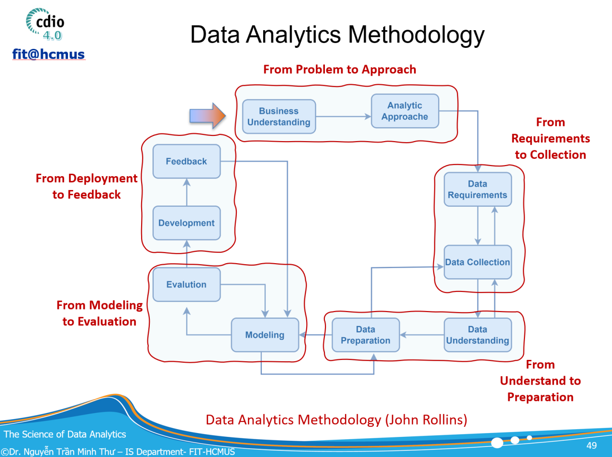

MTH045 - The Science of Data Analytics | Milestone 4

**MILESTONE P4**

# FROM MODELING TO EVALUATION TỪ LỰA CHỌN MÔ HÌNH ĐẾN THIẾT KẾ ĐÁNH GIÁ

---

_Modeling Strategy, Algorithm Selection & Evaluation Design_

### Lĩnh vực bắt buộc: GIÁO DỤC

> **Mục tiêu của Milestone 4**
>
> Chuyển các Analytical Questions và analytic-ready dataset từ Milestone 3 thành một kế hoạch Modeling & Evaluation có lập luận. Cấp độ bắt buộc yêu cầu lựa chọn nhóm giải pháp/thuật toán/mô hình phù hợp và thiết kế cách đánh giá; cấp độ mở rộng không bắt buộc cho phép lập trình prototype để kiểm chứng đề xuất.

| **Thông tin nhóm** | **Nội dung** |
|---|---|
| Tên nhóm |  |
| Thành viên |  |
| Project title |  |
| Milestone 1 proposal version |  |
| Milestone 2 dataset/version |  |
| Milestone 3 prepared dataset/version |  |
| Ngày nộp |  |

_Tài liệu hướng dẫn thực hiện đồ án - Student Project Guideline_

## 1. Vị trí của Milestone 4 trong Data Analytics Methodology

Milestone 4 tương ứng với giai đoạn From Modeling to Evaluation. Đây là bước chuyển từ câu hỏi phân tích và dữ liệu đã chuẩn bị sang chiến lược giải pháp: xác định bài toán kỹ thuật, lựa chọn nhóm phương pháp phù hợp, nêu baseline, lập luận trade-off và thiết kế tiêu chí đánh giá trước khi triển khai mô hình đầy đủ.

_Hình 1. Vị trí Milestone 4 trong Data Analytics Methodology (John Rollins)_

| **Milestone** | **Câu hỏi trung tâm** | **Đầu ra chính** |
|---|---|---|
| Milestone 1 - From Problem to Approach | Vấn đề nào cần giải quyết? Câu hỏi phân tích nào cần trả lời? | Business Goal, SMART Goal/KPI, Analytical Questions, Analytics Type |
| Milestone 2 - From Requirements to Collection | Cần dữ liệu gì và nguồn dữ liệu mở nào cung cấp được? | Data Requirements, dataset selection, raw data, provenance |
| Milestone 3 - From Understanding to Preparation | Dữ liệu thực tế có đủ và phù hợp không? Cần chuẩn bị thế nào? | AQ-Data Fit, prepared dataset, data quality & leakage controls |
| Milestone 4 - From Modeling to Evaluation | Nhóm giải pháp/mô hình nào phù hợp với từng AQ? Đánh giá bằng cách nào? | Modeling Strategy Matrix, Evaluation Plan; optional prototype |

> **Nguyên tắc xuyên suốt**
>
> Không phải mọi Analytical Question đều cần Machine Learning. Mô hình phức tạp không mặc định tốt hơn. Lựa chọn phương pháp phải bắt đầu từ câu hỏi, dạng output cần tạo, đặc điểm dữ liệu, yêu cầu giải thích và quyết định mà kết quả sẽ hỗ trợ.

## 2. Hai cấp độ yêu cầu của Milestone 4

| **Cấp độ** | **Tính bắt buộc** | **Yêu cầu** | **Sản phẩm** |
|---|---|---|---|
| LEVEL 1 - Modeling & Evaluation Proposal | BẮT BUỘC | Với từng Analytical Question: xác định technical task; đề xuất các nhóm giải pháp/thuật toán/mô hình; chọn baseline và primary approach; lập luận lựa chọn; thiết kế evaluation plan; nêu assumptions, risks, interpretability và fairness. | Modeling Strategy Matrix + Model Selection Cards + Evaluation Plan |
| LEVEL 2 - Prototype Experiment | KHÔNG BẮT BUỘC | Lập trình thử nghiệm có kiểm soát cho một hoặc nhiều đề xuất ở Level 1. Mục tiêu là kiểm chứng feasibility và hiểu trade-off, không phải thi leaderboard hoặc tối ưu hyperparameter đến mức tối đa. | Notebook/code + experiment log + preliminary results |

> **Quy tắc chấm hoàn thành**
>
> Nhóm không thực hiện Level 2 vẫn có thể hoàn thành đầy đủ Milestone 4 nếu Level 1 được lập luận tốt. Prototype chỉ là phần mở rộng minh chứng; không được dùng kết quả thử nghiệm để che lấp một Modeling Strategy yếu hoặc không phù hợp.

## 3. Entry Gate - đầu vào bắt buộc từ Milestone 3

| **Đầu vào** | **Yêu cầu tối thiểu trước khi modeling** |
|---|---|
| Approved Analytical Questions | Chỉ sử dụng các AQ còn hiệu lực sau AQ-Data Fit ở Milestone 3. AQ đã defer/drop không được tự động đưa trở lại. |
| Prepared dataset | Có version rõ ràng, data dictionary, unit of analysis, keys, target/outcome và feature windows nếu có. |
| Leakage controls | Nếu có Predictive Analytics, đã xác định prediction point, temporal boundary, target leakage và split rule. |
| Known limitations | Các data gaps, representativeness issues, sensitive attributes và assumptions đã được ghi nhận. |
| Traceability | Có chuỗi AQ -> Data Requirement -> Actual Variables -> Prepared Dataset. |

> **Không đạt Entry Gate?**
>
> Nếu dữ liệu không còn hỗ trợ AQ sau Milestone 3, nhóm phải quay lại cập nhật scope/câu hỏi trước khi chọn thuật toán. Không được “cứ chọn model” cho một câu hỏi mà dataset không thể trả lời.

## 4. Quy trình thực hiện Level 1 - bắt buộc

| **Bước** | **Hoạt động** | **Câu hỏi kiểm tra** | **Sản phẩm** |
|---|---|---|---|
| 1 | Reconfirm AQ & decision | AQ đang hỏi What happened, Why, What will happen hay What should we do? Kết quả sẽ hỗ trợ quyết định nào? | AQ Modeling Brief |
| 2 | Translate AQ to technical task | Bài toán kỹ thuật là aggregation, comparison, association, classification, regression, forecasting, survival, clustering, optimization...? | Technical Task Definition |
| 3 | Shortlist candidate solution families | Có ít nhất một baseline và 1-2 nhóm giải pháp hợp lý nào? | Candidate Solution Matrix |
| 4 | Select primary approach | Tại sao chọn? Trade-off về interpretability, complexity, assumptions, data size, imbalance, compute? | Selection Rationale |
| 5 | Design evaluation | Success được đo bằng metric nào? Split/validation nào? Baseline nào? Error/fairness analysis ra sao? | Evaluation Plan |
| 6 | Risk & ethics review | Có leakage, overfitting, causal overclaim, unfairness hoặc high-stakes automation không? | Risk & Ethics Notes |
| 7 | GenAI-assisted critique | AI gợi ý gì? Nhóm chấp nhận/từ chối gì và đã kiểm chứng như thế nào? | AI Decision Log |

## 5. Từ Analytical Question đến nhóm giải pháp/mô hình

Bảng dưới là định hướng, không phải danh sách bắt buộc. Nhóm phải chọn theo câu hỏi và dữ liệu thực tế. Không “nâng cấp” câu hỏi sang ML chỉ để có mô hình phức tạp.

| **Mức phân tích** | **Câu hỏi điển hình** | **Technical task** | **Nhóm giải pháp/phương pháp có thể xem xét** | **Điểm cần lưu ý** |
|---|---|---|---|---|
| Descriptive | What happened? Tỷ lệ hoàn thành, phân bố điểm, mức độ tương tác thay đổi thế nào? | Aggregation, summarization, segmentation, visualization | Descriptive statistics; grouped aggregation; rate/trend analysis; cross-tabulation; visualization/dashboard; exploratory clustering chỉ khi thật sự cần phân nhóm chưa biết trước. | Không cần ML nếu thống kê mô tả trả lời đủ câu hỏi. Xác minh denominator, grain, time period và uncertainty. |
| Diagnostic | Why / what factors are associated? Nhóm nào khác nhau? Yếu tố nào liên hệ với outcome? | Group comparison, association, explanatory modeling | Chi-square/Fisher; t-test/ANOVA hoặc non-parametric alternatives; correlation/association; logistic/linear regression; interpretable trees; feature importance như bằng chứng bổ trợ. | Association không đồng nghĩa causation. Nêu confounding, assumptions và effect size; tránh diễn giải feature importance như nguyên nhân. |
| Predictive | What is likely to happen? Có thể nhận diện nguy cơ không hoàn thành trước tuần 4 không? | Classification, regression, forecasting, survival/risk estimation, ranking | Logistic/linear regression baseline; decision tree; random forest; gradient boosting; SVM; neural network khi dữ liệu đủ; time-series models; survival models tùy AQ. | Prediction point, leakage, class imbalance, calibration và cost of errors phải rõ. Model phức tạp chỉ dùng khi có lợi ích được chứng minh. |
| Prescriptive | What should we do? Can thiệp nào nên áp dụng? Phân bổ nguồn lực thế nào? | Decision rules, optimization, simulation, causal/uplift analysis | Rule-based decision support; mathematical optimization; scenario simulation; causal inference/uplift nếu có treatment/outcome phù hợp; experiment/A-B test design. | Open observational data thường không đủ để khẳng định can thiệp nào “gây ra” kết quả. Nếu thiếu causal/intervention data, hạ claim thành decision-support hoặc đề xuất thiết kế thí nghiệm tương lai. |

## 6. Task 1 - Lập AQ Modeling Brief

Với mỗi Analytical Question, nhóm điền một Modeling Brief trước khi nêu tên thuật toán. Mục tiêu là tránh chọn model theo thói quen hoặc theo gợi ý của AI.

| **Thuộc tính** | **Nội dung nhóm phải xác định** |
|---|---|
| AQ ID & wording | Câu hỏi phân tích cuối cùng từ Milestone 3. |
| Analytics level | Descriptive / Diagnostic / Predictive / Prescriptive. |
| Decision supported | Ai sẽ dùng kết quả và để quyết định gì? |
| Unit of analysis | Student, student-course, student-week, assessment, event...? |
| Outcome/target | Nếu có supervised task: target là gì, ở thời điểm nào? Nếu không có target, ghi N/A. |
| Input information | Những nhóm biến nào hợp lệ để sử dụng; mốc thời gian/feature window nếu có. |
| Expected output | Rate/table, effect/association, probability, predicted score, forecast, cluster, ranking, recommendation/decision rule... |
| Main constraint | Interpretability, imbalance, sample size, time dependency, compute, fairness, missingness, data gap... |

## 7. Task 2 - Candidate Solution Matrix và lập luận lựa chọn

Mỗi AQ phải có ít nhất một baseline hợp lý. Với AQ cần modeling, nhóm nên xem xét 2-3 candidate families trước khi chọn primary approach. Không yêu cầu liệt kê càng nhiều thuật toán càng tốt.

| **AQ** | **Technical task** | **Baseline** | **Candidate 1** | **Candidate 2** | **Primary approach** | **Lập luận ngắn** |
|---|---|---|---|---|---|---|
| AQ-__ |  |  |  |  |  |  |
| AQ-__ |  |  |  |  |  |  |
| AQ-__ |  |  |  |  |  |  |
| AQ-__ |  |  |  |  |  |  |

### 7.1. Tiêu chí bắt buộc khi lập luận

- Fit to question: phương pháp có trực tiếp tạo output cần cho AQ không?
- Fit to data: sample size, feature types, sparsity, class imbalance, temporal structure và granularity có phù hợp không?
- Assumptions: mô hình yêu cầu giả định gì và dữ liệu có đáp ứng tương đối không?
- Interpretability: stakeholder cần hiểu yếu tố/logic hay chỉ cần dự báo? Mức giải thích cần thiết là bao nhiêu?
- Complexity vs baseline: mô hình phức tạp mang lại lợi ích kỳ vọng gì so với baseline?
- Robustness & reproducibility: có thể đánh giá ổn định, tái lập và tránh leakage không?
- Ethics/fairness: sai số có ảnh hưởng bất lợi đến nhóm sinh viên nào không? Có dùng sensitive attribute không?
- Actionability: output có hỗ trợ decision đã nêu trong Milestone 1 không?

> **Không chấp nhận lập luận dạng**
>
> “Random Forest mạnh”, “XGBoost phổ biến”, “Neural Network hiện đại”, hoặc “AI đề xuất mô hình này”. Tên thuật toán không phải là lập luận. Nhóm phải nối lựa chọn với AQ, dữ liệu, constraints và evaluation.

## 8. Task 3 - Thiết kế Evaluation Plan trước khi lập trình

Evaluation là phần bắt buộc của Level 1 ngay cả khi nhóm không code. Nhóm phải mô tả trước cách biết một phương pháp “tốt” hay “đủ dùng”, thay vì chạy nhiều model rồi chọn metric đẹp nhất.

| **Technical task** | **Evaluation gợi ý** | **Baseline/validation cần có** | **Lưu ý** |
|---|---|---|---|
| Descriptive / aggregation | Consistency checks; denominator validation; confidence interval khi phù hợp; comparison across groups/time; visual sanity checks. | Đối chiếu tổng số record, counts, known totals hoặc alternate aggregation. | Không dùng accuracy/F1 cho một bài toán chỉ cần mô tả. |
| Diagnostic / association | Effect size + confidence interval; test statistic/p-value khi giả định hợp lệ; model fit/residual diagnostics; sensitivity analysis. | Unadjusted comparison + adjusted model khi phù hợp. | Không biến “association” thành “cause”. |
| Classification | Confusion matrix; precision, recall, F1; ROC-AUC/PR-AUC; calibration; threshold-based metrics theo decision cost. | Majority/simple rule hoặc Logistic Regression baseline; stratified/temporal/student-level split phù hợp. | Với early-warning giáo dục, recall, precision và calibration thường quan trọng hơn chỉ accuracy. |
| Regression | MAE, RMSE, R²; residual analysis; error by subgroup. | Mean/median baseline hoặc simple linear model. | Chọn metric theo đơn vị outcome và cost của sai số. |
| Forecasting | MAE/RMSE/sMAPE tùy dữ liệu; rolling/temporal validation. | Naive last-value/seasonal baseline. | Không random split chuỗi thời gian. |
| Clustering | Silhouette/other internal metric + stability + domain interpretability. | Simple segmentation hoặc multiple seeds/solutions. | Cluster tốt về metric nhưng không có ý nghĩa giáo dục thì không tạo giá trị. |
| Prescriptive / optimization / causal | Objective value, feasibility, constraint satisfaction; treatment effect/uplift uncertainty nếu causal. | Current policy hoặc simple decision rule. | Nếu không có treatment/intervention data, không được tuyên bố hiệu quả can thiệp. |

### 8.1. Evaluation Design Card bắt buộc

| **Mục** | **Nhóm cần ghi** |
|---|---|
| Primary metric(s) | Metric chính và lý do metric này phản ánh đúng mục tiêu/decision. |
| Secondary metric(s) | Metric bổ sung để nhìn trade-off hoặc rủi ro. |
| Validation strategy | Holdout / cross-validation / temporal split / group split / student-level split... và lý do. |
| Baseline | Cách làm đơn giản để so sánh. Không có baseline thì khó biết model phức tạp có thực sự hữu ích. |
| Error analysis | Sai ở nhóm nào, loại lỗi nào, threshold nào? |
| Fairness / subgroup check | Hiệu năng có khác đáng kể giữa các nhóm liên quan không? Nếu có, xử lý/diễn giải thế nào? |
| Success criterion | Điều kiện để xem approach đủ tốt cho mục đích học thuật/project; tránh đặt ngưỡng tùy ý sau khi thấy kết quả. |

## 9. Ví dụ xuyên suốt - Course Completion Analytics

Ví dụ minh họa cách một project giáo dục có thể có nhiều mức câu hỏi nhưng không ép mọi mức vào Machine Learning.

| **AQ ví dụ** | **Mức** | **Technical task** | **Phương pháp hợp lý** | **Evaluation / quyết định** |
|---|---|---|---|---|
| AQ1. Tỷ lệ hoàn thành khác nhau thế nào giữa course và semester? | Descriptive | Rate/trend comparison | Aggregation, cross-tab, visualization; confidence interval nếu cần. | Kiểm tra denominator, trend consistency; hỗ trợ xác định course cần xem xét. |
| AQ2. Engagement và assessment behavior nào liên hệ với non-completion? | Diagnostic | Association / explanatory modeling | Group comparison + logistic regression; interpretable tree là bổ sung. | Effect size/CI, model diagnostics; diễn giải là association, không causal. |
| AQ3. Có thể nhận diện sinh viên có nguy cơ non-completion vào cuối tuần 4 không? | Predictive | Binary classification | Baseline Logistic Regression; Decision Tree/Random Forest/Gradient Boosting nếu dữ liệu đủ. | Temporal/student split; PR-AUC, recall, precision, calibration; tuyệt đối không dùng feature sau tuần 4. |
| AQ4. Can thiệp nào nên áp dụng để tăng completion? | Prescriptive | Causal/decision support | Nếu dataset không có intervention/treatment: chưa đủ để estimate causal effect. Có thể xây decision-support hypothesis và đề xuất A/B test tương lai. | Không dùng model dự báo để suy ra “can thiệp X sẽ làm tăng completion”. |

> **Bài học từ AQ4**
>
> Khi dữ liệu không đủ cho Prescriptive Analytics, lựa chọn đúng không phải là “sáng tạo một mô hình prescriptive”. Nhóm phải hạ claim, thiết kế decision-support ở mức phù hợp, hoặc đề xuất dữ liệu/thí nghiệm bổ sung cho giai đoạn sau.

## 10. LEVEL 2 - Prototype Experiment (không bắt buộc)

Nếu nhóm thực hiện Level 2, mục tiêu là kiểm tra feasibility của các đề xuất Level 1. Prototype không cần là hệ thống hoàn chỉnh và không yêu cầu hyperparameter tuning quy mô lớn.

| **Bước prototype** | **Yêu cầu tối thiểu** |
|---|---|
| 1. Reproduce data input | Load đúng prepared dataset/version từ Milestone 3; không sửa raw data âm thầm trong notebook. |
| 2. Implement baseline | Luôn chạy baseline trước hoặc cùng với candidate model. |
| 3. Implement candidate | Ít nhất một candidate approach từ Candidate Solution Matrix; không thay model tùy ý mà không cập nhật rationale. |
| 4. Split & fit correctly | Tuân thủ temporal/group/student-level split; mọi scaler/encoder/feature selection phải fit trên training partition nếu applicable. |
| 5. Evaluate | Dùng metric đã định nghĩa ở Evaluation Plan; báo cả metric không thuận lợi nếu có. |
| 6. Error / subgroup analysis | Xem lỗi theo threshold, class hoặc subgroup phù hợp; ghi nhận bất ổn và failure cases. |
| 7. Compare to Level 1 expectation | Kết quả có củng cố hay bác bỏ lựa chọn ban đầu? Có cần đổi primary approach không? |
| 8. Reproducibility | Lưu notebook/script, random seed, package/environment, data version và experiment log. |

> **Prototype không phải cuộc thi**
>
> Không chọn “best model” chỉ dựa trên một con số. Nếu improvement nhỏ nhưng interpretability giảm mạnh, nhóm phải thảo luận trade-off. Một baseline đơn giản có thể là lựa chọn tốt hơn.

## 11. Chính sách sử dụng Generative AI trong Milestone 4

Generative AI được phép dùng như Modeling Partner: hỗ trợ mở rộng lựa chọn, giải thích, phản biện và viết prototype. Quyết định cuối cùng và bằng chứng đánh giá vẫn thuộc trách nhiệm của nhóm.

| **Mức sử dụng** | **ĐƯỢC PHÉP / CÓ ĐIỀU KIỆN** | **KHÔNG ĐƯỢC PHÉP** |
|---|---|---|
| Hiểu thuật toán | Yêu cầu AI giải thích assumptions, ưu/nhược điểm, khi nào nên/không nên dùng một method; so sánh 2-3 model families. | Chép nguyên mô tả AI làm “lập luận lựa chọn” mà không nối với AQ và dữ liệu thật. |
| Model selection | Yêu cầu AI đề xuất candidate families và đặt câu hỏi phản biện; nhóm tự chọn và ghi rationale. | “Hãy chọn model tốt nhất cho tôi” rồi chấp nhận câu trả lời như kết luận. |
| Evaluation design | Nhờ AI review metric, split, leakage risk, class imbalance, calibration, fairness; phải kiểm tra lại với kiến thức môn học. | Bịa metric threshold, benchmark hoặc kết quả chưa chạy. |
| Coding prototype | AI có thể sinh skeleton code, function, unit test, plotting code hoặc hỗ trợ debug; nhóm phải chạy, hiểu, sửa và kiểm chứng. | Nộp code AI sinh nhưng thành viên không giải thích được; dùng code có data leakage dù “chạy được”. |
| Interpretation | Có thể nhờ AI challenge interpretation dựa trên output thật do nhóm cung cấp. | Cho AI tự tạo confusion matrix, scores, plots hoặc “kết quả dự kiến” rồi trình bày như kết quả thực nghiệm. |
| Data / synthetic results | Có thể tạo toy data nhỏ để test code path nếu ghi rõ là synthetic và không dùng làm evidence. | Tạo synthetic labels/outcomes hoặc fake student records để cải thiện performance hay thay thế evaluation trên real data. |

### 11.1. AI Decision Log bắt buộc

| **Prompt / mục tiêu** | **AI suggestion** | **Team decision** | **Evidence / verification** | **Ảnh hưởng đến proposal** |
|---|---|---|---|---|
|  |  |  |  |  |
|  |  |  |  |  |
|  |  |  |  |  |

**Gợi ý prompt tốt:**

- “Dựa trên AQ, unit of analysis, target, feature window và constraints dưới đây, hãy đề xuất 2-3 model families phù hợp. Không chọn thay nhóm. Với mỗi family, hãy nêu assumptions, ưu/nhược điểm, leakage risks và evaluation metrics cần cân nhắc.”
- “Hãy đóng vai reviewer và tìm các điểm yếu trong Model Selection Rationale này: có mismatch giữa AQ và model không, metric có phù hợp không, có causal overclaim, class imbalance hoặc leakage không?”

## 12. Sản phẩm nộp của Milestone 4

| **Deliverable** | **Bắt buộc?** | **Nội dung** |
|---|---|---|
| A. Updated Traceability Matrix | Có | Business Goal -> AQ -> Analytics Level -> Technical Task -> Prepared Data -> Primary Approach -> Evaluation -> Decision Supported. |
| B. AQ Modeling Briefs | Có | Một brief cho mỗi AQ được giữ lại. |
| C. Candidate Solution Matrix | Có | Baseline + candidate families + primary approach + rationale. |
| D. Evaluation Plan | Có | Metrics, validation strategy, baseline, error analysis, fairness/subgroup checks và success criterion. |
| E. Risk & Ethics Notes | Có | Leakage, overfitting, interpretability, causal limits, fairness và high-stakes use. |
| F. AI Decision Log | Có nếu dùng GenAI | Minh bạch AI đã hỗ trợ gì, nhóm quyết định gì, cách kiểm chứng. Nếu không dùng AI, ghi “Not used”. |
| G. Prototype Notebook / Code | Không | Nếu thực hiện: code + experiment log + preliminary results + reproducibility information. |

### 12.1. Bảng traceability cuối Milestone 4

| **AQ** | **Analytics Level** | **Technical Task** | **Baseline** | **Primary Approach** | **Primary Metric** | **Validation** | **Decision Supported** |
|---|---|---|---|---|---|---|---|
| AQ-__ |  |  |  |  |  |  |  |
| AQ-__ |  |  |  |  |  |  |  |
| AQ-__ |  |  |  |  |  |  |  |
| AQ-__ |  |  |  |  |  |  |  |

## 13. Cấu trúc báo cáo đề nghị

| **Mục** | **Nội dung** |
|---|---|
| 1. Project Context & Continuity | Tóm tắt Business Goal, SMART Goal, dataset và những AQ còn hiệu lực sau Milestone 3. |
| 2. AQ-to-Technical-Task Mapping | Mỗi AQ được chuyển thành technical task như thế nào. |
| 3. Candidate Modeling Approaches | Baseline, candidate families và selection rationale. |
| 4. Evaluation Design | Metrics, validation, baseline, error/fairness analysis và success criteria. |
| 5. Risk, Ethics & Limitations | Leakage, interpretability, causal limits, fairness, data constraints. |
| 6. Generative AI Usage | AI Decision Log và reflection ngắn. |
| 7. Optional Prototype Results | Chỉ có nếu nhóm thực hiện Level 2. |
| 8. Updated Traceability Matrix | Bảng tổng hợp để nối sang bước Development/Deployment hoặc báo cáo cuối. |

## 14. Rubric đánh giá Level 1 - 100 điểm

| **Tiêu chí** | **Điểm** | **Mô tả** |
|---|---|---|
| Traceability từ AQ đến technical task | NA | Không mất liên kết với Business Goal/Decision và prepared data. |
| Candidate solution families & baseline | NA | Đề xuất phù hợp, đủ nhưng không liệt kê lan man; có baseline. |
| Selection rationale | NA | Lập luận theo question-data-assumption-interpretability-complexity-actionability. |
| Evaluation design | NA | Metric, validation, baseline, error analysis và success criterion hợp lý. |
| Leakage / risk / ethics / fairness | NA | Nhận diện đúng các rủi ro quan trọng trong bối cảnh giáo dục. |
| GenAI transparency & critical use | NA | AI được dùng như partner; có decision log và kiểm chứng. |
| Presentation & consistency | NA | Bảng, thuật ngữ, versioning và logic toàn báo cáo rõ ràng. |
| TỔNG | 100 | Level 2 không phải điều kiện để đạt đủ 100 điểm của Level 1. |

## 15. Checklist trước khi nộp

- [ ] Mỗi AQ còn hiệu lực đều có Analytics Level và Technical Task rõ ràng.
- [ ] Không ép mọi AQ thành Machine Learning; Descriptive/Diagnostic đơn giản được giữ nếu phù hợp.
- [ ] Mỗi modeling AQ có baseline và ít nhất 1-2 candidate families hợp lý.
- [ ] Primary approach được chọn bằng lập luận gắn với dữ liệu, không bằng độ “hiện đại” của thuật toán.
- [ ] Evaluation Plan được viết trước hoặc độc lập với kết quả prototype.
- [ ] Nếu Predictive: prediction point, split strategy, leakage và class imbalance đã được xem xét.
- [ ] Nếu Diagnostic: không diễn giải association thành causation.
- [ ] Nếu Prescriptive: có bằng chứng/thiết kế causal thích hợp; nếu không, đã hạ claim hoặc đề xuất future experiment.
- [ ] Nếu dùng GenAI: AI Decision Log đầy đủ; không có metric/kết quả do AI bịa ra.
- [ ] Nếu làm prototype: code tái lập được, dùng đúng prepared dataset/version và metric đã cam kết.
- [ ] Updated Traceability Matrix thể hiện rõ AQ -> model/solution -> evaluation -> decision.

> **Điều kiện hoàn thành Milestone 4**
>
> Một submission đạt yêu cầu phải chứng minh rằng nhóm biết “vì sao chọn phương pháp này” và “sẽ đánh giá nó như thế nào” trước khi bị cuốn vào coding. Kết quả của Milestone 4 là Modeling & Evaluation Proposal có traceability, không phải một danh sách thuật toán.

From Modeling to Evaluation | Education Analytics Project
