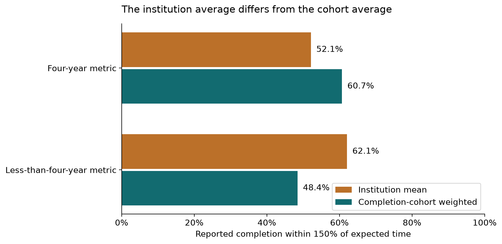
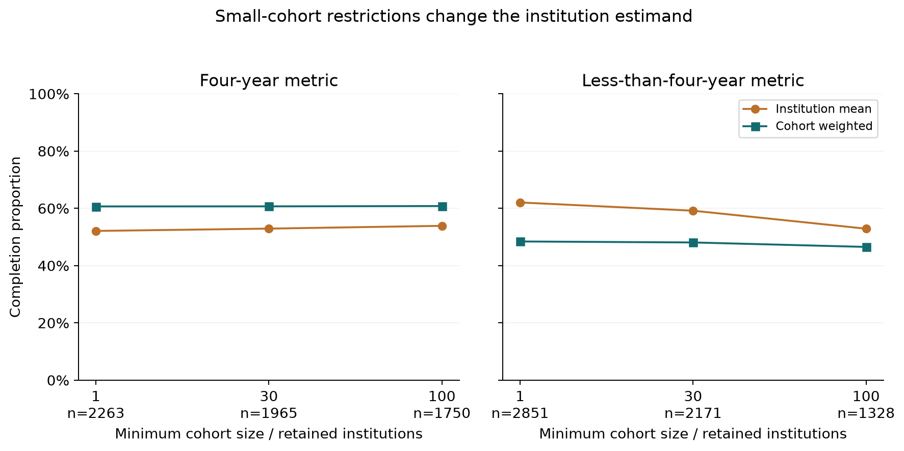

# College Scorecard: aggregate academic outcomes are available, but they cannot label early student risk

The local snapshot contains **6,273 institutions** and **227,980 institution–field–credential records**. It has completion and retention aggregates but no student-level assessment submissions, deadlines, availability times or later linked academic results. It cannot answer whether a student's early assessment behavior identifies future risk. No institution-ranking model or synthetic student label is substituted.

The bounded investigation asks how these outcome aggregates differ in grain, cohort and denominator, and whether coverage/weighting can mislead an early-warning design. The result is a **feasibility assessment with substantive outcome-definition context**, not a completed individual warning study.

## Completion and retention describe different populations

The completion fields (`C150_4`, `C150_L4`) describe completion within 150% of expected program time for full-time, first-time degree/certificate-seeking cohorts, with four-year and less-than-four-year metric families. Retention describes return after the first year, separating full-time and part-time students; the four-year retention population is bachelor's degree-seeking. The official documentation bases metric family on IPEDS institution level, **not predominant award code `PREDDEG`**. The analysis therefore uses each reported metric in its own family rather than imposing PREDDEG as a filter.

| family | measure | raw_institutions | valid_institutions | coverage | unweighted_mean | median | weighted_mean | cohort_denominator | weight_meaning |
|---|---|---|---|---|---|---|---|---|---|
| Four-year metric | 150% completion | 6273 | 2263 | 0.361 | 0.521 | 0.523 | 0.607 | 1857898.000 | D150_4 |
| Four-year metric | Full-time retention | 6273 | 2058 | 0.328 | 0.740 | 0.757 | — | — | Unavailable matching non-pooled retention cohort denominator |
| Four-year metric | Part-time retention | 6273 | 1368 | 0.218 | 0.455 | 0.444 | — | — | Unavailable matching non-pooled retention cohort denominator |
| Four-year metric | Suppressed pooled FT retention | 6273 | 1872 | 0.298 | 0.742 | 0.755 | 0.818 | 3215675.000 | RET_FT_DEN4_POOLED |
| Less-than-four-year metric | 150% completion | 6273 | 2851 | 0.454 | 0.621 | 0.645 | 0.484 | 686651.000 | D150_L4 |
| Less-than-four-year metric | Full-time retention | 6273 | 2805 | 0.447 | 0.723 | 0.731 | — | — | Unavailable matching non-pooled retention cohort denominator |
| Less-than-four-year metric | Part-time retention | 6273 | 1574 | 0.251 | 0.580 | 0.522 | — | — | Unavailable matching non-pooled retention cohort denominator |
| Less-than-four-year metric | Suppressed pooled FT retention | 6273 | 2538 | 0.405 | 0.712 | 0.716 | 0.664 | 1146878.000 | RET_FT_DENL4_POOLED |

Coverage here is valid reporting rows divided by **all 6,273 snapshot institutions**, and includes institutions for which a metric family is inapplicable. It is not a nonresponse rate among eligible institutions. “NULL” and suppression tokens are retained in the missing-token audit; the same missing token cannot by itself distinguish inapplicability from unreported data.

Neither 1 − retention nor 1 − completion is a defensible individual Fail/Withdrawn label. Students can transfer or finish elsewhere, take longer, or belong to a different underlying cohort. Same institution IDs do not make completion and retention longitudinal measurements of the same students. The latest-cohort file can contain different measurement periods across fields; the exact local per-field vintage is not verified and is not inferred from the filename or the current website.

## Institution averages and cohort-weighted averages answer different questions

*All valid reporting institutions in each metric family. Cohort weights are D150_4/D150_L4, not total enrollment. Different institutional and cohort estimands do not identify individual academic risk. Source: `results/outcome_definitions.csv`.*

[SVG figure](figures/completion_estimand_comparison.svg) · [Plotted data](figures/completion_estimand_comparison.csv)

*Completion-cohort minimums 1/30/100, with retained institution counts labeled. Restrictions change the population; they are sensitivity checks, not removal of proven errors. Rounded published rates make weighted totals approximate. Source: `results/small_cohort_sensitivity.csv`.*

[SVG figure](figures/small_cohort_sensitivity.svg) · [Plotted data](figures/small_cohort_sensitivity.csv)

Four-year completion averages **52.1% across reporting institutions**, but **60.7% weighted by their completion cohort sizes** (`D150_4`, 1,857,898 cohort members). Less-than-four-year completion reverses that pattern: **62.1% institution-average versus 48.4% cohort-weighted** (`D150_L4`, 686,651 members). These are different estimands, not contradictory calculations. The reversal implies that institution size and sector composition matter; an unweighted institutional summary must not be described as an average student's risk.

| family | sector | valid_institutions | unweighted_mean | weighted_mean | cohort_denominator |
|---|---|---|---|---|---|
| Four-year metric | All reported sectors | 2263 | 0.521 | 0.607 | 1857898.000 |
| Four-year metric | Public | 807 | 0.469 | 0.587 | 1281866.000 |
| Four-year metric | Private nonprofit | 1247 | 0.561 | 0.668 | 529822.000 |
| Four-year metric | Private for-profit | 209 | 0.484 | 0.468 | 46210.000 |
| Less-than-four-year metric | All reported sectors | 2851 | 0.621 | 0.484 | 686651.000 |
| Less-than-four-year metric | Public | 1035 | 0.475 | 0.381 | 444423.000 |
| Less-than-four-year metric | Private nonprofit | 146 | 0.667 | 0.624 | 23639.000 |
| Less-than-four-year metric | Private for-profit | 1670 | 0.707 | 0.679 | 218589.000 |

The executed small-cohort follow-up removes institutions with completion cohorts below 30 and 100, without redefining raw data or claiming small institutions are erroneous. Less-than-four-year institution means fall from 62.1% to 52.9% at a 100-member minimum, while the cohort-weighted estimate is 46.5%. Thus tiny cohorts materially affect the institution estimand, and removing them changes its population. Four-year cohort-weighted completion is comparatively stable under these restrictions.

| family | sector | min_completion_cohort | institutions | completion_mean | completion_weighted | cohort_students |
|---|---|---|---|---|---|---|
| Four-year metric | All reported sectors | 1 | 2263 | 0.521 | 0.607 | 1857898.000 |
| Four-year metric | All reported sectors | 30 | 1965 | 0.529 | 0.607 | 1854397.000 |
| Four-year metric | All reported sectors | 100 | 1750 | 0.539 | 0.608 | 1842055.000 |
| Less-than-four-year metric | All reported sectors | 1 | 2851 | 0.621 | 0.484 | 686651.000 |
| Less-than-four-year metric | All reported sectors | 30 | 2171 | 0.592 | 0.481 | 676201.000 |
| Less-than-four-year metric | All reported sectors | 100 | 1328 | 0.529 | 0.465 | 629077.000 |

Weights are **matching outcome cohort denominators**, never `UGDS` undergraduate enrollment, which represents a different population. Weighted numerators use published rounded rates times cohort counts and are approximate; they are not reconstructed exact person counts. No artificial confidence interval is attached to this full-snapshot accounting comparison.

## Pooled suppression changes what can be observed

Non-pooled retention lacks its matching cohort count in this selected local schema, so its average remains an institution-level mean. The suppressed pooled full-time retention fields do have supplied pooled denominators; they are analyzed as a distinct reporting measure. Four-year pooled retention is 74.2% institution-average versus 81.8% cohort-weighted; the less-than-four-year values are 71.2% versus 66.4%. These pooled cohorts are not silently equated to the non-pooled cohorts or completion cohorts.

| family | sector | valid_institutions | coverage | unweighted_mean | weighted_mean | cohort_denominator |
|---|---|---|---|---|---|---|
| Four-year metric | All reported sectors | 1872 | 0.298 | 0.742 | 0.818 | 3215675.000 |
| Four-year metric | Public | 642 | 0.314 | 0.739 | 0.822 | 2193537.000 |
| Four-year metric | Private nonprofit | 1133 | 0.596 | 0.751 | 0.817 | 989384.000 |
| Four-year metric | Private for-profit | 97 | 0.042 | 0.653 | 0.583 | 32754.000 |
| Less-than-four-year metric | All reported sectors | 2538 | 0.405 | 0.712 | 0.664 | 1146878.000 |
| Less-than-four-year metric | Public | 1000 | 0.489 | 0.654 | 0.644 | 918564.000 |
| Less-than-four-year metric | Private nonprofit | 112 | 0.059 | 0.701 | 0.727 | 21168.000 |
| Less-than-four-year metric | Private for-profit | 1426 | 0.613 | 0.753 | 0.746 | 207146.000 |

| field | token | rows |
|---|---|---|
| C150_4 | — | 4010 |
| C150_L4 | — | 3422 |
| RET_FT4 | — | 4215 |
| RET_FTL4 | — | 3468 |
| RET_FT4_POOLED_SUPP | — | 4137 |
| RET_FT4_POOLED_SUPP | PS | 264 |
| RET_FTL4_POOLED_SUPP | — | 3438 |
| RET_FTL4_POOLED_SUPP | PS | 297 |

Official documentation explains rolling pooled retention and small-cohort suppression; the code preserves suppressed values as missing rather than zero. Because withheld outcomes are not observed, no warning accuracy or person-level alert volume can be validated from these aggregates.

## A common institution does not establish common students

| family | sector | both_metrics_n | completion_only_n | retention_only_n | institution_spearman | median_completion | median_retention |
|---|---|---|---|---|---|---|---|
| Four-year metric | All reported sectors | 2001 | 262 | 57 | 0.606 | 0.539 | 0.759 |
| Less-than-four-year metric | All reported sectors | 2730 | 121 | 75 | 0.575 | 0.633 | 0.731 |

These same-institution comparisons are ecological diagnostics only. Spearman correlation across institution rates does not establish whether early assessment behavior predicts a later student outcome. Differences in cohort, reporting population, transfer and program duration remain unresolved by joining `UNITID`.

| predominant_award_code | institutions | completion_4_n | completion_l4_n | retention_4_n | retention_l4_n |
|---|---|---|---|---|---|
| 0 | 470 | 0 | 0 | 0 | 0 |
| 1 | 2619 | 152 | 2269 | 73 | 2215 |
| 2 | 974 | 314 | 582 | 180 | 590 |
| 3 | 1947 | 1797 | 0 | 1805 | 0 |
| 4 | 263 | 0 | 0 | 0 | 0 |

The field-of-study table has a separate compound grain (`UNITID`, `OPEID6`, `CIPCODE`, `CREDLEV`) with no duplicate keys in the inspected local extract. It includes 7,020 rows without a numeric UNITID and aggregates partly by institutional grouping. It is not a second independent student sample; joining its many program rows to institutions without re-aggregation would fan out institutional metrics. No such join is performed.

| quantity | n |
|---|---|
| institution rows | 6273 |
| institution fields | 3308 |
| field-of-study rows | 227980 |
| field-of-study compound-key duplicate rows | 0 |
| field-of-study identical selected rows | 0 |
| field-of-study distinct nonempty UNITID | 6128 |
| field-of-study rows without numeric UNITID | 7020 |

## What is missing for the project?

| Priority question | Local support | Exact blocker |
|---|---|---|
| Early assessment behavior versus future risk | Unsupported | Student/course identifiers, assessment events, submissions and scores absent |
| Warning cutoffs and support lead time | Unsupported | Applicable deadlines, observation/availability times and linked future event times absent |
| Added value over prior scores | Unsupported | No early individual score history or valid future student labels |
| False flags, missed students and review burden | Unsupported | No individual labels or held-out student/time cohort |
| Academic outcome suitability | Answered contextually | Aggregate reporting cohorts cannot be reinterpreted as individual Fail/Withdrawn |

All institution/program rows were scanned with relevant selected columns. Source preservation, institution key uniqueness, valid rate ranges, uninflated institutional denominator and an independent weighted completion recomputation were checked. No silent imputation, institution exclusion or outcome suppression reversal occurs. Sector comparisons are contextual denominator checks, not a ranking or causal judgment. The missing student/event/outcome linkage must be obtained from a separately authorized institutional source before this dataset can participate in an early-warning model.

## Scope, verification and handoff

Status: **feasibility assessment; completed aggregate academic-outcome suitability investigation**. The requested early-academic-risk objective is preserved; narrower evidence does not justify a substitute risk label or an unrelated ranking. Definitions not supplied by the user are proposed operationalizations. Stakeholder acceptance remains **PENDING**; no intervention exists, so intervention outcome evaluation is **NOT APPLICABLE**.

35 numerical/data checks passed in `results/verification.csv`. Checks include the quantities actually computed, with their expected conditions and methods; they do not verify missing real-world evidence. Remaining evidence boundaries:

| check | observed | consequence |
|---|---|---|
| student assessment behavior linkage | Aggregate UNITID/OPEID/CIP identifiers; no student assessment records | Blocks direct student early-warning inference; contextual only |
| future academic risk timing | Mixed aggregate reporting cohorts and no student event/deadline times | Blocks direct student early-warning inference; contextual only |
| snapshot measurement years | Most-Recent filename without verified per-field local cohort vintage | Blocks direct student early-warning inference; contextual only |

Source CSVs are unchanged. `source_manifest.csv` identifies actual local inputs; preserved source metadata and exact dependency versions support reproduction. [Open the local dashboard](dashboard/index.html), [reproduce the analysis](README.md), or inspect [the criterion and reader-task review](QUALITY_REVIEW.md). Browser interaction, mobile rendering, local links and display reconciliation are documented in `evidence/browser-review.json`; screenshots preserve actual inspection. Those checks validate delivery, not causality, stakeholder approval or live alert effectiveness.

Metadata sources accessed 13 October 2026: [U.S. Department of Education institution-level methodology](https://collegescorecard.ed.gov/files/InstitutionDataDocumentation.pdf), with field definitions/retention details verified through indexed official text when direct PDF access returned 403. Original local acquisition dates and per-field vintages are not invented.
