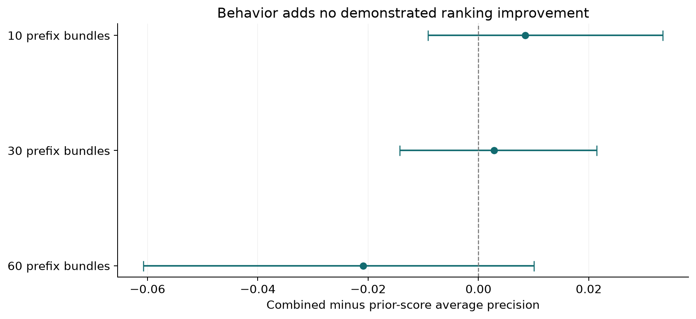
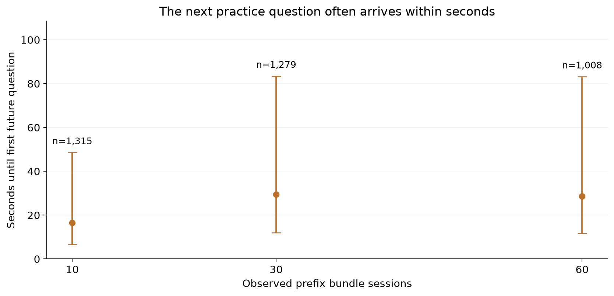

# EdNet: prior accuracy predicts later practice difficulty, but behavior has not demonstrated added warning value

After 30 observed bundle sessions, combined prior accuracy and behavior achieved average precision **0.198** on 1,279 held-out users, against **6.6%** later low-accuracy prevalence. Combined minus prior-score AP was only **0.003**, paired user-bootstrap 95% interval **[-0.014, 0.021]**. The interval includes zero. At none of the three tested cutoffs does the paired interval establish added ranking value for behavior beyond prior accuracy and the common content-context feature. This is evidence against assuming that more behavioral features improve warnings.

The outcome is a **practice-underperformance proxy**, not course failure, withdrawal or official TOEIC attainment: correctness below 40% over the next 20 observed bundle sessions. The 40% threshold is proposed for comparison, not a documented pass standard. The local KT1 files supply presented-question times, responses and durations but no course enrollment/deadline/final academic result. Meaningful within-user future assessment investigation is possible; direct academic failure warning remains unsupported.

## A large user frame still leaves limited label coverage

The local ZIP contains **784,309 user CSVs** and 3,072,366,053 uncompressed CSV bytes, verified from its central directory. A uniform sample of **50,000 users** without replacement (seed 20261013, sampling fraction 6.4%) yielded 6,061,678 response records. Sampling limits repeated decoding over 784,309 files and permits multi-cutoff uncertainty/error checks on a fixed user sample; it yields about 1,000–1,300 eligible held-out users per cutoff, sufficient for bounded prevalence/workload estimates but limited for small incremental AP claims. This is user sampling, not the first files in directory order. Sampled reads are ordered by archive offset for efficient I/O. The complete frame fingerprint is saved; sampled file CRCs/IDs stay in ignored `prepared/`.

| cutoff | sampled_users | eligible_users | coverage | train_n | validation_n | test_n | test_risk |
|---|---|---|---|---|---|---|---|
| 10 | 50000 | 8984 | 0.180 | 6264 | 1405 | 1315 | 0.099 |
| 30 | 50000 | 8769 | 0.175 | 6141 | 1349 | 1279 | 0.066 |
| 60 | 50000 | 6838 | 0.137 | 4757 | 1073 | 1008 | 0.055 |

Only **17.5%** of sampled users supply an eligible 30-bundle prefix and 20-bundle future window satisfying the timing condition. Those who stop before the outcome window are **unlabeled**, not failed or withdrawn. Therefore these findings concern continuing practice users with sufficient follow-up; they cannot be applied to all app users or used to infer dropout. Coverage differs across cutoffs and overlap exclusions, so naive time comparisons can mix behavior change and population selection.

| issue | n |
|---|---|
| sample users | 50000 |
| raw sampled response rows | 6061678 |
| unmatched question rows | 0 |
| invalid timestamp/elapsed/answer rows | 0 |
| users excluded for any invalid/unmatched row | 0 |
| overlapping prefix/outcome windows excluded | 5008 |

Prefix completion is approximated as question presentation time plus recorded elapsed duration; first future presentation must occur strictly after the maximum prefix completion estimate. The 5,008 excluded overlapping windows are snapshots, not distinct people, and can affect several cutoffs for one user. Actual response-completion/insertion timestamps are unavailable. Because published timestamps are shifted without a verified common real-world calendar, evaluation holds out users within the local snapshot rather than claiming prospective calendar-cohort deployment.

## Compare behavior with prior performance on identical users

*EdNet held-out continuing users. Every paired 95% user-bootstrap interval includes zero (500 replicates, fixed models); the target is next-20-bundle accuracy below 40%, not course failure. Source: `results/uncertainty.csv`.*

[SVG figure](figures/incremental_behavior_value.svg) · [Plotted data](figures/incremental_behavior_value.csv)

Behavior includes median/IQR bundle duration, median inter-bundle gap, prefix span and repeated-question exposure fraction. Bundle durations use one maximum elapsed value per `solving_id` group; repeated duration records for multi-question bundles are never summed as independent working time. Repeat exposure does not mean answer revisions. Prior performance is mean prefix correctness. All fitted models share early part-7 exposure share as a simple content-context feature; this is not complete adjustment for question difficulty or adaptive assignment.

| cutoff | model | n | prevalence | ap | precision | recall | alert_rate | fp | fn | brier |
|---|---|---|---|---|---|---|---|---|---|---|
| 10 | behavior | 1315 | 0.099 | 0.114 | 0.111 | 0.223 | 0.198 | 232 | 101 | 0.089 |
| 10 | score | 1315 | 0.099 | 0.182 | 0.144 | 0.477 | 0.328 | 369 | 68 | 0.086 |
| 10 | combined | 1315 | 0.099 | 0.190 | 0.191 | 0.415 | 0.215 | 229 | 76 | 0.086 |
| 10 | prevalence | 1315 | 0.099 | 0.099 | — | 0.000 | 0.000 | 0 | 130 | 0.089 |
| 10 | prior_accuracy_rule | 1315 | 0.099 | 0.137 | 0.195 | 0.392 | 0.198 | 210 | 79 | 0.220 |
| 30 | behavior | 1279 | 0.066 | 0.102 | 0.109 | 0.329 | 0.202 | 230 | 57 | 0.062 |
| 30 | score | 1279 | 0.066 | 0.195 | 0.165 | 0.576 | 0.232 | 248 | 36 | 0.058 |
| 30 | combined | 1279 | 0.066 | 0.198 | 0.173 | 0.553 | 0.213 | 225 | 38 | 0.058 |
| 30 | prevalence | 1279 | 0.066 | 0.066 | — | 0.000 | 0.000 | 0 | 85 | 0.062 |
| 30 | prior_accuracy_rule | 1279 | 0.066 | 0.093 | 0.164 | 0.271 | 0.109 | 117 | 62 | 0.140 |
| 60 | behavior | 1008 | 0.055 | 0.089 | 0.095 | 0.291 | 0.167 | 152 | 39 | 0.051 |
| 60 | score | 1008 | 0.055 | 0.233 | 0.176 | 0.709 | 0.220 | 183 | 16 | 0.046 |
| 60 | combined | 1008 | 0.055 | 0.212 | 0.172 | 0.727 | 0.230 | 192 | 15 | 0.047 |
| 60 | prevalence | 1008 | 0.055 | 0.055 | — | 0.000 | 0.000 | 0 | 55 | 0.052 |
| 60 | prior_accuracy_rule | 1008 | 0.055 | 0.089 | 0.224 | 0.200 | 0.049 | 38 | 44 | 0.081 |

| cutoff | comparison | estimate | lo | hi |
|---|---|---|---|---|
| 10 | combined minus score AP | 0.008 | -0.009 | 0.033 |
| 30 | combined minus score AP | 0.003 | -0.014 | 0.021 |
| 60 | combined minus score AP | -0.021 | -0.061 | 0.010 |

The fixed low-prior-accuracy rule and prevalence baseline make the comparison interpretable. AP measures ranking, not the fraction correctly classified. At 60 bundles, prior accuracy AP exceeds combined, although the paired interval still includes zero. Strong early performance persistence is compatible with ability, repeated item exposure and adaptive item selection; it is not evidence that changing response speed or spacing changes academic outcomes.

| cutoff | group | n | future_risk | future_accuracy | elapsed_median | gap_median | repeat_mean |
|---|---|---|---|---|---|---|---|
| 30 | low prior accuracy | 140 | 0.164 | 0.544 | 21.500 | 0.012 | 0.032 |
| 30 | higher prior accuracy | 1139 | 0.054 | 0.660 | 20.500 | 0.010 | 0.024 |
| 30 | Later higher accuracy | 1194 | 0.000 | 0.671 | 20.500 | 0.011 | 0.025 |
| 30 | Later low accuracy | 85 | 1.000 | 0.315 | 21.000 | 0.010 | 0.026 |

## Review burden and short lead time limit usefulness

*EdNet eligible held-out users; dots are median intervals to the first future question and whiskers are the interquartile range, not confidence intervals. Completion timing is approximated by presentation time plus recorded duration. Source: `results/lead_time.csv`.*

[SVG figure](figures/next_question_lead_time.svg) · [Plotted data](figures/next_question_lead_time.csv)

At the 30-bundle reference threshold (selected for a proposed 20% validation review quantile), **272** users are flagged (21.3%), **47** later proxy-positive users caught, **225** false positives and **38** missed. Precision is **17.3%**, so most flags are false positives against this particular <40% proxy. Capacity is assumed, not stakeholder-approved, and test volume can change under shift/ties.

| cutoff | split | capacity | n | threshold | alerts | precision | recall | fp | fn |
|---|---|---|---|---|---|---|---|---|---|
| 10 | validation | 0.100 | 1405 | 0.157 | 141 | 0.255 | 0.286 | 105 | 90 |
| 10 | test | 0.100 | 1315 | 0.157 | 160 | 0.244 | 0.300 | 121 | 91 |
| 10 | validation | 0.200 | 1405 | 0.129 | 281 | 0.181 | 0.405 | 230 | 75 |
| 10 | test | 0.200 | 1315 | 0.129 | 283 | 0.191 | 0.415 | 229 | 76 |
| 10 | validation | 0.300 | 1405 | 0.110 | 422 | 0.164 | 0.548 | 353 | 57 |
| 10 | test | 0.300 | 1315 | 0.110 | 429 | 0.159 | 0.523 | 361 | 62 |
| 30 | validation | 0.100 | 1349 | 0.152 | 135 | 0.215 | 0.367 | 106 | 50 |
| 30 | test | 0.100 | 1279 | 0.152 | 117 | 0.231 | 0.318 | 90 | 58 |
| 30 | validation | 0.200 | 1349 | 0.090 | 270 | 0.178 | 0.608 | 222 | 31 |
| 30 | test | 0.200 | 1279 | 0.090 | 272 | 0.173 | 0.553 | 225 | 38 |
| 30 | validation | 0.300 | 1349 | 0.063 | 405 | 0.133 | 0.684 | 351 | 25 |
| 30 | test | 0.300 | 1279 | 0.063 | 401 | 0.142 | 0.671 | 344 | 28 |
| 60 | validation | 0.100 | 1073 | 0.136 | 108 | 0.241 | 0.448 | 82 | 32 |
| 60 | test | 0.100 | 1008 | 0.136 | 111 | 0.234 | 0.473 | 85 | 29 |
| 60 | validation | 0.200 | 1073 | 0.079 | 215 | 0.163 | 0.603 | 180 | 23 |
| 60 | test | 0.200 | 1008 | 0.079 | 232 | 0.172 | 0.727 | 192 | 15 |
| 60 | validation | 0.300 | 1073 | 0.059 | 322 | 0.121 | 0.672 | 283 | 19 |
| 60 | test | 0.300 | 1008 | 0.059 | 308 | 0.133 | 0.745 | 267 | 14 |

The median time from the 30-bundle warning point to the **first future question** is **29 seconds**; 1,159/1,279 eligible held-out users encounter it within one hour. The median time to completion of the entire 20-bundle outcome window is 0.99 days. Finishing a future window later does not imply that its earliest difficulties can be prevented: lead time to the next question is often too short for conventional educator outreach. No useful support-time requirement was supplied.

| cutoff | group | n | first_hours_median | first_hours_q25 | first_hours_q75 | last_days_median | first_under_1hour_n |
|---|---|---|---|---|---|---|---|
| 10 | all eligible | 1315 | 0.005 | 0.002 | 0.014 | 0.843 | 1252 |
| 10 | flagged future low accuracy | 54 | 0.005 | 0.002 | 0.013 | 1.247 | 50 |
| 30 | all eligible | 1279 | 0.008 | 0.003 | 0.023 | 0.993 | 1159 |
| 30 | flagged future low accuracy | 47 | 0.017 | 0.003 | 0.049 | 0.585 | 40 |
| 60 | all eligible | 1008 | 0.008 | 0.003 | 0.023 | 0.976 | 923 |
| 60 | flagged future low accuracy | 40 | 0.010 | 0.002 | 0.025 | 0.718 | 40 |

## Challenge repetition, the threshold and sample instability

Could repeated question exposure account for the signal? The novel-future-item sensitivity uses future questions not seen in the prefix, requiring at least ten such responses; this changes the selected label population and still does not control unseen item difficulty. The <50% alternate proxy changes prevalence and practical error rates; its threshold is selected on its own validation labels and is not a retuned primary model.

| cutoff | setting | model | n | prevalence | ap | auc | brier | threshold | alerts | alert_rate | precision | recall | tp | fp | fn | tn |
|---|---|---|---|---|---|---|---|---|---|---|---|---|---|---|---|---|
| 30 | future_accuracy_below_50 | score | 1279 | 0.161 | 0.415 | 0.753 | 0.116 | 0.229 | 280 | 0.219 | 0.386 | 0.524 | 108 | 172 | 98 | 901 |
| 30 | future_accuracy_below_50 | combined | 1279 | 0.161 | 0.416 | 0.752 | 0.117 | 0.224 | 280 | 0.219 | 0.379 | 0.515 | 106 | 174 | 100 | 899 |
| 30 | novel_future_items | score | 1234 | 0.075 | 0.233 | 0.763 | 0.063 | 0.101 | 281 | 0.228 | 0.192 | 0.587 | 54 | 227 | 38 | 915 |
| 30 | novel_future_items | combined | 1234 | 0.075 | 0.236 | 0.764 | 0.063 | 0.098 | 263 | 0.213 | 0.205 | 0.587 | 54 | 209 | 38 | 933 |

The random sample-halves check uses the same fitted model/threshold on independently assigned halves of held-out users. It exposes substantial test AP variation, including day-30 combined AP 0.150 versus 0.264. The claimed extra behavior value remains uncertain; no stable improvement is inferred from the full-sample point estimate.

| cutoff | half | n | prevalence | ap | auc | brier | threshold | alerts | alert_rate | precision | recall | tp | fp | fn | tn |
|---|---|---|---|---|---|---|---|---|---|---|---|---|---|---|---|
| 10 | 0 | 640 | 0.092 | 0.173 | 0.620 | 0.082 | 0.129 | 133 | 0.208 | 0.180 | 0.407 | 24 | 109 | 35 | 472 |
| 10 | 1 | 675 | 0.105 | 0.228 | 0.661 | 0.091 | 0.129 | 150 | 0.222 | 0.200 | 0.423 | 30 | 120 | 41 | 484 |
| 30 | 0 | 624 | 0.067 | 0.150 | 0.727 | 0.061 | 0.090 | 134 | 0.215 | 0.149 | 0.476 | 20 | 114 | 22 | 468 |
| 30 | 1 | 655 | 0.066 | 0.264 | 0.800 | 0.055 | 0.090 | 138 | 0.211 | 0.196 | 0.628 | 27 | 111 | 16 | 501 |
| 60 | 0 | 500 | 0.054 | 0.229 | 0.834 | 0.046 | 0.079 | 121 | 0.242 | 0.182 | 0.815 | 22 | 99 | 5 | 374 |
| 60 | 1 | 508 | 0.055 | 0.210 | 0.759 | 0.048 | 0.079 | 111 | 0.219 | 0.162 | 0.643 | 18 | 93 | 10 | 387 |

| cutoff | future_dominant_part | n | prevalence | ap | auc | brier | threshold | alerts | alert_rate | precision | recall | tp | fp | fn | tn |
|---|---|---|---|---|---|---|---|---|---|---|---|---|---|---|---|
| 30 | 1 | 155 | 0.039 | 0.090 | 0.474 | 0.042 | 0.090 | 40 | 0.258 | 0.025 | 0.167 | 1 | 39 | 5 | 110 |
| 30 | 2 | 414 | 0.058 | 0.231 | 0.766 | 0.051 | 0.090 | 78 | 0.188 | 0.154 | 0.500 | 12 | 66 | 12 | 324 |
| 30 | 3 | 42 | 0.024 | 0.333 | 0.951 | 0.020 | 0.090 | 7 | 0.167 | 0.143 | 1.000 | 1 | 6 | 0 | 35 |
| 30 | 4 | 18 | 0.056 | 0.250 | 0.824 | 0.051 | 0.090 | 2 | 0.111 | 0.000 | 0.000 | 0 | 2 | 1 | 15 |
| 30 | 5 | 586 | 0.085 | 0.268 | 0.788 | 0.072 | 0.090 | 130 | 0.222 | 0.238 | 0.620 | 31 | 99 | 19 | 437 |
| 30 | 6 | 59 | 0.051 | 0.170 | 0.833 | 0.052 | 0.090 | 14 | 0.237 | 0.143 | 0.667 | 2 | 12 | 1 | 44 |
| 30 | 7 | 5 | 0.000 | — | — | 0.030 | 0.090 | 1 | 0.200 | 0.000 | — | 0 | 1 | 0 | 4 |

Future dominant part is an **outcome-window audit label**, never a predictor. It reveals content-related error differences but cannot identify difficulty-independent effects. Sex/disability or institutional groups are not available and are not invented.

| cutoff | bin | n | predicted | observed |
|---|---|---|---|---|
| 30 | 0.0–0.2 | 1205 | 0.048 | 0.056 |
| 30 | 0.2–0.4 | 67 | 0.265 | 0.224 |
| 30 | 0.4–0.6 | 7 | 0.480 | 0.286 |

## Timing, split and reproducibility definitions

| Quantity | Source / formula | Timing and limits |
|---|---|---|
| Observation unit | One sampled user at prefix 10, 30 or 60 `solving_id` bundles | All snapshots for a user stay in one split |
| Prefix completion | max(`timestamp` + `elapsed_time`) over prefix responses | Approximation; presentation timestamp is not submission time |
| Future target | mean(response == `correct_answer`) across next 20 bundle sessions <0.4 | Uses only future responses; no academic pass-standard claim |
| Behavior | One duration per bundle; gaps; span; repeated question exposure fraction | Prefix only; duration not verified active work time |
| Performance | Prefix accuracy joined many-to-one to question answer key | Assumes correct answers/feedback usable after prefix completion |
| Shared context | Prefix share of question `part == 7` | Known prefix metadata; not complete item-difficulty adjustment |
| Lead time | First future presentation / last future completion minus prefix completion | No official result or intervention deadline |

The 50,000 sampled users are split 70/15/15 before cutoff eligibility with seed 20261013. Median imputation, indicators and standardization fit train only; models are fixed L2 logistic regression (C=1), no test tuning. Validation chooses 10/20/30% thresholds; all comparisons use identical eligible users. Paired AP intervals resample held-out users 500 times with fixed fitted models. Prior external holdout reuse is unknown. Bad/unmatched records exclude an affected user's trajectory rather than silently shorten it; none were found in this sample. Source CRC checks occur on archive reads, and question IDs are unique. No student/user identifiers appear in public artifacts.

The four priority questions have bounded proxy-study answers: behavior associations are observed, added value is not demonstrated, coverage/lead time are limited, and workload/errors are quantified. Course academic risk, dropout and prospective calendar transport remain unsupported. A prospective evaluation with official outcomes and known feedback/insertion times would be needed before treating these estimates as academic warnings.

## Scope, verification and handoff

Status: **partial analysis of the broader academic-risk objective; completed sampled practice-underperformance investigation**. The requested early-academic-risk objective is preserved; narrower evidence does not justify a substitute risk label or an unrelated ranking. Definitions not supplied by the user are proposed operationalizations. Stakeholder acceptance remains **PENDING**; no intervention exists, so intervention outcome evaluation is **NOT APPLICABLE**.

7 numerical/data checks passed in `results/verification.csv`. Checks include the quantities actually computed, with their expected conditions and methods; they do not verify missing real-world evidence. Remaining evidence boundaries:

| check | observed | consequence |
|---|---|---|
| official academic adverse outcome | No course result or official TOEIC score in local files | Practice proxy only; course-risk claims unsupported |
| calendar temporal transport | Published timestamps shifted; no verified shared real calendar | Within-snapshot held-out-user estimate only |
| actual answer release and record availability | Question-presented timestamp and elapsed_time proxy | Timing conditional on duration interpretation |

Source CSVs are unchanged. `source_manifest.csv` identifies actual local inputs; preserved source metadata and exact dependency versions support reproduction. [Open the local dashboard](dashboard/index.html), [reproduce the analysis](README.md), or inspect [the criterion and reader-task review](QUALITY_REVIEW.md). Browser interaction, mobile rendering, local links and display reconciliation are documented in `evidence/browser-review.json`; screenshots preserve actual inspection. Those checks validate delivery, not causality, stakeholder approval or live alert effectiveness.

Metadata sources accessed 13 October 2026: [EdNet creators’ schema and release notes](https://github.com/riiid/ednet). Original local acquisition dates and per-field vintages are not invented.
