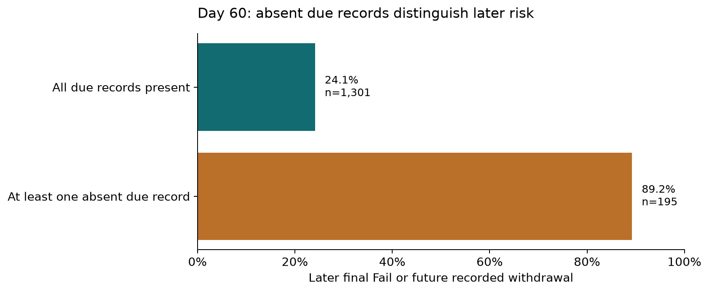
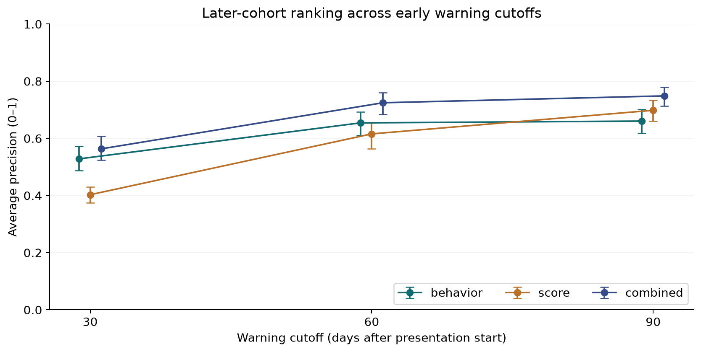

# FFF: early assessment behavior adds warning information, while many later adverse outcomes remain missed

At day 60, combined assessment behavior and delayed scores achieved average precision **0.725** on **1,496** later-cohort enrollments, against adverse-outcome prevalence **32.6%**. Its reference threshold flagged **238** enrollments (15.9%), with **82.4% precision** and **40.2% recall**. It missed **292** later Fail/Withdrawn outcomes. This supports a retrospective educator-review candidate; it does not establish sufficient standalone coverage or intervention benefit.

This is a dedicated FFF-module study, not an independent dataset replication: all five analysis tables were checked against the FFF-restricted parent OULAD records, with exact record-value equality. The assessment date column is inferred as float in the parent (because other modules have undated exams) and integer in FFF; this dtype difference does not change values. The unit is a student–FFF–presentation enrollment. The evaluation population is first module attempts registered by day 0, with coherent withdrawal records and no withdrawal by the warning cutoff. First attempts avoid carried-over-credit complications. One historical FFF withdrawal recorded at day 444 (after day 268 course end) is excluded outside the defined follow-up window, ensuring it cannot supply a future historical training label. The full local FFF snapshot spans four presentations; predictive results below refer to new-to-2013J students in 2014J. The descriptive cohort view includes all four presentations.

## Missing due records distinguish later outcomes

*FFF day-60 eligible 2014J first-attempt test enrollments; rates divide later adverse outcomes by each due-record group. Individual deadline exceptions are unknown. Source: `results/behavior_comparisons.csv`.*

[SVG figure](figures/due_records_and_risk.svg) · [Plotted data](figures/due_records_and_risk.csv)

On day 60, later Fail/Withdrawn occurred in **89.2%** of enrollments with an absent due-assessment record (n=195), versus **24.1%** with all due records present (n=1301). The difference is **65.1 percentage points**. This is an observed association within FFF; individual extensions/exemptions are not recorded, so absent records are proxies for completion behavior, not confirmed missed obligations.

| group | n | due_n | risk_rate | missing_mean | ontime_mean | lateness_median | score_mean |
|---|---|---|---|---|---|---|---|
| Distinction | 247 | 247 | 0.000 | 0.004 | 0.976 | 0.000 | 90.180 |
| Fail | 291 | 291 | 1.000 | 0.232 | 0.620 | 0.000 | 75.639 |
| Pass | 761 | 761 | 0.000 | 0.012 | 0.916 | 0.000 | 81.608 |
| Withdrawn | 197 | 197 | 1.000 | 0.236 | 0.632 | 0.000 | 76.433 |

Failure and withdrawal are distinct educational outcomes; both require supportive review but are not silently equated. Successful outcomes are Pass/Distinction. Missing activity alone never defines the adverse-outcome target. Mean lateness conditions on recorded due submissions and cannot describe the behavior of non-submitters. The apparent value of missing records was challenged with a failure-only target and a seven-day logging-delay assumption, below.

## Combining behavior and marks improves ranking here

*FFF held-out 2014J first attempts; all signals use the same eligible population at each cutoff. Whiskers are 95% student-cluster bootstrap intervals (300 replicates, fixed models); population changes across cutoffs. Source: `results/model_metrics.csv`, `results/uncertainty.csv`.*

[SVG figure](figures/ranking_across_cutoffs.svg) · [Plotted data](figures/ranking_across_cutoffs.csv)

All fitted comparisons include FFF context (constant within this dataset). Behavior adds due count, missing/on-time fractions, mean positive lateness and submission recency. The score baseline includes mean early score and available score count, so it already carries some record-availability information. At day 60, combined minus score AP was **0.109**, paired student-cluster bootstrap 95% interval **[0.084, 0.139]**, using 300 replicates with fixed fitted models. These intervals describe test-population variability and omit training/availability uncertainty.

| cutoff | model | n | prevalence | ap | precision | recall | alert_rate | fp | fn | brier |
|---|---|---|---|---|---|---|---|---|---|---|
| 30 | module | 1567 | 0.357 | 0.357 | 0.357 | 1.000 | 1.000 | 1008 | 0 | 0.233 |
| 30 | behavior | 1567 | 0.357 | 0.528 | 0.645 | 0.306 | 0.169 | 94 | 388 | 0.205 |
| 30 | score | 1567 | 0.357 | 0.403 | 0.400 | 0.911 | 0.813 | 765 | 50 | 0.228 |
| 30 | combined | 1567 | 0.357 | 0.564 | 0.734 | 0.320 | 0.156 | 65 | 380 | 0.199 |
| 30 | prevalence | 1567 | 0.357 | 0.357 | — | 0.000 | 0.000 | 0 | 559 | 0.233 |
| 30 | absent_due_rule | 1567 | 0.357 | 0.448 | 0.831 | 0.193 | 0.083 | 22 | 451 | 0.302 |
| 60 | module | 1496 | 0.326 | 0.326 | 0.326 | 1.000 | 1.000 | 1008 | 0 | 0.225 |
| 60 | behavior | 1496 | 0.326 | 0.654 | 0.864 | 0.389 | 0.147 | 30 | 298 | 0.169 |
| 60 | score | 1496 | 0.326 | 0.616 | 0.617 | 0.367 | 0.194 | 111 | 309 | 0.186 |
| 60 | combined | 1496 | 0.326 | 0.725 | 0.824 | 0.402 | 0.159 | 42 | 292 | 0.160 |
| 60 | prevalence | 1496 | 0.326 | 0.326 | — | 0.000 | 0.000 | 0 | 488 | 0.225 |
| 60 | absent_due_rule | 1496 | 0.326 | 0.528 | 0.892 | 0.357 | 0.130 | 21 | 314 | 0.224 |
| 90 | module | 1437 | 0.299 | 0.299 | 0.299 | 1.000 | 1.000 | 1008 | 0 | 0.216 |
| 90 | behavior | 1437 | 0.299 | 0.661 | 0.917 | 0.333 | 0.109 | 13 | 286 | 0.155 |
| 90 | score | 1437 | 0.299 | 0.698 | 0.836 | 0.310 | 0.111 | 26 | 296 | 0.149 |
| 90 | combined | 1437 | 0.299 | 0.749 | 0.915 | 0.378 | 0.123 | 15 | 267 | 0.137 |
| 90 | prevalence | 1437 | 0.299 | 0.299 | — | 0.000 | 0.000 | 0 | 429 | 0.216 |
| 90 | absent_due_rule | 1437 | 0.299 | 0.494 | 0.976 | 0.289 | 0.088 | 3 | 305 | 0.214 |

| cutoff | comparison | estimate | lo | hi |
|---|---|---|---|---|
| 30 | combined minus behavior AP | 0.035 | 0.023 | 0.049 |
| 60 | combined minus behavior AP | 0.070 | 0.053 | 0.086 |
| 90 | combined minus behavior AP | 0.088 | 0.067 | 0.111 |

The combined signal gains over behavior-only at all three cutoffs in this FFF population. That does not establish superiority on other modules or current cohorts. The module-only baseline is constant and cannot rank students; a quantile threshold flags everyone because of ties. Its 100% alert rate is not a feasible 20% policy. A separate prevalence baseline flags nobody and exposes the no-skill reference.

## Timing and review workload must be assessed together

| cutoff | cohort | raw_n | base_eligible_n | active_n | already_withdrawn_n | due_n | future_withdrawn_n | fail_n | test_n | train_n | validation_n |
|---|---|---|---|---|---|---|---|---|---|---|---|
| 30 | 2013B | 1614 | 1266 | 1138 | 128 | 1138 | 196 | 305 | 0 | 0 | 0 |
| 30 | 2013J | 2283 | 1985 | 1718 | 267 | 1718 | 311 | 405 | 0 | 1277 | 441 |
| 30 | 2014B | 1500 | 1208 | 1062 | 146 | 1062 | 204 | 285 | 0 | 0 | 0 |
| 30 | 2014J | 2365 | 2010 | 1567 | 443 | 1567 | 268 | 291 | 1567 | 0 | 0 |
| 60 | 2013B | 1614 | 1266 | 1093 | 173 | 1093 | 151 | 305 | 0 | 0 | 0 |
| 60 | 2013J | 2283 | 1985 | 1661 | 324 | 1661 | 254 | 405 | 0 | 1233 | 428 |
| 60 | 2014B | 1500 | 1208 | 1022 | 186 | 1022 | 164 | 285 | 0 | 0 | 0 |
| 60 | 2014J | 2365 | 2010 | 1496 | 514 | 1496 | 197 | 291 | 1496 | 0 | 0 |
| 90 | 2013B | 1614 | 1266 | 1051 | 215 | 1051 | 109 | 305 | 0 | 0 | 0 |
| 90 | 2013J | 2283 | 1985 | 1611 | 374 | 1611 | 204 | 405 | 0 | 1197 | 414 |
| 90 | 2014B | 1500 | 1208 | 988 | 220 | 988 | 130 | 285 | 0 | 0 | 0 |
| 90 | 2014J | 2365 | 2010 | 1437 | 573 | 1437 | 138 | 291 | 1437 | 0 | 0 |

At the day-60 reference threshold, flagged future withdrawals (n=76) had a median **35 days** before recorded withdrawal, IQR **14–91 days**. **17** were under the proposed 14-day support interval. This measured interval does not apply to final Fail, for which remaining scheduled course duration is only a proxy; failure occurrence/publication times are unavailable.

| cutoff | group | n | q25 | median | q75 | under_14 | at_least_14 | time_type |
|---|---|---|---|---|---|---|---|---|
| 30 | all_future_withdrawals | 268 | 29.750 | 63.500 | 110.500 | 19 | 249 | observed withdrawal day |
| 30 | flagged_future_withdrawals | 88 | 21.000 | 38.500 | 92.750 | 10 | 78 | observed withdrawal day |
| 30 | flagged_final_fail | 91 | 239.000 | 239.000 | 239.000 | 0 | 91 | course-end proxy, not failure event |
| 60 | all_future_withdrawals | 197 | 26.000 | 57.000 | 99.000 | 26 | 171 | observed withdrawal day |
| 60 | flagged_future_withdrawals | 76 | 14.000 | 35.000 | 91.000 | 17 | 59 | observed withdrawal day |
| 60 | flagged_final_fail | 120 | 209.000 | 209.000 | 209.000 | 0 | 120 | course-end proxy, not failure event |
| 90 | all_future_withdrawals | 138 | 24.000 | 48.500 | 80.750 | 24 | 114 | observed withdrawal day |
| 90 | flagged_future_withdrawals | 40 | 23.000 | 61.000 | 73.250 | 5 | 35 | observed withdrawal day |
| 90 | flagged_final_fail | 122 | 179.000 | 179.000 | 179.000 | 0 | 122 | course-end proxy, not failure event |

| cutoff | capacity | split | n | threshold | alerts | alert_rate | precision | recall | fp | fn |
|---|---|---|---|---|---|---|---|---|---|---|
| 30 | 0.100 | test | 1567 | 0.765 | 132 | 0.084 | 0.826 | 0.195 | 23 | 450 |
| 30 | 0.100 | validation | 441 | 0.765 | 45 | 0.102 | 0.800 | 0.200 | 9 | 144 |
| 30 | 0.200 | test | 1567 | 0.426 | 244 | 0.156 | 0.734 | 0.320 | 65 | 380 |
| 30 | 0.200 | validation | 441 | 0.426 | 123 | 0.279 | 0.577 | 0.394 | 52 | 109 |
| 30 | 0.300 | test | 1567 | 0.416 | 263 | 0.168 | 0.692 | 0.326 | 81 | 377 |
| 30 | 0.300 | validation | 441 | 0.416 | 240 | 0.544 | 0.508 | 0.678 | 118 | 58 |
| 60 | 0.100 | test | 1496 | 0.959 | 91 | 0.061 | 0.978 | 0.182 | 2 | 399 |
| 60 | 0.100 | validation | 428 | 0.959 | 43 | 0.100 | 0.977 | 0.251 | 1 | 125 |
| 60 | 0.200 | test | 1496 | 0.696 | 238 | 0.159 | 0.824 | 0.402 | 42 | 292 |
| 60 | 0.200 | validation | 428 | 0.696 | 87 | 0.203 | 0.885 | 0.461 | 10 | 90 |
| 60 | 0.300 | test | 1496 | 0.501 | 356 | 0.238 | 0.711 | 0.518 | 103 | 235 |
| 60 | 0.300 | validation | 428 | 0.501 | 129 | 0.301 | 0.775 | 0.599 | 29 | 67 |
| 90 | 0.100 | test | 1437 | 0.975 | 84 | 0.058 | 1.000 | 0.196 | 0 | 345 |
| 90 | 0.100 | validation | 414 | 0.975 | 42 | 0.101 | 1.000 | 0.275 | 0 | 111 |
| 90 | 0.200 | test | 1437 | 0.719 | 177 | 0.123 | 0.915 | 0.378 | 15 | 267 |
| 90 | 0.200 | validation | 414 | 0.719 | 83 | 0.200 | 0.904 | 0.490 | 8 | 78 |
| 90 | 0.300 | test | 1437 | 0.495 | 291 | 0.203 | 0.746 | 0.506 | 74 | 212 |
| 90 | 0.300 | validation | 414 | 0.495 | 124 | 0.300 | 0.782 | 0.634 | 27 | 56 |

Capacity is proposed at validation quantiles 10/20/30%, with higher observed quantiles and ties retained. Actual test alert volume changes under cohort shift; educators have not approved a capacity. No threshold was tuned against test labels. The common day-90 survivor panel below distinguishes increasing observation from changing enrollment membership; it is conditional on future survival and is not an operational eligibility rule.

| cutoff | n | prevalence | ap | precision | recall | alert_rate |
|---|---|---|---|---|---|---|
| 30 | 1437 | 0.299 | 0.478 | 0.652 | 0.284 | 0.130 |
| 60 | 1437 | 0.299 | 0.689 | 0.792 | 0.373 | 0.141 |
| 90 | 1437 | 0.299 | 0.749 | 0.915 | 0.378 | 0.123 |

## Sensitivity, error concentration and probability reliability

| cutoff | setting | model | n | prevalence | ap | precision | recall | alert_rate |
|---|---|---|---|---|---|---|---|---|
| 60 | score_delay_28 | score | 1496 | 0.326 | 0.567 | 0.635 | 0.332 | 0.170 |
| 60 | score_delay_28 | combined | 1496 | 0.326 | 0.718 | 0.841 | 0.391 | 0.152 |
| 60 | submission_logging_delay_7 | score | 1496 | 0.326 | 0.616 | 0.617 | 0.367 | 0.194 |
| 60 | submission_logging_delay_7 | combined | 1496 | 0.326 | 0.718 | 0.777 | 0.463 | 0.195 |
| 60 | failure_only | score | 1299 | 0.224 | 0.523 | 0.449 | 0.457 | 0.228 |
| 60 | failure_only | combined | 1299 | 0.224 | 0.643 | 0.656 | 0.440 | 0.150 |
| 60 | include_previous_2013J_students | combined | 1496 | 0.326 | 0.725 | 0.824 | 0.402 | 0.159 |

The +28-day mark-release and +7-day submission-recording challenges retain a combined day-60 AP near 0.718, versus 0.725 primary. Failure-only refits on final Fail versus Pass/Distinction, omitting future Withdrawn: this selected non-withdrawal population is diagnostic and cannot represent all active students. The previous-2013J-student inclusion challenge changes no FFF day-60 test rows; that absence of overlap is measured rather than assumed.

| dimension | group | n | prevalence | precision | recall | alert_rate | fp | fn |
|---|---|---|---|---|---|---|---|---|
| disability | N | 1353 | 0.312 | 0.816 | 0.400 | 0.153 | 38 | 253 |
| disability | Y | 143 | 0.462 | 0.871 | 0.409 | 0.217 | 4 | 39 |
| age_band | 0-35 | 1093 | 0.339 | 0.831 | 0.396 | 0.162 | 30 | 224 |
| age_band | 35-55 | 394 | 0.287 | 0.817 | 0.434 | 0.152 | 11 | 64 |
| age_band | 55<= | 9 | 0.444 | 0.000 | 0.000 | 0.111 | 1 | 4 |
| final_result | Distinction | 247 | 0.000 | 0.000 | — | 0.008 | 2 | 0 |
| final_result | Fail | 291 | 1.000 | 1.000 | 0.412 | 0.412 | 0 | 171 |
| final_result | Pass | 761 | 0.000 | 0.000 | — | 0.053 | 40 | 0 |
| final_result | Withdrawn | 197 | 1.000 | 1.000 | 0.386 | 0.386 | 0 | 121 |

| cutoff | bin | n | mean_prediction | observed_risk |
|---|---|---|---|---|
| 60 | 0.0–0.2 | 470 | 0.143 | 0.085 |
| 60 | 0.2–0.4 | 539 | 0.285 | 0.273 |
| 60 | 0.4–0.6 | 204 | 0.483 | 0.422 |
| 60 | 0.6–0.8 | 79 | 0.694 | 0.430 |
| 60 | 0.8–1.0 | 204 | 0.936 | 0.887 |

Demographic fields audit errors and are not model inputs. Small groups have unstable precision/recall and cannot support causal or fairness claims. Probability-bin gaps and Brier losses assess calibration; ranking value alone does not justify individual probability forecasts. A next supported decision is educator review of the chosen workload and a prospective study with actual score/log/label publication times, not automatic intervention.

## Design, preparation and feature timing

The 2013J population is split 75/25% by student with seed 20261013. Train-only median imputation, missingness indicators, scaling and categorical encoding precede fixed L2 logistic regression (C=1). Validation selects thresholds. Test is 2014J with every 2013J student excluded; repeated snapshots remain grouped, and uncertainty resamples students. Prior holdout reuse outside this run is unknown. Historical-label timing uses a checked calendar bound with an assumed 60-day publication lag; actual publication dates are unobserved. First attempts registered by start, within-scheduled-follow-up outcomes and retrospective coherent-outcome selection limit generalization to repeat/late/incoherent records.

| Variable | Source / formula | Availability rule |
|---|---|---|
| Eligibility | num_of_prev_attempts=0; date_registration<=0; coherent outcome/withdrawal records; withdrawal not after scheduled course end | Withdrawals already recorded by cutoff excluded; coherence is retrospective quality selection |
| Future risk | final_result is Fail or Withdrawn, with withdrawal day>cutoff | Labels/audit only, never predictors |
| Due count | Non-Exam assessments.date between 0 and cutoff | Schedule assumed known/applicable to first attempts; extensions unknown |
| Missing fraction | 1 − recorded due submissions/due count | Non-banked date_submitted<=cutoff; undefined when none due |
| On-time fraction | Due submissions with date_submitted<=due day divided by due count | Same cutoff and denominator |
| Mean lateness | Mean max(submission day − due day,0) among visible due submissions | Undefined if none submitted; not active working time |
| Recency | cutoff − last visible non-exam non-banked submission day | Prefix only; undefined with no event |
| Early score | Mean/count nonmissing non-exam score | date_submitted+14<=cutoff; +28 sensitivity; actual release absent |
| Lead time | Future withdrawal day − cutoff | Retrospective audit; for Fail, course length−cutoff is a proxy only |

| issue | n |
|---|---|
| withdrawal after scheduled course end (outside follow-up; excluded) | 1 |
| missing registration day | 11 |
| registered after day zero | 28 |
| repeat module attempt | 1244 |
| incoherent withdrawal/outcome record | 29 |
| banked submission rows | 620 |
| missing score rows | 46 |
| undated non-exam assessments | 0 |

Exclusion issue counts overlap. Coverage reconciles raw, baseline and active counts. Source fields retain their meanings and raw files are never overwritten. Zero-weight formative assessments remain opportunities. Source keys/joins, denominators, cutoff rules, and train/test separation were checked; `independent_checks.csv` independently recomputes every test enrollment's due count/missing fraction directly from raw records. `parent_overlap.csv` demonstrates source overlap with OULAD; it does not prove independent validation.

All four priority questions have retrospective answers, with unavailable actual event/grade/label release times and failure lead time remaining precise boundaries. No deployment or causal benefit is established.

## Scope, verification and handoff

Status: **complete retrospective analysis within the declared first-attempt FFF scope**. The requested early-academic-risk objective is preserved; narrower evidence does not justify a substitute risk label or an unrelated ranking. Definitions not supplied by the user are proposed operationalizations. Stakeholder acceptance remains **PENDING**; no intervention exists, so intervention outcome evaluation is **NOT APPLICABLE**.

61 numerical/data checks passed in `results/verification.csv`. Checks include the quantities actually computed, with their expected conditions and methods; they do not verify missing real-world evidence. Remaining evidence boundaries:

See the explicitly stated timing and selection assumptions above.

Source CSVs are unchanged. `source_manifest.csv` identifies actual local inputs; preserved source metadata and exact dependency versions support reproduction. [Open the local dashboard](dashboard/index.html), [reproduce the analysis](README.md), or inspect [the criterion and reader-task review](QUALITY_REVIEW.md). Browser interaction, mobile rendering, local links and display reconciliation are documented in `evidence/browser-review.json`; screenshots preserve actual inspection. Those checks validate delivery, not causality, stakeholder approval or live alert effectiveness.

Metadata sources accessed 13 October 2026: [creator documentation](https://rdrr.io/github/jakubkuzilek/oulad/src/R/oulad.R) and [UCI OULAD attribution, CC BY 4.0](https://archive.ics.uci.edu/dataset/349/open+university+learning+analytics+dataset). Original local acquisition dates and per-field vintages are not invented.
