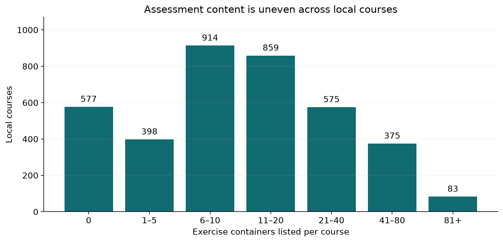
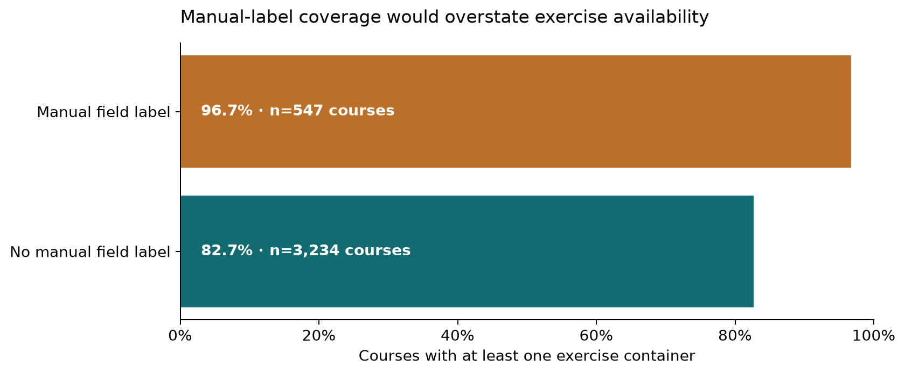

# MOOCCubeX: assessment content is visible, but this snapshot cannot support student early warnings

The actual local snapshot contains **3,781 courses** and **67,325 exercise-container memberships**, yet it lacks the documented student–problem event file, exercise–problem mapping, problem entities and linked future academic outcomes. These are concrete blockers: course content and concept edges cannot establish who submitted an assessment, when a score became available, or which student later struggled. No risk model, accuracy score, lead time or alert list is fabricated.

This is a **feasibility assessment with a completed assessment-content investigation**, not a student-warning validation. The narrower investigation quantifies content opportunity heterogeneity, linkage coverage and source anomalies so an analyst can identify what additional extraction is actually needed. It retains the project purpose rather than replacing it with general course popularity or institutional ranking.

## Exercise opportunities vary substantially even before observing students

*All 3,781 local courses, grouped by exercise-container count. Containers are groups of problems, not student submissions, obligations or deadlines. The 81+ bin includes counts up to 228. Source: `results/course_summary.csv`.*

[SVG figure](figures/exercise_opportunity_distribution.svg) · [Plotted data](figures/exercise_opportunity_distribution.csv)

**577 courses** (15.3%) have no exercise container in their local resource list. The median is **11 exercise containers**, IQR 5–23; the mean is 17.8, and the 95th percentile is 60. Content counts are skewed, so the mean alone would misdescribe typical course assessment infrastructure. An exercise container is a group of problems, not a completed student submission and not necessarily a required assessment.

| measure | courses | zero_n | mean | q25 | median | q75 | p95 | max | total |
|---|---|---|---|---|---|---|---|---|---|
| resources | 3781 | 0 | 71.686 | 38.000 | 59.000 | 88.000 | 167.000 | 2728 | 271043 |
| exercises | 3781 | 577 | 17.806 | 5.000 | 11.000 | 23.000 | 60.000 | 228 | 67325 |
| videos | 3781 | 11 | 53.879 | 28.000 | 44.000 | 66.000 | 124.000 | 2700 | 203718 |

The 271,043 resource memberships decompose into 203,718 videos and 67,325 exercise containers, with no other prefixes or duplicate course–resource memberships. Chapters express content order, not deadlines. The code validates decomposition and uniqueness rather than converting resource position into invented warning time.

## Concept edges cover only part of the course universe

| check | numerator | denominator | fraction |
|---|---|---|---|
| courses with concept-course edge | 887 | 3781 | 0.235 |
| concept-course target courses present locally | 887 | 887 | 1.000 |
| problem concepts also linked to courses | 6067 | 13822 | 0.439 |
| distinct course exercise ids | 67325 | 67325 | 1.000 |
| course-resource duplicate memberships | 0 | 271043 | 0.000 |

Concept-to-course edges reach **887 of 3,781 courses (23.5%)**. Only 43.9% of concepts attached to the observed problem IDs also appear in the concept–course relation. This is semantic overlap, not an exercise-to-problem linkage: linking a problem and course merely because they share a concept would create many-to-many fanout and unsupported assessment assignments. The missing exercise–problem mapping is necessary before constructing applicable student opportunity denominators.

| required_file | present | needed_for |
|---|---|---|
| entities/user.json | False | enrollment and timing |
| relations/user-problem.json | False | student submission time, correctness and score |
| relations/exercise-problem.json | False | exercise-container to problem linkage (documented JSON location) |
| relations/exercise-problem.txt | False | exercise-container to problem linkage (documented TXT variant) |
| entities/problem.json | False | problem identifiers, content and scores |
| entities/reply.json | False | reply text and creation time |

Both documented exercise–problem filename variants were checked and neither is present. The local user–reply and comment–reply edges lack the event text/time entities required to reconstruct assessment behavior. Help-query records provide user/type/question strings, not answer correctness or a linked academic result. Their measured coverage below cannot replace missing assessment logs.

| type | rows | users | distinct_questions |
|---|---|---|---|
| cannot_answer | 668 | 419 | 526 |
| 作诗 | 3133 | 403 | 69 |
| 加减乘除 | 303 | 67 | 67 |
| 助教回答 | 846 | 508 | 2 |
| 来自Aminer | 2415 | 1633 | 1579 |
| 来自Aminer|视频答案 | 7 | 7 | 1 |
| 来自Faq | 3033 | 1736 | 2027 |
| 来自baidu | 4373 | 2262 | 3490 |
| 来自baike | 3831 | 1985 | 2641 |
| 来自baike|视频答案 | 2 | 2 | 2 |
| 来自baike|讨论区 | 2 | 2 | 1 |
| 来自mooccube | 12953 | 3272 | 4379 |
| 来自mooccube|视频答案 | 1126 | 842 | 115 |
| 来自mooccube|讨论区 | 739 | 513 | 89 |
| 来自mooccube|讨论区|视频答案 | 150 | 105 | 20 |
| 来自图灵机器人 | 6426 | 1394 | 4696 |
| 来自课程信息 | 144 | 118 | 83 |
| 知识图谱点击 | 50883 | 14205 | 4564 |
| 知识图谱点击|视频答案 | 51 | 36 | 25 |
| 知识图谱点击|讨论区 | 24 | 17 | 10 |
| 知识图谱点击|讨论区|视频答案 | 13 | 9 | 6 |
| 脏问题 | 254 | 149 | 135 |
| 问助教 | 448 | 275 | 396 |
| 预设问答 | 15705 | 5368 | 53 |
| 飘窗回答 | 821 | 435 | 188 |
| 飘窗回答|讨论区 | 1 | 1 | 1 |

## Label coverage and repeated edges can distort a feasibility conclusion

*Matched manually labeled courses versus the remaining local course universe; 85 unmatched manual course IDs are excluded only from field summaries. No student academic-risk inference is supported. Source: `results/manual_label_sensitivity.csv`.*

[SVG figure](figures/manual_label_selection.svg) · [Plotted data](figures/manual_label_selection.csv)

Initial field joining assumed every manually labeled course would be in the local course file. The executed check found **110 unmatched field memberships on 85 courses**, out of 632 manually labeled course IDs. The pipeline was corrected to retain this coverage evidence and restrict field summaries to the 547 matched courses; it does not silently drop unmatched courses or infer resources for them.

| field_memberships | matched_memberships | unmatched_memberships | manual_courses | matched_courses | unmatched_courses |
|---|---|---|---|---|---|
| 793 | 683 | 110 | 632 | 547 | 85 |

| group | n | mean_exercises | median_exercises | exercise_coverage |
|---|---|---|---|---|
| Manual field label | 547 | 21.984 | 13.000 | 0.967 |
| No manual field label | 3234 | 17.100 | 10.000 | 0.827 |

Manually labeled matched courses have exercise coverage **96.7%**, versus **82.7%** among courses without a manual label. This executed sensitivity shows that analyzing only manually labeled courses would overstate exercise availability for the full local course universe. “No manual label” can still have field information in course entities; manual and other field sources are deliberately not treated as interchangeable. Courses can have multiple manual field memberships, so field rows are not independent courses and cannot be summed as a population.

| field | courses | mean_exercises | median_exercises | zero_exercise_courses | median_videos | exercise_coverage |
|---|---|---|---|---|---|---|
| 中国语言文学 | 20 | 22.300 | 22.500 | 1 | 49.000 | 0.950 |
| 临床医学 | 19 | 19.842 | 15.000 | 1 | 61.000 | 0.947 |
| 体育学 | 15 | 16.200 | 11.000 | 0 | 31.000 | 1.000 |
| 化学工程与技术 | 15 | 22.867 | 13.000 | 0 | 52.000 | 1.000 |
| 历史学 | 20 | 18.600 | 13.000 | 0 | 58.500 | 1.000 |
| 哲学 | 11 | 12.000 | 9.000 | 0 | 28.000 | 1.000 |
| 基础医学 | 12 | 24.500 | 18.000 | 0 | 50.500 | 1.000 |
| 外国语言文学 | 34 | 34.676 | 16.000 | 0 | 44.500 | 1.000 |
| 工商管理 | 16 | 10.500 | 9.000 | 1 | 47.000 | 0.938 |
| 应用经济学 | 19 | 11.789 | 9.000 | 2 | 62.000 | 0.895 |
| 建筑学 | 10 | 13.000 | 8.500 | 0 | 49.500 | 1.000 |
| 心理学 | 16 | 11.438 | 8.500 | 0 | 39.000 | 1.000 |
| 控制科学与工程 | 11 | 30.727 | 21.000 | 1 | 66.000 | 0.909 |
| 政治学 | 15 | 15.533 | 12.000 | 0 | 67.000 | 1.000 |
| 教育学 | 12 | 10.500 | 7.500 | 1 | 40.000 | 0.917 |
| 数学 | 21 | 45.429 | 41.000 | 0 | 85.000 | 1.000 |
| 机械工程 | 10 | 22.800 | 14.000 | 0 | 87.500 | 1.000 |
| 物理学 | 20 | 29.550 | 26.000 | 0 | 96.500 | 1.000 |
| 环境科学与工程 | 12 | 22.250 | 11.000 | 1 | 55.000 | 0.917 |
| 生物学 | 16 | 22.250 | 14.500 | 0 | 45.500 | 1.000 |
| 电子科学与技术 | 13 | 27.846 | 12.000 | 1 | 79.000 | 0.923 |
| 社会学 | 10 | 23.400 | 14.000 | 0 | 34.500 | 1.000 |
| 管理科学与工程 | 20 | 18.800 | 12.000 | 1 | 42.000 | 0.950 |
| 艺术学 | 35 | 11.943 | 9.000 | 1 | 49.000 | 0.971 |
| 计算机科学与技术 | 63 | 19.492 | 13.000 | 3 | 59.000 | 0.952 |

The concept–problem relation has 4,039 repeated pairs (12.2% of raw rows); course–teacher has 51,186 repeated pairs (52.7%). Unique-pair views are appropriate for linkage coverage, with raw and unique row counts retained. These repetitions are not extra student assessment attempts. Other mappings have legitimate many-to-many structure; uniqueness of a pair does not establish one-to-one entities.

| relation | raw_rows | unique_pairs | duplicate_rows | duplicate_fraction | left_entities | right_entities | malformed_rows |
|---|---|---|---|---|---|---|---|
| concept-problem | 33180 | 29141 | 4039 | 0.122 | 13822 | 19983 | 0 |
| concept-course | 451078 | 451078 | 0 | 0.000 | 216096 | 887 | 0 |
| course-teacher | 97192 | 46006 | 51186 | 0.527 | 13866 | 12252 | 0 |
| user-reply | 331011 | 331011 | 0 | 0.000 | 50313 | 331011 | 0 |
| comment-reply | 370493 | 370493 | 0 | 0.000 | 308213 | 370493 | 0 |

## What would make early warning answerable?

| Priority question | Actual support | Missing evidence |
|---|---|---|
| Early behavior associated with later academic risk | Unsupported at student level | User–problem attempts with submission times, scores and course linkage; later academic result |
| How early, with useful support time? | Content chapter order only | Enrollment start, applicable deadlines, event/availability timestamps, outcome timing |
| Added value beyond prior scores? | Unsupported | Correct early scores and a temporally separate later outcome |
| Misses, false flags and review volume? | Unsupported | Valid labels and held-out temporal/student evaluation |
| Assessment infrastructure feasibility | Answered by full local course/resource and relation investigation | Exercise–problem mapping and local problem entities still absent |

Raw JSONL and text relations are preserved; keys, malformed lines, decomposition and join cardinality were checked. No personal names, query text, or identifiable user records appear in the dashboard. All relevant course/resource/concept tables were read in full; no convenient small sample substitutes for the local scope. Documentation distinguishes `Ex_` exercise containers, `Pm_` problems and `U_` users; these namespaces are not interchangeable. Source scope is the local partial extraction, not an assumed full upstream release.

The next useful evidence is an authorized extraction of the missing linked user/problem/outcome files and their timing metadata. More content charts cannot validate warnings. Additional datasets were not acquired in this run.

## Scope, verification and handoff

Status: **feasibility assessment; completed bounded assessment-content investigation**. The requested early-academic-risk objective is preserved; narrower evidence does not justify a substitute risk label or an unrelated ranking. Definitions not supplied by the user are proposed operationalizations. Stakeholder acceptance remains **PENDING**; no intervention exists, so intervention outcome evaluation is **NOT APPLICABLE**.

8 numerical/data checks passed in `results/verification.csv`. Checks include the quantities actually computed, with their expected conditions and methods; they do not verify missing real-world evidence. Remaining evidence boundaries:

| check | observed | consequence |
|---|---|---|
| student assessment trajectories | No local user-problem event file | Blocks student-level early-warning inference |
| later academic adverse outcomes | No local linked outcome table | Blocks student-level early-warning inference |
| assessment deadline obligations | Course resource chapter labels are not due dates | Blocks student-level early-warning inference |
| exercise to problem linkage | Neither documented exercise-problem file variant is present | Blocks student-level early-warning inference |

Source CSVs are unchanged. `source_manifest.csv` identifies actual local inputs; preserved source metadata and exact dependency versions support reproduction. [Open the local dashboard](dashboard/index.html), [reproduce the analysis](README.md), or inspect [the criterion and reader-task review](QUALITY_REVIEW.md). Browser interaction, mobile rendering, local links and display reconciliation are documented in `evidence/browser-review.json`; screenshots preserve actual inspection. Those checks validate delivery, not causality, stakeholder approval or live alert effectiveness.

Metadata sources accessed 13 October 2026: [local course schema](../../datasets/mooccubex/docs/course-en.md), [local user schema](../../datasets/mooccubex/docs/user-en.md), and the [MOOCCubeX creators’ repository](https://github.com/THU-KEG/MOOCCubeX). Original local acquisition dates and per-field vintages are not invented.
