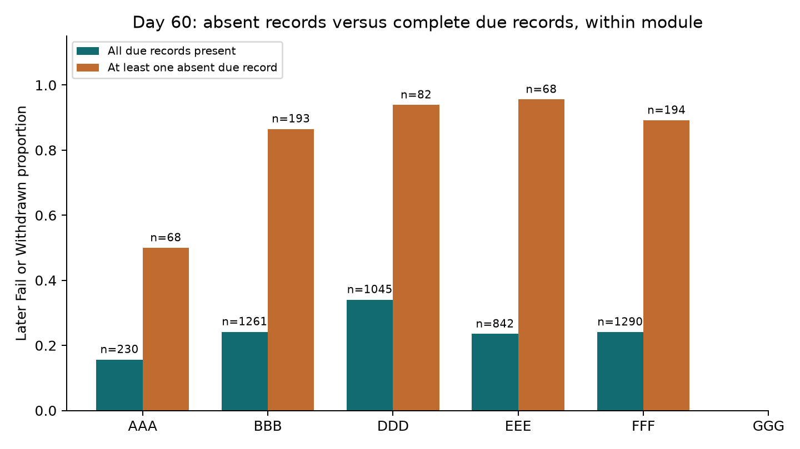
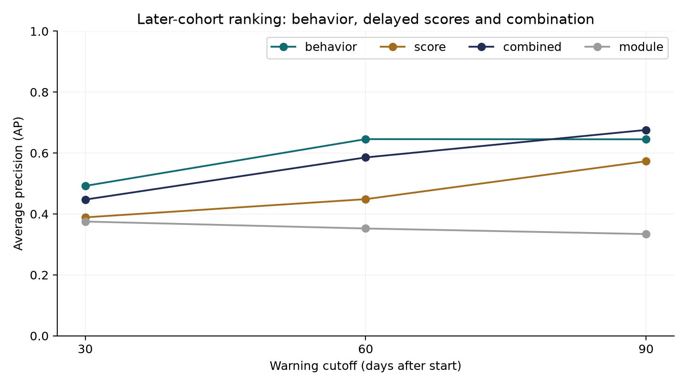

# Assessment records offer early warnings, with limited coverage and substantial missed risk

OULAD · analysis snapshot 13 October 2026 · unit: student–module–presentation enrollment.

**Complete retrospective analysis within the stated first-attempt, six-module evaluation scope; live warning validity remains conditional on unobserved recording and score-release times.** This study does not establish intervention effectiveness or performance on repeat attempts, late registrants, CCC, or current students.

On day 60, the combined model achieved average precision **0.586** against a test risk prevalence of **32.9%**. A threshold selected to review approximately 20% of validation enrollments flagged **1,358 of 5,903** later-cohort enrollments (23.0%), with **59.5% precision** and **41.5% recall**. It missed **1,137** later adverse outcomes. These estimates support an educator-review candidate, with substantial missed risk remaining.

[Open interactive dashboard](dashboard/index.html). All comparisons below refer to the common evaluated population for the selected cutoff unless stated otherwise. Report tables show proportions on 0–1 scales; the dashboard formats percentages. Supporting CSVs are in `results/`.

## 1. Missing due records are associated with later risk, including within modules

At day 60, enrollments with at least one absent due-assessment record had later Fail/Withdrawn prevalence **85.3%** (n=605), compared with **25.8%** among enrollments with all due records present (n=4,668); an observed difference of **59.5 percentage points**. “Absent” means no non-banked submission recorded by the cutoff for a scheduled, due, non-exam assessment; it does not prove a missed individual obligation. Extensions, exemptions and recording delays are unavailable.

Could module composition explain the difference? The executed follow-up compares both groups inside each module, below. GGG has no due assessment by day 60 and is not forced into the complete/missing contrast. Other modules can differ in how many and which assessments are due, so neither the aggregate nor within-module gaps identify a causal effect of completion. Outcome-specific rows further distinguish eventual failure from future withdrawal; they are not interchangeable educational outcomes.

| group | n | risk_rate | future_withdrawn_n | fail_n |
|---|---|---|---|---|
| AAA / All due records present | 230 | 0.157 | 17 | 19 |
| AAA / At least one absent due record | 68 | 0.5 | 16 | 18 |
| BBB / All due records present | 1261 | 0.242 | 111 | 194 |
| BBB / At least one absent due record | 193 | 0.865 | 41 | 126 |
| DDD / All due records present | 1045 | 0.341 | 141 | 215 |
| DDD / At least one absent due record | 82 | 0.939 | 35 | 42 |
| EEE / All due records present | 842 | 0.235 | 76 | 122 |
| EEE / At least one absent due record | 68 | 0.956 | 18 | 47 |
| FFF / All due records present | 1290 | 0.241 | 123 | 188 |
| FFF / At least one absent due record | 194 | 0.892 | 73 | 100 |
| GGG / No assessments due | 630 | 0.354 | 63 | 160 |

Outcome-specific behavior on day 60 (mean missing/on-time fractions use only defined due denominators; lateness median is across enrollment-level means for recorded due submissions):

| group | n | due_n | missing_mean | ontime_mean | lateness_median | score_mean |
|---|---|---|---|---|---|---|
| Distinction | 808 | 689 | 0.004 | 0.969 | 0.0 | 82.912 |
| Fail | 1231 | 1071 | 0.226 | 0.671 | 0.0 | 68.533 |
| Pass | 3150 | 2862 | 0.015 | 0.925 | 0.0 | 75.445 |
| Withdrawn | 714 | 651 | 0.187 | 0.671 | 0.0 | 67.133 |

The local data contains 32,593 enrollment records across 22 presentations and seven modules, not that many distinct people. Full-snapshot final outcomes are Fail 7,052, Withdrawn 10,156, Pass 12,361, Distinction 3,024. `cohort_behaviors.csv` gives the executed first-attempt descriptive comparisons across all local cohorts, including CCC and February starts; these are not additional predictive holdouts. VLE click data was not needed to answer the assessment-centered questions and was not scanned.

## 2. Earlier warnings trade evidence for support time

Day 30/60/90 were proposed in advance, not selected for the best test score. At day 30, EEE and GGG have no due assessment; GGG's first due assessment is day 61. A zero opportunity count gives **undefined completion fractions**, not perfect compliance or noncompliance. Models can still return module-prior-based estimates, which must not be mistaken for assessment-behavior evidence. Coverage is shown for all cohorts below. `test_n` is the stricter six-module, new-to-2013J subset, not the full active population.

| cutoff | cohort | raw_n | base_eligible_n | active_n | already_withdrawn_n | due_n | future_withdrawn_n | fail_n | test_n | train_n | validation_n |
|---|---|---|---|---|---|---|---|---|---|---|---|
| 30 | 2013J | 8845 | 7870 | 6855 | 1015 | 5008 | 1016 | 1674 | 0 | 5131 | 1724 |
| 30 | 2014J | 11260 | 9757 | 7941 | 1816 | 6355 | 1409 | 1591 | 6102 | 0 | 0 |
| 60 | 2013J | 8845 | 7870 | 6664 | 1206 | 5747 | 825 | 1674 | 0 | 4994 | 1670 |
| 60 | 2014J | 11260 | 9757 | 7610 | 2147 | 6980 | 1078 | 1591 | 5903 | 0 | 0 |
| 90 | 2013J | 8845 | 7870 | 6520 | 1350 | 6520 | 681 | 1674 | 0 | 4888 | 1632 |
| 90 | 2014J | 11260 | 9757 | 7371 | 2386 | 7371 | 839 | 1591 | 5746 | 0 | 0 |

The active enrollment population shrinks with each cutoff as withdrawals occur. The executed `active_through_day90_common_panel` sensitivity evaluates all three cutoffs on the same day-90 survivor enrollments, separating added observation time from changing membership. That panel conditions on future survival and is a diagnostic, not an operational eligibility rule.

| cutoff | n | prevalence | ap | precision | recall | alert_rate |
|---|---|---|---|---|---|---|
| 30 | 5746 | 0.311 | 0.39 | 0.384 | 0.369 | 0.298 |
| 60 | 5746 | 0.311 | 0.559 | 0.566 | 0.4 | 0.22 |
| 90 | 5746 | 0.311 | 0.676 | 0.622 | 0.449 | 0.225 |

For flagged future withdrawals at day 60 (n=299), the observed median interval to withdrawal was **61 days**, with interquartile range **20–98 days**. **51** were fewer than the proposed 14 support days away. Do not apply this withdrawal lead time to Fail. For final Fail, only the remaining scheduled course duration is available; it is a course-end proxy and cannot establish when academic difficulty became irreversible or grades were published.

| cutoff | group | n | q25 | median | q75 | under_14 | at_least_14 | time_type |
|---|---|---|---|---|---|---|---|---|
| 30 | all_future_withdrawals | 913 | 36.0 | 80.0 | 127.0 | 60 | 853 | observed withdrawal day |
| 30 | flagged_future_withdrawals | 390 | 30.0 | 70.0 | 121.0 | 23 | 367 | observed withdrawal day |
| 30 | flagged_final_fail | 447 | 232.0 | 239.0 | 239.0 | 0 | 447 | course-end proxy, not failure event |
| 60 | all_future_withdrawals | 714 | 35.0 | 71.5 | 105.8 | 88 | 626 | observed withdrawal day |
| 60 | flagged_future_withdrawals | 299 | 20.0 | 61.0 | 98.0 | 51 | 248 | observed withdrawal day |
| 60 | flagged_final_fail | 509 | 202.0 | 209.0 | 209.0 | 0 | 509 | course-end proxy, not failure event |
| 90 | all_future_withdrawals | 557 | 27.0 | 60.0 | 82.0 | 67 | 490 | observed withdrawal day |
| 90 | flagged_future_withdrawals | 235 | 24.0 | 56.0 | 75.0 | 32 | 203 | observed withdrawal day |
| 90 | flagged_final_fail | 567 | 172.0 | 179.0 | 179.0 | 0 | 567 | course-end proxy, not failure event |

## 3. Behavior adds information beyond a delayed-score baseline

All four fitted comparisons share the same train, validation and test enrollments at each cutoff. Every logistic model includes module context. “Behavior” adds due count, missing fraction, on-time fraction, mean positive lateness and recency; “score” adds mean available early score and count of nonmissing available scores. That score-count feature already conveys some assessment-record availability, making this a comparatively strong prior-score baseline rather than a pure marks-only comparison. “Combined” adds both sets. Missing scores never remove students from the comparison.

| cutoff | model | n | ap | precision | recall | alert_rate | fp | fn | brier |
|---|---|---|---|---|---|---|---|---|---|
| 30 | module | 6102 | 0.375 | 0.407 | 0.222 | 0.192 | 694 | 1667 | 0.229 |
| 30 | behavior | 6102 | 0.492 | 0.459 | 0.315 | 0.241 | 797 | 1468 | 0.212 |
| 30 | score | 6102 | 0.389 | 0.408 | 0.489 | 0.421 | 1519 | 1096 | 0.245 |
| 30 | combined | 6102 | 0.447 | 0.442 | 0.39 | 0.31 | 1055 | 1307 | 0.23 |
| 60 | module | 5903 | 0.352 | 0.351 | 0.471 | 0.442 | 1694 | 1028 | 0.223 |
| 60 | behavior | 5903 | 0.646 | 0.773 | 0.368 | 0.157 | 210 | 1230 | 0.177 |
| 60 | score | 5903 | 0.449 | 0.532 | 0.386 | 0.239 | 661 | 1194 | 0.234 |
| 60 | combined | 5903 | 0.586 | 0.595 | 0.415 | 0.23 | 550 | 1137 | 0.213 |
| 90 | module | 5746 | 0.334 | 0.329 | 0.464 | 0.439 | 1694 | 958 | 0.217 |
| 90 | behavior | 5746 | 0.645 | 0.83 | 0.367 | 0.137 | 134 | 1132 | 0.165 |
| 90 | score | 5746 | 0.573 | 0.583 | 0.414 | 0.221 | 531 | 1047 | 0.206 |
| 90 | combined | 5746 | 0.676 | 0.622 | 0.449 | 0.225 | 488 | 986 | 0.172 |

At day 60, combined minus score average precision was **0.137**, with a paired student-cluster bootstrap 95% interval **[0.126, 0.149]** (300 replicates, fixed fitted models). This estimates evaluation-population variability; it excludes training uncertainty, delay uncertainty, alternate cohorts and model-selection uncertainty. AP is a ranking measure, not a percentage of students correctly identified. No-skill AP equals prevalence; module-only AP may exceed that by exploiting course differences. The simple absent-due-record rule is evaluated separately:

| cutoff | model | n | ap | precision | recall | alert_rate | fp | fn |
|---|---|---|---|---|---|---|---|---|
| 30 | prevalence | 6102 | 0.351 | — | 0.0 | 0.0 | 0 | 2144 |
| 30 | absent_due_rule | 6102 | 0.412 | 0.866 | 0.117 | 0.048 | 39 | 1893 |
| 60 | prevalence | 5903 | 0.329 | — | 0.0 | 0.0 | 0 | 1945 |
| 60 | absent_due_rule | 5903 | 0.468 | 0.853 | 0.265 | 0.102 | 89 | 1429 |
| 90 | prevalence | 5746 | 0.311 | — | 0.0 | 0.0 | 0 | 1788 |
| 90 | absent_due_rule | 5746 | 0.496 | 0.913 | 0.306 | 0.104 | 52 | 1240 |

Could unknown mark-release times explain the result? The executed sensitivity delays usable marks from submission +14 to +28 days. Could absent records reflect delayed logging? A second challenge hides submissions for seven additional days while retaining the scheduled due denominator. Could the composite outcome hide a different failure problem? A third challenge refits for Fail versus Pass/Distinction, omitting future withdrawals; this is a selected retrospective non-withdrawal population and not a policy for all active students. A fourth adds students previously present in 2013J back to the test population. These comparisons bound interpretations; none was used to retune the primary model.

| setting | model | n | ap | precision | recall | alert_rate |
|---|---|---|---|---|---|---|
| score_delay_28 | score | 5903 | 0.429 | 0.499 | 0.425 | 0.28 |
| score_delay_28 | combined | 5903 | 0.585 | 0.591 | 0.417 | 0.233 |
| submission_logging_delay_7 | score | 5903 | 0.449 | 0.532 | 0.386 | 0.239 |
| submission_logging_delay_7 | combined | 5903 | 0.551 | 0.573 | 0.399 | 0.23 |
| failure_only | score | 5189 | 0.342 | 0.41 | 0.398 | 0.23 |
| failure_only | combined | 5189 | 0.487 | 0.471 | 0.429 | 0.216 |
| include_previous_2013J_students | combined | 5962 | 0.582 | 0.594 | 0.415 | 0.23 |
| active_through_day90_common_panel | combined | 5746 | 0.559 | 0.566 | 0.4 | 0.22 |

### Combining scores can reduce early warning quality under cohort shift

Behavior-only beats combined at days 30 and 60; combined leads at day 90. The paired comparison below shows that this is not merely ranking noise in the evaluated population. More feature groups do not guarantee stronger warnings.

| cutoff | comparison | estimate | lo | hi |
|---|---|---|---|---|
| 30 | combined minus behavior AP | -0.045 | -0.059 | -0.03 |
| 60 | combined minus behavior AP | -0.06 | -0.078 | -0.043 |
| 90 | combined minus behavior AP | 0.031 | 0.016 | 0.049 |

The executed follow-up shows a reversal from within-2013J validation to later-cohort testing. On day 60 validation, combined AP was 0.731 versus behavior-only 0.680; on test it fell to 0.586 versus behavior-only 0.646. This is evidence that a same-cohort validation gain does not establish transport to the next year. Module-specific testing and feature distributions localize part of the problem: BBB combined AP is 0.542 versus behavior 0.638, while DDD combined is 0.755 versus behavior 0.581. The pattern is heterogeneous, rather than uniformly harmful scores.

| module | behavior | combined | score |
|---|---|---|---|
| AAA | 0.41 | 0.481 | 0.43 |
| All | 0.646 | 0.586 | 0.449 |
| BBB | 0.638 | 0.542 | 0.342 |
| DDD | 0.581 | 0.755 | 0.744 |
| EEE | 0.597 | 0.707 | 0.685 |
| FFF | 0.672 | 0.715 | 0.612 |
| GGG | 0.583 | 0.591 | 0.371 |

For BBB, historical training mean available early score was 72.0 versus 59.0 on test; the due count changed from 3 to 2. The saved assessment schedule confirms that BBB 2013J had an early CMA due at day 54 and TMA deadlines at days 19/47; 2014J had no CMAs, TMA deadlines at 19/54, and the first TMA changed from 5% to 0% weight. The analysis deliberately retains zero-weight formative assessments as behavior opportunities, but unweighted average marks across this changed schedule have limited comparability. These observed shifts provide a plausible explanation, not proof that schedule changes caused the performance loss. The 28-day score-delay challenge leaves combined day-60 AP nearly unchanged (0.584 versus 0.586), so that release-delay choice alone does not explain the reversal.

| cutoff | split | module | n | due_count_mean | available_score_fraction | mean_score | missing_fraction |
|---|---|---|---|---|---|---|---|
| 60 | train | AAA | 279 | 2.0 | 0.964 | 70.355 | 0.118 |
| 60 | train | BBB | 1141 | 3.0 | 0.915 | 72.04 | 0.143 |
| 60 | train | DDD | 988 | 2.0 | 0.923 | 73.221 | 0.128 |
| 60 | train | EEE | 678 | 1.0 | 0.886 | 83.454 | 0.103 |
| 60 | train | FFF | 1247 | 2.0 | 0.952 | 78.725 | 0.088 |
| 60 | train | GGG | 661 | 0.0 | 0.082 | 69.333 | — |
| 60 | test | AAA | 298 | 2.0 | 0.98 | 69.216 | 0.121 |
| 60 | test | BBB | 1454 | 2.0 | 0.956 | 58.963 | 0.085 |
| 60 | test | DDD | 1127 | 2.0 | 0.965 | 76.549 | 0.053 |
| 60 | test | EEE | 910 | 1.0 | 0.916 | 86.745 | 0.075 |
| 60 | test | FFF | 1484 | 2.0 | 0.961 | 81.416 | 0.084 |
| 60 | test | GGG | 630 | 0.0 | 0.106 | 69.672 | — |

The implication is to retain behavior-only as a serious candidate, avoid claiming that combined is always preferable, and verify assessment comparability in a fresh future cohort before choosing a deployed model. The report uses combined at a fixed reference threshold to demonstrate workload, not to name it as the winning model at every cutoff. This follow-up was exploratory after the initial results and did not change any model or threshold.

## 4. Review workload, missed students and probability reliability matter

The proposed 10/20/30% capacities select score quantiles on validation, using the higher observed quantile. Tied probabilities can exceed capacity even on validation; cohort shift can change test alert volume. The dashboard shows the actual validation and test volumes, confusion counts and separate outcome recalls. Capacity is an assumption for comparison, not an educator-approved workload or a hard operational cap. Test outcomes were not used to set thresholds.

| split | capacity | n | threshold | alerts | alert_rate | precision | recall | fp | fn |
|---|---|---|---|---|---|---|---|---|---|
| test | 0.1 | 5903 | 0.856 | 887 | 0.15 | 0.586 | 0.267 | 367 | 1425 |
| validation | 0.1 | 1670 | 0.856 | 167 | 0.1 | 0.934 | 0.259 | 11 | 447 |
| test | 0.2 | 5903 | 0.639 | 1358 | 0.23 | 0.595 | 0.415 | 550 | 1137 |
| validation | 0.2 | 1670 | 0.639 | 356 | 0.213 | 0.764 | 0.451 | 84 | 331 |
| test | 0.3 | 5903 | 0.45 | 1791 | 0.303 | 0.559 | 0.515 | 789 | 943 |
| validation | 0.3 | 1670 | 0.45 | 501 | 0.3 | 0.693 | 0.575 | 154 | 256 |

At the reference threshold, these module, disability and age comparisons show where errors concentrate. Disability and age are audit fields only and never predictors. Denominators are each group's eligible test enrollments; recall divides by that group's positive outcomes, precision by its flagged enrollments. Small groups are descriptive and unstable; these are exploratory comparisons, without confirmatory significance or fairness certification.

| dimension | group | n | prevalence | precision | recall | alert_rate | fp | fn |
|---|---|---|---|---|---|---|---|---|
| code_module | AAA | 298 | 0.235 | 0.483 | 0.2 | 0.097 | 15 | 56 |
| code_module | BBB | 1454 | 0.325 | 0.385 | 0.504 | 0.425 | 380 | 234 |
| code_module | DDD | 1127 | 0.384 | 0.938 | 0.245 | 0.1 | 7 | 327 |
| code_module | EEE | 910 | 0.289 | 0.922 | 0.357 | 0.112 | 8 | 169 |
| code_module | FFF | 1484 | 0.326 | 0.762 | 0.444 | 0.19 | 67 | 269 |
| code_module | GGG | 630 | 0.354 | 0.659 | 0.632 | 0.34 | 73 | 82 |
| disability | N | 5383 | 0.317 | 0.579 | 0.407 | 0.223 | 505 | 1013 |
| disability | Y | 520 | 0.456 | 0.715 | 0.477 | 0.304 | 45 | 124 |
| age_band | 0-35 | 4060 | 0.347 | 0.63 | 0.417 | 0.23 | 345 | 822 |
| age_band | 35-55 | 1799 | 0.291 | 0.52 | 0.415 | 0.232 | 200 | 306 |
| age_band | 55<= | 44 | 0.273 | 0.375 | 0.25 | 0.182 | 5 | 9 |

At day 60, 937 enrollments in the highest probability bin had mean predicted risk **95.6%**, but observed adverse-outcome frequency was only **59.1%**. This is substantial overconfidence, not an operationally reliable probability estimate. BBB had 42.5% of enrollments flagged with 38.5% precision, compared with DDD at 10.0% flagged with 93.8% precision; the single global threshold distributes workload unevenly. These are exploratory observed comparisons, not evidence of a causal demographic effect.

Probability reliability is assessed with Brier loss (lower is better) above and fixed probability-bin observations below. The model was not recalibrated to the holdout. Differences between mean predicted and observed risk are evidence against treating probabilities as validated individualized forecasts. Course shift and missing delay metadata remain practical concerns even when ranking improves.

| cutoff | bin | n | mean_prediction | observed_risk |
|---|---|---|---|---|
| 60 | 0.0–0.2 | 2428 | 0.113 | 0.164 |
| 60 | 0.2–0.4 | 1488 | 0.266 | 0.287 |
| 60 | 0.4–0.6 | 575 | 0.486 | 0.496 |
| 60 | 0.6–0.8 | 475 | 0.667 | 0.589 |
| 60 | 0.8–1.0 | 937 | 0.956 | 0.591 |

A proposed next step is educator review of whether these signals and workloads suit a real support process, followed by a prospective study with logged alert, outreach, score-release and outcome times. No individual alert list is published. No actual intervention exists here; intervention outcome evaluation is **NOT APPLICABLE**. Stakeholder acceptance of these deliverables is **PENDING**.

## Definitions, timing and reproducible design

The intended question is future final Fail or future recorded withdrawal, not detecting withdrawal that already occurred. Pass and Distinction are successful outcomes; combining Fail/Withdrawn is a proposed support-review operationalization, with separate summaries and the failure-only challenge above. Withdrawal eligibility uses dates only to exclude past events. Future withdrawal dates and final outcomes are labels/audit quantities only, never predictors.

| Variable | Source and formula | Availability and cutoff |
|---|---|---|
| Enrollment eligibility | `num_of_prev_attempts == 0`, `date_registration <= 0`; withdrawal not after scheduled end; coherent `final_result`/`date_unregistration` | Baseline first attempt, registration by start; coherent outcome requirement is retrospective quality selection, disclosed below |
| Future risk | `final_result` in Fail/Withdrawn, withdrawal date > cutoff | Label through end of presentation; withdrawal time directly recorded, Fail event time absent |
| Due count | Count non-Exam `assessments` with 0 <= `date` <= cutoff for the enrollment's module/presentation | Scheduled deadlines assumed known; all scheduled assessments assumed applicable to first attempts |
| Missing fraction | 1 − recorded due submissions / due count | Non-banked `studentAssessment.date_submitted <= cutoff`; no due opportunities gives undefined |
| On-time fraction | Due submissions with `date_submitted <= assessments.date` / due count | Also submission-visible by cutoff; same denominator as missing fraction |
| Mean lateness | Mean max(submission − due, 0), only recorded due submissions | Undefined if none submitted; conditional on submitting, not time spent working |
| Recency | cutoff − most recent non-exam non-banked submission day | All visible submissions, including assessments not yet due; undefined with no record |
| Early score mean/count | Mean/count nonmissing `score` on non-exam, non-banked submissions | submission +14 days <= cutoff; +28-day challenge; actual grade release unknown |
| Module context | `code_module` | Categorical, known at registration; shared in all fitted models |
| Lead time | withdrawal day − cutoff | Retrospective audit only; course length − cutoff for Fail is explicitly a proxy |

The six-module evaluation includes AAA, BBB, DDD, EEE, FFF, GGG. CCC has no 2013J history and cannot support this temporal comparison. The 2013J historical population is split by student (75%/25%, seed 20261013) before cutoff-specific eligibility; all module records for a student stay in one side. The 2014J test excludes everyone appearing anywhere in 2013J, including ineligible historical records. Students may have multiple test enrollments, so uncertainty resamples student clusters. This supports new-to-that-historical-cohort later-presentation generalization only. It does not guarantee these are first-ever OU students.

All models are L2 logistic regression with C=1, no test-based tuning. Numerical medians, missingness indicators, scaling and one-hot module encoding are learned on train only; an entirely missing training column is retained with a constant placeholder. Validation fits no preprocessing and chooses thresholds only. Separate cutoff models use only information available by their cutoff under the timing assumptions. Validation is a within-2013J partition for tuning, not a simulated future deployment. The temporal claim comes from 2014J test evaluation. Prior reuse of this dataset/holdout outside this run is **unknown**, and a fresh external cohort is needed for independent confirmation.

To bound label timing without inventing start dates, the latest possible October 2013 start plus longest course plus an assumed 60-day final-result publication lag ends on **2014-09-24**, before the earliest October 2014 start. The calendar inequality was checked; actual label-release dates were not observed. This assumption is essential to a simulated deployment claim, rather than merely retrospectively training on earlier cohorts.

Raw source files are preserved; hashes and row counts are saved in `source_manifest.csv`. Relevant source semantics were checked against the [dataset creator's documentation](https://rdrr.io/github/jakubkuzilek/oulad/src/R/oulad.R) (scheduled cutoffs, submission days, banked credits, registration, outcomes). The [UCI record](https://archive.ics.uci.edu/dataset/349/open+university+learning+analytics+dataset) confirms February/October presentation codes and CC BY 4.0 attribution. Sources were accessed 13 October 2026; no historical acquisition date is inferred. Dataset attribution: Jakub Kuzilek, Martin Hlosta and Zdenek Zdrahal, Open University Learning Analytics Dataset; DOI 10.24432/C5KK69, research paper DOI 10.1038/sdata.2017.171.

## Quality, selection and limits

| issue | n |
|---|---|
| withdrawal after scheduled course end (outside follow-up; excluded) | 1 |
| missing registration day | 45 |
| registered after day zero | 234 |
| repeat module attempt | 4172 |
| incoherent withdrawal/outcome record | 102 |
| banked submission rows | 1909 |
| missing score rows | 173 |
| undated non-exam assessments | 0 |

Exclusion issue counts overlap. `coverage.csv` reconciles raw → baseline eligible → active at cutoff. One historical FFF/2013J withdrawal recorded at day 444, after scheduled day 268 end, is excluded outside the defined follow-up window before fitting. Missing registration dates and incoherent withdrawal/outcome records are excluded, rather than assigning an invented day. Missing scores stay missing, with train-only imputation and indicators. Banked credits appear only in repeat attempts; restricting to first attempts avoids imposing already-credited assessments as current obligations. No source outliers or duplicate submissions were dropped; keys and ranges were checked. Schedule changes and individual extensions remain unknown, so missing records are proxy behavior signals.

The coherent-outcome filter and first-attempt selection limit generalization; they are not operationally available future predictors. Incoherence is detected retrospectively to ensure auditable eligibility; the excluded population must be resolved before live deployment. Course end is not grade publication. Current activity or grade logging could be backfilled, and the seven-day logging challenge cannot verify actual historical availability. Two years and seven selected anonymized modules do not represent all higher education, and within-module contrasts do not adjust for all causes of risk. Associations are not causal effects of submitting earlier or outreach.

## Verification and question coverage

Reproduce with the commands in [README](README.md). Executed evidence is in `results/verification.csv`, `results/independent_checks.csv`, `evidence/analysis-run.txt`, and `evidence/browser-review.json`. Exact dependency versions are in `evidence/environment.txt`. The numerical ledger includes source keys, join coverage, banked-credit exclusion, score range, cutoff compliance, due-denominator bounds, student split separation, historical-label calendar bounds and independently reconciled confusion counts. Independent raw lookup recomputes due count and missing fraction for every primary test enrollment. The ledger verifies calculations under assumptions; it does not verify missing real-world timestamps.

| Priority question | Status and supported answer | Unresolved boundary |
|---|---|---|
| Early assessment behavior and later risk | Answered by outcome-specific and within-module missing/on-time comparisons | Individual obligations, causal mechanism, accommodations unavailable |
| Warning timing and coverage | Answered at 30/60/90 and common day-90 panel; withdrawal lead time measured | Failure-event time and actual useful support deadline unavailable |
| Added warning value | Answered by same-population baselines, paired AP intervals and delay/target challenges | Score release and current-record availability are assumed, prior holdout reuse unknown |
| Workload and errors | Answered by validation capacity thresholds, actual test volumes, confusion counts and subgroup/calibration audit | Stakeholder capacity, intervention effect and prospective transport unobserved |

See [quality and interface review](QUALITY_REVIEW.md) for criterion-specific review, reader-task paths and distinct analysis/delivery judgments. No claim of stakeholder approval or prevention of failure is made.
