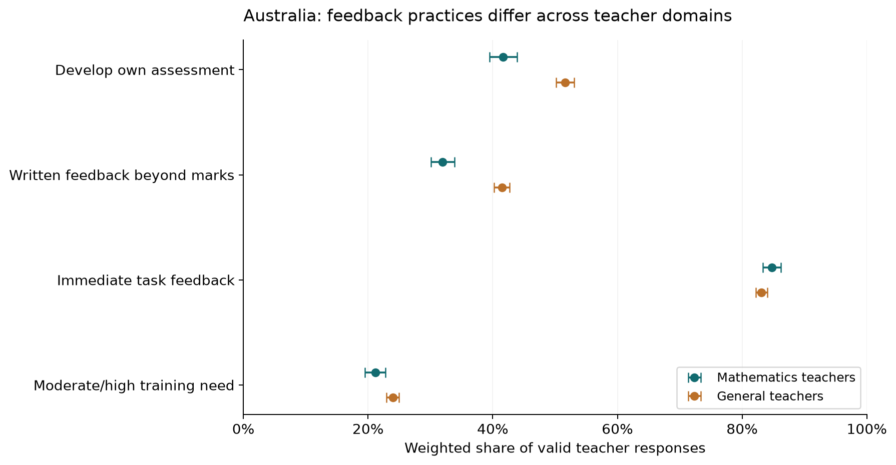

# PISA 2022: assessment practices provide context, but the local files cannot validate student early warnings

The local snapshot has **68,054 teacher respondents**, **21,629 school respondents** and an earlier-cycle **1,447,787-row ESCS trend export**. It does not include student assessment submissions, deadlines, score availability or later academic outcomes linked to early behavior. Direct student warning validation is therefore unsupported. The completed contextual investigation uses verified item meanings to examine recording practices, feedback and assessment-development needs, rather than substituting a generic socioeconomic profile.

In the illustrative **Australia mathematics-teacher domain**, weighted reported immediate feedback in most/every lesson is **84.8%**, versus **32.0%** for written feedback beyond marks. On the same **3,446** common valid respondents, the executed paired difference is **52.8 percentage points**, 95% Fay-BRR interval **[50.8, 54.9]**. That describes different teacher practices, not a causal effect on student risk or a verified record of timely support.

## Feedback form matters for an assessment-warning workflow

*Australia only; mathematics/general-teacher sampling domains remain separate. Practice success is most/every lesson; need is moderate/high. Whiskers: normal 95% intervals from 80 Fay-BRR replicates (factor 0.5); denominators vary by item. Source: `results/practice_estimates.csv`.*

[SVG figure](figures/teacher_feedback_domains.svg) · [Plotted data](figures/teacher_feedback_domains.csv)

*Australia common valid respondents within each teacher domain; paired differences retain covariance under 80 Fay-BRR replicates. Whiskers are normal 95% intervals, exploratory and not multiplicity-adjusted. This is practice context, not student warning validation. Source: `results/paired_feedback.csv`.*

[SVG figure](figures/paired_feedback_gap.svg) · [Plotted data](figures/paired_feedback_gap.csv)

| source | teacher_type | meaning | n | valid_n | weighted | unweighted | lo | hi |
|---|---|---|---|---|---|---|---|---|
| teacher | 1.000 | Develop own assessment | 3554 | 3451 | 0.417 | 0.411 | 0.394 | 0.439 |
| teacher | 1.000 | Written feedback beyond marks | 3554 | 3451 | 0.320 | 0.324 | 0.301 | 0.338 |
| teacher | 1.000 | Immediate task feedback | 3554 | 3454 | 0.848 | 0.841 | 0.833 | 0.862 |
| teacher | 1.000 | Moderate/high assessment training need | 3554 | 3437 | 0.211 | 0.201 | 0.195 | 0.228 |
| teacher | 2.000 | Develop own assessment | 7843 | 7570 | 0.516 | 0.526 | 0.502 | 0.531 |
| teacher | 2.000 | Written feedback beyond marks | 7843 | 7573 | 0.415 | 0.424 | 0.402 | 0.427 |
| teacher | 2.000 | Immediate task feedback | 7843 | 7582 | 0.831 | 0.834 | 0.822 | 0.840 |
| teacher | 2.000 | Moderate/high assessment training need | 7843 | 7561 | 0.239 | 0.232 | 0.229 | 0.250 |
| school | 0.000 | Teacher-developed tests monthly or more | 743 | 605 | 0.555 | 0.653 | — | — |
| school | 0.000 | Systematic recording of results | 743 | 610 | 0.990 | 0.990 | — | — |
| school | 0.000 | Teacher tests guide learning | 743 | 594 | 0.985 | 0.988 | — | — |
| school | 0.000 | Teacher tests adapt instruction | 743 | 593 | 0.934 | 0.944 | — | — |

The mathematics and general-teacher populations are distinct sampling domains. The general-teacher Australian paired gap is 41.6 percentage points, also positive. Comparing on common respondents rules out different item missingness as the sole explanation for this particular within-domain gap. It does not adjust away school context, self-report bias or different lesson tasks.

| country | teacher_type | comparison | n | valid_n | weighted | unweighted | se | lo | hi | weight_sum |
|---|---|---|---|---|---|---|---|---|---|---|
| AUS | 1.000 | Immediate minus written feedback | 3554 | 3446 | 0.528 | 0.517 | 0.010 | 0.508 | 0.549 | 11785.796 |
| AUS | 2.000 | Immediate minus written feedback | 7843 | 7562 | 0.416 | 0.409 | 0.008 | 0.401 | 0.431 | 58543.994 |

Both types of feedback can be useful, but immediate oral/task feedback may leave no submission-level historical record, while written feedback does not establish when its grade became available. These surveys cannot determine the availability times needed to prevent early-warning leakage.

## Reported result recording is not the actual student log

In Australia, 99.0% of valid school-base-weighted reports indicate systematic recording of test results/graduation rates, 98.5% report using teacher-developed tests to guide learning, and 93.4% adapting instruction using those tests. These school indicators show contextual infrastructure, not evidence that the local dataset supplies any student's ordered assessment history. The school and teacher estimands differ and are not joined as if they measured the same students.

| country | meaning | n | valid_n | weighted | unweighted | uncertainty |
|---|---|---|---|---|---|---|
| AUS | Teacher-developed tests monthly or more | 743 | 605 | 0.555 | 0.653 | No school replicate weights supplied; descriptive only |
| AUS | Systematic recording of results | 743 | 610 | 0.990 | 0.990 | No school replicate weights supplied; descriptive only |
| AUS | Teacher tests guide learning | 743 | 594 | 0.985 | 0.988 | No school replicate weights supplied; descriptive only |
| AUS | Teacher tests adapt instruction | 743 | 593 | 0.934 | 0.944 | No school replicate weights supplied; descriptive only |

School points use the supplied **grade-nonresponse-adjusted school base weight** (`W_SCHGRNRABWT`), not a final student weight or a teacher weight. No school replicate weights are supplied in this local file, so school intervals are **NOT VERIFIED** and are deliberately not fabricated. School estimates are weighted descriptive context, with valid-response denominators that can differ across items. Country-specific survey participation/response quality can further constrain national interpretation.

## Assessment training needs remain a separate context measure

Australian weighted moderate/high assessment-practice development need is 21.1% among mathematics teachers and 23.9% among general teachers. The executed conditional follow-up compares training need by frequency of written feedback using common valid item responses; this describes an association, not whether professional learning changes student outcomes.

| country | teacher_type | written_feedback | n | valid_n | weighted | unweighted | se | lo | hi | weight_sum |
|---|---|---|---|---|---|---|---|---|---|---|
| AUS | 1.000 | less often | 3554 | 2310 | 0.210 | 0.200 | 0.010 | 0.191 | 0.229 | 7950.082 |
| AUS | 1.000 | most/every lesson | 3554 | 1104 | 0.213 | 0.203 | 0.017 | 0.180 | 0.246 | 3729.933 |
| AUS | 2.000 | less often | 7843 | 4315 | 0.236 | 0.235 | 0.007 | 0.222 | 0.250 | 33948.677 |
| AUS | 2.000 | most/every lesson | 7843 | 3167 | 0.244 | 0.228 | 0.008 | 0.228 | 0.261 | 23992.487 |

The dashboard exposes every available country/domain estimate and uncertainty, with a clear empty state when optional teacher data is absent. No across-country ranking, pooled global teacher mean or causal interpretation is inferred. All country/domain contrasts are exploratory; normal 95% intervals are not adjusted for selecting among multiple comparisons and do not account for systematic self-report or nonresponse bias.

## Verified codebooks and weights prevent invented constructs

| source | field | label | codes |
|---|---|---|---|
| teacher | TC054Q01NA | How often? I develop and administer my own assessment. | {"1.0": "Never or almost never", "2.0": "Some lessons", "3.0": "Most lessons", "4.0": "Every lesson or almost every lesson", "95.0": "Valid Skip", "97.0": "Not Applicable", "98.0": "Invalid", "99.0": "No Response"} |
| teacher | TC054Q04NA | How often: I provide written feedback on student work in addition to a [mark, i.e. numeric score or letter grade]. | {"1.0": "Never or almost never", "2.0": "Some lessons", "3.0": "Most lessons", "4.0": "Every lesson or almost every lesson", "95.0": "Valid Skip", "97.0": "Not Applicable", "98.0": "Invalid", "99.0": "No Response"} |
| teacher | TC054Q06NA | How often: I observe students when working on particular tasks and provide immediate feedback. | {"1.0": "Never or almost never", "2.0": "Some lessons", "3.0": "Most lessons", "4.0": "Every lesson or almost every lesson", "95.0": "Valid Skip", "97.0": "Not Applicable", "98.0": "Invalid", "99.0": "No Response"} |
| teacher | TC185Q04HA | Degree you need professional development in: Student assessment practices | {"1.0": "No need at present", "2.0": "Low level of need", "3.0": "Moderate level of need", "4.0": "High level of need", "95.0": "Valid Skip", "97.0": "Not Applicable", "98.0": "Invalid", "99.0": "No Response"} |
| school | SC034Q03TA | How often students assessed by: Teacher-developed tests | {"1.0": "Never", "2.0": "1-2 times a year", "3.0": "3-5 times a year", "4.0": "Monthly", "5.0": "More than once a month", "95.0": "Valid Skip", "97.0": "Not Applicable", "98.0": "Invalid", "99.0": "No Response"} |
| school | SC037Q06NA | Exist at your school: Systematic recording of student test results and graduation rates | {"1.0": "Yes, this is mandatory, e.g. based on district or ministry policies", "2.0": "Yes, based on school initiative", "3.0": "No", "95.0": "Valid Skip", "97.0": "Not Applicable", "98.0": "Invalid", "99.0": "No Response"} |
| school | SC035Q01NB | How student tests are used: Teacher-developed tests: To guide students' learning | {"1.0": "Yes", "2.0": "No", "5.0": "Valid Skip", "7.0": "Not Applicable", "8.0": "Invalid", "9.0": "No Response"} |
| school | SC035Q09NB | How student tests are used: Teacher-developed tests: To adapt teaching to the students' needs | {"1.0": "Yes", "2.0": "No", "5.0": "Valid Skip", "7.0": "Not Applicable", "8.0": "Invalid", "9.0": "No Response"} |

Teacher practice items use valid categories 1–4, with 3/4 meaning most/every lesson. Training need uses 3/4 for moderate/high need. School teacher-developed-test frequency uses monthly/more-than-monthly categories 4/5; result recording uses categories 1/2 versus no=3; teacher-test guidance/adaptation uses yes=1 versus no=2. Special skip/not-applicable/invalid/no-response codes are retained in `missing_codes.csv` and excluded from item denominators; they are not recoded as zero practice.

Teacher points use final `W_FTCHWT`; 80 `W_FTCHRWT` replicates and Fay factor 0.5 give variance **4/80 × sum((replicate − full estimate)²)**. The paired feedback calculation uses difference indicators on the same respondents and replicate weights, retaining covariance. No plausible achievement values are averaged because no achievement target is present in these local questionnaires.

## The ESCS export is not 2022 student outcome evidence

The local ReadMe and full streamed coverage check show that the ESCS trend export contains **cycles 5/6/7 = 2012/2015/2018**, with socioeconomic index components but no achievement outcome or survey weights. It is not a 2022 student questionnaire, and its historical school/student IDs cannot be silently joined to 2022 questionnaire IDs. This is a precise input-scope limitation, not a reason to build an unrelated socioeconomic-risk model.

| cycle | year | countries | rows | escs_valid_n |
|---|---|---|---|---|
| 5 | 2012 | 58 | 453304 | 446717 |
| 6 | 2015 | 61 | 439102 | 424498 |
| 7 | 2018 | 71 | 555381 | 541841 |

All 1,447,787 trend rows were streamed to validate actual cycle/country coverage. The contextual survey analysis reads all relevant school/teacher rows and selected fields, not a small arbitrary sample. Source SPSS embedded labels verify substantive field semantics and category codes. Source keys and respondent totals reconcile; an independent weighted-rate calculation matches the primary result.

## Timing and project question coverage

| Quantity / question | Available evidence | Warning boundary |
|---|---|---|
| Student early behavior versus later academic risk | No linked timed student assessments or later academic results | Unsupported |
| Warning cutoff and lead time | Cross-sectional practice reports only | No event/score-release/outcome windows |
| Added value beyond prior marks | No individual score history or future target | Unsupported |
| Misses, false flags and review volume | No valid student labels | Unsupported |
| Assessment-practice infrastructure | Verified school recording/test-use and teacher feedback/need items | Completed context, not validated warnings |

The next meaningful evidence is timed student-level events, individual obligations and future academic results from a compatible authorized source. These reports can contextualize a warning implementation; they cannot validate an alert merely because a school reports maintaining records.

## Scope, verification and handoff

Status: **feasibility assessment; completed assessment-practice contextual investigation**. The requested early-academic-risk objective is preserved; narrower evidence does not justify a substitute risk label or an unrelated ranking. Definitions not supplied by the user are proposed operationalizations. Stakeholder acceptance remains **PENDING**; no intervention exists, so intervention outcome evaluation is **NOT APPLICABLE**.

5 numerical/data checks passed in `results/verification.csv`. Checks include the quantities actually computed, with their expected conditions and methods; they do not verify missing real-world evidence. Remaining evidence boundaries:

| check | observed | consequence |
|---|---|---|
| student assessment trajectory and future outcome | No linked student submission/deadline/outcome table in local snapshot | Context-only; no academic-risk model |
| school design-based uncertainty | No school replicate weights in supplied school file | School weighted points are descriptive; no fabricated CI |

Source CSVs are unchanged. `source_manifest.csv` identifies actual local inputs; preserved source metadata and exact dependency versions support reproduction. [Open the local dashboard](dashboard/index.html), [reproduce the analysis](README.md), or inspect [the criterion and reader-task review](QUALITY_REVIEW.md). Browser interaction, mobile rendering, local links and display reconciliation are documented in `evidence/browser-review.json`; screenshots preserve actual inspection. Those checks validate delivery, not causality, stakeholder approval or live alert effectiveness.

Metadata sources accessed 13 October 2026: [OECD PISA database](https://www.oecd.org/en/data/datasets/pisa-2022-database.html), embedded SPSS codebooks and local ESCS ReadMe, and the [official replication methodology](https://www.oecd.org/content/dam/oecd/en/publications/reports/2024/03/pisa-2022-technical-report_599753f0/01820d6d-en.pdf). Original local acquisition dates and per-field vintages are not invented.
