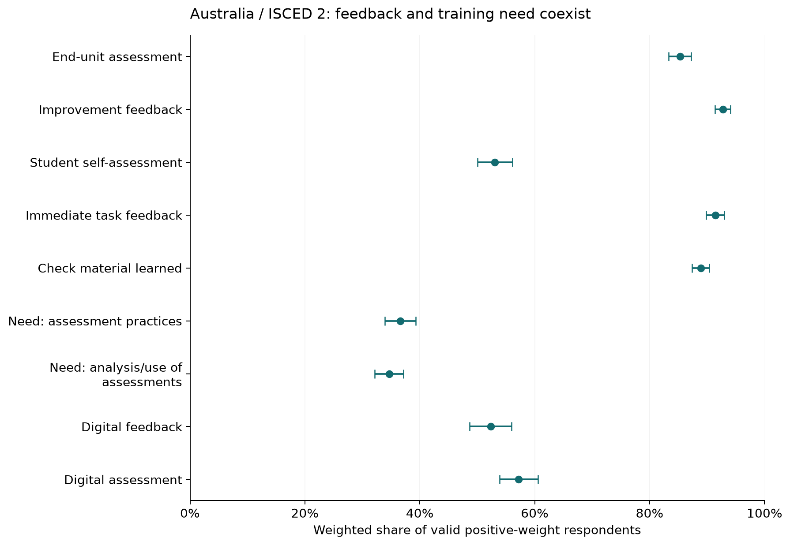
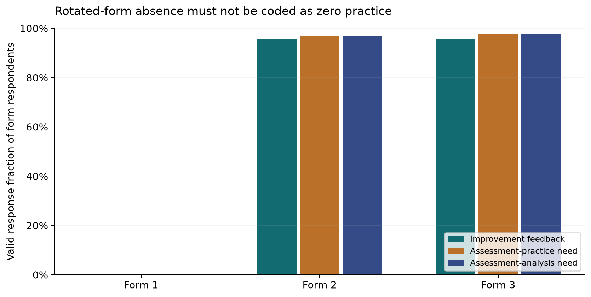

# TALIS 2024: frequent assessment feedback coexists with training needs; student early-warning validity is unobservable

The local teacher files contain **278,383 respondents**, exactly matching the combined export's respondent keys, levels and selected assessment-practice items. The level files and combined file are overlapping exports and are **not concatenated as independent samples**. The lower-secondary teacher file has 194,521 respondents across 55 education-system codes, with additional level-1/3 domains. The files contain cross-sectional teacher/principal reports, not student assessment events and later linked results; therefore direct academic-risk warning, lead time and alert accuracy cannot be estimated.

A bounded assessment-practice context study is nevertheless supported. In the illustrative **Australia / ISCED 2** domain, **92.7%** of valid weighted respondents report frequent/always improvement feedback, while **53.1%** report student self-assessment and **52.3%** digital feedback. High feedback prevalence does not mean that a school has the event histories or outcome linkage required for warning analytics.

## Practice differences are substantive, not identifier counts

*Australia lower-secondary teachers; practice success is frequent/always, need is moderate/high. Whiskers: normal 95% intervals using 100 Fay-BRR replicates (factor 0.5). Item-specific denominators differ; adjudication rating 2 (fair). Source: `results/practice_estimates.csv`.*

[SVG figure](figures/assessment_practices_and_need.svg) · [Plotted data](figures/assessment_practices_and_need.csv)

| item | meaning | n | valid_n | weighted | unweighted | lo | hi | adjudication |
|---|---|---|---|---|---|---|---|---|
| TT4G53A | End-unit assessment | 3035 | 1600 | 0.853 | 0.851 | 0.833 | 0.872 | 2 |
| TT4G53C | Improvement feedback | 3035 | 1599 | 0.927 | 0.929 | 0.914 | 0.941 | 2 |
| TT4G53D | Student self-assessment | 3035 | 1597 | 0.531 | 0.524 | 0.500 | 0.561 | 2 |
| TT4G53E | Immediate task feedback | 3035 | 1599 | 0.914 | 0.911 | 0.899 | 0.930 | 2 |
| TT4G53F | Check material learned | 3035 | 1596 | 0.889 | 0.885 | 0.874 | 0.904 | 2 |
| TT4G24D | Need: assessment practices | 3035 | 1816 | 0.366 | 0.369 | 0.339 | 0.393 | 2 |
| TT4G24M | Need: analysis/use of assessments | 3035 | 1817 | 0.346 | 0.348 | 0.321 | 0.372 | 2 |
| TT4G52C | Digital feedback | 3035 | 1602 | 0.523 | 0.525 | 0.487 | 0.560 | 2 |
| TT4G52I | Digital assessment | 3035 | 1601 | 0.572 | 0.575 | 0.539 | 0.606 | 2 |

Assessment-practice percentages use valid responses 1–4, with 3/4 indicating frequent/always use; professional-learning need percentages use 3/4 for moderate/high need. The units and denominators differ from a student risk rate. In Australia/ISCED 2, assessment-practice training need is **36.6%** and need in analysis/use of assessments **34.6%**. These areas are relevant to reviewing an early-warning workflow, but do not identify students or prove that training prevents academic failure.

The executed paired follow-up compares immediate task feedback with improvement feedback on the **same 1,595 valid respondents**, rather than subtracting rates from different item samples. The difference is **-1.2 percentage points**, 95% Fay-BRR interval **[-3.0, 0.6]**. It includes zero; this comparison does not establish that one form is more prevalent in this domain. Other practice gaps, including digital feedback and self-assessment, are visible in the full country/level table and dashboard without selecting countries for a ranking.

| country | level | comparison | n | valid_n | weighted | unweighted | se | lo | hi | weight_sum |
|---|---|---|---|---|---|---|---|---|---|---|
| AUS | 2 | Immediate minus improvement feedback | 3035 | 1595 | -0.012 | -0.018 | 0.009 | -0.030 | 0.006 | 63473.244 |

## Rotated questionnaire missingness can halve a naive prevalence

*Fixed full local ISCED-2 extract across all systems, not Australia only. Each bar divides valid item responses by that form’s respondents; zero valid responses on Form 1 indicates design/routing absence, not zero feedback. Source: `results/form_coverage.csv`.*

[SVG figure](figures/rotated_form_coverage.svg) · [Plotted data](figures/rotated_form_coverage.csv)

In the Australian reference domain, 1,599/3,035 teachers have a valid improvement-feedback response. The item is not administered identically on all forms. Among valid responses, the unweighted frequent/always proportion is **92.9%**; treating every absent/nonvalid response as “does not provide feedback” would yield **48.9%**. That naive number is invalid because it converts questionnaire design and nonresponse into behavior.

| level | form | item | rows | valid_n | valid_fraction |
|---|---|---|---|---|---|
| 2 | 1 | TT4G53C | 64904 | 0 | 0.000 |
| 2 | 2 | TT4G53C | 64836 | 61931 | 0.955 |
| 2 | 3 | TT4G53C | 64781 | 62074 | 0.958 |
| 2 | 1 | TT4G24D | 64904 | 0 | 0.000 |
| 2 | 2 | TT4G24D | 64836 | 62794 | 0.969 |
| 2 | 3 | TT4G24D | 64781 | 63190 | 0.975 |
| 2 | 1 | TT4G24M | 64904 | 0 | 0.000 |
| 2 | 2 | TT4G24M | 64836 | 62740 | 0.968 |
| 2 | 3 | TT4G24M | 64781 | 63194 | 0.976 |

Across the local lower-secondary extract, form 1 has **zero valid responses** for these selected items, while forms 2/3 have high valid-response coverage. The pipeline retains nonvalid codes, does not impute missing-by-design values, and computes each estimate only from valid positive-weight respondents. The form table is observed coverage; the full item routing for each individual is not reconstructed. This remaining limitation is stated rather than labeling all missing values item nonresponse.

## Frequent feedback does not imply no training need

The executed common-respondent comparison estimates moderate/high training need separately by reported feedback use. In Australia/ISCED 2, assessment-practice need is about 36% both among teachers giving feedback frequently and among those doing so less often. The less-frequent group has only 113 common valid respondents, with much wider uncertainty. These are exploratory associations conditional on available form/item responses, not evidence that feedback has no effect or that professional learning is unnecessary.

| country | level | need_item | need_meaning | feedback_group | n | valid_n | weighted | unweighted | se | lo | hi | weight_sum |
|---|---|---|---|---|---|---|---|---|---|---|---|---|
| AUS | 2 | TT4G24D | assessment practices | never/occasionally | 3035 | 113 | 0.363 | 0.407 | 0.040 | 0.284 | 0.442 | 4588.215 |
| AUS | 2 | TT4G24D | assessment practices | frequent/always | 3035 | 1478 | 0.367 | 0.367 | 0.015 | 0.339 | 0.396 | 58692.120 |
| AUS | 2 | TT4G24M | analysis/use of assessments | never/occasionally | 3035 | 113 | 0.319 | 0.327 | 0.042 | 0.236 | 0.401 | 4580.471 |
| AUS | 2 | TT4G24M | analysis/use of assessments | frequent/always | 3035 | 1479 | 0.350 | 0.349 | 0.014 | 0.323 | 0.378 | 58706.651 |

Selection, self-report, school context and common causes can influence both reported practices and training needs. No student academic-risk outcome is present to assess whether either measure predicts or prevents failure.

## Country, level, weights and adjudication stay separate

| CNTRY | IDCNTPOP | IDPOP | teachers | schools | adjudication |
|---|---|---|---|---|---|
| ALB | ALB2 | 2 | 4029 | 282 | 3 |
| ARE | ARE1 | 1 | 4091 | 206 | 3 |
| ARE | ARE2 | 2 | 4369 | 212 | 3 |
| ARE | ARE3 | 3 | 4228 | 200 | 3 |
| AUS | AUS1 | 1 | 3003 | 178 | 2 |
| AUS | AUS2 | 2 | 3035 | 179 | 2 |
| AUT | AUT2 | 2 | 4335 | 247 | 3 |
| AZE | AZE2 | 2 | 4307 | 222 | 3 |
| BEL | BEL1 | 1 | 4913 | 326 | 2 |
| BEL | BEL2 | 2 | 5175 | 273 | 2 |
| BFL | BFL1 | 1 | 2258 | 146 | 0 |
| BFL | BFL2 | 2 | 2444 | 143 | 1 |
| BFL | BFL3 | 3 | 2427 | 141 | 1 |
| BFR | BFR1 | 1 | 2655 | 180 | 3 |
| BFR | BFR2 | 2 | 2731 | 130 | 3 |
| BGR | BGR2 | 2 | 3629 | 210 | 3 |
| BHR | BHR2 | 2 | 3104 | 116 | 3 |
| BRA | BRA1 | 1 | 2994 | 279 | 3 |
| BRA | BRA2 | 2 | 3009 | 207 | 3 |
| CAB | CAB2 | 2 | 1823 | 153 | 0 |
| CHL | CHL2 | 2 | 2319 | 353 | 2 |
| COL | COL2 | 2 | 3010 | 213 | 2 |
| CRI | CRI2 | 2 | 3026 | 187 | 3 |
| CSH | CSH2 | 2 | 4078 | 205 | 3 |
| CYP | CYP2 | 2 | 1793 | 99 | 3 |
| CZE | CZE2 | 2 | 6369 | 346 | 3 |
| DNK | DNK2 | 2 | 2488 | 189 | 2 |
| DNK | DNK3 | 3 | 2550 | 179 | 2 |
| ESP | ESP1 | 1 | 8060 | 500 | 3 |
| ESP | ESP2 | 2 | 9098 | 507 | 3 |
| EST | EST2 | 2 | 3339 | 199 | 3 |
| FIN | FIN2 | 2 | 4300 | 226 | 3 |
| FRA | FRA1 | 1 | 1993 | 291 | 3 |
| FRA | FRA2 | 2 | 2877 | 161 | 3 |
| HRV | HRV2 | 2 | 3163 | 268 | 3 |
| HRV | HRV3 | 3 | 3497 | 192 | 3 |
| HUN | HUN2 | 2 | 3890 | 235 | 3 |
| ISL | ISL2 | 2 | 1427 | 131 | 3 |
| ISR | ISR2 | 2 | 3227 | 196 | 3 |
| ITA | ITA2 | 2 | 3874 | 200 | 3 |
| JPN | JPN1 | 1 | 3356 | 202 | 3 |
| JPN | JPN2 | 2 | 3558 | 201 | 3 |
| KAZ | KAZ2 | 2 | 7360 | 377 | 3 |
| KOR | KOR1 | 1 | 3124 | 184 | 2 |
| KOR | KOR2 | 2 | 3098 | 169 | 2 |
| LTU | LTU2 | 2 | 4223 | 210 | 3 |
| LVA | LVA2 | 2 | 4088 | 215 | 3 |
| MAR | MAR1 | 1 | 4905 | 394 | 3 |
| MAR | MAR2 | 2 | 6112 | 398 | 3 |
| MKD | MKD2 | 2 | 3992 | 202 | 3 |
| MLT | MLT2 | 2 | 2263 | 48 | 3 |
| MNE | MNE2 | 2 | 1354 | 126 | 3 |
| NLD | NLD1 | 1 | 1305 | 140 | 0 |
| NLD | NLD2 | 2 | 1271 | 84 | 0 |
| NOR | NOR2 | 2 | 1528 | 112 | 0 |
| NZL | NZL1 | 1 | 1529 | 130 | 0 |
| NZL | NZL2 | 2 | 1204 | 97 | 0 |
| POL | POL2 | 2 | 3783 | 279 | 3 |
| PRT | PRT2 | 2 | 3511 | 224 | 3 |
| PRT | PRT3 | 3 | 3878 | 203 | 3 |
| ROU | ROU2 | 2 | 3873 | 216 | 3 |
| SAU | SAU1 | 1 | 3783 | 218 | 3 |
| SAU | SAU2 | 2 | 3306 | 326 | 3 |
| SAU | SAU3 | 3 | 3952 | 226 | 3 |
| SGP | SGP2 | 2 | 3355 | 156 | 3 |
| SRB | SRB2 | 2 | 4007 | 199 | 3 |
| SVK | SVK2 | 2 | 4190 | 242 | 3 |
| SVN | SVN1 | 1 | 3615 | 220 | 3 |
| SVN | SVN2 | 2 | 2831 | 222 | 3 |
| SVN | SVN3 | 3 | 2717 | 113 | 3 |
| SWE | SWE2 | 2 | 3065 | 196 | 3 |
| TUR | TUR1 | 1 | 4053 | 232 | 3 |
| TUR | TUR2 | 2 | 4932 | 229 | 3 |
| TUR | TUR3 | 3 | 4976 | 201 | 3 |
| USA | USA2 | 2 | 1988 | 154 | 1 |
| UZB | UZB2 | 2 | 4431 | 210 | 3 |
| VNM | VNM2 | 2 | 4348 | 202 | 3 |
| XKX | XKX2 | 2 | 3281 | 222 | 3 |
| ZAF | ZAF2 | 2 | 3301 | 361 | 3 |

The dashboard filters country/system and ISCED 1/2/3. A country-level combination absent from the local files produces an explicit empty state, not zero practice. Level 1/2/3 populations are not assumed to be the same teachers. No pooled “global teacher rate” is reported. Final `TCHWGT` is used for teacher estimands; 100 `TRWGT` replicate weights with Fay factor 0.5 give variance **4/100 × sum((replicate − full estimate)²)**. Paired differences use the same replicate weights on common respondents, preserving covariance. Reported 95% intervals are normal approximations, unadjusted for multiple exploratory comparisons; they do not include measurement/nonresponse bias.

`ADJRT24` is a **data adjudication rating**, not a rotated-questionnaire adjustment weight: 0 insufficient, 1 poor, 2 fair, 3 good. Its meaning was verified before using the field. The dashboard shows it beside every teacher estimate; rating 0 populations remain descriptive and cannot support confident national inference. School/principal files were inspected for scope but not joined to create student labels or repeat teacher observations:

| file | rows | fields | country_populations | duplicate_school_keys |
|---|---|---|---|---|
| acgintt4.csv | 3846 | 480 | 16 | 0 |
| bcgintt4.csv | 11622 | 473 | 55 | 0 |
| ccgintt4.csv | 1411 | 473 | 8 | 0 |

## Preparation, timing and question coverage

| Element | Operational definition | Warning relevance |
|---|---|---|
| Unit | Teacher within country/system and ISCED population | Cross-sectional context, not a student trajectory |
| Practices | TT4G53A/C/D/E/F and TT4G52C/I, valid 1–4; success 3/4 | Reported frequency; no observed student submission timestamp |
| Training needs | TT4G24D/M, valid 1–4; success 3/4 | Current moderate/high need, not later academic risk |
| Weight / variance | TCHWGT; TRWGT1–100; Fay 0.5 | Design-aware country/level estimates and paired contrasts |
| Eligibility | Valid item and positive final weight | Missing/form routing not converted to zero |
| Target / cutoff / outcome window | Not available for individual students | Early-warning validation, support lead time and alert workload blocked |

CSV delimiters were verified as semicolons. Keys combine population, school and teacher identifiers; no raw names or identifiable respondent rows appear in public outputs. All level teacher rows were analyzed with selected items/replicate weights. Extracted-file CRCs were checked against the supplied archive, and the combined export was reconciled to the three level extracts on every respondent and selected item. A first comparison failed because column order differed; explicitly aligning columns fixed the comparison without changing values. Source hashes and an independent weighted-proportion calculation support reproducibility.

The project questions about early student behavior, warning timing, added prior-score value and error workload remain unsupported because linkage and future student outcomes are absent. The supported practice/training/form-design investigation is complete, and identifies infrastructure and measurement issues to resolve before using teacher survey context in a separate prospective warning study.

## Scope, verification and handoff

Status: **feasibility assessment; completed country/level assessment-practice contextual investigation**. The requested early-academic-risk objective is preserved; narrower evidence does not justify a substitute risk label or an unrelated ranking. Definitions not supplied by the user are proposed operationalizations. Stakeholder acceptance remains **PENDING**; no intervention exists, so intervention outcome evaluation is **NOT APPLICABLE**.

11 numerical/data checks passed in `results/verification.csv`. Checks include the quantities actually computed, with their expected conditions and methods; they do not verify missing real-world evidence. Remaining evidence boundaries:

| check | observed | consequence |
|---|---|---|
| student future risk linkage | Teachers/principals surveyed once, no student event/outcome linkage | No student early-warning model or causal practice effect supported |
| absence versus form-assigned missingness | Questionnaire form IDs and nonvalid codes retained; full routing not reconstructed | Nonresponse/by-design missingness not equated; complete-case conditional estimates |

Source CSVs are unchanged. `source_manifest.csv` identifies actual local inputs; preserved source metadata and exact dependency versions support reproduction. [Open the local dashboard](dashboard/index.html), [reproduce the analysis](README.md), or inspect [the criterion and reader-task review](QUALITY_REVIEW.md). Browser interaction, mobile rendering, local links and display reconciliation are documented in `evidence/browser-review.json`; screenshots preserve actual inspection. Those checks validate delivery, not causality, stakeholder approval or live alert effectiveness.

Metadata sources accessed 13 October 2026: [OECD teacher questionnaire, pp. 14/33–34](https://www.oecd.org/content/dam/oecd/en/about/programmes/edu/talis/talis2024questionnaires/TALIS2024TeacherQuestionnaireISCED1-2-3.pdf), [official BRR/adjudication guide](https://one.oecd.org/document/EDU/TALIS/GB%282025%299/en/pdf), and [official weighting/rotation notes](https://www.oecd.org/en/publications/results-from-talis-2024_90df6235-en/full-report/technical-notes-on-analyses-in-this-volume_286d707e.html). Original local acquisition dates and per-field vintages are not invented.
