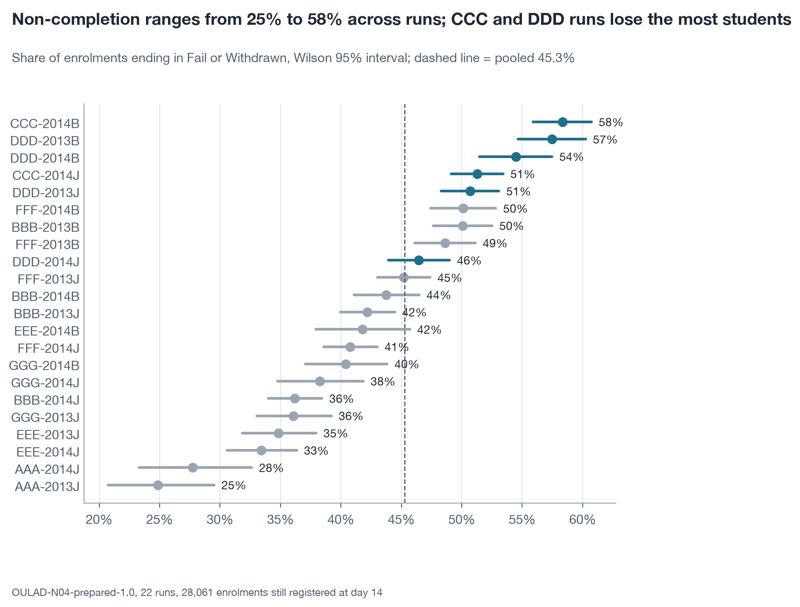
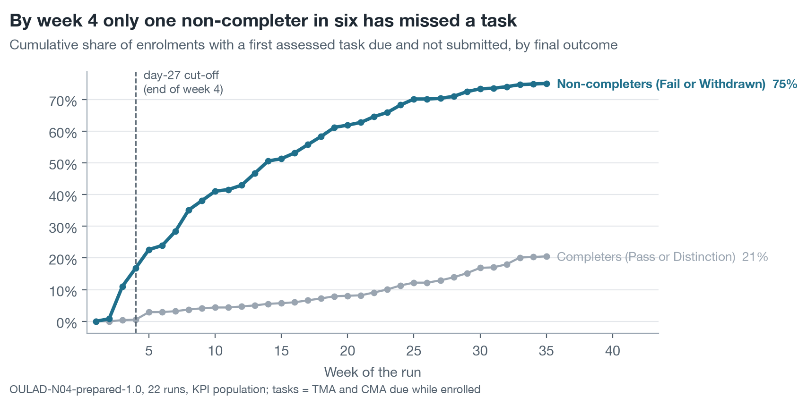

# AQ1 – 45% of enrolments still registered at day 14 do not complete, from 25% to 58% by run, and most non-completers have missed no task by week 4

*Milestone 4, Level 2 prototype · team N04 · descriptive question (AQ1) · 22 runs of 7 modules, 2013–2014 ·
28,061 enrolments still registered at day 14 (the KPI population) · run 11 November 2026 (UTC)*

> **Summary.** Of the 28,061 enrolments still registered at day 14, 12,700 (45.3%, 95% interval 44.7 to 45.8) ended
> in Fail (25.0%) or Withdrawn (20.2%). The rate differs far more between modules and runs than between years: it
> runs from 24.9% in AAA-2013J to 58.3% in CCC-2014B, and February runs lose 8.4 points more than October runs
> (50.4% against 42.0%), while 2013 and 2014 are alike (45.7% and 44.9%). Three in four non-completers eventually
> miss an assessed task, but late: half of those first misses come after week 9, and by the end of week 4 only 16.8%
> of non-completers have missed one. A week-4 contact list therefore cannot rest on missed tasks alone. Both
> aggregation paths, the prepared view and the raw OULAD tables, agree to the enrolment in all 22 runs.
> **Status:** complete descriptive analysis; full population of the dataset, so intervals describe precision of a
> rate, not sampling from a wider population.

| Non-completion, KPI population | Lowest and highest run | February against October runs | Non-completers with a missed task by week 4 | Aggregation paths |
| :---- | :---- | :---- | :---- | :---- |
| **45.3%** (12,700 of 28,061) | **24.9%** to **58.3%** | **50.4%** against **42.0%** | **16.8%** | agree in **22 of 22** runs |

## 1. Module and start month matter; the year does not

**Table 1. Non-completion rate (Fail or Withdrawn) of enrolments registered at day 14, with Wilson 95% intervals**

| Level | Group | Enrolments | Non-completers | Rate | 95% interval |
| :---- | :---- | :---- | :---- | :---- | :---- |
| All runs | – | 28,061 | 12,700 | 45.3% | 44.7 to 45.8 |
| Year | 2013 (9 runs) | 12,076 | 5,515 | 45.7% | 44.8 to 46.6 |
| | 2014 (13 runs) | 15,985 | 7,185 | 44.9% | 44.2 to 45.7 |
| Start month | February (B) | 10,977 | 5,531 | 50.4% | 49.5 to 51.3 |
| | October (J) | 17,084 | 7,169 | 42.0% | 41.2 to 42.7 |
| Module | AAA | 720 | 189 | 26.3% | 23.2 to 29.6 |
| | BBB | 6,537 | 2,797 | 42.8% | 41.6 to 44.0 |
| | CCC | 3,670 | 1,994 | 54.3% | 52.7 to 55.9 |
| | DDD | 5,401 | 2,796 | 51.8% | 50.4 to 53.1 |
| | EEE | 2,573 | 924 | 35.9% | 34.1 to 37.8 |
| | FFF | 6,713 | 3,067 | 45.7% | 44.5 to 46.9 |
| | GGG | 2,447 | 933 | 38.1% | 36.2 to 40.1 |

The intervals of 2013 and 2014 overlap, so the two years do not differ in a way the data can show. The February
effect holds in both years (51.6% against 42.4% in 2013; 49.6% against 41.6% in 2014) and inside each of the six
modules that have both start months, by 3.4 to 8.0 points (`results/rates_module_by_start_month_all.csv`). Modules lose students in different ways (Table 2): CCC loses a third of its students to
withdrawal, the highest share of any module, while GGG loses few to withdrawal (8.4%) and many to failure (29.7%).

**Table 2. Outcome shares by module, KPI population**

| Module | Enrolments | Distinction | Pass | Fail | Withdrawn |
| :---- | :---- | :---- | :---- | :---- | :---- |
| All runs | 28,061 | 10.8% | 44.0% | 25.0% | 20.2% |
| AAA | 720 | 6.1% | 67.6% | 12.4% | 13.9% |
| BBB | 6,537 | 10.3% | 46.9% | 26.9% | 15.9% |
| CCC | 3,670 | 13.6% | 32.1% | 21.3% | 33.1% |
| DDD | 5,401 | 7.1% | 41.1% | 26.1% | 25.7% |
| EEE | 2,573 | 13.8% | 50.3% | 21.8% | 14.1% |
| FFF | 6,713 | 10.0% | 44.3% | 25.4% | 20.3% |
| GGG | 2,447 | 16.2% | 45.7% | 29.7% | 8.4% |

For decision D2 (where advisors' time goes), the runs to look at first are the CCC and DDD runs and the February runs
in general. A run-level rate says where non-completion is concentrated, not why.

## 2. The denominator moves the headline rate by 7.5 points

The Level 1 card names a second denominator as a baseline: all 32,593 enrolments instead of the 28,061 still
registered at day 14.

**Table 3. The same rate under three denominators**

| Denominator | Enrolments | Non-completers | Rate |
| :---- | :---- | :---- | :---- |
| Registered at day 14 (KPI population) | 28,061 | 12,700 | 45.3% |
| All enrolments | 32,593 | 17,208 | 52.8% |
| KPI population without the 99 flagged enrolments | 27,962 | 12,602 | 45.1% |

Counting all enrolments adds the 4,532 enrolments not registered at day 14, of which 4,508 ended in Fail or
Withdrawn (most left before the start or in the first two weeks), and raises the rate by 7.5 points. The shift is uneven: from 1.7 points (GGG-2013J) to 13.6 points
(BBB-2014J), and in 17 of 22 runs the all-enrolment rate lies outside the interval of the KPI rate. A comparison of
runs therefore changes with the denominator, and every rate in this report states the KPI population. The 138
enrolments flagged in Milestone 3 for a missing withdrawal or registration day (99 of them in the KPI population) do
not matter: removing them moves no run's rate by more than 0.8 points and none outside its interval.

## 3. Most non-completers miss their first task after week 4

**Table 4. First assessed task (TMA or CMA) due while enrolled and not submitted, KPI population**

| Final result | Enrolments | Ever missed a task | Median week of the first miss | Missed by week 4 | By week 8 | By week 12 | By week 20 |
| :---- | :---- | :---- | :---- | :---- | :---- | :---- | :---- |
| Non-completers (Fail or Withdrawn) | 12,700 | 75.1% | 9 | 16.8% | 35.1% | 43.0% | 61.9% |
| – Fail | 7,027 | 82.8% | 12 | 15.0% | 33.5% | 42.4% | 63.6% |
| – Withdrawn | 5,673 | 65.5% | 8 | 19.0% | 37.1% | 43.6% | 59.8% |
| Completers (Pass or Distinction) | 15,361 | 20.5% | 24 | 0.5% | 3.8% | 4.7% | 8.1% |

A missed task separates the groups sharply, since 0.5% of completers have missed one by week 4 against 16.8% of
non-completers. It is also a late signal: five in six non-completers have missed nothing by the day-27 cut-off. The
calendar explains much of this. In 6 of the 22 runs (all runs of EEE and GGG) no task is due by day 27, so no student
there can have missed one; where a task is due early (BBB, CCC, DDD) about 21% of non-completers have missed it by
week 4. A withdrawn student is counted only for tasks due before leaving, which is why fewer Withdrawn than Fail
students ever miss a task (65.5% against 82.8%).

**Table 5. Non-completers by module: when the first missed task appears**

| Module | Non-completers | Ever missed a task | Median week of the first miss | Missed by week 4 | Missed by week 8 |
| :---- | :---- | :---- | :---- | :---- | :---- |
| AAA | 189 | 60.3% | 12.5 | 12.2% | 30.2% |
| BBB | 2,797 | 79.5% | 8 | 21.2% | 42.3% |
| CCC | 1,994 | 72.5% | 5 | 20.4% | 44.7% |
| DDD | 2,796 | 71.2% | 8 | 21.2% | 36.6% |
| EEE | 924 | 75.3% | 10 | 0.0% | 28.1% |
| FFF | 3,067 | 75.3% | 13 | 16.9% | 34.0% |
| GGG | 933 | 80.7% | 17 | 0.0% | 0.0% |

This finding sets up the next questions. It shows why the early-sign rule of AQ3 adds inactivity to missed tasks
(Change Log C10), and why a week-4 list catches fewer than half of the non-completers whatever method ranks it
(AQ3 and AQ4 reports).

## 4. Rates by student group, as description

The Level 1 card asks for rates by gender, disability, deprivation band and age band as description only; no model
reads these columns.

**Table 6. Non-completion by audit attribute, KPI population**

| Attribute | Group | Enrolments | Rate | 95% interval |
| :---- | :---- | :---- | :---- | :---- |
| Gender | Female | 12,573 | 43.4% | 42.6 to 44.3 |
| | Male | 15,488 | 46.7% | 45.9 to 47.5 |
| Disability | Not declared | 25,385 | 44.2% | 43.6 to 44.9 |
| | Declared | 2,676 | 54.9% | 53.0 to 56.8 |
| Deprivation band | 0–10% (most deprived) | 2,708 | 57.1% | 55.2 to 58.9 |
| | 40–50% | 2,773 | 45.3% | 43.5 to 47.2 |
| | 90–100% (least deprived) | 2,268 | 35.7% | 33.7 to 37.7 |
| | Missing | 1,037 | 29.9% | 27.2 to 32.8 |
| Age band | 0–35 | 19,580 | 47.3% | 46.6 to 48.0 |
| | 35–55 | 8,283 | 40.7% | 39.7 to 41.8 |
| | 55 or over | 198 | 32.8% | 26.7 to 39.6 |

Non-completion falls steadily from the most to the least deprived band, a spread of 21 points, and is 11 points higher
for students with a declared disability. These gaps are the reason the fairness audit of AQ4 checks whether a contact
list reaches such students as well as others. They are unadjusted descriptions; module mix differs between groups.

## What the prototype says about the Level 1 choice (brief step 7)

| Level 1 expectation | Prototype result |
| :---- | :---- |
| Grouped rates with intervals answer AQ1; no model is needed | Confirmed: every part of the question is answered by counts and rates |
| Control totals 32,593 and 28,061 | Reproduced exactly; 138 flagged enrolments reproduced |
| Two aggregation paths agree to the enrolment | Agree in 22 of 22 runs (prepared view against raw `studentInfo` and `studentRegistration`) |
| The second denominator shows which rates depend on the population | 7.5 points pooled; 17 of 22 runs move outside their interval |
| Runs with no task due by day 27 are listed | 6 of 22: every run of EEE and GGG |

The success criterion of the AQ1 card is met: both paths agree, every rate carries its denominator and interval, and
no run is compared without its interval.

## Limitations

- **Description of ended runs.** Rates describe what happened in 22 runs; they predict nothing about a new run.
- **Full population.** The 22 runs are all the runs in OULAD, not a sample of a larger set, so the intervals express
  how precisely a rate of that size is pinned down by its count, and two runs should be compared with that in mind.
- **Exams excluded.** The first missed task counts tutor-marked and computer-marked assessments only, because exam
  results are missing in five modules.
- **Withdrawal truncates the record.** A student who withdraws cannot miss later tasks, so "ever missed" understates
  disengagement among Withdrawn students.
- **Stand-in data.** OULAD modules are distance-learning courses of the UK Open University in 2013–2014.

## Method

Population: enrolments registered by day 14 (or with an unknown registration day) and not unregistered by day 14
(Change Log C09). Outcome: final result Fail or Withdrawn. Intervals: Wilson 95%. First missed task: earliest week
(week n = days 7(n−1) to 7n−1) of a TMA or CMA due while the student was enrolled and not submitted; recomputed from
the task table and equal to the stored value for all 32,593 enrolments. The 2013 runs were analysed first; the 2014
runs were added after the AQ3 model was frozen, so that no test outcome was read before the freeze. Implementation
choices are fixed in [`../PROTOCOL.md`](../PROTOCOL.md) (P02, P18).

## Appendix: files

| Content | File |
| :---- | :---- |
| Analysis tables extracted from the prepared dataset | `extracted-datasets/aq1_enrolments_all.csv`, `aq1_task_schedule_all.csv`, `aq1_first_missed_recomputed_all.csv` (and `_2013`) |
| Rates by level, with intervals | `results/rates_all.csv` |
| Denominators | `results/denominators_by_run_all.csv`, `denominators_pooled_all.csv`, `populations_all.csv` |
| Outcome shares | `results/outcome_shares_all.csv` |
| First missed task | `results/first_missed_task_by_outcome_all.csv`, `first_missed_task_cumulative_all.csv`, `first_missed_task_by_module_all.csv`, `task_calendar_by_run_all.csv` |
| Rates by audit group | `results/rates_by_audit_group_all.csv` |
| Checks | `results/checks_all.csv`, `check_two_paths_all.csv` (and `_2013`) |
| Decisions, check ledger, methods checklist | [`NOTES.md`](NOTES.md) |
| Step logs | `logs/` |
