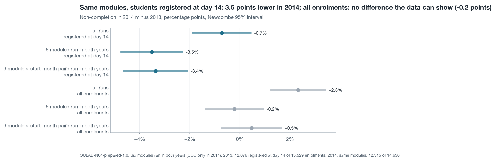

# AQ1 – 45% of enrolments still registered at day 14 do not complete; in the same modules the rate was 3.5 points lower in 2014 than in 2013, a gap that vanishes when early leavers are counted

*Milestone 4, Level 2 prototype · team N04 · descriptive question (AQ1) · 22 runs of 7 modules, 2013–2014 · 28,061 enrolments still registered at day 14 (the KPI population) · rerun of 12 November 2026 (UTC)*

> **Summary.** Of the 28,061 enrolments still registered at day 14, 12,700 (45.3%, 95% interval 44.7 to 45.8) ended in Fail (25.0%) or Withdrawn (20.2%). The rate runs from 24.9% in AAA-2013J to 58.3% in CCC-2014B, and February runs lose 8.4 points more than October runs (50.4% against 42.0%). The year matters too, and its direction depends on who is counted. In the six modules that ran in both years, non-completion among students registered at day 14 was −3.5 points (−4.8 to −2.3) in 2014 against 2013; over all enrolments of the same modules the difference is −0.2 points (−1.4 to +0.9), because 16.2% of the 2014 enrolments against 10.7% of the 2013 enrolments were no longer registered at day 14, and nearly all of those end in Fail or Withdrawn. A before-and-after comparison of the KPI can therefore move by several points with no intervention at all. Three in four non-completers eventually miss an assessed task, but late: by the end of week 4 only 16.8% of non-completers have missed one (19.7% in the 16 runs that have a task due by then). A week-4 contact list cannot rest on missed tasks alone. Both aggregation paths, the prepared view and the raw OULAD tables, agree to the enrolment in all 22 runs. **Status:** complete descriptive analysis; full population of the dataset, so intervals describe the precision of a rate, not sampling from a wider population. This is a rerun made after the 2014 outcomes were known; the year comparison was added in it.

| Non-completion, KPI population | Lowest and highest run | February against October runs | 2014 − 2013, same six modules, registered at day 14 | The same over all enrolments | Non-completers with a missed task by week 4 |
| :---- | :---- | :---- | :---- | :---- | :---- |
| **45.3%** (12,700 of 28,061) | **24.9%** to **58.3%** | **50.4%** against **42.0%** | **−3.5 points** (−4.8 to −2.3) | **−0.2 points** (−1.4 to +0.9) | **16.8%** |

**Status of this analysis.** The folder was first produced on 11 November 2026. That run compared the two years by whether the intervals of their pooled rates overlap and concluded that the year made no difference. The team compared it with the Milestone 5 report of a team member, and this rerun replaces that comparison with the difference between the years, its interval, both denominators and like-for-like sets of runs (`../PROTOCOL.md`, P18). The choice was made after the 2014 rates had been seen. It is a correction of method: every rate of Table 1 is the same number as before.

## 1. Module and start month move the rate most

<!-- table: AQ1 Table 1 -->
**Table 1. Non-completion rate (Fail or Withdrawn) of enrolments registered at day 14, with Wilson 95% intervals**

| Level | Group | Enrolments | Non-completers | Rate | 95% interval |
| :---- | :---- | :---- | :---- | :---- | :---- |
| All runs | 22 runs | 28,061 | 12,700 | 45.3% | 44.7 to 45.8 |
| Year | 2013 | 12,076 | 5,515 | 45.7% | 44.8 to 46.6 |
| Year | 2014 | 15,985 | 7,185 | 44.9% | 44.2 to 45.7 |
| Start month | February (B) | 10,977 | 5,531 | 50.4% | 49.5 to 51.3 |
| Start month | October (J) | 17,084 | 7,169 | 42.0% | 41.2 to 42.7 |
| Module | AAA | 720 | 189 | 26.3% | 23.2 to 29.6 |
| Module | BBB | 6,537 | 2,797 | 42.8% | 41.6 to 44.0 |
| Module | CCC | 3,670 | 1,994 | 54.3% | 52.7 to 55.9 |
| Module | DDD | 5,401 | 2,796 | 51.8% | 50.4 to 53.1 |
| Module | EEE | 2,573 | 924 | 35.9% | 34.1 to 37.8 |
| Module | FFF | 6,713 | 3,067 | 45.7% | 44.5 to 46.9 |
| Module | GGG | 2,447 | 933 | 38.1% | 36.2 to 40.1 |
<!-- /table -->

The February gap holds in both years (51.6% against 42.4% in 2013; 49.6% against 41.6% in 2014) and inside each of the six modules that have both start months, by 3.4 to 8.0 points (`results/rates_module_by_start_month_all.csv`). Modules lose students in different ways (Table 5): CCC loses a third of its students to withdrawal, the highest share of any module, while GGG loses few to withdrawal (8.4%) and many to failure (29.7%).

<!-- table: AQ1 Table 5 -->
**Table 5. Outcome shares by module, KPI population**

| Module | Enrolments | Distinction | Pass | Fail | Withdrawn |
| :---- | :---- | :---- | :---- | :---- | :---- |
| All runs | 28,061 | 10.8% | 44.0% | 25.0% | 20.2% |
| AAA | 720 | 6.1% | 67.6% | 12.4% | 13.9% |
| BBB | 6,537 | 10.3% | 46.9% | 26.9% | 15.9% |
| CCC | 3,670 | 13.6% | 32.1% | 21.3% | 33.1% |
| DDD | 5,401 | 7.1% | 41.1% | 26.1% | 25.7% |
| EEE | 2,573 | 13.8% | 50.3% | 21.8% | 14.1% |
| FFF | 6,713 | 10.0% | 44.3% | 25.4% | 20.3% |
| GGG | 2,447 | 16.2% | 45.7% | 29.7% | 8.4% |
<!-- /table -->

For decision D2 (where advisors' time goes), the runs to look at first are the CCC and DDD runs and the February runs in general. A run-level rate says where non-completion is concentrated, not why.

## 2. In the same modules, 2014 lost 3.5 points fewer of the students registered at day 14, and no fewer of all enrolments

The pooled rates of the two years, 45.7% and 44.9%, are not a like-for-like comparison: the 2014 figure includes module CCC, which did not run in 2013 and has the highest rate of all (54.3%). Table 2 compares the years on the runs that can be compared, under both denominators of the Level 1 card.

<!-- table: AQ1 Table 2 -->
**Table 2. Non-completion in 2014 minus 2013, percentage points with 95% interval, under two denominators**

| Denominator | Runs compared | Method | 2013 enrolments | 2013 rate | 2014 enrolments | 2014 rate | 2014 − 2013 (95% interval) |
| :---- | :---- | :---- | :---- | :---- | :---- | :---- | :---- |
| Registered at day 14 | all runs (9 of 2013, 13 of 2014) | pooled | 12,076 | 45.7% | 15,985 | 44.9% | −0.7 (−1.9 to +0.5) |
| Registered at day 14 | 6 modules run in both years | pooled | 12,076 | 45.7% | 12,315 | 42.2% | −3.5 (−4.8 to −2.3) |
| Registered at day 14 | 9 module × start-month pairs run in both years | pooled | 12,076 | 45.7% | 10,900 | 42.3% | −3.4 (−4.6 to −2.1) |
| Registered at day 14 | 9 module × start-month pairs run in both years | weighted over the pairs | 12,076 | 45.7% | 10,900 | 42.3% | −3.1 (−4.3 to −1.8) |
| All enrolments | all runs (9 of 2013, 13 of 2014) | pooled | 13,529 | 51.4% | 19,064 | 53.8% | +2.3 (+1.2 to +3.4) |
| All enrolments | 6 modules run in both years | pooled | 13,529 | 51.4% | 14,630 | 51.2% | −0.2 (−1.4 to +0.9) |
| All enrolments | 9 module × start-month pairs run in both years | pooled | 13,529 | 51.4% | 13,103 | 51.9% | +0.5 (−0.7 to +1.7) |
| All enrolments | 9 module × start-month pairs run in both years | weighted over the pairs | 13,529 | 51.4% | 13,103 | 51.9% | +0.5 (−0.7 to +1.7) |
<!-- /table -->

Three readings follow. First, over all 22 runs the day-14 population shows −0.7 points (−1.9 to +0.5), a difference the data cannot show, because CCC's high rate offsets a fall elsewhere. Second, once the comparison is restricted to runs that exist in both years, the fall is clear: −3.5 points (−4.8 to −2.3) in the six shared modules and −3.4 points (−4.6 to −2.1) in the nine module × start-month pairs that ran in both years. Weighting the nine pairs so that a different mix of runs cannot create the result gives −3.1 points (−4.3 to −1.8). Third, the same comparisons over all enrolments give −0.2 points (−1.4 to +0.9) and +0.5 points (−0.7 to +1.7): no difference. Over all enrolments of all runs the sign even reverses, +2.3 points (+1.2 to +3.4), again through CCC.

Table 4 shows what separates the two denominators.

<!-- table: AQ1 Table 4 -->
**Table 4. Enrolments not registered at day 14, by year**

| Runs compared | 2013 | 2014 | 2014 − 2013 (95% interval) | Of these, Fail or Withdrawn (2013 / 2014) |
| :---- | :---- | :---- | :---- | :---- |
| all runs | 1,453 of 13,529 (10.7%) | 3,079 of 19,064 (16.2%) | +5.4 (+4.7 to +6.1) | 99.4% / 99.5% |
| 6 modules run in both years | 1,453 of 13,529 (10.7%) | 2,315 of 14,630 (15.8%) | +5.1 (+4.3 to +5.9) | 99.4% / 99.4% |
| 9 module × start-month pairs run in both years | 1,453 of 13,529 (10.7%) | 2,203 of 13,103 (16.8%) | +6.1 (+5.2 to +6.9) | 99.4% / 99.4% |
<!-- /table -->

In 2014, 16.2% of the 2014 enrolments against 10.7% of the 2013 enrolments were not registered at day 14, a rise of 5.4 points that is the same in the shared modules. More than 99% of these enrolments end in Fail or Withdrawn in either year. The lower 2014 rate among students registered at day 14 therefore coincides with more students leaving before day 14. The data cannot say whether the same kind of student left earlier in 2014, which would lower the day-14 rate without any student doing better, or whether the students who stayed did better. Either way the count of students lost over all enrolments did not fall.

The fall is not uniform across modules (Table 3).

<!-- table: AQ1 Table 3 -->
**Table 3. The year difference by module and by start month (2013 / 2014)**

| Group | Registered at day 14: enrolments | Rate | 2014 − 2013 (95% interval) | All enrolments: enrolments | Rate | 2014 − 2013 (95% interval) |
| :---- | :---- | :---- | :---- | :---- | :---- | :---- |
| AAA | 370 / 350 | 24.9% / 27.7% | +2.8 (−3.6 to +9.3) | 383 / 365 | 27.4% / 30.7% | +3.3 (−3.2 to +9.8) |
| BBB | 3,457 / 3,080 | 45.8% / 39.4% | −6.5 (−8.9 to −4.1) | 4,004 / 3,905 | 53.2% / 51.9% | −1.3 (−3.5 to +0.9) |
| DDD | 2,872 / 2,529 | 53.5% / 49.8% | −3.7 (−6.4 to −1.1) | 3,241 / 3,031 | 58.7% / 58.1% | −0.6 (−3.1 to +1.8) |
| EEE | 933 / 1,640 | 34.8% / 36.5% | +1.7 (−2.2 to +5.5) | 1,052 / 1,882 | 42.1% / 44.7% | +2.6 (−1.2 to +6.3) |
| FFF | 3,518 / 3,195 | 46.7% / 44.6% | −2.1 (−4.5 to +0.3) | 3,897 / 3,865 | 51.8% / 54.2% | +2.3 (+0.1 to +4.6) |
| GGG | 926 / 1,521 | 36.1% / 39.4% | +3.3 (−0.7 to +7.2) | 952 / 1,582 | 37.8% / 41.7% | +3.9 (+0.0 to +7.8) |
| February runs, modules run in both years | 4,323 / 5,063 | 51.6% / 46.8% | −4.8 (−6.8 to −2.7) | 4,684 / 5,868 | 55.3% / 54.1% | −1.2 (−3.1 to +0.7) |
| October runs, modules run in both years | 7,753 / 7,252 | 42.4% / 38.9% | −3.5 (−5.1 to −1.9) | 8,845 / 8,762 | 49.4% / 49.3% | −0.1 (−1.6 to +1.4) |
| February runs, all modules | 4,323 / 6,654 | 51.6% / 49.6% | −2.0 (−3.9 to −0.1) | 4,684 / 7,804 | 55.3% / 57.0% | +1.7 (−0.1 to +3.5) |
| October runs, all modules | 7,753 / 9,331 | 42.4% / 41.6% | −0.7 (−2.2 to +0.8) | 8,845 / 11,260 | 49.4% / 51.5% | +2.1 (+0.7 to +3.5) |
<!-- /table -->

Among students registered at day 14, two modules carry the fall: BBB (−6.5 points) and DDD (−3.7). FFF is lower with an interval that reaches 0, and AAA, EEE and GGG are 2 to 3 points higher with intervals that include 0. Over all enrolments no module is lower with an interval excluding 0, and FFF is higher (+2.3 points). The fall appears in February and in October runs of the shared modules alike (−4.8 and −3.5 points).

What this means for the pilot: the KPI of the SMART Goal is a completion rate on the day-14 population, and its target gain is 5 points. Between two ordinary years of the same modules that rate moved by 3.5 points with no intervention, and by more in single modules. A comparison of a pilot year with the year before cannot tell such a shift from an effect of contact, which supports judging the pilot against tutor groups of the same run (decision D3). The share of enrolments not registered at day 14 should be reported beside the KPI, since it moves the KPI.

## 3. The denominator moves the headline rate by 7.5 points

The Level 1 card names a second denominator as a baseline: all 32,593 enrolments instead of the 28,061 still registered at day 14.

<!-- table: AQ1 Table 6 -->
**Table 6. The same rate under three denominators**

| Denominator | Enrolments | Non-completers | Rate |
| :---- | :---- | :---- | :---- |
| KPI (registered at day 14) | 28,061 | 12,700 | 45.3% |
| all enrolments | 32,593 | 17,208 | 52.8% |
| KPI without flagged | 27,962 | 12,602 | 45.1% |
<!-- /table -->

Counting all enrolments adds the 4,532 enrolments not registered at day 14, of which 4,508 ended in Fail or Withdrawn, and raises the rate by 7.5 points. The shift is uneven: from 1.7 points (GGG-2013J) to 13.6 points (BBB-2014J), and in 17 of 22 runs the all-enrolment rate lies outside the interval of the KPI rate (`results/denominators_by_run_all.csv`). A comparison of runs, like the comparison of years, changes with the denominator, and every rate in this report states its population. The 138 enrolments flagged in Milestone 3 for a missing withdrawal or registration day (99 of them in the KPI population) do not matter: removing them moves no run's rate by more than 0.8 points and none outside its interval.

## 4. Most non-completers miss their first task after week 4

<!-- table: AQ1 Table 7 -->
**Table 7. First assessed task (TMA or CMA) due while enrolled and not submitted, KPI population**

| Final result | Enrolments | Ever missed a task | Median week of the first miss | Missed by week 4 | By week 8 | By week 12 | By week 20 |
| :---- | :---- | :---- | :---- | :---- | :---- | :---- | :---- |
| Non-completers (Fail or Withdrawn) | 12,700 | 75.1% | 9 | 16.8% | 35.1% | 43.0% | 61.9% |
| – Fail | 7,027 | 82.8% | 12 | 15.0% | 33.5% | 42.4% | 63.6% |
| – Withdrawn | 5,673 | 65.5% | 8 | 19.0% | 37.1% | 43.6% | 59.8% |
| Completers (Pass or Distinction) | 15,361 | 20.5% | 24 | 0.5% | 3.8% | 4.7% | 8.1% |
<!-- /table -->

A missed task separates the groups sharply, since 0.5% of completers have missed one by week 4 against 16.8% of non-completers. It is also a late signal: five in six non-completers have missed nothing by the day-27 cut-off. Part of this is the calendar. In 6 of the 22 runs (all runs of EEE and GGG) no task is due by day 27, so a student there cannot have missed one: their status is undefined, not "nothing missed". Table 8 gives the share with those runs set apart.

<!-- table: AQ1 Table 8 -->
**Table 8. Non-completers with a missed task by the end of week 4**

| Runs | Year | Number of runs | Non-completers | Missed a task by week 4 | Share | 95% interval |
| :---- | :---- | :---- | :---- | :---- | :---- | :---- |
| All runs | Both years | 22 | 12,700 | 2,133 | 16.8% | 16.2 to 17.5 |
| All runs | 2013 | 9 | 5,515 | 1,080 | 19.6% | 18.6 to 20.7 |
| All runs | 2014 | 13 | 7,185 | 1,053 | 14.7% | 13.9 to 15.5 |
| Runs with a task due by day 27 | Both years | 16 | 10,843 | 2,133 | 19.7% | 18.9 to 20.4 |
| Runs with a task due by day 27 | 2013 | 7 | 4,856 | 1,080 | 22.2% | 21.1 to 23.4 |
| Runs with a task due by day 27 | 2014 | 9 | 5,987 | 1,053 | 17.6% | 16.6 to 18.6 |
<!-- /table -->

In the 16 runs with a task due by day 27 the share is 19.7% in the two years together, still fewer than one in five. It was lower in 2014 than in 2013 in both populations (−4.9 points over all runs, interval −6.3 to −3.6; −4.7 points in the runs with a task due, −6.2 to −3.1; `results/first_missed_by_week4_year_difference_all.csv`), which fits the larger share of 2014 students who had already left before day 14 and are outside this population. A withdrawn student is counted only for tasks due before leaving, which is why fewer Withdrawn than Fail students ever miss a task (65.5% against 82.8%).

<!-- table: AQ1 Table 9 -->
**Table 9. Non-completers by module: when the first missed task appears**

| Module | Runs with a task due by day 27 | Non-completers | Ever missed a task | Median week of the first miss | Missed by week 4 | Missed by week 8 |
| :---- | :---- | :---- | :---- | :---- | :---- | :---- |
| AAA | 2 of 2 | 189 | 60.3% | 12.5 | 12.2% | 30.2% |
| BBB | 4 of 4 | 2,797 | 79.5% | 8 | 21.2% | 42.3% |
| CCC | 2 of 2 | 1,994 | 72.5% | 5 | 20.4% | 44.7% |
| DDD | 4 of 4 | 2,796 | 71.2% | 8 | 21.2% | 36.6% |
| EEE | 0 of 3 | 924 | 75.3% | 10 | no task due by day 27 | 28.1% |
| FFF | 4 of 4 | 3,067 | 75.3% | 13 | 16.9% | 34.0% |
| GGG | 0 of 3 | 933 | 80.7% | 17 | no task due by day 27 | 0.0% |
<!-- /table -->

This finding sets up the next questions. It shows why the early-sign rule of AQ3 adds inactivity to missed tasks (Change Log C10), and why a week-4 list catches fewer than half of the non-completers whatever method ranks it (AQ3 and AQ4 reports).

## 5. Rates by student group, as description

The Level 1 card asks for rates by gender, disability, deprivation band and age band as description only; no model reads these columns.

<!-- table: AQ1 Table 10 -->
**Table 10. Non-completion by audit attribute, KPI population**

| Attribute | Group | Enrolments | Rate | 95% interval |
| :---- | :---- | :---- | :---- | :---- |
| Gender | Female | 12,573 | 43.4% | 42.6 to 44.3 |
| Gender | Male | 15,488 | 46.7% | 45.9 to 47.5 |
| Disability | Not declared | 25,385 | 44.2% | 43.6 to 44.9 |
| Disability | Declared | 2,676 | 54.9% | 53.0 to 56.8 |
| Deprivation band | 0–10% (most deprived) | 2,708 | 57.1% | 55.2 to 58.9 |
| Deprivation band | 40–50% | 2,773 | 45.3% | 43.5 to 47.2 |
| Deprivation band | 90–100% (least deprived) | 2,268 | 35.7% | 33.7 to 37.7 |
| Deprivation band | Missing | 1,037 | 29.9% | 27.2 to 32.8 |
| Age band | 0–35 | 19,580 | 47.3% | 46.6 to 48.0 |
| Age band | 35–55 | 8,283 | 40.7% | 39.7 to 41.8 |
| Age band | 55 or over | 198 | 32.8% | 26.7 to 39.6 |
<!-- /table -->

Non-completion falls steadily from the most to the least deprived band, a spread of 21 points, and is 11 points higher for students with a declared disability. These gaps are the reason the fairness audit of AQ4 checks whether a contact list reaches such students as well as others. They are unadjusted descriptions; module mix differs between groups.

## What the prototype says about the Level 1 choice (brief step 7)

| Level 1 expectation | Prototype result |
| :---- | :---- |
| Grouped rates with intervals answer AQ1; no model is needed | Confirmed: every part of the question is answered by counts, rates and differences of rates |
| Control totals 32,593 and 28,061 | Reproduced exactly; 138 flagged enrolments reproduced |
| Two aggregation paths agree to the enrolment | Agree in 22 of 22 runs (prepared view against raw `studentInfo` and `studentRegistration`); the counts behind the year comparison agree as well |
| Rates per year | The year difference is −3.5 points on the day-14 population of the shared modules and −0.2 points over all their enrolments; overlap of two pooled intervals would have hidden both facts |
| The second denominator shows which rates depend on the population | 7.5 points pooled; 17 of 22 runs move outside their interval; the year comparison changes sign with it |
| Runs with no task due by day 27 are listed | 6 of 22: every run of EEE and GGG; the week-4 share is given with and without them |

The success criterion of the AQ1 card is met: both paths agree, every rate carries its denominator and interval, and no rate is compared across runs or years without an interval for the comparison.

## Limitations

- **Description of ended runs.** Rates describe what happened in 22 runs; they predict nothing about a new run.
- **Two years only.** The year comparison rests on one pair of years. It shows that the KPI can move by 3.5 points between years; it does not show a trend.
- **Full population.** The 22 runs are all the runs in OULAD, not a sample of a larger set, so the intervals express how precisely a rate or difference of that size is pinned down by its counts.
- **Many comparisons.** Table 3 holds 20 differences; one or two intervals that exclude 0 would be expected by chance alone, so single modules are read as description and the overall rows carry the finding.
- **Exams excluded.** The first missed task counts tutor-marked and computer-marked assessments only, because exam results are missing in five modules.
- **Withdrawal truncates the record.** A student who withdraws cannot miss later tasks, so "ever missed" understates disengagement among Withdrawn students.
- **Stand-in data.** OULAD modules are distance-learning courses of the UK Open University in 2013–2014.

## Method

Population: enrolments registered by day 14 (or with an unknown registration day) and not unregistered by day 14 (Change Log C09). Outcome: final result Fail or Withdrawn. Intervals of rates: Wilson 95%. Differences between years: 2014 minus 2013 with Newcombe's hybrid score interval; the weighted row gives each of the nine module × start-month pairs the weight n13 × n14 ÷ (n13 + n14) and uses a Wald interval. First missed task: earliest week (week n = days 7(n−1) to 7n−1) of a TMA or CMA due while the student was enrolled and not submitted; recomputed from the task table and equal to the stored value for all 32,593 enrolments. The scripts read the 2013 runs first and the 2014 runs after the AQ3 freeze of this rerun, in the order Level 1 fixes. Implementation choices are in [`../PROTOCOL.md`](../PROTOCOL.md) (P02, P18).

## Appendix: files

| Content | File |
| :---- | :---- |
| Analysis tables extracted from the prepared dataset | `extracted-datasets/aq1_enrolments_all.csv`, `aq1_task_schedule_all.csv`, `aq1_first_missed_recomputed_all.csv` (and `_2013`) |
| Rates by level, with intervals | `results/rates_all.csv`, `rates_module_by_start_month_all.csv` |
| Year comparison | `results/year_comparison_all.csv`, `not_registered_d14_by_year_all.csv` |
| Denominators | `results/denominators_by_run_all.csv`, `denominators_pooled_all.csv`, `populations_all.csv` |
| Outcome shares | `results/outcome_shares_all.csv` |
| First missed task | `results/first_missed_task_by_outcome_all.csv`, `first_missed_task_cumulative_all.csv`, `first_missed_task_by_module_all.csv`, `first_missed_by_week4_all.csv`, `first_missed_by_week4_year_difference_all.csv`, `task_calendar_by_run_all.csv` |
| Rates by audit group | `results/rates_by_audit_group_all.csv` |
| Checks | `results/checks_all.csv`, `check_two_paths_all.csv` (and `_2013`) |
| Decisions, check ledger, methods checklist | [`NOTES.md`](NOTES.md) |
| Step logs | `logs/` |
