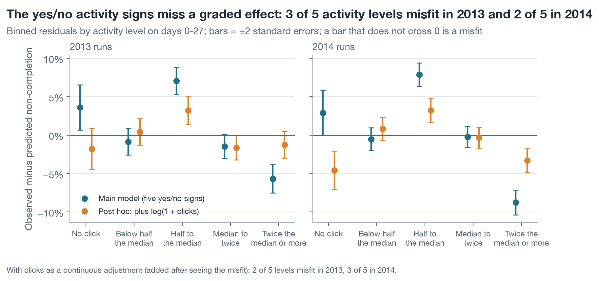

# AQ2 – A task missed by week 4 goes with 41 more points of non-completion among similar students; four signs hold up in both years, and the low-activity cut adds nothing once clicks are counted

*Milestone 4, Level 2 prototype · team N04 · diagnostic question (AQ2), association only · enrolments registered at day 27 · estimated on the 9 runs of 2013, re-estimated on the 13 runs of 2014 · rerun of 12 November 2026 (UTC)*

> **Summary.** All five early signs meet the criterion fixed in Level 1 in both years: an adjusted risk difference of at least 5 percentage points, an interval that excludes 0, and the same direction in at least two-thirds of the modules. A task due by day 27 and not submitted is by far the strongest: 90% of the students with it did not complete against 40% without it, and the gap is still 41 points (95% interval 38 to 44) when students are compared within the same run with the other signs held equal. A late TMA goes with 22 points, low activity with 15, a week without activity with 13 and no activity before the start with 11. No sign moves by more than 2.1 points between 2013 and 2014. Two limits qualify this. First, the yes/no activity signs miss a graded effect: when clicks on days 0–27 enter the model as a continuous measure, the low-activity sign falls to 3 points in 2013 and 1 point in 2014 and no longer meets the criterion, while the other four signs still do. Second, a sign that is consistent overall can show nothing in a single module: a late TMA has no detectable association in AAA-2014J. These are associations. They say which students tutors should look at, not that changing a sign changes the outcome. **Status:** complete analysis of AQ2 on OULAD. This is a rerun made after the 2014 outcomes were known; the status note below says which choices were made with that knowledge.

| Missed task | Late TMA | Low activity | Inactive last 7 days | No pre-start activity | Signs meeting the Level 1 criterion | Signs that also survive the continuous-activity check |
| :---- | :---- | :---- | :---- | :---- | :---- | :---- |
| **+41 points** | **+22 points** | **+15 points** | **+13 points** | **+11 points** | **5 of 5**, in 2013 and in 2014 | **4 of 5** (not low activity) |

**Status of this analysis.** The folder was first produced on 11 November 2026. The team compared that run with the Milestone 5 report of a team member and found three errors of method in AQ2, and this rerun corrects them: a risk difference is now averaged only over the rows where the sign has an estimated slope; the residual check now has five activity levels and tenths of predicted risk; and a module estimate that cannot be told from 0 is no longer counted as agreement without saying so. These choices (`../PROTOCOL.md`, P16, P17, P21, P22) were made after the 2013 and 2014 results had been seen. The Level 1 criterion and the Level 1 model are unchanged, and every result is given whichever way it falls.

## 1. A missed task is the strongest sign, and adjustment does not explain it away

Table 1 gives, for each sign, the plain comparison (the baseline of Level 1) beside the adjusted estimate (the primary approach): a logistic regression with a fixed effect for every run, adjustment for previous attempts and credits, all five signs together, and sign × module terms. The adjusted risk difference is the average difference in predicted risk between having and not having the sign, for the same students. Each difference is averaged over the enrolments of the runs where the sign can occur, and the column n gives that number.

<!-- table: AQ2 Table 1 -->
**Table 1. Risk difference in non-completion per sign, 9 runs of 2013, enrolments registered at day 27**

| Sign at day 27 | n (rows averaged over) | Students with the sign | Non-completion with / without | Unadjusted difference (95% interval) | Adjusted difference (95% interval) | Odds ratio (95% interval) |
| :---- | :---- | :---- | :---- | :---- | :---- | :---- |
| Task due and not submitted | 9,960 | 1,285 (12.9%) | 90.0% / 39.6% | +50.3 (48.3 to 52.2) | **+40.7** (37.5 to 43.8) | 7.5 (6.1 to 9.1) |
| TMA submitted late | 9,960 | 577 (5.8%) | 63.6% / 45.1% | +18.5 (14.4 to 22.5) | **+21.7** (17.4 to 25.9) | 2.9 (2.4 to 3.5) |
| Clicks below half the run median | 11,811 | 3,175 (26.9%) | 67.8% / 35.8% | +32.1 (30.1 to 33.9) | **+14.7** (12.3 to 17.0) | 1.9 (1.8 to 2.2) |
| No platform activity in the last 7 days | 11,811 | 2,444 (20.7%) | 64.4% / 39.2% | +25.3 (23.1 to 27.4) | **+13.5** (10.1 to 16.8) | 1.7 (1.5 to 1.9) |
| No activity before the start | 11,811 | 2,297 (19.4%) | 61.5% / 40.3% | +21.2 (19.0 to 23.4) | **+11.3** (8.5 to 14.0) | 1.6 (1.4 to 1.8) |
<!-- /table -->

The two task signs are defined where the calendar lets them occur: a missed task in the 7 runs with a TMA or CMA due by day 27, a late TMA in the 7 runs with a TMA due by day 27 (the same 9,960 enrolments in 2013). The runs of EEE and GGG have no task due by then. Odds ratios come from the same model without sign × module terms.

The three activity signs lose about half of their plain gap once the other signs are held equal (32 → 15, 25 → 13, 21 → 11 points), because they overlap: the correlation between inactivity in the last week and low activity is 0.50, and in the runs with a task due both correlate with a missed task (0.40 and 0.41). Each adjusted value is therefore a partial association, what one sign adds when the others are known, and not the share of non-completion that the sign explains. The late-TMA gap grows slightly under adjustment (18.5 → 21.7), because students who submit late are by definition not among those who did not submit at all. The odds ratios read much larger than the risk gaps: an odds ratio of 7.5 for a missed task corresponds to a risk ratio of 2.3 (90.0% against 39.6%), which is why Level 1 reports risk differences first.

Signs also add up. In the 2013 runs where all five signs can occur, 32.0% of students with none of them did not complete, 53.1% with one, 66.9% with two, 78.8% with three and 94.4% with four (391 students).

## 2. Each sign points the same way in every module, but in some modules it cannot be told from zero

<!-- table: AQ2 Table 2 -->
**Table 2. Adjusted risk difference by module, 2013 runs (percentage points, 95% interval, n)**

| Sign | AAA | BBB | DDD | EEE | FFF | GGG | Same direction (point estimate) | Same direction, interval excludes 0 |
| :---- | :---- | :---- | :---- | :---- | :---- | :---- | :---- | :---- |
| Task missed | +44 (22 to 65; n = 369) | +45 (40 to 50; n = 3,364) | +35 (30 to 40; n = 2,790) | not defined | +41 (35 to 47; n = 3,437) | not defined | 4 of 4 | 4 of 4 |
| TMA late | +20 (6 to 33; n = 369) | +22 (17 to 28; n = 3,364) | +17 (6 to 28; n = 2,790) | not defined | +25 (19 to 31; n = 3,437) | not defined | 4 of 4 | 4 of 4 |
| Low activity | +14 (1 to 27; n = 369) | +11 (7 to 15; n = 3,364) | +16 (11 to 21; n = 2,790) | +35 (25 to 44; n = 927) | +12 (8 to 17; n = 3,437) | +13 (5 to 21; n = 924) | 6 of 6 | 6 of 6 |
| Inactive last 7 days | *+5 (−8 to 18; n = 369)* | +9 (4 to 13; n = 3,364) | +19 (9 to 29; n = 2,790) | +19 (10 to 29; n = 927) | +15 (9 to 21; n = 3,437) | *+4 (−3 to 11; n = 924)* | 6 of 6 | 4 of 6 |
| No pre-start activity | *+9 (−9 to 27; n = 369)* | +8 (4 to 12; n = 3,364) | +14 (7 to 20; n = 2,790) | +16 (8 to 24; n = 927) | +13 (7 to 19; n = 3,437) | *+5 (−2 to 11; n = 924)* | 6 of 6 | 4 of 6 |
<!-- /table -->

Estimates in italics have a 95% interval that includes 0: in that module the data show no detectable association for that sign. All 26 module estimates of 2013 are positive, so the Level 1 direction count is met everywhere. The count says less than it seems, however: 4 of the 26 module estimates of 2013 cannot be told from 0 (a week without activity and no pre-start activity, each in AAA and GGG). In GGG more than half of the students (506 of 924) show a week without activity, so the sign does not separate them. AAA is the smallest module (369 enrolments), and its intervals are wide for every sign. In EEE, where no task falls due by day 27, low activity is a much stronger sign (+35 points) than elsewhere. A tutor should therefore read the activity signs against the module: they mean most where tasks come late.

## 3. The associations reappear in the 2014 runs, and no sign moves by more than 2.1 points

Level 1 estimates AQ2 on the 2013 runs and re-estimates it on the 2014 runs after the AQ3 model is frozen and tested (Change Log C14). Table 3 puts the two years side by side with the change between them.

<!-- table: AQ2 Table 3 -->
**Table 3. Adjusted risk difference per sign, estimation and replication**

| Sign | 2013 runs | 2014 runs | Change 2014 − 2013 (95% interval) | Level 1 criterion (2013 / 2014) | Counting only modules whose interval excludes 0 (2013 / 2014) |
| :---- | :---- | :---- | :---- | :---- | :---- |
| Task missed | +40.7 (37.5 to 43.8), n = 9,960 | +39.6 (36.8 to 42.5), n = 12,585 | −1.0 (−5.2 to +3.2) | Consistent / Consistent | Consistent / Consistent |
| TMA late | +21.7 (17.4 to 25.9), n = 9,960 | +22.5 (17.9 to 27.2), n = 9,064 | +0.9 (−5.4 to +7.2) | Consistent / Consistent | Consistent / Consistent |
| Low activity | +14.7 (12.3 to 17.0), n = 11,811 | +14.8 (12.7 to 16.8), n = 15,724 | +0.1 (−3.0 to +3.2) | Consistent / Consistent | Consistent / Consistent |
| Inactive last 7 days | +13.5 (10.1 to 16.8), n = 11,811 | +15.4 (12.8 to 18.1), n = 15,724 | +1.9 (−2.3 to +6.2) | Consistent / Consistent | Consistent / Consistent |
| No pre-start activity | +11.3 (8.5 to 14.0), n = 11,811 | +9.2 (6.9 to 11.4), n = 15,724 | −2.1 (−5.7 to +1.5) | Consistent / Consistent | Consistent / Weak or inconsistent |
<!-- /table -->

Table 1b gives the 2014 estimates in the same form as Table 1.

<!-- table: AQ2 Table 1b -->
**Table 1b. Risk difference in non-completion per sign, 13 runs of 2014, enrolments registered at day 27**

| Sign at day 27 | n (rows averaged over) | Students with the sign | Non-completion with / without | Unadjusted difference (95% interval) | Adjusted difference (95% interval) | Odds ratio (95% interval) |
| :---- | :---- | :---- | :---- | :---- | :---- | :---- |
| Task due and not submitted | 12,585 | 1,368 (10.9%) | 89.0% / 40.3% | +48.8 (46.8 to 50.6) | **+39.6** (36.8 to 42.5) | 6.6 (5.5 to 7.9) |
| TMA submitted late | 9,064 | 429 (4.7%) | 59.4% / 42.1% | +17.3 (12.5 to 22.0) | **+22.5** (17.9 to 27.2) | 2.7 (2.2 to 3.3) |
| Clicks below half the run median | 15,724 | 4,099 (26.1%) | 66.3% / 36.1% | +30.2 (28.5 to 31.9) | **+14.8** (12.7 to 16.8) | 1.9 (1.8 to 2.1) |
| No platform activity in the last 7 days | 15,724 | 3,440 (21.9%) | 64.7% / 38.1% | +26.5 (24.7 to 28.3) | **+15.4** (12.8 to 18.1) | 2.0 (1.8 to 2.2) |
| No activity before the start | 15,724 | 3,161 (20.1%) | 58.3% / 40.3% | +17.9 (16.0 to 19.8) | **+9.2** (6.9 to 11.4) | 1.5 (1.4 to 1.7) |
<!-- /table -->

Every sign keeps its Level 1 verdict, and 5 of the 5 changes have an interval that includes 0, so the data show no change between the years for any sign. The largest change is −2.1 points, for no activity before the start.

The late TMA needs its population stated. No CCC student can have a late TMA by day 27, because the only task CCC sets by then is a computer-marked one. The sign is therefore estimated on the four modules with a TMA due, where it goes with +22.5 points (17.9 to 27.2) over the 9,064 enrolments of those modules in 2014, against +21.7 points over 9,960 in 2013. Averaging over CCC's 3,521 enrolments as well would count each of them as a difference of exactly 0 and give +16.2 points (`results/late_tma_average_check.csv`), a number that describes no group of students.

<!-- table: AQ2 Table 2b -->
**Table 2b. Adjusted risk difference by module, 2014 runs (percentage points, 95% interval, n)**

| Sign | AAA | BBB | CCC | DDD | EEE | FFF | GGG | Same direction (point estimate) | Same direction, interval excludes 0 |
| :---- | :---- | :---- | :---- | :---- | :---- | :---- | :---- | :---- | :---- |
| Task missed | +41 (24 to 59; n = 348) | +53 (48 to 59; n = 3,066) | +35 (30 to 40; n = 3,521) | +37 (30 to 43; n = 2,492) | not defined | +33 (27 to 40; n = 3,158) | not defined | 5 of 5 | 5 of 5 |
| TMA late | *+0 (−13 to 13; n = 348)* | +26 (19 to 33; n = 3,066) | not defined | +21 (12 to 29; n = 2,492) | not defined | +23 (14 to 33; n = 3,158) | not defined | 4 of 4 | 3 of 4 |
| Low activity | *+1 (−10 to 11; n = 348)* | +7 (3 to 12; n = 3,066) | +9 (4 to 13; n = 3,521) | +18 (12 to 23; n = 2,492) | +29 (22 to 36; n = 1,625) | +21 (16 to 25; n = 3,158) | +15 (9 to 21; n = 1,514) | 7 of 7 | 6 of 7 |
| Inactive last 7 days | +16 (3 to 30; n = 348) | +12 (8 to 17; n = 3,066) | +19 (15 to 23; n = 3,521) | +14 (7 to 22; n = 2,492) | +14 (6 to 21; n = 1,625) | +17 (8 to 25; n = 3,158) | +15 (9 to 20; n = 1,514) | 7 of 7 | 7 of 7 |
| No pre-start activity | *+10 (−9 to 29; n = 348)* | *+1 (−2 to 5; n = 3,066)* | +13 (8 to 18; n = 3,521) | *+6 (−1 to 13; n = 2,492)* | +22 (16 to 29; n = 1,625) | +9 (4 to 14; n = 3,158) | +7 (2 to 12; n = 1,514) | 7 of 7 | 4 of 7 |
<!-- /table -->

Module CCC, absent from 2013, shows the same pattern as the other modules for the four signs it can have (task missed +35 points, inactive +19, low activity +9, no pre-start activity +13). Within modules the picture is less uniform than the overall table suggests: 5 of the 30 module estimates of 2014 have an interval that includes 0. The clearest case is a late TMA in AAA-2014J: +0.2 points (−13.2 to +13.5; 53 of 348 students with the sign), where the same module showed +20 points in 2013. That is no association in that run, not a fourth module "in the same direction", and the late-TMA sign meets the two-thirds rule in 2014 on its three other modules. The same holds for low activity in AAA (+1 point) and for no activity before the start in AAA, BBB and DDD. For that last sign only 4 of 7 modules have an interval above 0 in 2014, which is below two-thirds: it meets the Level 1 criterion as written, on point estimates, and would not meet it if a module counted only when its own interval excludes 0. It is the weakest of the five signs on the module count.

## 4. The yes/no activity signs miss a graded effect

The Level 1 card asks for binned residuals by run and activity level. With three levels cut at the low-activity sign's own threshold, the model fits by construction: 2 of 27 cells lie outside two standard errors in 2013 (both in GGG-2013J, about 10 points) and 0 of 39 in 2014 (`results/binned_residuals_by_run_*.csv`). Five activity levels show what three hide.

<!-- table: AQ2 Table 5 -->
**Table 5. Binned residuals by activity level on days 0–27: observed minus predicted non-completion (percentage points; band = ±2 standard errors; bold = outside the band)**

| Model | Activity level | 2013: enrolments | 2013: observed / predicted | 2013: residual (band) | 2014: enrolments | 2014: observed / predicted | 2014: residual (band) |
| :---- | :---- | :---- | :---- | :---- | :---- | :---- | :---- |
| Main model | No click | 607 | 81.1% / 77.5% | **+3.6 (±2.9)** | 624 | 82.2% / 79.3% | +2.9 (±2.9) |
| Main model | Below half the run median | 2,568 | 64.7% / 65.6% | −0.9 (±1.7) | 3,475 | 63.5% / 64.0% | −0.5 (±1.5) |
| Main model | Half the median to the median | 2,714 | 46.7% / 39.6% | **+7.0 (±1.8)** | 3,734 | 47.8% / 39.9% | **+7.9 (±1.5)** |
| Main model | Median to twice the median | 3,447 | 33.4% / 34.9% | −1.5 (±1.6) | 4,660 | 34.9% / 35.1% | −0.2 (±1.4) |
| Main model | Twice the median or more | 2,475 | 27.2% / 32.8% | **−5.7 (±1.8)** | 3,231 | 24.2% / 33.0% | **−8.8 (±1.6)** |
| Post hoc: plus log(1 + clicks) | No click | 607 | 81.1% / 82.8% | −1.8 (±2.7) | 624 | 82.2% / 86.8% | **−4.6 (±2.5)** |
| Post hoc: plus log(1 + clicks) | Below half the run median | 2,568 | 64.7% / 64.3% | +0.4 (±1.7) | 3,475 | 63.5% / 62.6% | +0.8 (±1.5) |
| Post hoc: plus log(1 + clicks) | Half the median to the median | 2,714 | 46.7% / 43.5% | **+3.2 (±1.8)** | 3,734 | 47.8% / 44.6% | **+3.2 (±1.6)** |
| Post hoc: plus log(1 + clicks) | Median to twice the median | 3,447 | 33.4% / 35.1% | **−1.6 (±1.6)** | 4,660 | 34.9% / 35.2% | −0.3 (±1.4) |
| Post hoc: plus log(1 + clicks) | Twice the median or more | 2,475 | 27.2% / 28.4% | −1.3 (±1.8) | 3,231 | 24.2% / 27.5% | **−3.3 (±1.5)** |
<!-- /table -->

In the main model 3 of 5 activity levels misfit in 2013 and 2 of 5 in 2014. Students between half the run median and the median do not complete 7 to 8 points more often than the model predicts, and students at twice the median or more complete 6 to 9 points more often than predicted. The sign treats everyone above half the median alike, while non-completion keeps falling as activity rises (in 2014 from 82% with no click to 24% at twice the median or more). By tenths of predicted risk the model is close: 2 of 10 tenths lie outside the band in 2013, by 3 points, and none in 2014 (`results/binned_residuals_decile_*.csv`). The model therefore ranks risk about right overall and misstates how risk depends on the amount of activity.

Because the misfit concerns signs that serve as reasons on a tutor's list, one sensitivity run was added after seeing it: the same model plus log(1 + clicks on days 0–27) as a continuous adjustment. It is not part of the Level 1 plan and cannot change the Level 1 verdict; it shows what each yes/no sign adds once graded activity is known.

<!-- table: AQ2 Table 6 -->
**Table 6. Each sign against the Level 1 criterion when clicks on days 0–27 enter as a continuous adjustment (post hoc)**

| Low-activity cut in the model | Sign | 2013: adjusted difference (95% interval) | 2013: modules, same direction | 2013: criterion | 2014: adjusted difference (95% interval) | 2014: modules, same direction | 2014: criterion |
| :---- | :---- | :---- | :---- | :---- | :---- | :---- | :---- |
| Half the run median (primary) | Task missed | +37.3 (33.8 to 40.8) | 4 of 4 | Consistent | +35.8 (32.7 to 39.0) | 5 of 5 | Consistent |
| Half the run median (primary) | TMA late | +20.4 (16.1 to 24.6) | 4 of 4 | Consistent | +21.2 (16.5 to 26.0) | 3 of 4 | Consistent |
| Half the run median (primary) | Inactive last 7 days | +8.7 (5.1 to 12.2) | 5 of 6 | Consistent | +10.2 (7.5 to 13.0) | 7 of 7 | Consistent |
| Half the run median (primary) | Low activity (below half the run median) | +2.9 (−0.2 to 6.0) | 4 of 6 | Weak or inconsistent | +0.8 (−1.9 to 3.4) | 3 of 7 | Weak or inconsistent |
| Half the run median (primary) | No pre-start activity | +9.1 (6.3 to 11.9) | 6 of 6 | Consistent | +6.5 (4.3 to 8.8) | 6 of 7 | Consistent |
| Run median | Task missed | +37.4 (33.9 to 40.9) | 4 of 4 | Consistent | +35.7 (32.5 to 38.9) | 5 of 5 | Consistent |
| Run median | TMA late | +19.6 (15.3 to 23.9) | 4 of 4 | Consistent | +21.0 (16.2 to 25.8) | 3 of 4 | Consistent |
| Run median | Inactive last 7 days | +9.2 (5.8 to 12.7) | 6 of 6 | Consistent | +10.7 (8.0 to 13.3) | 7 of 7 | Consistent |
| Run median | Low activity (below the run median) | +5.9 (3.4 to 8.3) | 5 of 6 | Consistent | +5.9 (3.8 to 8.1) | 4 of 7 | Weak or inconsistent |
| Run median | No pre-start activity | +8.9 (6.1 to 11.6) | 6 of 6 | Consistent | +6.5 (4.2 to 8.7) | 6 of 7 | Consistent |
<!-- /table -->

With clicks counted, the low-activity sign at half the run median goes with +2.9 points (−0.2 to +6.0) in 2013 and +0.8 (−1.9 to +3.4) in 2014: it no longer meets the criterion in either year. Cut at the run median, it goes with +5.9 points (+3.4 to +8.3) in 2013 and +5.9 (+3.8 to +8.1) in 2014, which meets the criterion in 2013 and fails it in 2014, where the direction holds in only 4 of 7 modules. The other four signs still meet the criterion in both years: a missed task and a late TMA lose 1 to 4 points, a week without activity falls to 8.7 and 10.2 points and no pre-start activity to 9.1 and 6.5. The reading is that "low activity" is a coarse summary of how much a student clicks, not a separate sign: a tutor learns more from the amount of activity than from which side of a threshold it falls. The continuous term removes most but not all of the misfit (Table 5), so a single log term is itself only an approximation.

## 5. The estimates do not depend on the planned analytic choices

<!-- table: AQ2 Table 4 -->
**Table 4. Sensitivity of the adjusted risk differences, 2013 runs (percentage points; n = rows averaged over)**

| Variant | Task missed | TMA late | Low activity | Inactive last 7 days | No pre-start activity |
| :---- | :---- | :---- | :---- | :---- | :---- |
| Main model | 40.7 (n = 9,960) | 21.7 (n = 9,960) | 14.7 (n = 11,811) | 13.5 (n = 11,811) | 11.3 (n = 11,811) |
| Low activity from de-duplicated clicks | 40.6 (n = 9,960) | 21.6 (n = 9,960) | 14.8 (n = 11,811) | 13.5 (n = 11,811) | 11.2 (n = 11,811) |
| Late CMAs also count as late | 40.6 (n = 9,960) | 16.7 (n = 9,960) | 14.7 (n = 11,811) | 13.4 (n = 11,811) | 11.3 (n = 11,811) |
| Without flagged enrolments | 40.7 (n = 9,954) | 21.7 (n = 9,954) | 14.6 (n = 11,803) | 13.5 (n = 11,803) | 11.3 (n = 11,803) |
| Only the runs with a task due by day 27 | 40.6 (n = 9,960) | 21.6 (n = 9,960) | 12.9 (n = 9,960) | 13.8 (n = 9,960) | 11.4 (n = 9,960) |
| Low activity = below a quarter of the run median | 41.4 (n = 9,960) | 22.4 (n = 9,960) | 14.4 (n = 11,811) | 15.4 (n = 11,811) | 12.0 (n = 11,811) |
| Low activity = below the run median (the Milestone 5 cut) | 40.9 (n = 9,960) | 20.3 (n = 9,960) | 13.4 (n = 11,811) | 14.3 (n = 11,811) | 10.6 (n = 11,811) |
| Post hoc: plus log(1 + clicks on days 0–27) | 37.3 (n = 9,960) | 20.4 (n = 9,960) | **2.9 (n = 11,811): criterion not met** | 8.7 (n = 11,811) | 9.1 (n = 11,811) |
| Post hoc: low activity = below the run median, plus log(1 + clicks) | 37.4 (n = 9,960) | 19.6 (n = 9,960) | 5.9 (n = 11,811) | 9.2 (n = 11,811) | 8.9 (n = 11,811) |
<!-- /table -->

<!-- table: AQ2 Table 4b -->
**Table 4b. Sensitivity of the adjusted risk differences, 2014 runs (percentage points; n = rows averaged over)**

| Variant | Task missed | TMA late | Low activity | Inactive last 7 days | No pre-start activity |
| :---- | :---- | :---- | :---- | :---- | :---- |
| Main model | 39.6 (n = 12,585) | 22.5 (n = 9,064) | 14.8 (n = 15,724) | 15.4 (n = 15,724) | 9.2 (n = 15,724) |
| Low activity from de-duplicated clicks | 39.8 (n = 12,585) | 22.6 (n = 9,064) | 14.6 (n = 15,724) | 15.5 (n = 15,724) | 9.1 (n = 15,724) |
| Late CMAs also count as late | 40.9 (n = 12,585) | 18.3 (n = 12,585) | 14.8 (n = 15,724) | 15.4 (n = 15,724) | 9.2 (n = 15,724) |
| Without flagged enrolments | 39.3 (n = 12,499) | 22.6 (n = 9,007) | 14.8 (n = 15,632) | 15.1 (n = 15,632) | 9.2 (n = 15,632) |
| Only the runs with a task due by day 27 | 39.7 (n = 12,585) | 22.5 (n = 9,064) | 12.7 (n = 12,585) | 15.7 (n = 12,585) | 7.6 (n = 12,585) |
| Low activity = below a quarter of the run median | 40.4 (n = 12,585) | 23.8 (n = 9,064) | 15.2 (n = 15,724) | 17.0 (n = 15,724) | 9.9 (n = 15,724) |
| Low activity = below the run median (the Milestone 5 cut) | 39.3 (n = 12,585) | 21.8 (n = 9,064) | 14.6 (n = 15,724) | 15.7 (n = 15,724) | 8.6 (n = 15,724) |
| Post hoc: plus log(1 + clicks on days 0–27) | 35.8 (n = 12,585) | 21.2 (n = 9,064) | **0.8 (n = 15,724): criterion not met** | 10.2 (n = 15,724) | 6.5 (n = 15,724) |
| Post hoc: low activity = below the run median, plus log(1 + clicks) | 35.7 (n = 12,585) | 21.0 (n = 9,064) | **5.9 (n = 15,724): criterion not met** | 10.7 (n = 15,724) | 6.5 (n = 15,724) |
<!-- /table -->

None of the seven planned variants moves an estimate across the 5-point criterion in either year; only the two post hoc rows do, for the low-activity sign (Section 4). Counting late CMAs as late lowers the late-task gap from 21.7 to 16.7 points in 2013 and from 22.5 to 18.3 in 2014, which supports the Level 1 choice to keep CMA lateness out of the rule. That variant is also the only one whose late sign can occur in CCC, so its 2014 value averages over 12,585 enrolments and is not comparable with the 9,064 of the main row: in the two CCC runs 86% and 89% of the students have a late CMA by day 27, which makes it a near-universal event there. The primary cut for low activity stays at half the run median, as fixed in the protocol. The Milestone 5 report of the team uses the run median as its primary cut; its numbers correspond to the row "below the run median" here (+13.4 points in 2013 and +14.6 in 2014 in both analyses).

<!-- table: AQ2 Table 7 -->
**Table 7. Adjusted risk difference by student group, 2013 runs (percentage points; n = rows of the group averaged over)**

| Group | Task missed | TMA late | Low activity | Inactive last 7 days | No pre-start activity |
| :---- | :---- | :---- | :---- | :---- | :---- |
| Women | 42.3 (n = 4,852) | 21.6 (n = 4,852) | 12.8 (n = 5,697) | 11.1 (n = 5,697) | 9.5 (n = 5,697) |
| Men | 39.1 (n = 5,108) | 21.7 (n = 5,108) | 16.3 (n = 6,114) | 15.7 (n = 6,114) | 12.9 (n = 6,114) |
| No declared disability | 40.7 (n = 9,004) | 21.8 (n = 9,004) | 14.8 (n = 10,688) | 13.5 (n = 10,688) | 11.3 (n = 10,688) |
| Declared disability | 40.0 (n = 956) | 20.7 (n = 956) | 13.8 (n = 1,123) | 12.9 (n = 1,123) | 10.7 (n = 1,123) |
| Deprivation 0–30% (most deprived) | 40.2 (n = 3,132) | 21.2 (n = 3,132) | 13.8 (n = 3,690) | 12.7 (n = 3,690) | 10.7 (n = 3,690) |
| Deprivation 30–70% | 40.8 (n = 3,936) | 21.7 (n = 3,936) | 14.7 (n = 4,684) | 13.4 (n = 4,684) | 11.2 (n = 4,684) |
| Deprivation 70–100% (least deprived) | 41.1 (n = 2,527) | 22.1 (n = 2,527) | 15.4 (n = 3,019) | 14.1 (n = 3,019) | 11.8 (n = 3,019) |
| Deprivation band missing | 40.9 (n = 365) | 22.8 (n = 365) | 16.6 (n = 418) | 16.6 (n = 418) | 13.5 (n = 418) |
<!-- /table -->

The adjusted gaps are of similar size for women and men, for students with and without a declared disability and across deprivation bands; for a missed task they range from 39 to 42 points. Each cell averages over the group's enrolments in the runs where the sign can occur. The plain gap of a missed task is smaller where the base rate is higher (44 points in the most deprived 30% against 55 in the least deprived 30%), because non-completion without the sign is already more common there (`results/subgroups_2013.csv`).

## What the prototype says about the Level 1 choice (brief step 7)

| Level 1 expectation | Prototype result |
| :---- | :---- |
| Logistic regression with run fixed effects and sign × module terms is feasible on 9 runs | Fits and converges (37 coefficients on 11,811 enrolments in 2013; 45 on 15,724 in 2014); no cell below 20 students needed pooling |
| Unadjusted and adjusted estimates differ because signs overlap | Activity signs lose about half of their gap; both are reported side by side |
| A sign is consistent at ≥ 5 points, interval excluding 0, two-thirds of modules | All five signs, in 2013 and in 2014, on the criterion as written. No pre-start activity would fail in 2014 if a module counted only when its interval excludes 0 |
| Task-based signs only in runs with a task due | Made exact: a late TMA is defined in the runs with a TMA due, which excludes CCC |
| Binned residuals by run and activity level check the fit | The three-level check passes by construction; a five-level check shows a graded activity effect the yes/no signs miss |
| Replication on 2014, CCC included, after the AQ3 test | Done in that order; all verdicts unchanged; no change between years exceeds 2.1 points |
| No causal claim | Kept: the wording is "goes with", never "causes" |

The results support the reasons shown with each name in decision D1 for four signs: a missed task is the sign a tutor should read first, then a late TMA, a week without activity and no activity before the start. For activity, the evidence favours showing the amount (clicks against the run median) over a yes/no flag. Whether to change the low-activity sign is a design decision for the team; the Level 1 text stays as submitted.

## Limitations

- **Association, not cause.** Students who miss a task differ from others in ways the data do not record (work, health, motivation). Getting a student to submit a task is not shown to change completion.
- **Signs known by day 27 only.** A task is due by day 27 in 16 of 22 runs and a TMA in 14; in EEE and GGG the task signs cannot occur, and in CCC the late-TMA sign cannot, so the week-4 picture there rests on fewer signs.
- **Choices made with the outcomes known.** The correction of the averaging rule, the added residual checks and the continuous-activity run were decided after the 2013 and 2014 results had been seen. The continuous-activity run in particular is post hoc and should be confirmed on other data before the sign definitions change.
- **Small modules.** AAA holds about 350 enrolments per year; its module estimates have intervals of ±10 to ±20 points and say little either way.
- **Withdrawal and failure together.** The outcome joins Fail and Withdrawn, as Level 1 defines it.
- **Stand-in data.** OULAD modules are distance-learning courses of the UK Open University in 2013–2014.

## Method

Population: enrolments registered at day 27 (11,811 in 2013; 15,724 in 2014). Outcome: final result Fail or Withdrawn. Model: logistic regression by maximum likelihood (statsmodels GLM) with HC1 robust standard errors; run fixed effects; log(1 + previous attempts); log(1 + credits); for each sign one slope per module where the module holds at least 20 students with and 20 without the sign. A sign is defined in the runs whose calendar lets it occur, and its support is the set of rows that carry one of its slopes. Adjusted risk difference: average over the support of predicted risk with the sign minus without it, other columns as observed; interval by the delta method. Unadjusted difference: Newcombe interval for two proportions, on the same rows. Change between years: difference of the two adjusted estimates with an interval from their two standard errors. Residuals: observed minus predicted rate per group with a band of two standard errors, 2 × sqrt(Σ p(1 − p)) ÷ n. Standard errors are not clustered, because every run of the modules is observed, not sampled (Level 1, Section 3.2). Implementation choices are in [`../PROTOCOL.md`](../PROTOCOL.md) (P16, P17, P21, P22).

## Appendix: files

| Content | File |
| :---- | :---- |
| Analysis table (one row per enrolment, signs, covariates, audit columns) | `extracted-datasets/aq2_signs_d27_2013.csv`, `aq2_signs_d27_2014.csv` |
| Task calendar and sign counts per run | `results/sign_calendar_2013.csv`, `sign_calendar_2014.csv` |
| Risk differences, n of the support and verdicts | `results/associations_2013.csv`, `associations_2014.csv` |
| Support of each sign by module | `results/sign_support_2013.csv`, `sign_support_2014.csv` |
| By module | `results/associations_by_module_2013.csv`, `associations_by_module_2014.csv` |
| Replication | `results/replication.csv`, `replication_by_module.csv`, `replication_sensitivity.csv` |
| Odds ratios, coefficients | `results/odds_ratios_*.csv`, `model_coefficients_*.csv` |
| Correlation of signs, non-completion by number of signs | `results/sign_correlation_*.csv`, `non_completion_by_sign_count_*.csv` |
| Residuals | `results/binned_residuals_by_run_*.csv`, `binned_residuals_activity5_*.csv`, `binned_residuals_decile_*.csv` |
| Sensitivity, subgroups | `results/sensitivity_*.csv`, `subgroups_*.csv` |
| Decisions, check ledger, methods checklist | [`NOTES.md`](NOTES.md) |
| Step logs | `logs/` |
