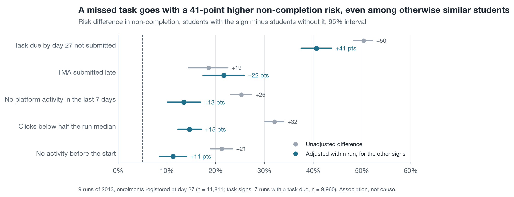
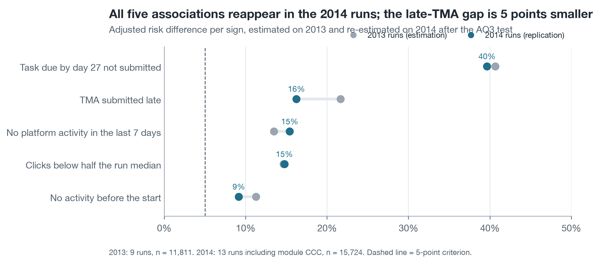

# AQ2 – Students who miss a task by week 4 are 41 points more likely not to complete than similar students in the same run

*Milestone 4, Level 2 prototype · team N04 · diagnostic question (AQ2), association only · enrolments registered at
day 27 · estimated on the 9 runs of 2013, replicated on the 13 runs of 2014 after the AQ3 test · run 11 November 2026 (UTC)*

> **Summary.** All five early signs go with later non-completion, and all five meet the criterion fixed in Level 1: an
> adjusted risk difference of at least 5 percentage points, an interval that excludes 0, and the same direction in at
> least two-thirds of the modules. A task due by day 27 and not submitted is by far the strongest sign: 90% of the
> students with it did not complete against 40% without it, and the gap is still 41 points (95% interval 38 to 44)
> when students are compared within the same run and with the other signs held equal. A late TMA adds 22 points, low
> activity 15, a week without activity 13 and no activity before the start 11. Every association reappears in the
> 2014 runs with the same verdict, including in module CCC, which has no 2013 run. These are associations: they say
> which students tutors should look at, not that changing a sign changes the outcome. **Status:** complete analysis
> of AQ2 on OULAD, estimated and replicated.

| Missed task | Late TMA | Low activity | Inactive last 7 days | No pre-start activity | Signs meeting the criterion |
| :---- | :---- | :---- | :---- | :---- | :---- |
| **+41 points** | **+22 points** | **+15 points** | **+13 points** | **+11 points** | **5 of 5**, in 2013 and in 2014 |

## 1. A missed task is the strongest sign, and adjustment does not explain it away

Table 1 gives, for each sign, the plain comparison (the baseline of Level 1) beside the adjusted estimate (the primary
approach): a logistic regression with a fixed effect for every run, adjustment for previous attempts and credits, all
five signs together, and sign × module terms. The adjusted risk difference is the average difference in predicted risk
between having and not having the sign, for the same students.

**Table 1. Risk difference in non-completion per sign, 9 runs of 2013, enrolments registered at day 27**

| Sign at day 27 | Students with the sign | Non-completion with / without | Unadjusted difference (95% interval) | Adjusted difference (95% interval) | Odds ratio (95% interval) |
| :---- | :---- | :---- | :---- | :---- | :---- |
| Task due and not submitted | 1,285 of 9,960 (12.9%) | 90.0% / 39.6% | +50.3 points (48.3 to 52.2) | **+40.7 points** (37.5 to 43.8) | 7.5 (6.1 to 9.1) |
| TMA submitted late | 577 of 9,960 (5.8%) | 63.6% / 45.1% | +18.5 (14.4 to 22.5) | **+21.7** (17.4 to 25.9) | 2.9 (2.4 to 3.5) |
| Clicks below half the run median | 3,175 of 11,811 (26.9%) | 67.8% / 35.8% | +32.1 (30.1 to 33.9) | **+14.7** (12.3 to 17.0) | 1.9 (1.8 to 2.2) |
| No platform activity in the last 7 days | 2,444 of 11,811 (20.7%) | 64.4% / 39.2% | +25.3 (23.1 to 27.4) | **+13.5** (10.1 to 16.8) | 1.7 (1.5 to 1.9) |
| No activity before the start | 2,297 of 11,811 (19.4%) | 61.5% / 40.3% | +21.2 (19.0 to 23.4) | **+11.3** (8.5 to 14.0) | 1.6 (1.4 to 1.8) |

Task signs are defined in the 7 runs with a task due by day 27 (9,960 enrolments); the two runs of EEE and GGG have no
task due by then. Odds ratios come from the same model without sign × module terms.

The three activity signs lose about half of their plain gap once the other signs are held equal (32 → 15, 25 → 13,
21 → 11 points), because they overlap: the correlation between inactivity in the last week and low activity is 0.50,
and both correlate with a missed task (0.32 and 0.38). Each adjusted value is therefore a partial association, what
one sign adds when the others are known, and not the share of non-completion that the sign explains. The late-TMA
gap grows slightly under adjustment (18.5 → 21.7), because students who submit late are by definition not among those
who did not submit at all. The odds ratios read much larger than the risk gaps: an odds ratio of 7.5 for a missed task
corresponds to a risk ratio of 2.3 (90.0% against 39.6%), which is why Level 1 reports risk differences first.

Signs also add up. In the 2013 runs, 30.6% of students with none of the five signs did not complete, 50.8% with one,
63.1% with two, 73.9% with three and 94.4% with four (391 students).

## 2. Each sign points the same way in every module, with different strength

**Table 2. Adjusted risk difference by module, 2013 runs (percentage points, 95% interval)**

| Sign | AAA | BBB | DDD | EEE | FFF | GGG | Modules with the same direction |
| :---- | :---- | :---- | :---- | :---- | :---- | :---- | :---- |
| Task missed | +44 (22 to 65) | +45 (40 to 50) | +35 (30 to 40) | no task due | +41 (35 to 47) | no task due | 4 of 4 |
| TMA late | +20 (6 to 33) | +22 (17 to 28) | +17 (6 to 28) | no task due | +25 (19 to 31) | no task due | 4 of 4 |
| Low activity | +14 (1 to 27) | +11 (7 to 15) | +16 (12 to 21) | +35 (25 to 44) | +12 (8 to 17) | +13 (5 to 21) | 6 of 6 |
| Inactive last 7 days | +5 (−8 to 18) | +9 (4 to 13) | +19 (9 to 29) | +19 (10 to 29) | +15 (9 to 21) | +4 (−3 to 11) | 6 of 6 |
| No pre-start activity | +9 (−9 to 27) | +8 (5 to 12) | +14 (7 to 20) | +16 (8 to 24) | +13 (7 to 19) | +5 (−2 to 11) | 6 of 6 |

All 26 module estimates are positive, so the direction is consistent. The size is not uniform. In GGG a week without
activity says little (+4 points, interval including 0): more than half of GGG's students (506 of 924) show that sign,
so it does not separate them. In AAA, the smallest module (369 enrolments), the intervals of three signs include 0. In
EEE, where no task falls due by day 27, low activity is a much stronger sign (+35 points) than elsewhere. A tutor
should therefore read the activity signs against the module: they mean most where tasks come late.

## 3. The associations replicate on the 2014 runs

Level 1 estimates AQ2 on the 2013 runs and re-estimates it on the 2014 runs only after the AQ3 model is frozen and
tested (Change Log C14), so that no test outcome is seen while the predictive model is chosen. The guard of this
prototype enforces that order: the 2014 extraction ran at 23:23 UTC, after the freeze at 23:18 UTC and the test at 23:19 UTC.

**Table 3. Adjusted risk difference per sign, estimation and replication**

| Sign | 2013 runs (n = 11,811) | 2014 runs (n = 15,724) | Change | Verdict in both years |
| :---- | :---- | :---- | :---- | :---- |
| Task missed | +40.7 (37.5 to 43.8) | +39.6 (36.8 to 42.5) | −1.0 | Consistent association |
| TMA late | +21.7 (17.4 to 25.9) | +16.2 (12.9 to 19.6) | −5.4 | Consistent association |
| Low activity | +14.7 (12.3 to 17.0) | +14.8 (12.7 to 16.8) | +0.1 | Consistent association |
| Inactive last 7 days | +13.5 (10.1 to 16.8) | +15.4 (12.8 to 18.1) | +1.9 | Consistent association |
| No pre-start activity | +11.3 (8.5 to 14.0) | +9.2 (6.9 to 11.4) | −2.1 | Consistent association |

Every 2014 interval overlaps its 2013 interval, and every sign keeps its verdict. All 26 sign × module estimates that
exist in both years have the same direction, and 21 of the 26 have a 2014 interval that excludes 0. Module CCC, absent
from 2013, shows the same pattern (task missed +35 points, inactive +19, low activity +9, no pre-start activity +13).
The one visible change is the late TMA, 5 points smaller in 2014; in AAA-2014J it vanishes (+0 points, interval −13 to
+13, 53 students), so a late TMA is the least stable of the five signs.

## 4. The estimates do not depend on the analytic choices tested

**Table 4. Sensitivity of the adjusted risk differences, 2013 runs (percentage points)**

| Variant | Task missed | Late task | Inactive | Low activity | No pre-start |
| :---- | :---- | :---- | :---- | :---- | :---- |
| Main model | 40.7 | 21.7 | 13.5 | 14.7 | 11.3 |
| Low activity from de-duplicated clicks | 40.6 | 21.6 | 13.5 | 14.8 | 11.2 |
| Late CMAs also count as late | 40.6 | 16.7 | 13.4 | 14.7 | 11.3 |
| Without the 8 flagged enrolments | 40.7 | 21.7 | 13.5 | 14.6 | 11.3 |
| Only the 7 runs with a task due | 40.6 | 21.6 | 13.8 | 12.9 | 11.4 |
| Low activity = below a quarter of the run median | 41.4 | 22.4 | 15.4 | 14.4 | 12.0 |
| Low activity = below the run median | 40.9 | 20.3 | 14.3 | 13.4 | 10.6 |

No variant moves an estimate across the 5-point criterion. Counting late CMAs as late lowers the late-task gap from
21.7 to 16.7 points, which supports the Level 1 choice to keep CMA lateness out of the rule: a late computer-marked
task is a weaker sign than a late tutor-marked one. The model fits its cells: observed and predicted non-completion by
run and activity level differ by more than two standard errors in 2 of 27 cells in 2013 (both in GGG-2013J, about 10
points) and in 0 of 39 cells in 2014.

**Subgroups (description).** The adjusted gaps are of similar size for women and men, for students with and without a
declared disability and across deprivation bands; for a missed task they range from 39 to 42 points. The plain gap of
a missed task is smaller where the base rate is higher (44 points in the most deprived 30% against 55 in the least
deprived 30%), because non-completion without the sign is already more common there (`results/subgroups_2013.csv`).

## What the prototype says about the Level 1 choice (brief step 7)

| Level 1 expectation | Prototype result |
| :---- | :---- |
| Logistic regression with run fixed effects and sign × module terms is feasible on 9 runs | Fits and converges (37 coefficients, 11,811 enrolments); no cell below 20 students needed pooling |
| Unadjusted and adjusted estimates differ because signs overlap | Activity signs lose about half of their gap; both are reported side by side |
| A sign is consistent at ≥ 5 points, interval excluding 0, two-thirds of modules | All five signs, in 2013 and in 2014 |
| Replication on 2014, CCC included, after the AQ3 test | Done in that order; all verdicts unchanged |
| No causal claim | Kept: the wording is "goes with", never "causes" |

The results support the reasons shown with each name in decision D1: a missed task is the sign a tutor should read
first, and the early-sign rule built from these signs is a strong baseline for AQ3 for exactly this reason.

## Limitations

- **Association, not cause.** Students who miss a task differ from others in ways the data do not record (work,
  health, motivation). Getting a student to submit a task is not shown to change completion.
- **Signs known by day 27 only.** A task is due by day 27 in 16 of 22 runs; in EEE and GGG the task signs cannot fire,
  so the week-4 picture there rests on activity alone.
- **Binary signs.** Each sign is a yes/no cut of a continuous behaviour, defined before the results (protocol P16).
  The thresholds for low activity were varied (Table 4); other definitions are possible.
- **Withdrawal and failure together.** The outcome joins Fail and Withdrawn, as Level 1 defines it.
- **Stand-in data.** OULAD modules are distance-learning courses of the UK Open University in 2013–2014.

## Method

Population: enrolments registered at day 27 (11,811 in 2013; 15,724 in 2014). Outcome: final result Fail or Withdrawn.
Model: logistic regression by maximum likelihood (statsmodels GLM) with HC1 robust standard errors; run fixed effects;
log(1 + previous attempts); log(1 + credits); for each sign one slope per module where the module holds at least 20
students with and 20 without the sign. Adjusted risk difference: average over the enrolments where the sign is defined
of predicted risk with the sign minus without it, other columns as observed; interval by the delta method. Unadjusted
difference: Newcombe interval for two proportions. Standard errors are not clustered, because every run of the modules
is observed, not sampled (Level 1, Section 3.2). Implementation choices are fixed in
[`../PROTOCOL.md`](../PROTOCOL.md) (P16, P17).

## Appendix: files

| Content | File |
| :---- | :---- |
| Analysis table (one row per enrolment, signs, covariates, audit columns) | `extracted-datasets/aq2_signs_d27_2013.csv`, `aq2_signs_d27_2014.csv` |
| Risk differences and verdicts | `results/associations_2013.csv`, `associations_2014.csv` |
| By module | `results/associations_by_module_2013.csv`, `associations_by_module_2014.csv` |
| Replication | `results/replication.csv`, `replication_by_module.csv` |
| Odds ratios, coefficients | `results/odds_ratios_*.csv`, `model_coefficients_*.csv` |
| Correlation of signs, non-completion by number of signs | `results/sign_correlation_*.csv`, `non_completion_by_sign_count_*.csv` |
| Residuals, sensitivity, subgroups | `results/binned_residuals_*.csv`, `sensitivity_*.csv`, `subgroups_*.csv` |
| Decisions, check ledger, methods checklist | [`NOTES.md`](NOTES.md) |
| Step logs | `logs/` |
