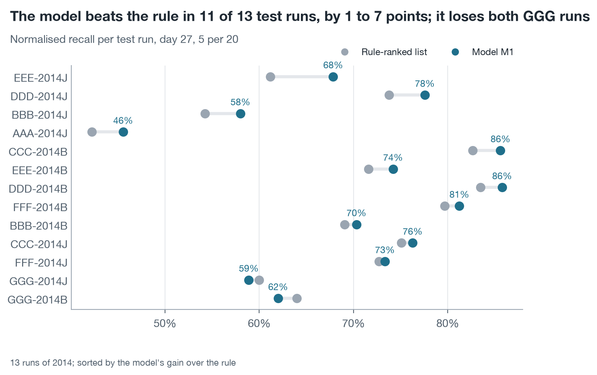
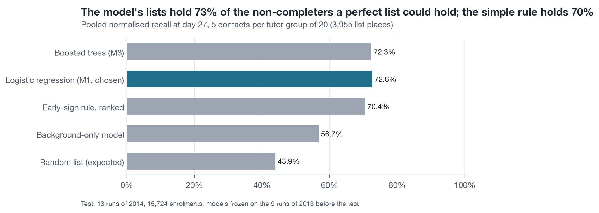
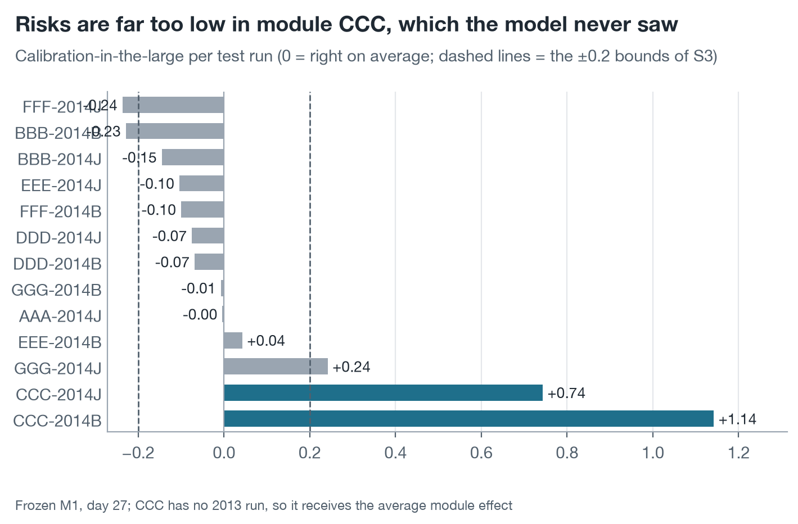

# AQ3 – A model built on 2013 runs lists slightly more later non-completers in 2014 than the early-sign rule

*Milestone 4, Level 2 prototype · team N04 · predictive question (AQ3) · prepared dataset OULAD-N04-prepared-1.0 · development on the 9 runs of 2013, test on the 13 runs of 2014 · rerun of 12 November 2026 (UTC), a reproduction of the unchanged design of the first run of 11 November*

> **Summary.** The primary approach of Level 1, a penalised logistic regression on the 19 primary predictors (M1), passes the single success gate S1. On the 13 test runs of 2014, at day 27 with 5 contacts per tutor group of 20, its lists hold 2,870 of the 3,955 non-completers that perfect lists could hold (pooled normalised recall 0.726), against 2,786 for the early-sign rule (0.704). The gain of 0.021, or 84 more non-completers on 3,955 list places, has a 95% bootstrap interval of 0.007 to 0.036 and a sign-flip p-value of 0.003; the model wins 11 runs and loses 2. The gain is real but small: about one more non-completer for every nine tutor groups. Gradient-boosted trees and the extended predictor set did not reach the margin fixed in advance, so the primary approach stays. Calibration meets the pooled bounds of S3 in this run, but not robustly, so the recommendation is to show tutors ranks and reasons, not probabilities. **Status:** complete prototype analysis of AQ3 on OULAD; feasibility evidence, not expected performance at the university. Every number here was regenerated in a rerun of the whole pipeline and equals the first run's; the status note below says what that does and does not show.

| Normalised recall, model | Normalised recall, rule | Gain over the rule | Runs won by the model | Random list |
| :---- | :---- | :---- | :---- | :---- |
| **0.726** (2,870 / 3,955) | **0.704** (2,786 / 3,955) | **+0.021** (95% interval +0.007 to +0.036) | **11 of 13** (2 lost) | 0.439 |

**Status of this analysis.** The folder was first produced on 11 November 2026: that run froze its models at 2026-11-11T23:18:16Z and read the 2014 outcomes for the first time at 2026-11-11T23:19:02Z. After the team found errors in the AQ1 and AQ2 reports, the whole pipeline was run again so that every table in the folder comes from one run. For AQ3 nothing was changed: the same models, grids, tuning criterion, tie-breaking, seed, bootstrap sizes and choice rule (`../PROTOCOL.md`, P01–P15, P19). The rerun froze at 2026-11-12T15:58:51Z and its scripts first read the 2014 outcomes at 2026-11-12T15:58:53Z. By then the outcomes and the first run's results were known to the analyst, so this is a reproduction of one test, not a second test: it shows that the result follows from the data, the code and the seed. Of the 30 AQ3 result tables, 28 are byte-identical to the first run's and 2 differ only in a column that records run time (the seconds each fold took, and the freeze time quoted in the detail of check V6); all 12 frozen model files have the same SHA-256 as in the first run (`../logs/compare_first_run.md`).

Normalised recall is the share of the best possible list that a list achieves: the non-completers on the list divided by the most a list of that length can hold. In all 13 test runs more students fail or withdraw than a list has places, so here it equals precision, the share of listed students who did not complete.

## 1. The model passes gate S1, by a small margin

Level 1 fixed one gate before any prototype result existed: on all 13 test runs, all eligible enrolments, day 27 and 5 per 20, the model's pooled normalised recall must exceed the rule-ranked list's, with the 95% paired two-level bootstrap interval of the difference above 0 and a one-sided sign-flip test on the 13 per-run differences below 0.05. Table 1 gives the result.

**Table 1. Gate S1 on the 13 test runs of 2014 (day 27, 5 per 20; 15,724 enrolments, 3,955 list places)**

| Quantity | Value |
| :---- | :---- |
| Model M1: non-completers on the lists / most attainable | 2,870 / 3,955 = 0.726 (bootstrap 95% interval 0.666 to 0.775) |
| Rule-ranked list | 2,786 / 3,955 = 0.704 (0.641 to 0.755) |
| Difference, model − rule | +0.021 = +84 non-completers |
| 95% paired two-level bootstrap interval of the difference | +0.007 to +0.036 (2,000 replicates; 0.15% of replicates at or below 0) |
| Sign-flip test on the 13 per-run differences, one-sided | p = 0.003 (26 of 8,192 sign assignments) |
| Wins / ties / losses over runs | 11 / 0 / 2 |
| Unweighted mean of the per-run differences | +0.021 |
| **Verdict** | **S1 met** |

The model beats the rule in 11 runs by 1 to 7 points and loses both runs of module GGG by 1 to 2 points (4 and 2 non-completers). GGG has no task due by day 27 and the rule already flags about half of its students as inactive, so the model has little to add there. The intervals of the two methods are wide (0.67 to 0.78 for the model) because runs differ a lot from each other; the interval of the *difference* is narrow because both lists are compared on the same resampled students.

What the gain means in practice: the 13 runs hold 791 assumed tutor groups. On a list of 5, the model names on average 3.63 students who will not complete and the rule 3.52. The model therefore adds one non-completer for about every nine tutor groups. Level 1 named the rule as the method to beat, and the model beats it with the certainty that was asked for; it does not replace the judgement that the rule alone already delivers 97% of the model's hits.

## 2. Activity and task information carry the ranking; a more complex model adds nothing measurable

Table 2 places the model between its baselines and its challengers on the same test runs. Only the first comparison (M1 against the rule) is the gate; the rest is context that cannot change the verdict.

<!-- table: AQ3 Table 2 -->
**Table 2. All rankings on the test runs, day 27, 5 per 20**

| Ranking | Pooled normalised recall | Lift over the base rate | ROC-AUC within run | Difference to M1 (95% interval) |
| :---- | :---- | :---- | :---- | :---- |
| Random list (expected) | 0.439 | 1.00 | 0.500 | – |
| B3 background-only logistic model | 0.567 | 1.29 | 0.603 | −0.158 (−0.186 to −0.132) |
| B2 early-sign rule, ranked | 0.704 | 1.60 | 0.711 | −0.021 (−0.036 to −0.007) |
| **M1 penalised logistic regression, primary set (chosen)** | **0.726** | **1.65** | **0.730** | – |
| M2 penalised logistic regression, extended set | 0.726 | 1.65 | 0.734 | +0.001 (−0.009 to +0.009) |
| M3 gradient-boosted trees, primary set | 0.723 | 1.65 | 0.730 | −0.003 (−0.012 to +0.010) |
| M4 gradient-boosted trees, extended set | 0.728 | 1.66 | 0.732 | +0.003 (−0.008 to +0.015) |
<!-- /table -->

Three readings follow. First, who the student is (module, start month, previous attempts, credits, education, registration lead) lifts a list from 0.439 to 0.567; what the student does by day 27 lifts it further to 0.726, so behaviour adds 16 points beyond background. Second, the three challengers lie within 0.003 of M1 and every interval includes 0, so 14 further predictors or a tree ensemble buy no measurable gain. Third, this agrees with the development folds, where the choice is made before the test (Table 6): on the 9 runs of 2013 the challengers scored 0.001 to 0.002 *below* M1, far from the margin of +0.03 and 7 of 9 folds that Level 1 required. The simpler, interpretable model stays, as the Level 1 selection rationale expected.

<!-- table: AQ3 Table 6 -->
**Table 6. Model choice on the 9 development folds of 2013 (day 27, 5 per 20)**

| Configuration | Pooled normalised recall | Gain over M1 | Folds with a gain over M1 | Choice |
| :---- | :---- | :---- | :---- | :---- |
| B3 | 0.568 | −0.182 | 0 of 9 |  |
| M1 | 0.750 | – | – | chosen |
| M2 | 0.749 | −0.001 | 3 of 9 |  |
| M3 | 0.749 | −0.002 | 5 of 9 |  |
| M4 | 0.748 | −0.002 | 3 of 9 |  |
<!-- /table -->

## 3. Both lists mostly find students who are already visibly disengaged

The lists reach 41.5% (model) and 40.3% (rule) of all 6,911 non-completers; no list of 5 per 20 can reach more than 57.2%, because 2,956 non-completers exceed the places available in their runs. Table 3 shows where the remaining misses fall.

<!-- table: AQ3 Table 3 -->
**Table 3. Recall by activity level and history, day 27, 5 per 20 (share of the group's non-completers who are listed)**

| Group at day 27 | Enrolments | Non-completers | Model recall | Rule recall |
| :---- | :---- | :---- | :---- | :---- |
| No clicks since the start | 624 | 513 | 98.4% | 100.0% |
| Low activity (below half the run median) | 3,475 | 2,205 | 70.9% | 73.3% |
| Normal activity | 11,625 | 4,193 | 19.1% | 15.6% |
| First attempt at the module | 13,865 | 5,801 | 37.0% | 37.9% |
| Repeat attempt | 1,859 | 1,110 | 65.3% | 53.0% |
| Registered after the start | 152 | 65 | 73.8% | 53.8% |
| Final result Fail | 3,805 | 3,805 | 43.2% | 41.9% |
| Final result Withdrawn | 3,106 | 3,106 | 39.5% | 38.3% |
<!-- /table -->

Six in ten non-completers (4,193 of 6,911) still show normal activity at day 27, and the lists reach fewer than one in five of them. This is the main limit of any week-4 list on these data, and no model tested here changes it. The model's advantage over the rule sits in two places the rule cannot see: students repeating the module (+12 points of recall) and active students with weaker signals (+3.5 points). The two lists share 77% of their places (3,053 of 3,955); the 902 students only the model lists did not complete in 60.0% of cases, against 50.7% of the 902 only the rule lists.

The cut at rank k is firm except at its edge. When a run's students are resampled, a student in the last 5% of places before the cut stays on the list in 90% of resamples and a student in the first 5% after it enters in 10%; everyone further away keeps their status. Students within 7 days of withdrawing are a small part of the picture: 205 test enrolments left in the 7 days after the cut-off, and the list held 110 of them.

## 4. Calibration meets the pooled bounds, but not well enough to show probabilities

Level 1 lets tutors see probabilities only if the pooled calibration-in-the-large lies between −0.2 and 0.2 and the slope between 0.8 and 1.2 (condition S3). The frozen model gives +0.124 and 0.873: the bounds are met. The mean predicted risk is 41.5% against an observed 44.0%.

<!-- table: AQ3 Table 4 -->
**Table 4. Calibration of the frozen M1 at day 27 (no recalibration on any 2014 row)**

| Scope | Calibration-in-the-large (target 0) | Slope (target 1) | Mean predicted | Observed |
| :---- | :---- | :---- | :---- | :---- |
| All 13 test runs (S3) | +0.124 | 0.873 | 41.5% | 44.0% |
| CCC-2014B (module absent from training) | +1.142 | 1.014 | 34.1% | 55.8% |
| CCC-2014J | +0.743 | 0.923 | 34.9% | 49.8% |
| Runs outside ±0.2 | 5 of 13 (BBB-2014B, CCC-2014B, CCC-2014J, FFF-2014J, GGG-2014J) |  |  |  |
| Declared disability | +0.386 | 0.881 | 46.2% | 54.0% |
| Deprivation band 0–10% | +0.363 | 0.840 | 45.7% | 53.0% |
<!-- /table -->

Three facts argue against showing probabilities despite the pooled pass. The pooled value hides five runs outside the bounds, including the unseen module CCC, where risks are 15 to 22 points too low. Risks are also about 8 points too low for students with a declared disability and for the most deprived band. And the verdict depends on an implementation detail that Level 1 left open: the team's earlier run, written as separate code, tuned the penalty on recall at capacity, obtained a much stronger penalty (C = 0.001 against C = 10 here) and a slope of 1.31, which fails S3 (Section 6). A condition that flips with the tuning criterion is not a safe basis for showing a number to a tutor. The ranking, in contrast, is unaffected: within a run, module and start-month terms move every student by the same amount.

**Recommendation:** tutors see ranks and reasons only. This is the fallback Level 1 already defines for a failed S3; adopting it needs a recorded decision (proposed Change Log entry, Section 7).

## 5. The result holds across the planned sensitivity checks, with less certainty for unpaired runs

<!-- table: AQ3 Table 5 -->
**Table 5. Sensitivity of the model-minus-rule difference (none of these can change the S1 verdict)**

| Variant | Runs | Model | Rule | Difference (95% interval) | Wins / ties / losses |
| :---- | :---- | :---- | :---- | :---- | :---- |
| Main: all runs, day 27, 5 per 20 | 13 | 0.726 | 0.704 | +0.021 (+0.007 to +0.036) | 11 / 0 / 2 |
| Paired runs (module and start month also ran in 2013) | 9 | 0.708 | 0.683 | +0.025 (+0.008 to +0.042) | 8 / 0 / 1 |
| Unpaired runs (CCC-B, CCC-J, EEE-B, GGG-B) | 4 | 0.765 | 0.752 | +0.014 (−0.013 to +0.036) | 3 / 0 / 1 |
| Module CCC only | 2 | 0.802 | 0.783 | +0.019 (−0.006 to +0.046) | 2 / 0 / 0 |
| Without module CCC | 11 | 0.704 | 0.682 | +0.022 (+0.005 to +0.039) | 9 / 0 / 2 |
| Without test enrolments of students seen in 2013 | 13 | 0.702 | 0.681 | +0.021 (+0.006 to +0.037) | 11 / 0 / 2 |
| Without Withdrawn enrolments lacking a withdrawal day | 13 | 0.718 | 0.697 | +0.021 (+0.007 to +0.035) | 11 / 1 / 1 |
| Rule variant that also counts late CMAs | 13 | 0.726 | 0.700 | +0.026 (+0.010 to +0.043) | 11 / 0 / 2 |
| Labels-available: February runs, trained on 2013 February runs only | 6 | 0.782 | 0.762 | +0.020 (+0.002 to +0.035) | 5 / 1 / 0 |
| Same February runs, model trained on all 2013 runs | 6 | 0.778 | 0.762 | +0.016 (−0.004 to +0.034) | 5 / 0 / 1 |
| Day 27, 3 per 20 | 13 | 0.810 | 0.778 | +0.032 (+0.006 to +0.055) | 11 / 0 / 2 |
| Day 13, 5 per 20 | 13 | 0.688 | 0.667 | +0.021 (+0.002 to +0.036) | 9 / 0 / 4 |
| Day 13, 3 per 20 | 13 | 0.742 | 0.707 | +0.035 (+0.008 to +0.059) | 9 / 1 / 3 |
<!-- /table -->

The gain is of the same size, about 0.02 to 0.035, in every variant. It is established for runs whose module and start month were seen in training; for the four unpaired runs the estimate is positive but its interval includes 0, so transfer to a new module or a new start month is plausible, not shown. Repeat students do not drive the result. A model trained only on the runs whose outcomes a university would already hold in February (labels-available) performs as well on the February runs as the model trained on all 2013 runs (0.782 against 0.778). The week-3 list (day 13), which uses activity only, is weaker for both methods (0.688 and 0.667) and the model wins fewer runs (9 of 13).

## 6. A second implementation of the same design reaches the same S1 verdict

The team ran an earlier prototype of the same frozen design (`reports/milestone-4/package/`), with code written separately from this folder's. The first run of this folder was built and tested before that run's results were opened; in this rerun both sets of results were already known, so the table below is a comparison of two implementations, not a blind replication (`results/crosscheck_earlier_run.csv`).

| Quantity | This prototype | Earlier team run |
| :---- | :---- | :---- |
| Rule-ranked list, non-completers listed | 2,786 (identical in all 13 runs) | 2,786 |
| Model M1, non-completers listed | 2,870 | 2,871 |
| Difference in pooled normalised recall | +0.021 (+0.007 to +0.036) | +0.021 (+0.009 to +0.034) |
| Runs won by the model | 11 of 13 | 12 of 13 |
| S1 | met | met |
| Frozen penalty of M1 at day 27 | C = 10 (tuned on log loss) | C = 0.001 (tuned on recall at capacity) |
| Calibration slope / S3 | 0.873 / met | 1.311 / not met |

The baseline reproduces exactly and the model within one non-completer in 3,955 places, although the two fits use very different penalties. The ranking is therefore robust to the penalty; calibration is not.

## 7. Comparison with the Level 1 expectation (brief step 7)

| Level 1 expectation | Prototype result | Consequence |
| :---- | :---- | :---- |
| M1 beats the rule at the main operating point (S1) | Met: +0.021, interval above 0, p = 0.003, 11 of 13 runs | Primary approach confirmed for D1 |
| Trees or the extended set replace M1 only with +0.03 and 7 of 9 folds | Not met: −0.001 to −0.002 on the development folds; within ±0.003 on the test | No change of primary approach |
| A baseline may match the model | The rule delivers 97% of the model's hits with no fitting | Keep the rule as the fallback and as a plain-language check on the list |
| S2 precision reported against base rate and ceiling | 0.726 against a base rate of 0.440 and a ceiling of 1.000: 51% of the way (rule 47%) | Reported, not a gate |
| S3 decides whether probabilities are shown | Met on pooled estimates here, failed in the earlier team run, failed in 5 of 13 runs | Proposed: ranks and reasons only |
| Transfer to a later run is the risk to test | Shown for paired runs; uncertain for 4 unpaired runs | State as scope of the claim |

Proposed entries for the Controlled Change Log, for the team to decide (the frozen Level 1 text stays as submitted):

1. **C15 (proposed):** the tuning criterion of the penalty is stated as log loss on the inner folds. Reason: Level 1 left it open, and the S3 verdict depends on it while S1 does not.
2. **C16 (proposed):** tutors receive ranks and reasons only; probabilities are not shown until calibration is checked on the university's own runs. Reason: Table 4 and Section 6.

## Limitations

- **Stand-in data.** OULAD describes distance-learning modules of the UK Open University in 2013–2014. The numbers show that the design is feasible; they are not expected performance at the university, which needs its own check.
- **One test, thirteen runs.** Thirteen runs make interval estimates coarse, which is why the gate also uses the sign-flip test. Subsets of fewer than 6 runs cannot reach p < 0.05 at all and are read by their intervals.
- **Capacity is assumed.** OULAD records no tutor groups; lists of 5 per 20 stand in for tutors' lists.
- **Risk is not need.** The list ranks by risk of non-completion. Whether the students ranked first benefit most from a contact is untested until a randomised pilot; no result here says that contact works.
- **One test, looked at more than once.** Level 1 allows one test. The team's earlier run opened the 2014 outcomes on 9 November 2026, the first run of this folder on 11 November, and this rerun on 12 November (in two passes of the pipeline, because the first pass stopped at a checking step; `../logs/process-log.md`, section 6). No AQ3 or AQ4 design choice was changed after a 2014 outcome was seen: the choices P01–P15 and P19 are those written before the first run's first result, and the rerun reproduces that run's numbers. The freeze and access record of the rerun show the order in which its scripts ran; they do not show a blind test. The team should present these runs as one test and its reproductions, never as several tests.

## Method

**Data.** Feature views of OULAD-N04-prepared-1.0 at day 13 and day 27, hash-checked against the Milestone 3 manifest: 12,080 and 11,811 development enrolments (5,519 and 5,245 non-completers), 15,989 and 15,724 test enrolments, the counts of Level 1 Table A.6. Target: final result Fail or Withdrawn. No audit attribute is a model input.

**Baselines first.** Random list (analytic expectation); the early-sign rule ranked by its number of signs with ties by lower activity relative to the run; a background-only logistic model.

**Candidates.** Penalised (ridge) logistic regression and gradient-boosted trees, each on the primary set (19 predictors, 23 parameters) and the extended set. Counts enter as log(1 + x); module and start month are deviation-coded so that an unseen module receives the average; every transform is refitted on the training rows of each fold.

**Validation.** Leave-one-run-out over the 9 runs of 2013; students who also appear in the validation run are removed from training (0 to 55 enrolments per fold at day 27; 121 students with two 2013 enrolments in all, the figure of Level 1 Table A.5); hyperparameters are tuned in an inner leave-one-run-out loop on log loss. The choice rule of Level 1 was applied to the fold results. All models were then refitted on all 2013 runs and frozen with their SHA-256 at 2026-11-12T15:58:51Z in this rerun; its scripts first read a 2014 outcome at 2026-11-12T15:58:53Z (`logs/test-access.md`). The first run's freeze was at 2026-11-11T23:18:16Z.

**Uncertainty.** Paired two-level bootstrap (runs, then enrolments; lists re-formed in every replicate) and an exact sign-flip test over all 8,192 sign assignments.

**Implementation choices** that Level 1 left open are listed in [`../PROTOCOL.md`](../PROTOCOL.md). Those that govern AQ3 (P01–P15, P19) were written on 11 November 2026 before the first run's first result and were not changed for the rerun.

## Appendix: files

| Content | File |
| :---- | :---- |
| Gate S1, per-run table, bootstrap replicates | `results/s1_gate.csv`, `s1_gate_per_run.csv`, `s1_bootstrap.csv` |
| All rankings per run and pooled, both cut-offs and capacities | `results/test_runs.csv`, `test_pooled.csv`, `test_context_vs_rule.csv` |
| Secondary metrics, S2, calibration, net benefit | `results/secondary.csv`, `calibration.csv`, `calibration_bins.csv`, `calibration_by_run.csv`, `net_benefit.csv` |
| Error analysis | `results/errors_by_run.csv`, `errors_by_slice.csv`, `list_overlap.csv`, `list_stability.csv` |
| Sensitivity | `results/sensitivity.csv`, `sensitivity_per_run_labels_available.csv` |
| Development folds, tuning, model choice | `results/dev_folds.csv`, `dev_pooled.csv`, `dev_tuning.csv`, `dev_fold_design.csv`, `model_choice.csv` |
| Freeze record, frozen models, coefficients | `results/freeze.json`, `frozen_models.csv`, `frozen_M1_d27_coefficients.csv`, `results/models/` |
| Verification and comparison with the earlier runs | `results/verification.csv`, `crosscheck_earlier_run.csv`, `crosscheck_per_run.csv`, `../logs/compare_first_run.csv` |
| Extracted datasets | `extracted-datasets/` (development table, blind test features, out-of-fold scores, scored test table) |
| Decisions, check ledger, methods checklist | [`NOTES.md`](NOTES.md) |
| Step logs | `logs/` |
