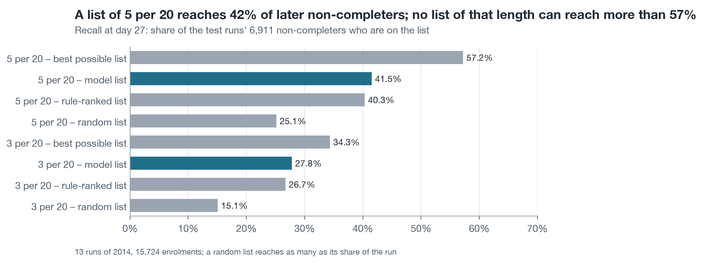
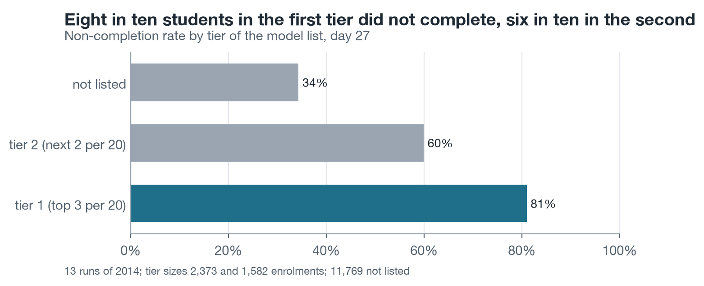
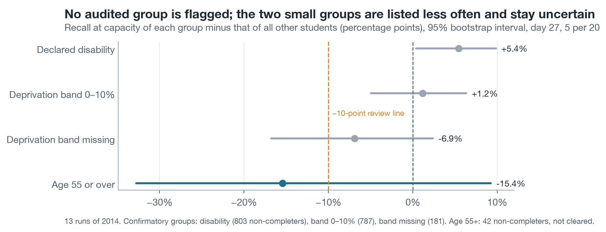

# AQ4 – A list of 5 per 20 reaches 42% of later non-completers, 1.65 times a random list, with no audited group flagged

*Milestone 4, Level 2 prototype · team N04 · ranking question (AQ4), decision support · lists formed from the frozen AQ3 scores · 13 test runs of 2014 · rerun of 12 November 2026 (UTC), a reproduction of the unchanged design of the first run of 11 November*

> **Summary.** Cutting the frozen AQ3 scores at the assumed capacity gives one ranked list per run. At day 27 with 5 contacts per tutor group of 20, the 13 lists hold 3,955 students, of whom 2,870 (72.6%) later failed or withdrew. That is 41.5% of all 6,911 non-completers, against 25.1% for a random list, 40.3% for the rule-ranked list and a ceiling of 57.2% that no list of this length can pass. Eight in ten students in the first tier (top 3 per 20) did not complete, six in ten in the second tier (next 2 per 20). The confirmatory fairness check flags none of the three groups fixed in Level 1: recall for students with a declared disability is 5.4 points above the other students', for the most deprived band 1.2 points above, for the missing deprivation band 6.9 points below with an interval that includes 0. Students aged 55 or over are too few to clear. **Status:** complete prototype analysis of AQ4 as a ranking; the list ranks risk, not the benefit of a contact, and no result here says that contact works. Every number here was regenerated in a rerun of the whole pipeline and equals the first run's.

| Recall of the model list | Random list | Rule-ranked list | Best possible list | Lift over the base rate | Confirmatory groups flagged |
| :---- | :---- | :---- | :---- | :---- | :---- |
| **41.5%** (2,870 of 6,911) | 25.1% | 40.3% | 57.2% | **1.65** | **0 of 3** |

**Status of this analysis.** AQ4 fits nothing: it cuts the frozen AQ3 scores at the assumed capacity. The folder was first produced on 11 November 2026 and run again on 12 November after errors were found in the AQ1 and AQ2 reports. For AQ4 nothing was changed: the same lists, tie-breaking, bootstrap size and fairness rule (`../PROTOCOL.md`, P03–P05, P14). The rerun is a reproduction with the 2014 outcomes already known, not a second test. All 13 AQ4 result tables are byte-identical to the first run's (`../logs/compare_first_run.md`).

## 1. The list reaches 42% of non-completers; capacity, not the model, sets most of the limit

<!-- table: AQ4 Table 1 -->
**Table 1. List quality on the 13 test runs of 2014**

| Cut-off and capacity | List places | Ranking | Non-completers listed | Recall | Ceiling of recall | Normalised recall | Precision | Lift |
| :---- | :---- | :---- | :---- | :---- | :---- | :---- | :---- | :---- |
| Day 27, 5 per 20 (main) | 3,955 | Model | 2,870 | 41.5% | 57.2% | 0.726 | 72.6% | 1.65 |
|  |  | Rule | 2,786 | 40.3% | 57.2% | 0.704 | 70.4% | 1.60 |
|  |  | Random (expected) | 1,738 | 25.1% | 57.2% | 0.439 | 43.9% | 1.00 |
| Day 27, 3 per 20 | 2,373 | Model | 1,922 | 27.8% | 34.3% | 0.810 | 81.0% | 1.84 |
|  |  | Rule | 1,846 | 26.7% | 34.3% | 0.778 | 77.8% | 1.77 |
|  |  | Random (expected) | 1,043 | 15.1% | 34.3% | 0.439 | 43.9% | 1.00 |
| Day 13, 5 per 20 | 4,030 | Model | 2,771 | 38.5% | 56.1% | 0.688 | 68.8% | 1.53 |
|  |  | Rule | 2,688 | 37.4% | 56.1% | 0.667 | 66.7% | 1.48 |
| Day 13, 3 per 20 | 2,418 | Model | 1,795 | 25.0% | 33.6% | 0.742 | 74.2% | 1.65 |
|  |  | Rule | 1,710 | 23.8% | 33.6% | 0.707 | 70.7% | 1.57 |
<!-- /table -->

Because 44% of students do not complete and a list holds 25% of them, even a perfect list would miss 43% of the non-completers. The model closes 51% of the distance between a random list and a perfect one; the rule closes 47%. The list shares the success gate of AQ3: the model's lists beat the rule's with a 95% interval of +0.007 to +0.036 in pooled normalised recall (gate S1 met, `results/s1_reference.csv`). The gain over a random list is large; the gain over the rule is small, 84 students on 3,955 places.

Per run, the model's lift over the base rate lies between 1.53 and 2.06. No list fills with completers: the share of listed students who completed ranges from 14% (CCC-2014B, DDD-2014B) to 54% (AAA-2014J, the smallest run with the lowest non-completion rate, 27%).

## 2. Two tiers from capacity separate students well

Level 1 offers risk tiers for tutors who want a lighter second contact: tier 1 is the top 3 per 20 and tier 2 the next 2 per 20, both cut points coming from capacity and not from the test data.

<!-- table: AQ4 Table 2 -->
**Table 2. Non-completion by tier of the model list, day 27**

| Tier | Enrolments | Did not complete | Withdrawn | Failed |
| :---- | :---- | :---- | :---- | :---- |
| Tier 1 (top 3 per 20) | 2,373 | 81.0% (1,922) | 812 | 1,110 |
| Tier 2 (next 2 per 20) | 1,582 | 59.9% (948) | 414 | 534 |
| Not listed | 11,769 | 34.3% (4,041) | 1,880 | 2,161 |
<!-- /table -->

The list holds failing and withdrawing students in similar proportion to their numbers: it reaches 43.2% of the 3,805 students who later failed and 39.5% of the 3,106 who later withdrew. One student in three who is not listed still does not complete, which restates the capacity limit of Section 1.

## 3. Every listed student comes with reasons, and one of them should not be shown

Each name on the list carries the three predictors that raise that student's risk most, taken from the same frozen logistic equation that ranks the students (coefficient × standardised value; module and start month are left out because they are equal for everyone in a run). All 3,955 listed students have at least one reason (`extracted-datasets/aq4_contact_list_d27.csv`).

<!-- table: AQ4 Table 3 -->
**Table 3. First reason of the listed students, day 27, 5 per 20**

| First reason | Listed students | Share of the list | Did not complete |
| :---- | :---- | :---- | :---- |
| Few active days since the start | 1,500 | 37.9% | 64.4% |
| Task due and not submitted | 1,362 | 34.4% | 89.0% |
| Lower prior education | 572 | 14.5% | 64.9% |
| TMA submitted late | 292 | 7.4% | 62.0% |
| Previous attempt at the module | 94 | 2.4% | 60.6% |
| Other reasons together | 135 | 3.4% | – |
<!-- /table -->

For 80% of the list the first reason is a behaviour a tutor can talk about: low activity, a missed task or a late task. For 14.5% it is the student's prior education. That predictor belongs to the primary set fixed in Level 1 and improves the ranking, but it is a background attribute marked sensitive in the Milestone 3 dictionary, and a tutor cannot act on it. The recommendation for the next stage is to keep it in the score but show tutors only behavioural reasons, and to test in the pilot how much the list changes without it.

The model list and the rule list share 77% of their places (3,053 of 3,955). The 624 students with no click at all since the start take 16% of the places on either list, and 82% of them do not complete; any method finds them. The model's contribution lies among the 15,100 students with some activity, where it reaches 37.0% of the non-completers against 35.5% for the rule.

## 4. The confirmatory fairness check flags no group; two small groups stay uncertain

Level 1 fixed the check before any test outcome was opened (rule FR1), and the rerun applies it unchanged: for each of three groups, recall at capacity minus the recall of all other students; a group is flagged for review when the gap is below −10 points and its one-sided 95% bootstrap interval, Holm-adjusted over the three groups, lies entirely below 0.

<!-- table: AQ4 Table 4 -->
**Table 4. Confirmatory check FR1, model list, day 27, 5 per 20 (5,000 two-level bootstrap replicates)**

| Group | Test enrolments | Non-completers | Recall of the group | Recall of the others | Gap (95% interval) | Holm-adjusted p | Status |
| :---- | :---- | :---- | :---- | :---- | :---- | :---- | :---- |
| Declared disability | 1,488 | 803 | 46.3% | 40.9% | +5.4 points (+0.4 to +9.8) | 1.00 | Not flagged |
| Deprivation band 0–10% | 1,486 | 787 | 42.6% | 41.4% | +1.2 points (−5.0 to +6.3) | 1.00 | Not flagged |
| Deprivation band missing | 610 | 181 | 34.8% | 41.7% | −6.9 points (−16.8 to +2.4) | 0.20 | Not flagged |
| Age 55 or over (below 400 enrolments) | 118 | 42 | 26.2% | 41.6% | −15.4 points (−32.8 to +9.2) | – | Insufficient data, not cleared |
<!-- /table -->

No confirmatory group is flagged, so condition FR1 for use holds. Two results need care. The missing deprivation band has a gap of −6.9 points whose interval reaches −16.8: with 181 non-completers the check cannot rule out a gap beyond the review line, it only fails to show one. Students aged 55 or over show the largest point gap (−15.4) on 42 non-completers; Level 1 reports this group as not cleared, and it stays so. Both groups have low non-completion rates (30% and 36%) and high activity (median 289 and 311 clicks against 168 overall), so fewer of them rank high; the rule list shows nearly the same gaps (−6.8 and −16.6 points), which means the gap comes from the activity signals themselves, not from the fitted model.

<!-- table: AQ4 Table 5 -->
**Table 5. Descriptive checks by group, model list, day 27, 5 per 20**

| Group | Non-completion rate | Share listed | Recall | Precision | Calibration-in-the-large |
| :---- | :---- | :---- | :---- | :---- | :---- |
| Female | 41.3% | 23.9% | 38.7% | 66.8% | +0.03 |
| Male | 45.9% | 26.1% | 43.4% | 76.5% | +0.20 |
| No declared disability | 42.9% | 24.4% | 40.9% | 71.9% | – |
| Declared disability | 54.0% | 32.5% | 46.3% | 77.0% | +0.39 |
| Deprivation band 0–10% | 53.0% | 29.5% | 42.6% | 76.3% | +0.36 |
| Deprivation band 90–100% | 35.2% | 20.0% | 39.2% | 68.9% | – |
| Deprivation band missing | 29.7% | 15.7% | 34.8% | 65.6% | −0.27 |
| Age 0–35 | 45.9% | 27.5% | 43.6% | 72.8% | – |
| Age 35–55 | 39.7% | 20.1% | 36.3% | 71.7% | – |
<!-- /table -->

Three descriptive patterns are worth stating. Recall is 4.7 points lower for women than for men (38.7% against 43.4%), with the rule list showing a similar gap (37.9% against 41.9%); gender was not a confirmatory group, so this is a finding to carry into the pilot's audit plan, not a flag. The threshold-free measure agrees: the area between the ROC curves of women and men (ABROCA 0.063) is above what shuffled labels produce (95th percentile 0.054), while the three confirmatory groups are within chance. Groups with higher non-completion rates are listed more often and with higher precision, as expected when base rates differ. And the model's risks are too low on average for students with a declared disability and for the most deprived band (calibration-in-the-large +0.39 and +0.36), a further reason to show ranks rather than probabilities (AQ3 report, Section 4).

## What the prototype says about the Level 1 choice (brief step 7)

| Level 1 expectation | Prototype result |
| :---- | :---- |
| Top-k per run from the AQ3 scores, with reasons, is the primary approach | Feasible: lists, tiers and reasons are produced from the frozen scores with no further fitting |
| The list is judged by recall against the attainable maximum and by lift (Change Log C13) | Normalised recall 0.726, lift 1.65 at the main operating point; gate S1 met |
| Baselines: random list and rule-ranked list | Random 0.439; rule 0.704, 77% of places shared with the model list |
| Confirmatory fairness check passes or its flags are reviewed | 0 of 3 groups flagged; age 55 or over not cleared; a descriptive gender gap of 4.7 points |
| No statement about the effect of contact | Kept: every result describes who is listed, none what a contact achieves |

The primary approach of Level 1 stands. Three points go to the next stage: show behavioural reasons only (Section 3); add gender to the audit groups of the pilot (Section 4); and keep the claim at "ranking by risk" until a randomised pilot tests whether the students ranked first are the ones a contact helps.

## Limitations

- **Assumed capacity.** OULAD has no tutor groups, so one list per run with 3 or 5 places per 20 students stands in for tutors' lists. Real groups differ in size and composition, and a per-group list would behave differently from a per-run list cut to the same total.
- **Risk order is not need order.** The data hold no contact and no outcome after contact. The assumption that the students at highest risk are the ones to contact first is untested.
- **Small groups.** The fairness check can flag a gap; with 181 or 42 non-completers it cannot prove the absence of one. Intervals are given so that the reader sees how much is unknown.
- **Stand-in data.** The groups, their sizes and their non-completion rates are those of OULAD; the check must be repeated on the university's own students.

## Method

Lists: for every test run, students are ordered by the frozen M1 score; exact ties at the edge are broken by one fixed pseudo-random number per enrolment; k = 5 × ceil(n / 20) (or 3 ×), as in the prepared capacity table. Metrics follow Level 1 Appendix II. Fairness: two-level bootstrap (runs, then enrolments) with lists re-formed in each of 5,000 replicates; one-sided p-value = share of replicates with a gap at or above 0; Holm step-down over the three groups. ABROCA is computed within run on runs where both the group and the others hold at least 10 completers and 10 non-completers, weighted by group size, with 200 within-run label shuffles as the reference. Implementation choices are fixed in [`../PROTOCOL.md`](../PROTOCOL.md) (P03–P05, P14).

## Appendix: files

| Content | File |
| :---- | :---- |
| The day-27 contact list with reasons (outcome columns marked evaluation-only) | `extracted-datasets/aq4_contact_list_d27.csv` |
| All test enrolments with ranks, list flags and tiers | `extracted-datasets/aq4_ranked_d27.csv`, `aq4_ranked_d13.csv` |
| List quality per run and pooled | `results/list_quality_by_run.csv`, `list_quality_pooled.csv` |
| Tiers, kind of non-completion, overlap, activity split, reasons | `results/tiers.csv`, `outcome_kind_on_list.csv`, `overlap_by_run.csv`, `active_vs_inactive.csv`, `reason_frequency.csv` |
| Fairness | `results/fairness_confirmatory.csv`, `fairness_descriptive.csv`, `fairness_calibration.csv`, `fairness_abroca.csv`, `fairness_proxy.csv` |
| Decisions, check ledger, methods checklist | [`NOTES.md`](NOTES.md) |
| Step logs | `logs/` |
