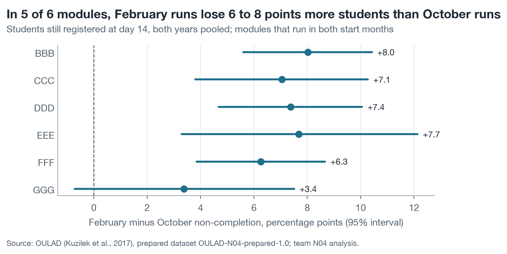
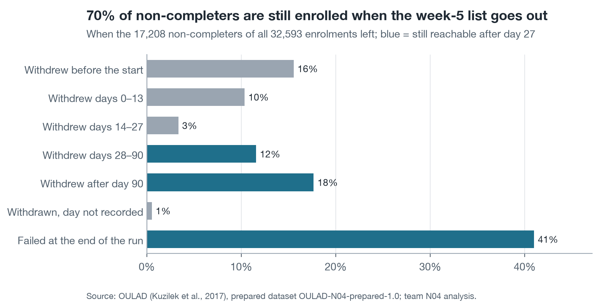
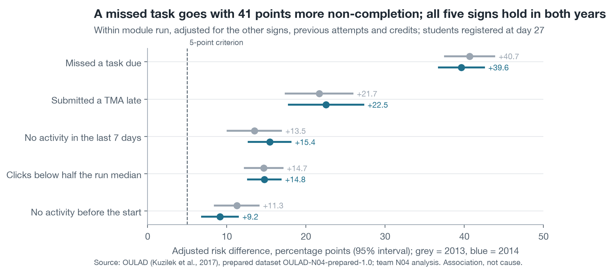
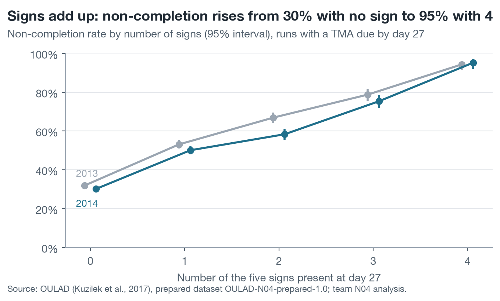
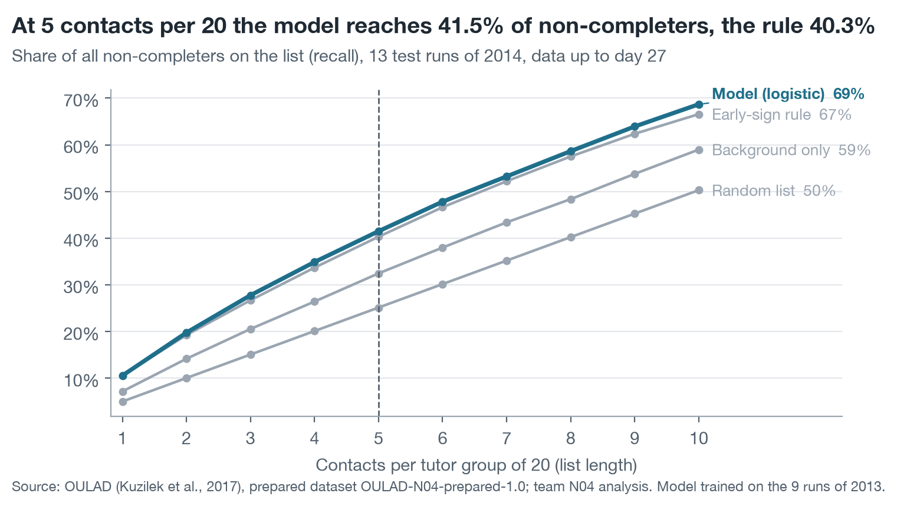
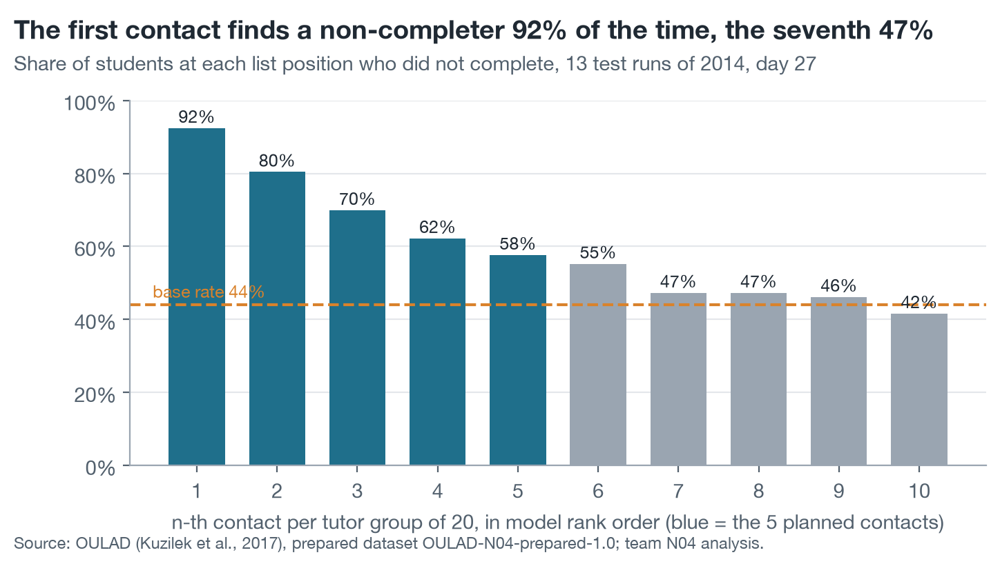
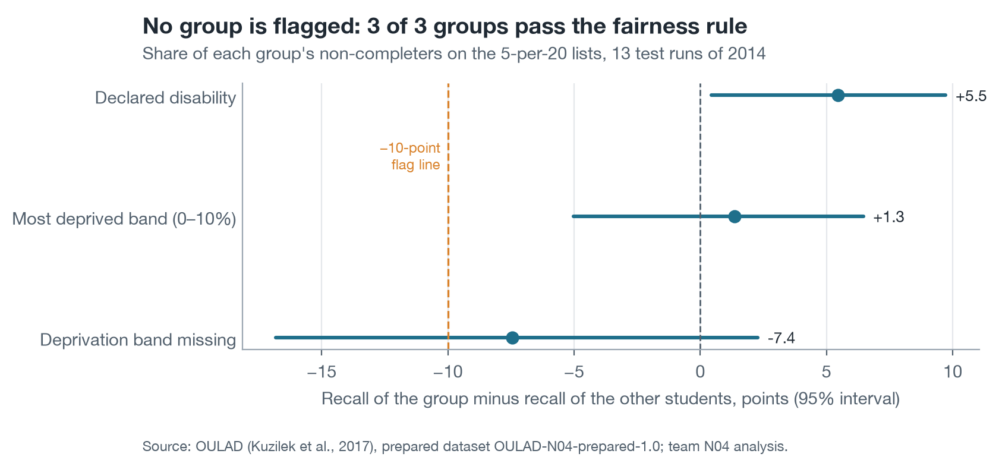

# Who leaves, what shows early, and whom to contact: AQ1–AQ4 on OULAD 2013–2014

*Team N04 · MTH045 The Science of Data Analytics · Milestone 4 Level 2 prototype, results for the Final Report · Open University Learning Analytics Dataset (OULAD), prepared dataset OULAD-N04-prepared-1.0 · 22 module runs, 32,593 enrolments*

## Summary

**A week-5 contact list built from the first four weeks of data works, but only for the students whose trouble already shows.** On the 13 module runs of 2014, a logistic model trained on the 9 runs of 2013 puts 41.5% of all later non-completers on a list of 5 names per tutor group of 20, and 72.5% of the listed students do not complete. The early-sign rule (missed task, late assignment, no activity in 7 days) does almost as well: the model lists 82 more non-completers on 3,955 list places, about one per 9.6 tutor groups, and passes the success gate fixed in Milestone 4 (gain +0.021 in normalised recall, 95% interval +0.006 to +0.036; 11 of 13 runs).

Three findings matter more for the decisions than the gain:

1. **Timing.** 70.2% of non-completers are still enrolled after day 27, so a week-5 list can still reach most of them; 25.9% have already left before day 14 and are out of reach of any list.
2. **The blind spot.** 60.7% of 2014 non-completers look normally active at day 27; the model reaches only 19.1% of them. Those who miss a task at all first do so at a median of week 13, and 32.4% never miss one.
3. **Capacity.** The first contact per tutor group finds a non-completer 92.4% of the time, the fifth 57.6%, the seventh 47.3%, against a base rate of 44.0%: contacts beyond about six per 20 add little.

No fairness group is flagged. Probabilities are not reliable run by run, so tutors should see ranks and reasons. **Status:** complete analysis for AQ1–AQ3; AQ4 complete as a ranking for decision support, while the effect of contacting a student cannot be measured with these data.

| Question | Answer in one line |
| :---- | :---- |
| AQ1 Descriptive | 45.3% of the 28,061 enrolments registered at day 14 do not complete (24.9% to 58.3% by run); most non-completers leave late or fail at the end |
| AQ2 Diagnostic | Five signs at day 27 go with non-completion in both years; a missed task is the strongest (+40.7 and +39.6 points) and signs add up |
| AQ3 Predictive | The model beats the early-sign rule narrowly (0.725 against 0.704 normalised recall); boosted trees and extra predictors add nothing measurable |
| AQ4 Prescriptive (ranking) | 72.5% of the students on lists of 5 per 20 do not complete; no fairness group flagged; show ranks with behavioural reasons, not probabilities |

## 1. Most non-completers are still enrolled at week 5, but few show it by then (AQ1)

Of the 28,061 enrolments still registered at day 14, the population of the course KPI, 12,700 (45.3%) end in Fail or Withdrawn. Table 1 shows that the rate varies most by module and start month.

<!-- table: results/aq1_rates_kpi.csv cols=level,group,enrolments,non_completers,rate,low,high "names=level:Level,group:Group,enrolments:Enrolments,non_completers:Non-completers,rate:Non-completion,low:95% low,high:95% high" pct=rate,low,high digits=1 -->
| Level | Group | Enrolments | Non-completers | Non-completion | 95% low | 95% high |
| :---- | :---- | :---- | :---- | :---- | :---- | :---- |
| All runs | 22 runs | 28,061 | 12,700 | 45.3% | 44.7% | 45.8% |
| Year | 2013 (9 runs) | 12,076 | 5,515 | 45.7% | 44.8% | 46.6% |
| Year | 2014 (13 runs) | 15,985 | 7,185 | 44.9% | 44.2% | 45.7% |
| Start month | February (B) | 10,977 | 5,531 | 50.4% | 49.5% | 51.3% |
| Start month | October (J) | 17,084 | 7,169 | 42.0% | 41.2% | 42.7% |
| Module | AAA | 720 | 189 | 26.3% | 23.2% | 29.6% |
| Module | BBB | 6,537 | 2,797 | 42.8% | 41.6% | 44.0% |
| Module | CCC | 3,670 | 1,994 | 54.3% | 52.7% | 55.9% |
| Module | DDD | 5,401 | 2,796 | 51.8% | 50.4% | 53.1% |
| Module | EEE | 2,573 | 924 | 35.9% | 34.1% | 37.8% |
| Module | FFF | 6,713 | 3,067 | 45.7% | 44.5% | 46.9% |
| Module | GGG | 2,447 | 933 | 38.1% | 36.2% | 40.1% |
<!-- /table -->

**Table 1.** Non-completion (Fail or Withdrawn) of enrolments registered at day 14, with Wilson 95% intervals.

February runs lose more than October runs in every module that has both: by 6 to 8 points in 5 of the 6 modules, with an interval above 0 (Figure 1). Run rates go from 24.9% (AAA-2013J) to 58.3% (CCC-2014B).

**Figure 1.** February minus October non-completion within each module, students registered at day 14.

**When students leave decides what a list can do.** Figure 2 counts all 17,208 non-completers of the 32,593 enrolments by when they left. A quarter (25.9%) withdrew before day 14, a further 3.3% in days 14–27, and 70.2% were still enrolled after day 27: 41.0% failed at the end of the run and the rest withdrew later.

**Figure 2.** When the 17,208 non-completers left, all enrolments.

**But the visible trouble comes late.** By week 4 only 16.8% of non-completers have missed an assessed task (19.7% in the 16 runs with a task due by then), against 0.5% of completers; their first missed task falls at a median of week 9, and 75.1% miss one eventually. A missed task is therefore a strong but late sign, which is why AQ2 also looks at activity.

**The KPI moves without any intervention.** In the six modules that ran in both years, the day-14 rate was 3.5 points lower in 2014 (95% interval −4.8 to −2.3), yet over all enrolments of the same modules the difference was −0.2 points (−1.4 to +0.9): 15.8% of 2014 enrolments against 10.7% of 2013 enrolments were no longer (or not yet) registered at day 14, and nearly all of them count as non-completers (Appendix B, Tables B.2 and B.9). A pilot measured before and after on the day-14 population could show a gain that is only a shift in who leaves early.

## 2. Five early signs go with non-completion in both years, and they add up (AQ2)

Each sign was compared within its module run and adjusted for the others, previous attempts and credits (Appendix A). Table 2 gives the adjusted risk difference, how many percentage points more non-completion goes with the sign, in the 2013 runs where it was estimated and in the 2014 runs where it was replicated.

<!-- table: results/aq2_replication.csv cols=label,rd_2013,low_2013,high_2013,rd_2014,low_2014,high_2014,modules_positive_2014 "names=label:Sign at day 27,rd_2013:2013 (points),low_2013:low,high_2013:high,rd_2014:2014 (points),low_2014:low,high_2014:high,modules_positive_2014:Modules positive in 2014" points=rd_2013,low_2013,high_2013,rd_2014,low_2014,high_2014 digits=1 -->
| Sign at day 27 | 2013 (points) | low | high | 2014 (points) | low | high | Modules positive in 2014 |
| :---- | :---- | :---- | :---- | :---- | :---- | :---- | :---- |
| Missed a task due | 40.7 | 37.5 | 43.8 | 39.6 | 36.8 | 42.5 | 5 of 5 |
| Submitted a TMA late | 21.7 | 17.4 | 25.9 | 22.5 | 17.9 | 27.2 | 4 of 4 |
| No activity in the last 7 days | 13.5 | 10.1 | 16.8 | 15.4 | 12.8 | 18.1 | 7 of 7 |
| Clicks below half the run median | 14.7 | 12.3 | 17.0 | 14.8 | 12.7 | 16.8 | 7 of 7 |
| No activity before the start | 11.3 | 8.5 | 14.0 | 9.2 | 6.9 | 11.4 | 7 of 7 |
<!-- /table -->

**Table 2.** Adjusted risk differences with 95% intervals; association within module run, not cause.

**Figure 3.** Every sign meets the Milestone 4 criterion (at least 5 points, interval above 0, same direction in two-thirds of modules) in both years.

A missed task is the strongest sign: +40.7 points in 2013 and +39.6 in 2014. No sign changed detectably between years. The signs also stack (Figure 4): in the 2014 runs with an assignment due by day 27, non-completion rises from 30.2% with no sign to 95.3% with 4.

**Figure 4.** Non-completion by number of signs present at day 27.

**One sign is weaker than it looks.** "Clicks below half the run median" overlaps with inactivity (correlation 0.45 in 2014), and the model fits activity in steps that the yes/no sign misses. When total clicks enter as a continuous measure, the low-activity sign falls to +2.9 points in 2013 and +0.8 in 2014 and no longer meets the criterion, while the other four signs hold (Appendix B, Table B.3). Low activity matters as an amount, not as a yes/no flag.

## 3. The model beats the rule narrowly, and both miss students who still look active (AQ3)

The model is a penalised logistic regression on 19 predictors available at day 27, chosen in development on the 2013 runs because boosted trees and an extended predictor set gained less than the 0.03 margin fixed in advance (Appendix A). Table 3 scores every list on the 13 runs of 2014.

<!-- table: results/aq3_test_pooled.csv where=cutoff:27,per20:5 cols=name,tp,recall,precision,lift "names=name:List of 5 per 20 at day 27,tp:Non-completers listed,recall:Share of all non-completers,precision:Share of list not completing,lift:Lift over random" pct=recall,precision digits=1,lift:2 -->
| List of 5 per 20 at day 27 | Non-completers listed | Share of all non-completers | Share of list not completing | Lift over random |
| :---- | :---- | :---- | :---- | :---- |
| Early-sign rule (ranked) | 2,786 | 40.3% | 70.4% | 1.60 |
| Background-only model | 2,244 | 32.5% | 56.7% | 1.29 |
| Logistic, primary predictors | 2,868 | 41.5% | 72.5% | 1.65 |
| Logistic, extended predictors | 2,869 | 41.5% | 72.5% | 1.65 |
| Boosted trees, primary | 2,860 | 41.4% | 72.3% | 1.65 |
| Boosted trees, extended | 2,880 | 41.7% | 72.8% | 1.66 |
| Random list (expected) | 1,737.9 | 25.1% | 43.9% | 1.00 |
<!-- /table -->

**Table 3.** List quality on the 2014 test runs (3,955 list places, 6,911 non-completers among 15,724 enrolments).

The gate S1 is met: pooled normalised recall 0.725 against 0.704 for the rule, a gain of +0.021 (95% interval +0.006 to +0.036, sign-flip p = 0.0035), with the model ahead in 11 of 13 runs. The gain is real and small: the rule alone delivers 97.1% of the model's hits. Every sensitivity view (day 13, 3 per 20, runs with or without a 2013 counterpart, without repeat students) points the same way (Appendix B, Table B.4). Working at day 13 instead of day 27 costs little: recall at 5 per 20 is 38.6% against 41.5%.

**Figure 5.** Share of non-completers listed at each list length; the dashed line marks the planned 5 per 20.

**Where the gain comes from.** The two lists share most names; each holds 903 students the other does not (Table 4). The model's own picks mostly show no rule sign (21.3% have one) and more often have a previous attempt at the module (30.7%, against 6.4% of the rule's own picks); 59.7% of them do not complete, against 50.6% of the rule's own picks.

<!-- table: results/aq3_model_vs_rule.csv cols=group,enrolments,non_completers,rate,share_with_rule_sign,share_previous_attempt,median_activity_ratio "names=group:Group,enrolments:Students,non_completers:Non-completers,rate:Non-completion,share_with_rule_sign:With a rule sign,share_previous_attempt:Previous attempt,median_activity_ratio:Median activity (run median = 1)" pct=rate,share_with_rule_sign,share_previous_attempt digits=1,median_activity_ratio:2 -->
| Group | Students | Non-completers | Non-completion | With a rule sign | Previous attempt | Median activity (run median = 1) |
| :---- | :---- | :---- | :---- | :---- | :---- | :---- |
| On both lists | 3,052 | 2,329 | 76.3% | 92.6% | 23.3% | 0.17 |
| Model list only | 903 | 539 | 59.7% | 21.3% | 30.7% | 0.67 |
| Rule list only | 903 | 457 | 50.6% | 84.5% | 6.4% | 0.43 |
| On neither list | 10,866 | 3,586 | 33.0% | 5.9% | 7.5% | 1.36 |
<!-- /table -->

**Table 4.** Students on the model and rule lists, 2014 test runs, day 27, 5 per 20.

**The blind spot.** 4,193 of the 2014 non-completers (60.7%) had normal activity at day 27, at least half their run's median clicks. The model lists 19.1% of them and the rule 15.6%, while the model lists 98.4% of those with no click at all (Appendix B, Table B.5). With data up to week 4, a list mostly confirms disengagement that has already happened; the students who struggle later are not yet visible.

**Probabilities are not safe to show.** Pooled, the model's risks meet the calibration condition S3 (calibration-in-the-large 0.117, slope 0.886), but only 5 of the 13 test runs meet it on their own (Appendix B, Table B.6). Shown as percentages, risks would mislead in most runs; ranks do not depend on calibration.

## 4. Five contacts per 20 is close to the useful limit; the lists pass the fairness check (AQ4)

AQ4 cuts the model ranking of each run at the capacity staff can follow up. Figure 6 shows the share of non-completers at each list position, counted per tutor group of 20.

**Figure 6.** The n-th contact per tutor group in rank order; the base rate is what a random contact would find.

The first contact finds a non-completer 92.4% of the time, the fifth 57.6% and the sixth 55.2%; from the seventh on the yield is 47.3% or less, close to the 44.0% of a random contact. A list of 3 per 20 is even sharper (80.9% of its names do not complete) but reaches fewer students.

**What tutors would see.** Each name carries the predictors that push its risk above average. For 80.7% of listed students the main reason is behavioural: low activity, a missed task or a late submission (Table 5). For 14.2% it is prior education, a background attribute a tutor cannot act on and that is sensitive to show.

<!-- table: results/aq4_reasons.csv cols=top_reason,listed,share_of_list,rate "names=top_reason:Main reason shown,listed:Students listed,share_of_list:Share of list,rate:Non-completion" pct=share_of_list,rate digits=1 -->
| Main reason shown | Students listed | Share of list | Non-completion |
| :---- | :---- | :---- | :---- |
| Low activity | 1,839 | 46.5% | 69.2% |
| Missed a task | 1,076 | 27.2% | 86.9% |
| Prior education | 562 | 14.2% | 64.9% |
| Late submission | 277 | 7.0% | 62.1% |
| Previous attempt | 98 | 2.5% | 62.2% |
| No activity before start | 65 | 1.6% | 50.8% |
| Study load | 38 | 1.0% | 76.3% |
<!-- /table -->

**Table 5.** Main reason behind each listed student, 2014 test runs, day 27, 5 per 20.

**Fairness.** The confirmatory check asks whether the lists reach a group's non-completers at least as well as everyone else's. No group is flagged (Figure 7): students with a declared disability are reached slightly better (+5.5 points), the most deprived band about equally (+1.3), and students with a missing deprivation band less well (−7.4 points, interval −16.8 to +2.3), within the 10-point tolerance. Two gaps need watching rather than action: women's non-completers are reached less often than men's (38.7% against 43.4%), and the 118 students aged 55 or over are too few to judge (Appendix B, Table B.7).

**Figure 7.** Recall gap of each confirmatory group against the other students, with bootstrap 95% intervals.

**Reach.** Of the 2,868 listed non-completers, 111 withdraw in the week the list is delivered (days 28–34), and 57.4% of them stay to the end and fail: for most listed students academic support, not only a retention call, is the relevant help.

## 5. Recommendations

1. **D1, whom to contact:** use the model ranking for the week-5 list at 5 contacts per tutor group of 20, and show each name with its rank and up to two behavioural reasons, never a probability. Where maintaining a model is not possible, the ranked early-sign rule delivers 97.1% of the model's hits.
2. **D1 and D2, capacity:** do not extend lists beyond about six per 20; the seventh contact finds non-completers at almost the base rate. Spend extra time on a second review point later in the run: the 60.7% of non-completers who look active at week 4 first miss a task at a median of week 13, and 32.4% of them never do, so that review point needs signs beyond missed tasks; test it in the pilot before relying on it.
3. **D2, where advisors' time goes:** weight it towards February runs and the modules with the highest rates (CCC, DDD), and test a welcome contact before and at the start of the run, because 25.9% of non-completers leave before day 14, before any list exists: 15.6% before the run starts and 10.3% in its first two weeks. Whether such a contact keeps anyone is untested.
4. **D3, judging the pilot:** compare pilot tutor groups with groups of the same run, and report the share not registered at day 14 beside the KPI, since that share alone moved the day-14 rate by several points between years.
5. **What would confirm the approach:** a pilot that randomly assigns contact among listed students, so that the effect of contact, which these data cannot show, can be measured.

## 6. Limitations

- **Population.** OULAD stands in for the university's records: seven modules of UK distance learning in 2013 and 2014. Rates, signs and list quality describe these runs; the pilot must recount its own baseline.
- **Association, not cause.** AQ2 shows which signs go with non-completion within a run; it does not show that changing a sign changes the outcome. AQ4 ranks risk, and risk is not the same as benefit from contact; no contact record exists in the data.
- **The test.** The model, predictors, list rule and success criteria were fixed in the Milestone 4 design before any 2014 outcome was used. The 2014 runs were also described in the team's Milestone 5 report (Sections 11.2–11.3), so this test confirms a fixed design rather than giving a first look. An independent implementation of the same design reproduces the development results and the rule's lists exactly, and the model's lists to within a few students.
- **Calibration.** Probabilities hold pooled but not run by run (5 of 13 runs within bounds), so the conclusions rest on ranks.
- **Small groups.** Fairness is confirmed for three groups of at least 400 test enrolments; students aged 55 or over (118) are not cleared, and the gender gap is descriptive.
- **Timing of records.** Features use only records dated on or before the cut-off; a task recorded late by the platform would make the early lists look slightly better than in practice.

## Appendix A. Methods

**Populations.** AQ1 uses the 28,061 enrolments registered at day 14 (registered by day 14 and not withdrawn by then), with all 32,593 enrolments as a second denominator; AQ2–AQ4 use enrolments registered at the cut-off (day 27: 11,811 in 2013, 15,724 in 2014; day 13: 12,080 and 15,989). Non-completion is a final result of Fail or Withdrawn.

**AQ1.** Rates with Wilson 95% intervals; year differences with Newcombe intervals on runs present in both years, and a Mantel–Haenszel weighted difference over the nine module × start-month pairs. A second code path recomputes the KPI population and every run's rate from the raw OULAD tables; all 22 runs agree to the enrolment.

**AQ2.** Logistic regression of non-completion on the five signs with run fixed effects, log previous attempts and log credits, sign × module terms (a module gets its own slope with at least 20 students on each side, smaller modules share one), and robust (HC1) standard errors. The adjusted risk difference averages, over the rows where the sign is defined, the predicted risk with the sign minus without it, with a delta-method interval. Task signs are defined only in runs with a task (missed task) or an assignment (late TMA) due by day 27.

**AQ3.** Development on the 9 runs of 2013 with leave-one-run-out folds, removing from training the students who also appear in the validation run; penalty and tree settings tuned by an inner leave-one-run-out loop on log loss. Candidates: background-only logistic (baseline), logistic on 19 primary predictors, logistic with 10 extended predictors and weekly clicks, and gradient-boosted trees on each set; a challenger had to gain at least 0.03 pooled normalised recall and win 7 of 9 folds, and none did (Table B.1). The ten final models were frozen before the 2014 outcomes were read, and the 2014 runs were scored once. Normalised recall divides the non-completers on a run's list by the most a list of that length can hold. The gate S1 uses a paired two-level bootstrap (runs, then students; 2,000 replicates) and an exact sign-flip test on the 13 run differences. The rule-ranked list orders students by number of rule signs, then by lower activity.

**AQ4.** Lists of k = 5 × ⌈n / 20⌉ per run (3 × for the sensitivity view), ties broken by a fixed random number per student. Reasons are the predictor groups with the largest positive contribution (coefficient × standardised value). Fairness rule FR1 flags a group whose recall is more than 10 points below the other students' with a Holm-adjusted one-sided bootstrap p below 0.05 (5,000 replicates).

## Appendix B. Further tables

**Table B.1.** Development choice on the 2013 runs (leave-one-run-out, day 27, 5 per 20).

<!-- table: results/aq3_dev_summary.csv cols=config,tp,norm_recall,gain_over_M1,folds_better_than_M1,chosen "names=config:Configuration,tp:Non-completers listed,norm_recall:Normalised recall,gain_over_M1:Gain over M1,folds_better_than_M1:Folds better than M1,chosen:Chosen" digits=3 -->
| Configuration | Non-completers listed | Normalised recall | Gain over M1 | Folds better than M1 | Chosen |
| :---- | :---- | :---- | :---- | :---- | :---- |
| B3 | 1,690 | 0.568 | −0.182 | 0 | False |
| M1 | 2,233 | 0.750 | 0 | 0 | True |
| M2 | 2,229 | 0.749 | −0.001 | 4 | False |
| M3 | 2,228 | 0.749 | −0.002 | 5 | False |
| M4 | 2,226 | 0.748 | −0.002 | 3 | False |
| RULE | 2,164 | 0.727 | −0.023 | 2 | False |
<!-- /table -->

B3 = background only; M1 = logistic, primary predictors; M2 = logistic, extended; M3 and M4 = boosted trees, primary and extended; RULE = ranked early-sign rule.

**Table B.2.** Non-completion in 2014 minus 2013, percentage points, under two denominators.

<!-- table: results/aq1_year_comparison.csv cols=denominator,runs,method,n_2013,n_2014,difference,low,high "names=denominator:Denominator,runs:Runs compared,method:Method,n_2013:Enrolments 2013,n_2014:Enrolments 2014,difference:2014 − 2013,low:95% low,high:95% high" points=difference,low,high digits=1 -->
| Denominator | Runs compared | Method | Enrolments 2013 | Enrolments 2014 | 2014 − 2013 | 95% low | 95% high |
| :---- | :---- | :---- | :---- | :---- | :---- | :---- | :---- |
| Registered at day 14 | All runs | pooled | 12,076 | 15,985 | −0.7 | −1.9 | 0.5 |
| Registered at day 14 | 6 modules run in both years | pooled | 12,076 | 12,315 | −3.5 | −4.8 | −2.3 |
| Registered at day 14 | 9 module × start-month pairs run in both years | pooled | 12,076 | 10,900 | −3.4 | −4.6 | −2.1 |
| Registered at day 14 | 9 module × start-month pairs run in both years | weighted over pairs (Mantel–Haenszel) | 12,076 | 10,900 | −3.1 | −4.3 | −1.8 |
| All enrolments | All runs | pooled | 13,529 | 19,064 | 2.3 | 1.2 | 3.4 |
| All enrolments | 6 modules run in both years | pooled | 13,529 | 14,630 | −0.2 | −1.4 | 0.9 |
| All enrolments | 9 module × start-month pairs run in both years | pooled | 13,529 | 13,103 | 0.5 | −0.7 | 1.7 |
| All enrolments | 9 module × start-month pairs run in both years | weighted over pairs (Mantel–Haenszel) | 13,529 | 13,103 | 0.5 | −0.7 | 1.7 |
<!-- /table -->

**Table B.3.** AQ2 sensitivity in 2014: adjusted risk differences under other low-activity cuts and with clicks as a continuous adjustment.

<!-- table: results/aq2_sensitivity_2014.csv cols=variant,sign,adj_rd,adj_low,adj_high,meets_criterion "names=variant:Variant,sign:Sign,adj_rd:Adjusted (points),adj_low:low,adj_high:high,meets_criterion:Meets criterion" points=adj_rd,adj_low,adj_high digits=1 -->
| Variant | Sign | Adjusted (points) | low | high | Meets criterion |
| :---- | :---- | :---- | :---- | :---- | :---- |
| primary | missed_task | 39.6 | 36.8 | 42.5 | True |
| primary | late_tma | 22.5 | 17.9 | 27.2 | True |
| primary | inactive_7d | 15.4 | 12.8 | 18.1 | True |
| primary | low_activity | 14.8 | 12.7 | 16.8 | True |
| primary | no_prestart | 9.2 | 6.9 | 11.4 | True |
| low cut = run median | missed_task | 39.3 | 36.5 | 42.1 | True |
| low cut = run median | late_tma | 21.8 | 17.1 | 26.6 | True |
| low cut = run median | inactive_7d | 15.7 | 13.2 | 18.3 | True |
| low cut = run median | low_activity | 14.6 | 13.0 | 16.2 | True |
| low cut = run median | no_prestart | 8.6 | 6.4 | 10.8 | True |
| low cut = quarter of median | missed_task | 40.4 | 37.5 | 43.2 | True |
| low cut = quarter of median | late_tma | 23.8 | 19.2 | 28.4 | True |
| low cut = quarter of median | inactive_7d | 17.0 | 14.4 | 19.6 | True |
| low cut = quarter of median | low_activity | 15.2 | 12.0 | 18.4 | True |
| low cut = quarter of median | no_prestart | 9.9 | 7.6 | 12.1 | True |
| + log clicks (continuous) | missed_task | 35.8 | 32.7 | 39.0 | True |
| + log clicks (continuous) | late_tma | 21.2 | 16.5 | 26.0 | True |
| + log clicks (continuous) | inactive_7d | 10.2 | 7.5 | 13.0 | True |
| + log clicks (continuous) | low_activity | 0.8 | −1.9 | 3.4 | False |
| + log clicks (continuous) | no_prestart | 6.5 | 4.3 | 8.8 | True |
| + log clicks, low cut = run median | missed_task | 35.7 | 32.5 | 38.9 | True |
| + log clicks, low cut = run median | late_tma | 21.0 | 16.2 | 25.8 | True |
| + log clicks, low cut = run median | inactive_7d | 10.7 | 8.0 | 13.3 | True |
| + log clicks, low cut = run median | low_activity | 5.9 | 3.8 | 8.1 | False |
| + log clicks, low cut = run median | no_prestart | 6.5 | 4.2 | 8.7 | True |
<!-- /table -->

**Table B.4.** Model against rule in sensitivity views (cannot change the S1 verdict; 500 bootstrap replicates each).

<!-- table: results/aq3_sensitivity.csv cols=variant,runs,norm_recall_a,norm_recall_b,difference,low,high,wins,losses "names=variant:View,runs:Runs,norm_recall_a:Model,norm_recall_b:Rule,difference:Difference,low:95% low,high:95% high,wins:Runs won,losses:Runs lost" digits=3 -->
| View | Runs | Model | Rule | Difference | 95% low | 95% high | Runs won | Runs lost |
| :---- | :---- | :---- | :---- | :---- | :---- | :---- | :---- | :---- |
| Main: all 13 runs, day 27, 5 per 20 | 13 | 0.725 | 0.704 | 0.021 | 0.007 | 0.034 | 11 | 2 |
| Day 13, 5 per 20 | 13 | 0.688 | 0.667 | 0.021 | 0.002 | 0.034 | 9 | 3 |
| Day 27, 3 per 20 | 13 | 0.809 | 0.778 | 0.031 | 0.009 | 0.052 | 11 | 2 |
| 9 runs also run in 2013 | 9 | 0.707 | 0.683 | 0.024 | 0.010 | 0.043 | 8 | 1 |
| 4 runs not run in 2013 | 4 | 0.765 | 0.752 | 0.013 | −0.019 | 0.035 | 3 | 1 |
| Without module CCC | 11 | 0.703 | 0.682 | 0.021 | 0.003 | 0.037 | 9 | 2 |
| Module CCC only | 2 | 0.801 | 0.783 | 0.018 | −0.006 | 0.046 | 2 | 0 |
| Without students seen in 2013 | 13 | 0.701 | 0.681 | 0.020 | 0.006 | 0.037 | 11 | 2 |
| Without Withdrawn lacking a withdrawal day | 13 | 0.717 | 0.697 | 0.020 | 0.007 | 0.035 | 11 | 1 |
<!-- /table -->

**Table B.5.** Recall of model and rule by slice of 2014 non-completers, day 27, 5 per 20.

<!-- table: results/aq3_errors_by_slice.csv cols=slice,level,enrolments,non_completers,recall_model,recall_rule "names=slice:Slice,level:Level,enrolments:Enrolments,non_completers:Non-completers,recall_model:Model recall,recall_rule:Rule recall" pct=recall_model,recall_rule digits=1 -->
| Slice | Level | Enrolments | Non-completers | Model recall | Rule recall |
| :---- | :---- | :---- | :---- | :---- | :---- |
| activity | low | 3,475 | 2,205 | 70.8% | 73.3% |
| activity | none | 624 | 513 | 98.4% | 100.0% |
| activity | normal | 11,625 | 4,193 | 19.1% | 15.6% |
| history | first attempt | 13,865 | 5,801 | 37.0% | 37.9% |
| history | previous attempt | 1,859 | 1,110 | 64.9% | 53.0% |
| registration | registered after the start | 152 | 65 | 73.8% | 53.8% |
| registration | registered by the start | 15,572 | 6,846 | 41.2% | 40.2% |
| kind | Distinction | 1,948 | 0 | – | – |
| kind | Fail | 3,805 | 3,805 | 43.3% | 41.9% |
| kind | Pass | 6,865 | 0 | – | – |
| kind | Withdrawn | 3,106 | 3,106 | 39.3% | 38.3% |
| reach | still reachable | 15,519 | 6,706 | 41.1% | 39.9% |
| reach | withdrew within 7 days | 205 | 205 | 54.1% | 53.2% |
<!-- /table -->

**Table B.6.** Discrimination within run and calibration on the 2014 runs.

<!-- table: results/aq3_discrimination_calibration.csv cols=cutoff,method,roc_auc_within_run,pr_auc_within_run,citl,slope,runs_within_s3_bounds "names=cutoff:Cut-off day,method:Method,roc_auc_within_run:ROC-AUC,pr_auc_within_run:PR-AUC,citl:Calibration in the large,slope:Calibration slope,runs_within_s3_bounds:Runs within S3 bounds" digits=3 -->
| Cut-off day | Method | ROC-AUC | PR-AUC | Calibration in the large | Calibration slope | Runs within S3 bounds |
| :---- | :---- | :---- | :---- | :---- | :---- | :---- |
| 27 | RULE | 0.711 | 0.660 | – | – | – |
| 27 | B3 | 0.603 | 0.520 | 0.075 | 0.780 | 5 |
| 27 | M1 | 0.730 | 0.686 | 0.117 | 0.886 | 5 |
| 27 | M2 | 0.734 | 0.688 | 0.067 | 0.930 | 5 |
| 27 | M3 | 0.730 | 0.687 | 0.002 | 1.178 | 5 |
| 27 | M4 | 0.732 | 0.688 | −0.006 | 1.141 | 6 |
| 13 | RULE | 0.679 | 0.606 | – | – | – |
| 13 | B3 | 0.603 | 0.529 | 0.068 | 0.762 | 5 |
| 13 | M1 | 0.701 | 0.638 | 0.065 | 0.915 | 4 |
| 13 | M2 | 0.702 | 0.639 | 0.035 | 0.927 | 8 |
| 13 | M3 | 0.706 | 0.641 | −0.001 | 1.009 | 4 |
| 13 | M4 | 0.705 | 0.640 | −0.033 | 1.024 | 4 |
<!-- /table -->

**Table B.7.** Fairness, descriptive: selection rate, recall and precision by group (day 27, 5 per 20).

<!-- table: results/aq4_fairness_descriptive.csv cols=attribute,group,enrolments,base_rate,selection_rate,recall,precision,note "names=attribute:Attribute,group:Group,enrolments:Enrolments,base_rate:Non-completion,selection_rate:Listed,recall:Recall,precision:Precision,note:Note" pct=base_rate,selection_rate,recall,precision digits=1 -->
| Attribute | Group | Enrolments | Non-completion | Listed | Recall | Precision | Note |
| :---- | :---- | :---- | :---- | :---- | :---- | :---- | :---- |
| gender | F | 6,666 | 41.3% | 23.9% | 38.7% | 66.8% | – |
| gender | M | 9,058 | 45.9% | 26.1% | 43.4% | 76.4% | – |
| age_band | 0-35 | 10,942 | 45.9% | 27.5% | 43.6% | 72.8% | – |
| age_band | 35-55 | 4,664 | 39.7% | 20.0% | 36.1% | 71.6% | – |
| age_band | 55<= | 118 | 35.6% | 11.9% | 26.2% | 78.6% | insufficient data, not cleared |
| disability | N | 14,236 | 42.9% | 24.4% | 40.9% | 71.9% | – |
| disability | Y | 1,488 | 54.0% | 32.5% | 46.3% | 77.0% | – |
| imd_band | 0-10% | 1,486 | 53.0% | 29.6% | 42.7% | 76.4% | – |
| imd_band | 10-20% | 1,582 | 51.3% | 29.7% | 44.9% | 77.4% | – |
| imd_band | 20-30% | 1,701 | 50.1% | 28.0% | 42.4% | 76.1% | – |
| imd_band | 30-40% | 1,691 | 44.5% | 26.5% | 43.6% | 73.2% | – |
| imd_band | 40-50% | 1,543 | 43.9% | 25.7% | 42.8% | 73.0% | – |
| imd_band | 50-60% | 1,529 | 44.1% | 26.7% | 43.2% | 71.3% | – |
| imd_band | 60-70% | 1,464 | 40.8% | 22.6% | 37.9% | 68.3% | – |
| imd_band | 70-80% | 1,435 | 42.0% | 22.9% | 38.9% | 71.3% | – |
| imd_band | 80-90% | 1,401 | 37.5% | 21.8% | 37.9% | 65.2% | – |
| imd_band | 90-100% | 1,282 | 35.2% | 20.0% | 39.0% | 68.8% | – |
| imd_band | Missing | 610 | 29.7% | 15.7% | 34.3% | 64.6% | – |
<!-- /table -->

**Table B.8.** Confirmatory fairness check FR1.

<!-- table: results/aq4_fairness_confirmatory.csv cols=group,enrolments,non_completers,recall_group,recall_others,gap,low,high,p_holm,flagged "names=group:Group,enrolments:Enrolments,non_completers:Non-completers,recall_group:Recall of group,recall_others:Recall of others,gap:Gap (points),low:95% low,high:95% high,p_holm:Holm p,flagged:Flagged" pct=recall_group,recall_others points=gap,low,high digits=1,p_holm:3 -->
| Group | Enrolments | Non-completers | Recall of group | Recall of others | Gap (points) | 95% low | 95% high | Holm p | Flagged |
| :---- | :---- | :---- | :---- | :---- | :---- | :---- | :---- | :---- | :---- |
| Declared disability | 1,488 | 803 | 46.3% | 40.9% | 5.5 | 0.4 | 9.7 | 1.000 | False |
| Most deprived band (0–10%) | 1,486 | 787 | 42.7% | 41.3% | 1.3 | −5.0 | 6.5 | 1.000 | False |
| Deprivation band missing | 610 | 181 | 34.3% | 41.7% | −7.4 | −16.8 | 2.3 | 0.188 | False |
<!-- /table -->

**Table B.9.** Share of enrolments not registered at day 14, six modules that ran in both years.

<!-- table: results/aq1_not_registered_d14.csv text=year "names=year:Year,enrolments:Enrolments,not_registered_d14:Not registered at day 14,share:Share,non_completion_of_those:Non-completion among them" pct=share,non_completion_of_those digits=1 -->
| Year | Enrolments | Not registered at day 14 | Share | Non-completion among them |
| :---- | :---- | :---- | :---- | :---- |
| 2013 | 13,529 | 1,453 | 10.7% | 99.4% |
| 2014 | 14,630 | 2,315 | 15.8% | 99.4% |
<!-- /table -->

**Table B.10.** Non-completion by run, enrolments registered at day 14.

<!-- table: results/aq1_rates_by_run_kpi.csv cols=group,enrolments,non_completers,rate,low,high "names=group:Run,enrolments:Enrolments,non_completers:Non-completers,rate:Non-completion,low:95% low,high:95% high" pct=rate,low,high digits=1 -->
| Run | Enrolments | Non-completers | Non-completion | 95% low | 95% high |
| :---- | :---- | :---- | :---- | :---- | :---- |
| CCC-2014B | 1,591 | 928 | 58.3% | 55.9% | 60.7% |
| DDD-2013B | 1,197 | 688 | 57.5% | 54.7% | 60.2% |
| DDD-2014B | 1,050 | 572 | 54.5% | 51.5% | 57.5% |
| CCC-2014J | 2,079 | 1,066 | 51.3% | 49.1% | 53.4% |
| DDD-2013J | 1,675 | 849 | 50.7% | 48.3% | 53.1% |
| FFF-2014B | 1,309 | 656 | 50.1% | 47.4% | 52.8% |
| BBB-2013B | 1,606 | 804 | 50.1% | 47.6% | 52.5% |
| FFF-2013B | 1,520 | 739 | 48.6% | 46.1% | 51.1% |
| DDD-2014J | 1,479 | 687 | 46.5% | 43.9% | 49.0% |
| FFF-2013J | 1,998 | 903 | 45.2% | 43.0% | 47.4% |
| BBB-2014B | 1,289 | 564 | 43.8% | 41.1% | 46.5% |
| BBB-2013J | 1,851 | 781 | 42.2% | 40.0% | 44.5% |
| EEE-2014B | 613 | 256 | 41.8% | 37.9% | 45.7% |
| FFF-2014J | 1,886 | 769 | 40.8% | 38.6% | 43.0% |
| GGG-2014B | 802 | 324 | 40.4% | 37.1% | 43.8% |
| GGG-2014J | 719 | 275 | 38.2% | 34.8% | 41.9% |
| BBB-2014J | 1,791 | 648 | 36.2% | 34.0% | 38.4% |
| GGG-2013J | 926 | 334 | 36.1% | 33.0% | 39.2% |
| EEE-2013J | 933 | 325 | 34.8% | 31.8% | 37.9% |
| EEE-2014J | 1,027 | 343 | 33.4% | 30.6% | 36.3% |
| AAA-2014J | 350 | 97 | 27.7% | 23.3% | 32.6% |
| AAA-2013J | 370 | 92 | 24.9% | 20.7% | 29.5% |
<!-- /table -->

## Appendix C. Reproducing the results

The folder runs on its own from the prepared dataset of Milestone 3: `bash run_all.sh` verifies the input files by SHA-256, runs every step in order and writes one log per step; the 2014 runs are scored once and later steps read the saved scores. It takes about 15 minutes on 10 cores, most of it bootstrap resampling.
