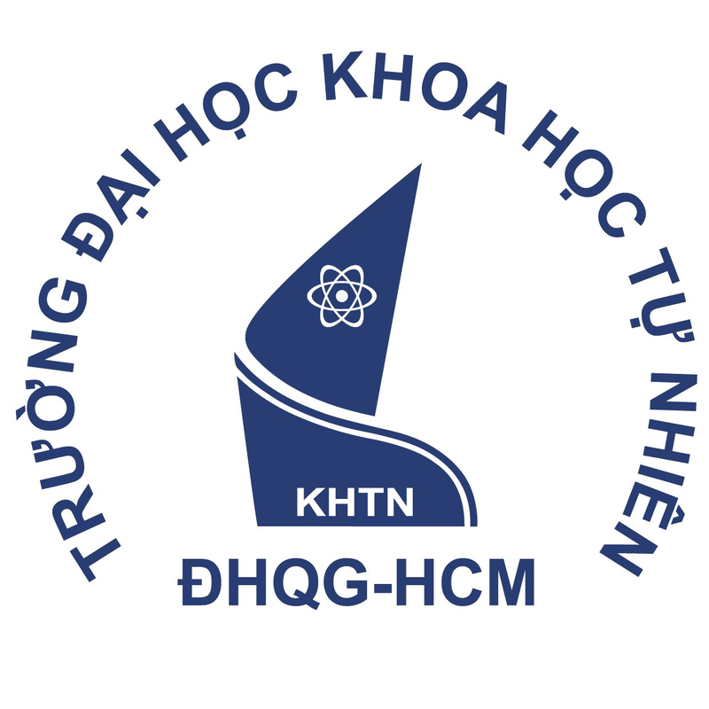

**UNIVERSITY OF SCIENCE**

**FACULTY OF INFORMATION TECHNOLOGY**

**MTH045 – The Science of Data Analytics**

**Milestone 1: Requirement Analysis and Analytics Project Proposal**

**IMPROVING COURSE COMPLETION IN ONLINE AND BLENDED COURSES**

| **Group information** | **Content** |
| :---- | :---- |
| Lecturers | Dr. Nguyễn Trần Minh Thư |
|  | MSc. Phạm Minh Tú |
| Group name | Group 4 (N04) |
| Members | 25C12002 – Lê Ngọc Trúc Huỳnh |
|  | 25C12003 – Phan Trần Khanh |
|  | 25C12031 – Dương Tấn Huỳnh Phong |
| Project title | Improving course completion through early identification of disengaging students |
| Simulated stakeholders | Program Manager, Course Lecturer, Academic Advisor, Student, Learning Technology and Data Officer (played by generative AI) |
| Submission date | 14 November 2026 |

Ho Chi Minh City, November 2026
