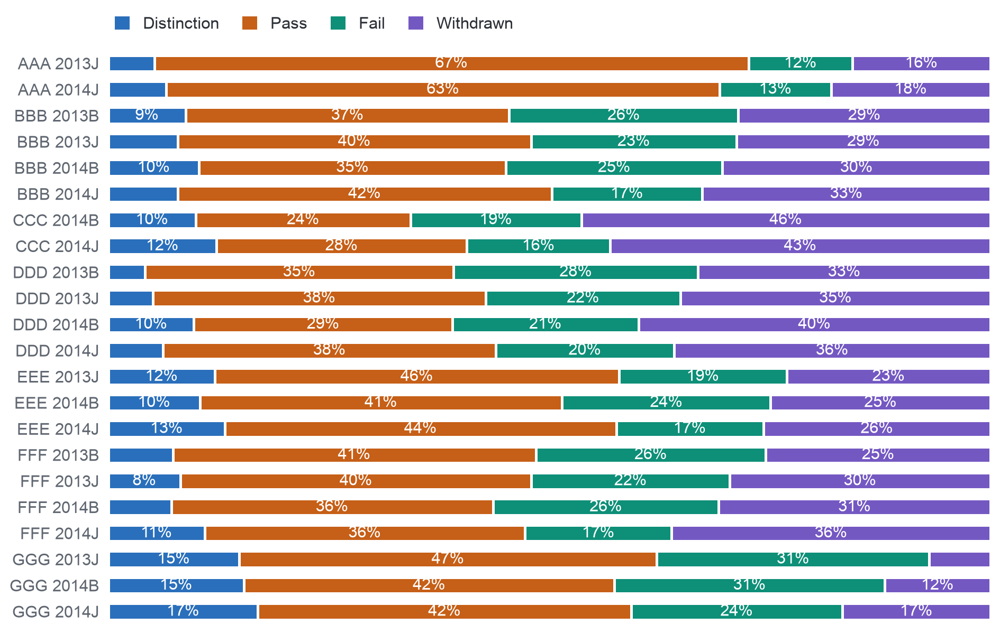

## 3.3. Distributions, Outliers and Outcome Balance

Activity is strongly skewed: per enrolment the median is 602 clicks, 3,365 enrolments have none, 2,503 lie beyond the
upper fence of the interquartile range, the usual statistical boundary for an outlier, and a single click record, one student on one resource on one day, reaches
6,977 clicks. These are heavy users rather than errors, so no value is removed or capped, and models sensitive to
scale receive the logarithm of the counts instead (DQ16). Scores lean the other way, with a median of 80, and 45.8% of
CMA scores fall on a multiple of ten against 17.4% of TMA scores, a sign of coarse marking steps; study load reaches
655 credits against a 99th percentile of 240.

The two outcome classes are close in size. Of the 28,061 enrolments registered by day 14 and not unregistered by it,
the KPI population, 54.7% completed, a value of OULAD that is not the university's assumed baseline of
70%; non-completion reaches 45.3% among those enrolled at day 13 and 44.2% at day 27,
ranges from 24.9% to 58.3% between runs in the KPI population, and the smaller class holds at least 92 enrolments in every run, so no
resampling is needed. Figure 3.1 shows the final results of every run: withdrawal is highest in the CCC runs
(43–46%), while GGG has the fewest withdrawals but the most failures. Appendix I gives the full evidence of this
section.

