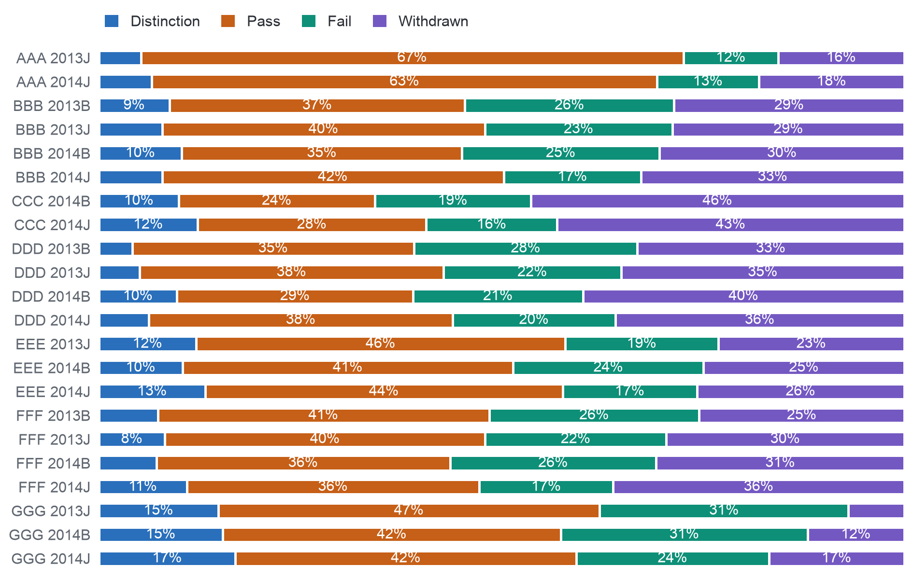

## 3.3. Phân phối, giá trị ngoại lai và mức cân bằng của biến kết quả

Hoạt động trên nền tảng học tập có phân phối lệch mạnh. Tính trên mỗi lượt đăng ký học, trung vị là 602 lượt nhấp; 3.365 lượt đăng ký học không có lượt nhấp nào; 2.503 lượt đăng ký học vượt ngưỡng trên theo khoảng tứ phân vị (ranh giới thống kê thường dùng để xác định giá trị ngoại lai); riêng một dòng lượt nhấp đạt tới 6.977 lượt nhấp. Đây là những sinh viên dùng nền tảng rất nhiều chứ không phải lỗi dữ liệu, nên không giá trị nào bị loại bỏ hoặc cắt ngưỡng; thay vào đó, các mô hình nhạy với thang đo dùng logarit của số lượt nhấp làm đầu vào (DQ16). Hai lớp của biến kết quả có kích thước gần nhau. Nhóm tính KPI (các lượt đăng ký học còn hiệu lực tại ngày 14) gồm 28.061 lượt đăng ký học; trong nhóm này, 54,7% hoàn thành, một giá trị của OULAD chứ không phải mức cơ sở giả định 70% của trường. Tỷ lệ không hoàn thành là 45,3% trong số sinh viên đang đăng ký học vào ngày 13 và 44,2% vào ngày 27; ở mọi kỳ mở, lớp thiểu số (lớp có ít lượt đăng ký học hơn) có ít nhất 92 lượt đăng ký học, nên không cần lấy mẫu lại. Hình 3.1 trình bày kết quả cuối cùng của từng kỳ mở: tỷ lệ rút khỏi module cao nhất ở các kỳ mở CCC (43–46%), còn GGG có ít lượt rút nhất nhưng nhiều lượt không đạt nhất. Phụ lục I trình bày đầy đủ bằng chứng của mục này, gồm cả phân phối của điểm số và số tín chỉ đang học.

