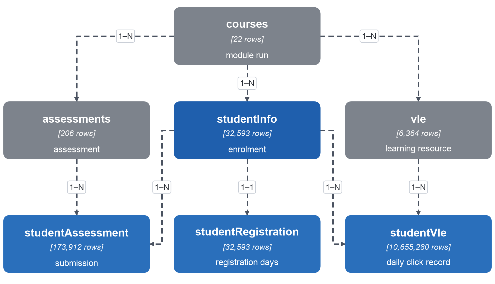
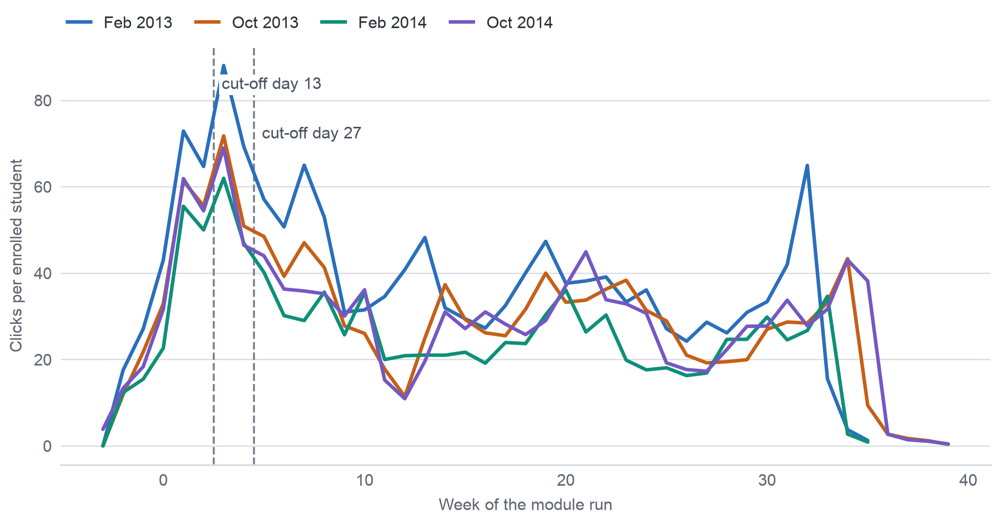

## Appendix I – Data Understanding, Profiling and Quality Details

Figure A.1 shows the seven OULAD tables with their row counts and the keys that link them; each link was checked on the data (`understanding.json`).

Figure A.2 shows weekly clicks per enrolled student by start month, with the two cut-offs at the end of weeks 2 and 4 (`fig_weekly_activity.csv`).

The inputs required by the brief, checked before preparation began, are listed in Table A.1 with their status.

**Table A.1. Inputs from Milestone 2 and their status**

| Input (brief) | Content in this project | Status |
| :---- | :---- | :---- |
| Milestone 1 baseline | Business Goal, SMART Goal, KPIs, AQ1–AQ4, analytics types and decisions, frozen with a SHA-256 checksum of each file; all 8 source files unchanged | Complete |
| Updated traceability matrix | KPI → AQ → data requirement → file → actual variables → coverage → decision | Complete |
| Raw data package | Seven CSV tables of OULAD, figshare version 1, DOI 10.6084/m9.figshare.5081998.v1, each matching its pinned SHA-256 | Complete, 7 of 7 match |
| Metadata and data dictionary | Column definitions from the data descriptor, license CC BY 4.0, citation | Complete |
| Collection evidence | Web address, DOI, access date 6 November 2026 (UTC+7), version, checksums, collection log | Complete |
| Controlled Change Log | C01–C08 with old and new content and data evidence | Complete |

Table A.2 sets out what each day field and measure of OULAD means and when it becomes known; the meanings come from the data descriptor and the OU's assessment policy, the counts from `understanding.json`.

**Table A.2. Meaning and timing of the key fields**

| Field | Meaning | Unit and scale | Known at |
| :---- | :---- | :---- | :---- |
| date_registration, date_unregistration | Days the student registered and unregistered; empty unregistration = did not withdraw | days from the start | the day itself |
| assessments.date | Cut-off (due) day of the assessment | days | from the start of the run |
| date_submitted | Day the student submitted; all 1,909 banked results carry −1, a placeholder | days | the day itself |
| is_banked | Result carried over from an earlier run | 0/1 | registration |
| score | Mark, 0–100; below 40 is a fail | points | TMA: tutor marking, usually within ten working days of the cut-off; CMA: automatic, within 7 days |
| weight | Share of the grade; exams 100, other assessments together 100 | % | from the start |
| sum_click | Number of interactions with one resource on one day | count | the day itself |
| studied_credits | Credits of all modules studied at the same time; 60 a year is part-time, 120 full-time | credits | registration |

Table A.3 lists the six sensitive attributes with their codes, smallest group and the number of module-run groups with fewer than 20 students.

**Table A.3. Sensitive attributes**

| Attribute | Codes | Smallest group | Run groups below 20 | Nature |
| :---- | :---- | :---- | :---- | :---- |
| gender | F, M | F: 14,718 | 0 | Personal |
| age_band | 0-35, 35-55, 55<= | 55<=: 216 | 18 | Personal |
| disability | Y, N (declared) | Y: 3,164 | 1 | Health-related |
| imd_band | ten deciles, blank | blank: 1,111 | 11 | Socio-economic, area-level |
| region | 13 regions | Ireland: 1,184 | 11 | Location |
| highest_education | five levels | Postgraduate: 313 | 29 | Socio-economic |

The Data Quality Issue Log in Table A.4 gives the full evidence of every issue of Table 3.1; P. refers to sections of `data/metadata/profile.json` and U. to `understanding.json`.

**Table A.4. Data Quality Issue Log with evidence**

| ID | Variable / table | Evidence | Impact on AQ | Severity | Decision |
| :---- | :---- | :---- | :---- | :---- | :---- |
| DQ01 | studentVle: exact duplicate rows | 787,170 rows (7.39%) repeat another row in every column; 3.82–11.73% per run; 69.8% of duplicated groups are single-click; collapsing them removes 3.19% of clicks (P.duplicates). In two-row student-site-day groups, 31.5% have equal counts against 24.0% expected by chance from each site's own counts (Table A.6) | Click measures of AQ2 and AQ3 | Medium | Cause not decidable from the data: keep every row in the primary click measures (the table's record grain) and build a de-duplicated variant of each click feature for sensitivity |
| DQ02 | studentVle: grain differs from the documentation | 1,614,505 student-site-day groups hold several rows (3,810,465 rows), 1,179,074 of them with different click counts; up to 10 rows in one group (P.shape) | Any join or count at row level would mistake records for days | Medium | Aggregate clicks to enrolment × day and enrolment × week before any join; count active days, not rows |
| DQ03 | studentVle, studentAssessment: activity after unregistration | 29,440 click rows (98,745 clicks) by 1,279 enrolments, up to 423 days after unregistering; 588 non-banked submissions by 411 enrolments (P.validity) | Engagement up to withdrawal (AQ1, AQ2); none at a cut-off for students still registered | Medium | Truncate engagement measures at the unregistration day; feature views contain only students still registered at the cut-off, so no post-withdrawal event enters them |
| DQ04 | final_result × date_unregistration | 93 Withdrawn enrolments without an unregistration day, 87 of them in October 2014 runs; 9 Fail enrolments with one, 8 of them on or before day 0 (U.outcome, P.validity) | Populations at day 14, 13 and 27; time to withdrawal | Low | Keep final_result as the outcome; keep the recorded day; flag both groups (`withdrawal_day_missing`, `unregistered_not_withdrawn`); the 93 stay in every population because no record shows them leaving before a cut-off, and an evaluation flag lets test metrics be reported with and without them |
| DQ05 | studentRegistration: registration after day 14 | 58 enrolments registered on days 16–167, after the two-week sign-up window of the descriptor; 16 of them later unregistered (P.validity) | KPI denominator and populations at cut-offs | Low | Define "enrolled at day d" as registered by day d (or registration day unknown) and not unregistered by day d; late registrants enter only the populations of later days |
| DQ06 | studentRegistration: departures before teaching | 3,097 enrolments unregistered on or before day 0; one unregistration on day 444 of a 268-day run (U.outcome) | KPI denominator | Low | Not an error: these students left before the run began and are outside the day-14 KPI population; the day-444 record is kept with a flag |
| DQ07 | studentAssessment: banked results | All 1,909 banked results carry date_submitted = −1, a placeholder for a result carried over from an earlier run (P.validity) | Timeliness and missed-task measures (AQ1–AQ3) | Medium | Exclude banked rows from submission timing, lateness and missed-task counts; keep a per-enrolment count of banked results, known at registration |
| DQ08 | assessments, studentAssessment: exams | 18 of 24 exams have no result rows (scores only for CCC 2 and DDD 4); 11 exams have no due day (P.missing, U.time) | "First missed assessed task" (AQ1); task signs (AQ2, AQ3) | High (exams) | Count missed and late tasks over TMA and CMA only; the outcome stays final_result; exam scores are not used |
| DQ09 | assessments: weights | Coursework weights sum to 0 in the three GGG runs and to 100 elsewhere; FFF CMAs weigh 0; CCC 2014 runs hold two exams (total 200) (P.validity, U.measurement) | Weighted score features | Medium | Build no weighted grade; count tasks unweighted (formative tasks are still due) and keep weight as a column |
| DQ10 | studentAssessment: late and post-run submissions | 49,318 of 169,138 non-banked submissions with a due day are late (29.2%; median 3, 99th percentile 29 days): 16,320 of 97,088 TMA and 32,991 of 69,956 CMA, although the OU's current (2025) policy accepts no CMA after its cut-off day; 85 fall after the run ended, up to day 608 (P.validity) | Late-task signs (AQ1, AQ2, early-sign rule) | Medium | Keep every submission; lateness = date_submitted − due day, counted separately for TMA and CMA because the meaning of a late CMA in 2013–2014 is not documented; post-run submissions fall after both cut-offs |
| DQ11 | studentAssessment.score | 173 missing scores, all TMA (P.missing); 45.8% of CMA scores are multiples of 10 against 17.4% of TMA (P.distribution) | Score features | Low | Keep the submission, leave the score missing; scores enter features only where the mark is known at the cut-off (decision matrix, row "Derived feature") |
| DQ12 | studentInfo.imd_band | 1,111 missing (3.41%), 40.1% of North Region and 22.5% of Ireland; success 65.7% when missing against 46.6% when present, so not missing at random; one label "10-20" lacks the % sign (P.missing, P.validity) | AQ4 fairness check by deprivation; background features | Medium | Normalise the label to "10-20%"; keep missing as its own category "Missing"; no imputation |
| DQ13 | studentRegistration.date_registration | 45 missing, 39 of them Withdrawn (P.missing) | Registration-lead feature | Low | Keep null with an indicator; any filling is fitted on the training runs only |
| DQ14 | vle.week_from, week_to | 82.4% missing; filled for 1,121 of 6,364 sites (P.missing, U.time) | None | Low | Not used |
| DQ15 | studentVle: days without any click | In all six February 2014 runs two consecutive days carry no click (days 218–219; days 211–212 in BBB) (P.temporal) | Daily activity series after week 30 | Low | Treat the two days as missing, not as zero activity, in daily series; both lie after the cut-offs |
| DQ16 | Outliers: clicks and credits | One row of 6,977 clicks; clicks per enrolment skewness 3.03, 2,503 enrolments beyond the upper interquartile-range fence; studied_credits up to 655 against a 99th percentile of 240 (P.distribution) | Scale-sensitive methods | Low | Keep every value (heavy users and students on several modules are real); log or rank transforms are applied in modelling, fitted on training runs |
| DQ17 | Enrolments without any activity or submission row | 3,365 enrolments without a click row (2,988 Withdrawn; 2,390 left by day 0); 6,750 without a submission (P.missing) | Counts would drop these students under an inner join | Medium | Absence of a row records no activity (descriptor: no submission, no result row): fill counts with 0 after left joins from the enrolment table |
| DQ18 | assessments: tasks due by the cut-offs | A non-exam task is due by day 13 in 1 of 22 runs and by day 27 in 16; two or more are due by day 27 in 1 run only (P.temporal) | AQ3 comparison rule and secondary KPI 1: the Milestone 1 rule ("two or more tasks missed or late by week 4") can fire in 1 run of 22, and its OULAD form of one task (C06) in 16 runs at day 27 and 1 at day 13 | High | Task 3 decision (AQ–Data fit): rule restated on the tasks actually due (Change Log C10) |
| DQ19 | Population and module mix | Seven UK distance-learning modules of 2013–2014, selected partly for many failing students; women 11.5% of EEE and 88.4% of BBB; completion in the day-14 population from 45.7% (CCC) to 73.8% (AAA) (P.representativeness) | Generalisation of every AQ; group comparisons | High (claims) | State the scope; compare groups within module; results describe OULAD and are re-checked on the university's data before decisions D1–D3 |

Thirteen figures of the profile were recounted by an independent exploration of the same files with separate code (`profile_crosscheck.csv`); Table A.5 shows the 13 measures compared, all equal.

**Table A.5. Cross-check with an independent recount**

| Measure | Independent recount | Milestone 3 profile | Equal |
| :---- | :---- | :---- | :---- |
| studentVle exact duplicate rows | 787,170 | 787,170 | yes |
| clicks raw | 39,605,099 | 39,605,099 | yes |
| clicks after collapsing duplicates | 38,343,063 | 38,343,063 | yes |
| repeated student-site-day groups | 1,614,505 | 1,614,505 | yes |
| rows in repeated groups | 3,810,465 | 3,810,465 | yes |
| enrolments without activity | 3,365 | 3,365 | yes |
| enrolments without submission | 6,750 | 6,750 | yes |
| late submissions | 49,318 | 49,318 | yes |
| submissions after run end | 85 | 85 | yes |
| click rows after unregistration | 29,440 | 29,440 | yes |
| enrolments with clicks after unregistration | 1,279 | 1,279 | yes |
| submissions after unregistration (incl. 13 banked rows dated day -1) | 601 | 601 | yes |
| click rows before day 0 | 688,988 | 688,988 | yes |

The chance test of duplicate click rows compares, in the 1,311,841 student-resource-day groups with exactly two rows, the share with equal click counts (31.5%) with the share expected by chance from each resource's own counts (24.0%) or from each activity type's counts (21.7%). Table A.6 gives the observed share for the six activity types with the most such groups.

**Table A.6. Equal counts in two-row groups by activity type**

| Activity type | Two-row groups | Equal counts observed |
| :---- | :---- | :---- |
| forumng | 895,551 | 32.8% |
| oucontent | 279,561 | 32.2% |
| quiz | 71,751 | 11.5% |
| ouwiki | 21,555 | 7.7% |
| questionnaire | 14,694 | 6.0% |
| oucollaborate | 11,921 | 59.6% |

**Profiling findings in full.** The paragraphs below give the full evidence and reasoning behind the summaries of
Sections 3.1 to 3.4, aspect by aspect, with the issue identifiers of the Data Quality Issue Log (Table 3.1).

**Evidence behind Section 3.1: shape, keys, duplicates and joins.**

**Shape and schema.** Every table holds the number of rows that its documentation states [2], and the six tables
with a key have no duplicate key. Two names differ from the documentation: the run length is stored as
module_presentation_length rather than length, and the withdrawn outcome as "Withdrawn" rather than "Withdrawal"
[2]. Neither changes a value, and the pipeline uses the names as stored.

**Grain of the click table.** The click table differs from its documentation in grain, the level of detail that one
row represents. It is documented as the interactions of a student with a resource on a day [7], which would give one
row per student, resource and day. Instead, 1,614,505 student-resource-days hold several rows, and 1,179,074 of them
hold different click counts in their rows, up to ten rows in one group. A row is therefore a record of the logging
system rather than a day, so clicks are summed by enrolment and day before any use, and activity is counted in active
days rather than rows (DQ02).

**Exact duplicates.** In addition, 787,170 click rows (7.39%) repeat another row in every column; collapsing them
would remove 3.19% of all clicks. Two explanations are possible: the duplicates are copies made by the logging system,
or they are separate visits that happen to carry the same count. If they were copies, two rows of the same student,
resource and day would carry equal click counts far more often than chance alone would produce. They do so in 31.5%
of two-row groups, against 24.0% expected by chance from each resource's own counts; the excess appears for forums
and content pages, while quizzes, wikis and questionnaires fall below chance (Table A.6). The evidence
points both ways, so the cause cannot be decided from the data. Every row is kept, which is the table's own grain, and
a de-duplicated twin of each click feature lets Milestone 4 test whether the choice matters (DQ01).

**Joins.** Joining the tables needs care for two reasons. First, a direct join of submissions with click rows on the
student would multiply rows: it returns 89,347,197 rows, because every submission is paired with every click record
of the same student. Second, an inner join with activity, which keeps only rows that appear in both tables, would drop
the 3,365 enrolments without any click row; most of these students left before the run began and so have no activity
rows [8], and dropping them would remove withdrawals from the descriptive rates. Tables are therefore summed to the
enrolment first and then joined to the enrolment table with left joins, which keep every enrolment and record no
activity as zero (DQ17).

**Evidence behind Section 3.2: missingness and validity.**

**Missing values.** Missing values are few, and their pattern shows where they come from. The deprivation band is
blank for 1,111 enrolments (3.41%), and the blanks concentrate in two regions: 40.1% of the enrolments of North Region
and 22.5% of those of Ireland lack a band. These students also succeed more often, in 65.7% of cases against 46.6% for
students with a band, so the blanks are related to the outcome rather than random, and filling them with a typical
value would hide a group that behaves differently (DQ12). The registration day is missing for 45 enrolments, 39 of
them Withdrawn (DQ13), and 173 TMA scores are missing although the submission exists (DQ11).

**Structural gaps.** Three further gaps are structural: they follow from how the data are recorded rather than from
lost values. An empty unregistration day marks a student who did not withdraw [2]; a missing submission row marks a
task that was not submitted [2]; and exam results are usually absent by design [2], so 18 of the 24 exams have no
result row at all (DQ08). These gaps are recorded absences, and they are read as "did not withdraw", "not submitted"
and "no exam result", never filled in.

**Validity.** The validity checks found scores within 0 to 100 and no submission dated before the student's
registration, but six inconsistencies:

(1) 93 Withdrawn enrolments have no unregistration day, 87 of them in the October 2014 runs, and 9 Fail enrolments have one (DQ04);
(2) 58 enrolments registered after the two-week sign-up window that the descriptor describes [2], up to day 167 (DQ05);
(3) all 1,909 banked results carry the placeholder submission day −1 (DQ07);
(4) 98,745 clicks by 1,279 enrolments and 588 submissions by 411 enrolments are dated after the student unregistered, up to 423 days later (DQ03);
(5) 32,991 of the 69,956 CMA submissions arrive after their due day, although the OU's current policy of 2025 accepts no CMA after its cut-off day [3]; the data describe 2013–2014 practice, whose rule is not documented (DQ10);
(6) one band label, "10-20", lacks its percent sign (DQ12).

None of these is corrected by changing a recorded value. Each receives a flag or a rule in the preparation plan of
Section 5, so that the prepared data keep what was recorded and show how it was used.

**Evidence behind Section 3.3: distributions, outliers and outcome balance.**

**Activity.** Activity is strongly skewed. Per enrolment, the median is 602 clicks over the whole run, a quarter of
enrolments have 142 clicks or fewer and a quarter 1,585 or more, and 3,365 enrolments have none. The upper fence of
the interquartile range, the usual statistical boundary for an outlier (the third quartile plus one and a half times
the distance between the first and third quartiles), lies at 3,750 clicks, and 2,503 enrolments lie beyond it; a
single record of one student on one resource on one day reaches 6,977 clicks. These students are heavy users of the
platform rather than errors in the data, since nothing in the records marks their activity as false, so no value is
removed or capped (DQ16). Because a few students carry a large share of all clicks, models that are sensitive to
scale receive the logarithm of the counts instead (Section 6.2).

**Scores and study load.** Scores lean the other way: the median is 80 and a quarter of scores reach 90 or more. In
addition, 45.8% of CMA scores fall on a multiple of ten, against 17.4% of TMA scores, a sign that computer marking
moves in coarse steps. Study load reaches 655 credits, against a 99th percentile of 240; such students are taking many
modules at once, which is unusual but possible, so the value is kept.

**Outcome balance.** The brief asks whether the outcome is badly imbalanced and whether the smaller class has enough
cases [1]. The KPI population is the enrolments registered by day 14 and not unregistered by it, 28,061 enrolments, of
whom 54.7% completed. Non-completion reaches 45.3% among the enrolments still enrolled at day 13 and 44.2% among those
enrolled at day 27, so the two classes are close in size and no resampling is needed. Between runs, non-completion
ranges from 24.9% to 58.3%, and the smaller class holds at least 92 enrolments in every run, enough to estimate a rate
for each run. Figure 3.1 shows the final results of every run: withdrawal is highest in the CCC runs (43–46%), while
GGG has the fewest withdrawals but the most failures.

**Evidence behind Section 3.4: temporal coverage and representativeness.**

**Temporal coverage.** The data cover the February and October runs of 2013 and 2014, and activity is recorded from
about four weeks before the start of a run to week 39. Weekly clicks per enrolled student rise before the start, peak
in week 3, just after the first cut-off, and then settle at a lower level (Figure A.2). In all six
February 2014 runs, two consecutive days near the end of the run carry no click at all, days 218 and 219 (days 211
and 212 in BBB). A gap shared by six modules on the same days points to a failure of the logging system rather than
to students' behaviour, so the two days are treated as missing rather than as zero activity (DQ15). Both days lie long after the cut-offs.

**Tasks due by the cut-offs.** The cut-offs sit early in the run, before most assessments fall due. A TMA or CMA
falls due by day 13 in only 1 of the 22 runs, and by day 27 in 16 runs; two or more fall due by day 27 in a single
run (DQ18). The first non-exam task falls due between day 12 and day 61, depending on the module. A rule that counts
missed or late tasks therefore has nothing to count at the first cut-off in 21 runs, and Section 4.1 explains how the
early-sign rule is restated as a result.

**History for prediction.** For prediction on a later run, 9 pairs of module and start month ran in both years, so a
model built on 2013 can be tested on the same module and start month in 2014. The CCC module in both start months and
the February runs of EEE and GGG ran only in 2014, so their test runs have no 2013 counterpart. Only withdrawals dated
on or before a cut-off can be known at that cut-off [8], so the outcome at the end of the run is never available as
a feature.

**Representativeness.** Representativeness limits every claim. OULAD is a subset of OU students of 2013–2014, reduced
by anonymisation, and its modules were chosen partly because many students failed them [2]. The students learn at a
distance; 70.4% are under 35, and 63.1% study 60 credits or fewer at once. The modules differ sharply: women form
11.5% of the enrolments in EEE and 88.4% in BBB, and completion in the KPI population ranges from 45.7% in CCC to
73.8% in AAA. The deprivation band follows each nation's own index and cannot be pooled across nations [6]. Results
therefore describe OULAD runs, groups are compared within module rather than across modules, and every result must be
checked on the university's own records before it informs decisions D1 to D3 (DQ19).

**Measures in full.**

Three of the key fields of Table A.2 need care before they become measures. First, a banked result is a result
carried over from an earlier run of the same module, and all 1,909 of them carry the placeholder submission day −1
rather than a real day, so they cannot be used to time a submission. Second, scores run from 0 to 100 with 40 as the
pass mark [2], but a TMA is returned by the tutor, usually within ten working days of its due day, and a CMA score is
expected within 7 days [3]; OULAD holds no day on which a mark was released, so a TMA mark cannot be shown to be known
at a cut-off. Third, weights depart from the documented rule [2] in two places: the three GGG runs weight all
coursework at zero, and the two CCC runs of 2014 hold two exams. Studied credits count every module the student takes
at the same time [2], with 60 credits a year being part-time and 120 full-time study [4], so they measure study load
rather than effort in one module.
