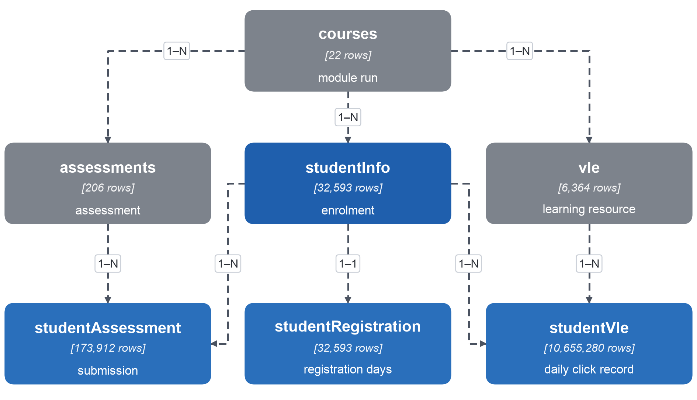
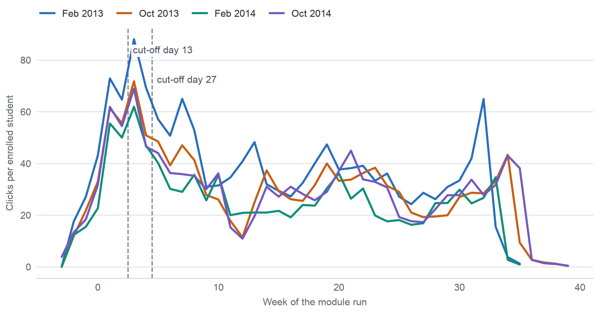

## Phụ lục I – Chi tiết về hiểu dữ liệu, khảo sát dữ liệu (profiling) và chất lượng dữ liệu

Hình A.1 trình bày bảy bảng của OULAD cùng số dòng và các khóa liên kết giữa chúng; từng liên kết đều đã được kiểm tra trên dữ liệu (`understanding.json`).

Hình A.2 cho thấy số lượt nhấp mỗi tuần trên một sinh viên đang đăng ký học, theo tháng bắt đầu, kèm hai thời điểm chốt dữ liệu vào cuối tuần 2 và cuối tuần 4 (`fig_weekly_activity.csv`).

Bảng A.1 liệt kê các đầu vào mà đề bài yêu cầu, được kiểm tra trước khi bắt đầu chuẩn bị dữ liệu, cùng trạng thái của từng đầu vào.

**Bảng A.1. Các đầu vào từ Milestone 2 và trạng thái**

| Đầu vào (đề bài) | Nội dung trong dự án | Trạng thái |
| :---- | :---- | :---- |
| Phiên bản cơ sở của Milestone 1 | Business Goal, SMART Goal, các KPI, AQ1–AQ4, loại phân tích và các quyết định, được chốt bằng mã kiểm tra SHA-256 của từng tệp; cả 8 tệp nguồn không thay đổi | Đầy đủ |
| Ma trận truy vết đã cập nhật | KPI → AQ → yêu cầu dữ liệu → tệp → biến thực tế → mức đáp ứng → quyết định | Đầy đủ |
| Gói dữ liệu gốc | Bảy bảng CSV của OULAD, phiên bản 1 trên figshare, DOI 10.6084/m9.figshare.5081998.v1, mỗi bảng khớp với giá trị SHA-256 tham chiếu ghi sẵn | Đầy đủ, khớp 7/7 |
| Metadata và từ điển dữ liệu | Định nghĩa các cột theo bài mô tả dữ liệu, giấy phép CC BY 4.0, thông tin trích dẫn | Đầy đủ |
| Bằng chứng thu thập | Địa chỉ web, DOI, ngày truy cập 06/11/2026 (UTC+7), phiên bản, mã kiểm tra, nhật ký thu thập | Đầy đủ |
| Nhật ký thay đổi có kiểm soát | C01–C08, kèm nội dung cũ, nội dung mới và bằng chứng dữ liệu | Đầy đủ |

Bảng A.2 giải thích ý nghĩa của từng trường ngày và từng đại lượng đo trong OULAD, cùng thời điểm giá trị được biết; ý nghĩa lấy từ bài mô tả dữ liệu và chính sách đánh giá của OU, còn các số đếm lấy từ `understanding.json`.

**Bảng A.2. Ý nghĩa và thời điểm có giá trị của các trường chính**

| Trường | Ý nghĩa | Đơn vị và thang đo | Thời điểm được biết |
| :---- | :---- | :---- | :---- |
| date_registration, date_unregistration | Ngày sinh viên đăng ký và hủy đăng ký; ngày hủy đăng ký để trống nghĩa là sinh viên không rút | ngày (từ ngày 0) | chính ngày đó |
| assessments.date | Ngày đến hạn (cut-off) của bài đánh giá | ngày | từ khi kỳ mở bắt đầu |
| date_submitted | Ngày sinh viên nộp bài; cả 1.909 kết quả bảo lưu đều mang giá trị −1, là giá trị giữ chỗ | ngày | chính ngày đó |
| is_banked | Kết quả được chuyển từ một kỳ mở trước | 0/1 | khi đăng ký |
| score | Điểm, 0–100; dưới 40 là không đạt | điểm | TMA: giảng viên hướng dẫn chấm, thường trong vòng mười ngày làm việc sau ngày đến hạn; CMA: chấm tự động, trong vòng 7 ngày |
| weight | Tỷ trọng trong điểm tổng kết; bài thi chiếm 100, các bài đánh giá còn lại cộng lại chiếm 100 | % | từ khi bắt đầu |
| sum_click | Số lượt tương tác với một tài nguyên học tập trong một ngày | số đếm | chính ngày đó |
| studied_credits | Tổng tín chỉ của mọi module học cùng lúc; 60 tín chỉ một năm là học bán thời gian, 120 là toàn thời gian | tín chỉ | khi đăng ký |

Bảng A.3 liệt kê sáu thuộc tính nhạy cảm cùng mã giá trị, nhóm nhỏ nhất và số nhóm theo kỳ mở module có dưới 20 sinh viên.

**Bảng A.3. Các thuộc tính nhạy cảm**

| Thuộc tính | Mã giá trị | Nhóm nhỏ nhất | Số nhóm theo kỳ mở dưới 20 | Bản chất |
| :---- | :---- | :---- | :---- | :---- |
| gender | F, M | F: 14.718 | 0 | Cá nhân |
| age_band | 0-35, 35-55, 55<= | 55<=: 216 | 18 | Cá nhân |
| disability | Y, N (tự khai) | Y: 3.164 | 1 | Liên quan đến sức khỏe |
| imd_band | mười nhóm thập phân vị, để trống | để trống: 1.111 | 11 | Kinh tế – xã hội, theo khu vực |
| region | 13 vùng | Ireland: 1.184 | 11 | Vị trí |
| highest_education | năm cấp | Postgraduate: 313 | 29 | Kinh tế – xã hội |

Nhật ký vấn đề chất lượng dữ liệu (Data Quality Issue Log) trong Bảng A.4 trình bày đầy đủ bằng chứng cho từng vấn đề của Bảng 3.1; tiền tố P. chỉ các phần của `data/metadata/profile.json`, còn U. chỉ các khóa của `understanding.json`.

**Bảng A.4. Nhật ký vấn đề chất lượng dữ liệu kèm bằng chứng**

| Mã | Biến / bảng | Bằng chứng | Ảnh hưởng đến AQ | Mức độ | Quyết định |
| :---- | :---- | :---- | :---- | :---- | :---- |
| DQ01 | studentVle: dòng trùng lặp hoàn toàn | 787.170 dòng (7,39%) lặp lại một dòng khác ở mọi cột; 3,82–11,73% theo kỳ mở; 69,8% số nhóm trùng lặp chỉ có một lượt nhấp; gộp các dòng này làm mất 3,19% số lượt nhấp (P.duplicates). Trong các nhóm sinh viên – tài nguyên – ngày có hai dòng, 31,5% có số lượt nhấp bằng nhau, so với 24,0% kỳ vọng do ngẫu nhiên tính từ chính số lượt nhấp của từng tài nguyên (Bảng A.6) | Các đại lượng lượt nhấp của AQ2 và AQ3 | Trung bình | Dữ liệu không đủ để xác định nguyên nhân: giữ mọi dòng trong các đại lượng lượt nhấp chính (mỗi dòng là một bản ghi nhật ký) và dựng phiên bản đã bỏ dòng trùng cho từng đặc trưng lượt nhấp để kiểm tra độ nhạy |
| DQ02 | studentVle: đơn vị mỗi dòng (grain) khác với tài liệu | 1.614.505 nhóm sinh viên – tài nguyên – ngày có nhiều dòng (3.810.465 dòng), trong đó 1.179.074 nhóm có số lượt nhấp khác nhau; một nhóm có tối đa 10 dòng (P.shape) | Mọi phép nối bảng hoặc phép đếm ở mức dòng sẽ nhầm bản ghi với ngày | Trung bình | Gộp lượt nhấp theo lượt đăng ký học × ngày và lượt đăng ký học × tuần trước mọi phép nối bảng; đếm số ngày hoạt động, không đếm số dòng |
| DQ03 | studentVle, studentAssessment: hoạt động sau khi hủy đăng ký | 29.440 dòng lượt nhấp (98.745 lượt nhấp) của 1.279 lượt đăng ký học, muộn nhất 423 ngày sau khi hủy đăng ký; 588 bài nộp không bảo lưu của 411 lượt đăng ký học (P.validity) | Mức tham gia đến lúc rút (AQ1, AQ2); không ảnh hưởng tại thời điểm chốt đối với sinh viên còn đăng ký | Trung bình | Cắt các đại lượng mức tham gia tại ngày hủy đăng ký; các bảng đặc trưng chỉ chứa sinh viên còn đăng ký tại thời điểm chốt, nên không sự kiện nào sau khi rút đi vào các bảng này |
| DQ04 | final_result × date_unregistration | 93 lượt đăng ký học Withdrawn không có ngày hủy đăng ký, 87 lượt trong số đó thuộc các kỳ mở tháng 10 năm 2014; 9 lượt đăng ký học Fail có ngày hủy đăng ký, 8 lượt trong số đó vào ngày 0 hoặc sớm hơn (U.outcome, P.validity) | Các lượt đăng ký học còn hiệu lực tại ngày 14, 13 và 27; thời gian đến khi rút | Thấp | Giữ final_result làm biến kết quả; giữ ngày đã ghi nhận; gắn cờ cho cả hai nhóm (`withdrawal_day_missing`, `unregistered_not_withdrawn`); 93 lượt này vẫn nằm trong mọi tổng thể vì không bản ghi nào cho thấy sinh viên rời đi trước thời điểm chốt; một cờ phục vụ đánh giá cho phép báo cáo các chỉ số trên tập kiểm thử khi có và khi không có các lượt này |
| DQ05 | studentRegistration: đăng ký sau ngày 14 | 58 lượt đăng ký học có ngày đăng ký từ ngày 16 đến ngày 167, sau thời hạn đăng ký hai tuần theo bài mô tả dữ liệu; 16 lượt trong số đó về sau hủy đăng ký (P.validity) | Mẫu số của KPI và các lượt đăng ký học còn hiệu lực tại các thời điểm chốt | Thấp | Định nghĩa "đang đăng ký học vào ngày d" là đã đăng ký đến ngày d (hoặc không rõ ngày đăng ký) và chưa hủy đăng ký đến ngày d; sinh viên đăng ký muộn chỉ vào tổng thể của các ngày về sau |
| DQ06 | studentRegistration: rời đi trước khi giảng dạy | 3.097 lượt đăng ký học hủy đăng ký vào ngày 0 hoặc sớm hơn; một lượt hủy đăng ký vào ngày 444 của một kỳ mở dài 268 ngày (U.outcome) | Mẫu số của KPI | Thấp | Không phải lỗi: các sinh viên này rời đi trước khi kỳ mở bắt đầu và nằm ngoài tổng thể KPI tại ngày 14; bản ghi ngày 444 được giữ lại kèm cờ |
| DQ07 | studentAssessment: kết quả bảo lưu | Cả 1.909 kết quả bảo lưu đều có date_submitted = −1, là giá trị giữ chỗ cho kết quả chuyển từ một kỳ mở trước (P.validity) | Các đại lượng về nộp đúng hạn và bài bỏ lỡ (AQ1–AQ3) | Trung bình | Loại các dòng bảo lưu khỏi phép tính thời điểm nộp, nộp trễ và số bài bỏ lỡ; giữ số kết quả bảo lưu của mỗi lượt đăng ký học, giá trị này biết được ngay khi đăng ký |
| DQ08 | assessments, studentAssessment: bài thi | 18 trên 24 bài thi không có dòng kết quả (chỉ có điểm cho CCC 2 và DDD 4); 11 bài thi không có ngày đến hạn (P.missing, U.time) | "Bài được chấm điểm đầu tiên bị bỏ lỡ" (AQ1); dấu hiệu về bài (AQ2, AQ3) | Cao (bài thi) | Chỉ đếm bài bỏ lỡ và bài nộp trễ trên TMA và CMA; biến kết quả vẫn là final_result; không dùng điểm thi |
| DQ09 | assessments: tỷ trọng | Tổng tỷ trọng bài tập trong kỳ bằng 0 ở ba kỳ mở GGG và bằng 100 ở các kỳ mở khác; các CMA của FFF có tỷ trọng 0; các kỳ mở CCC năm 2014 có hai bài thi (tổng 200) (P.validity, U.measurement) | Các đặc trưng điểm có trọng số | Trung bình | Không dựng điểm tổng kết có trọng số; đếm bài không theo trọng số (bài đánh giá không tính điểm vẫn có ngày đến hạn) và giữ weight làm một cột |
| DQ10 | studentAssessment: bài nộp trễ và nộp sau khi kỳ mở kết thúc | 49.318 trên 169.138 bài nộp không bảo lưu có ngày đến hạn bị trễ (29,2%; trung vị 3 ngày, phân vị thứ 99 là 29 ngày): 16.320 trên 97.088 TMA và 32.991 trên 69.956 CMA, dù chính sách hiện hành (2025) của OU không nhận CMA nào sau ngày đến hạn; 85 bài nộp sau khi kỳ mở kết thúc, muộn nhất vào ngày 608 (P.validity) | Dấu hiệu nộp trễ (AQ1, AQ2, quy tắc dấu hiệu sớm) | Trung bình | Giữ mọi bài nộp; số ngày trễ = date_submitted − ngày đến hạn, đếm riêng cho TMA và CMA vì ý nghĩa của một CMA nộp trễ trong giai đoạn 2013–2014 không được ghi trong tài liệu; các bài nộp sau khi kỳ mở kết thúc đều nằm sau cả hai thời điểm chốt |
| DQ11 | studentAssessment.score | 173 điểm bị thiếu, đều là TMA (P.missing); 45,8% điểm CMA là bội số của 10, so với 17,4% ở TMA (P.distribution) | Các đặc trưng về điểm | Thấp | Giữ bài nộp, để trống điểm; điểm chỉ đi vào đặc trưng khi đã biết tại thời điểm chốt (ma trận quyết định, dòng "Derived feature") |
| DQ12 | studentInfo.imd_band | 1.111 giá trị thiếu (3,41%), chiếm 40,1% ở North Region và 22,5% ở Ireland; tỷ lệ đạt là 65,7% khi thiếu so với 46,6% khi có, nên giá trị không thiếu ngẫu nhiên; một nhãn "10-20" thiếu dấu % (P.missing, P.validity) | Kiểm tra công bằng của AQ4 theo mức khó khăn của khu vực; các đặc trưng về đặc điểm cá nhân | Trung bình | Chuẩn hóa nhãn thành "10-20%"; giữ giá trị thiếu thành một nhóm riêng "Missing"; không điền giá trị thiếu |
| DQ13 | studentRegistration.date_registration | 45 giá trị thiếu, 39 trong số đó là Withdrawn (P.missing) | Đặc trưng số ngày đăng ký trước khi bắt đầu | Thấp | Giữ giá trị rỗng kèm biến chỉ báo; mọi phép điền giá trị thiếu chỉ được ước lượng trên các kỳ mở huấn luyện |
| DQ14 | vle.week_from, week_to | 82,4% giá trị thiếu; chỉ có giá trị cho 1.121 trên 6.364 tài nguyên (P.missing, U.time) | Không có | Thấp | Không sử dụng |
| DQ15 | studentVle: các ngày không có lượt nhấp nào | Ở cả sáu kỳ mở tháng 2 năm 2014, hai ngày liên tiếp không có lượt nhấp nào (ngày 218–219; ngày 211–212 ở BBB) (P.temporal) | Chuỗi hoạt động theo ngày sau tuần 30 | Thấp | Coi hai ngày này là dữ liệu thiếu, không phải không hoạt động, trong chuỗi theo ngày; cả hai ngày đều nằm sau các thời điểm chốt |
| DQ16 | Giá trị ngoại lai: lượt nhấp và tín chỉ | Một dòng có 6.977 lượt nhấp; độ lệch phân phối (skewness) của số lượt nhấp trên mỗi lượt đăng ký học là 3,03, với 2.503 lượt đăng ký học vượt ngưỡng trên theo khoảng tứ phân vị; studied_credits lên tới 655, so với phân vị thứ 99 là 240 (P.distribution) | Các phương pháp nhạy với thang đo | Thấp | Giữ mọi giá trị (sinh viên dùng nền tảng rất nhiều và sinh viên học nhiều module là có thật); phép biến đổi logarit hoặc xếp hạng được áp dụng khi lập mô hình, với tham số ước lượng trên các kỳ mở huấn luyện |
| DQ17 | Lượt đăng ký học không có dòng hoạt động hoặc bài nộp nào | 3.365 lượt đăng ký học không có dòng lượt nhấp (2.988 Withdrawn; 2.390 rời đi trước hoặc vào ngày 0); 6.750 lượt không có bài nộp (P.missing) | Phép nối trong (inner join) sẽ làm mất các sinh viên này khỏi phép đếm | Trung bình | Không có dòng nghĩa là không có hoạt động (theo bài mô tả dữ liệu: không nộp bài thì không có dòng kết quả): điền 0 vào các số đếm sau phép nối trái từ bảng lượt đăng ký học |
| DQ18 | assessments: các bài đến hạn tính đến hết thời điểm chốt | Bài không phải bài thi có ngày đến hạn tính đến hết ngày 13 ở 1 trên 22 kỳ mở và tính đến hết ngày 27 ở 16 kỳ mở; có từ hai bài trở lên đến hạn tính đến hết ngày 27 ở 1 kỳ mở duy nhất (P.temporal) | Quy tắc so sánh của AQ3 và KPI phụ 1: quy tắc của Milestone 1 ("bỏ lỡ hoặc nộp trễ từ hai bài trở lên tính đến hết tuần 4") chỉ có thể đánh dấu được sinh viên ở 1 trên 22 kỳ mở, còn dạng điều chỉnh cho OULAD với một bài (C06) đánh dấu được sinh viên ở 16 kỳ mở tại ngày 27 và 1 kỳ mở tại ngày 13 | Cao | Quyết định ở Nhiệm vụ 3 (mức phù hợp giữa AQ và dữ liệu): phát biểu lại quy tắc trên các bài thực sự đến hạn (thay đổi C10 trong Nhật ký thay đổi) |
| DQ19 | Tổng thể và cơ cấu module | Bảy module đào tạo từ xa của UK giai đoạn 2013–2014, được chọn một phần vì có nhiều sinh viên không đạt; nữ chiếm 11,5% ở EEE và 88,4% ở BBB; tỷ lệ hoàn thành trong nhóm tính KPI từ 45,7% (CCC) đến 73,8% (AAA) (P.representativeness) | Khả năng tổng quát hóa của mọi AQ; so sánh giữa các nhóm | Cao (nhận định) | Nêu rõ phạm vi; so sánh các nhóm trong cùng module; kết quả mô tả OULAD và phải được kiểm tra lại trên dữ liệu của trường trước các quyết định D1–D3 |

Mười ba con số trong kết quả khảo sát dữ liệu đã được đếm lại bằng một lần khám phá độc lập trên cùng các tệp với mã riêng (`profile_crosscheck.csv`); Bảng A.5 trình bày 13 đại lượng được so sánh, tất cả đều bằng nhau.

**Bảng A.5. Đối chiếu với một lần đếm lại độc lập**

| Đại lượng | Lần đếm lại độc lập | Kết quả khảo sát Milestone 3 | Bằng nhau |
| :---- | :---- | :---- | :---- |
| Dòng trùng lặp hoàn toàn trong studentVle | 787.170 | 787.170 | có |
| Lượt nhấp gốc | 39.605.099 | 39.605.099 | có |
| Lượt nhấp sau khi gộp dòng trùng lặp | 38.343.063 | 38.343.063 | có |
| Nhóm sinh viên – tài nguyên – ngày bị lặp | 1.614.505 | 1.614.505 | có |
| Số dòng trong các nhóm bị lặp | 3.810.465 | 3.810.465 | có |
| Lượt đăng ký học không có hoạt động | 3.365 | 3.365 | có |
| Lượt đăng ký học không có bài nộp | 6.750 | 6.750 | có |
| Bài nộp trễ | 49.318 | 49.318 | có |
| Bài nộp sau khi kỳ mở kết thúc | 85 | 85 | có |
| Dòng lượt nhấp sau khi hủy đăng ký | 29.440 | 29.440 | có |
| Lượt đăng ký học có lượt nhấp sau khi hủy đăng ký | 1.279 | 1.279 | có |
| Bài nộp sau khi hủy đăng ký (gồm 13 dòng bảo lưu ghi ngày -1) | 601 | 601 | có |
| Dòng lượt nhấp trước ngày 0 | 688.988 | 688.988 | có |

Phép kiểm tra so với mức ngẫu nhiên đối với các dòng lượt nhấp trùng lặp xét 1.311.841 nhóm sinh viên – tài nguyên – ngày có đúng hai dòng. Phép kiểm tra này so sánh tỷ lệ nhóm có số lượt nhấp bằng nhau (31,5%) với tỷ lệ kỳ vọng do ngẫu nhiên, tính từ chính số lượt nhấp của từng tài nguyên (24,0%) hoặc của từng loại hoạt động (21,7%). Bảng A.6 trình bày tỷ lệ quan sát được ở sáu loại hoạt động có nhiều nhóm như vậy nhất.

**Bảng A.6. Tỷ lệ số lượt nhấp bằng nhau trong các nhóm hai dòng, theo loại hoạt động**

| Loại hoạt động | Số nhóm hai dòng | Tỷ lệ bằng nhau quan sát được |
| :---- | :---- | :---- |
| `forumng` | 895.551 | 32,8% |
| `oucontent` | 279.561 | 32,2% |
| `quiz` | 71.751 | 11,5% |
| `ouwiki` | 21.555 | 7,7% |
| `questionnaire` | 14.694 | 6,0% |
| `oucollaborate` | 11.921 | 59,6% |

**Chi tiết về kết quả khảo sát dữ liệu.** Các đoạn dưới đây trình bày đầy đủ bằng chứng và lập luận làm cơ sở cho phần tóm tắt ở Mục 3.1 đến Mục 3.4, lần lượt theo từng khía cạnh, kèm mã vấn đề trong Nhật ký vấn đề chất lượng dữ liệu (Bảng 3.1).

**Bằng chứng cho Mục 3.1: kích thước bảng, khóa, dòng trùng lặp và phép nối bảng.**

**Kích thước và schema.** Mỗi bảng có đúng số dòng mà tài liệu mô tả nêu [2]; sáu bảng có khóa chính đều không có giá trị khóa trùng lặp. Hai tên trong tệp khác với tài liệu: độ dài kỳ mở được lưu trong trường module_presentation_length chứ không phải length, còn kết quả rút khỏi module được ghi là "Withdrawn" chứ không phải "Withdrawal" [2]. Hai khác biệt này không làm thay đổi giá trị nào; quy trình chuẩn bị dữ liệu (pipeline) dùng nguyên các tên được lưu trong tệp.

**Mức chi tiết của bảng lượt nhấp.** Bảng lượt nhấp khác với tài liệu ở mức chi tiết của bảng (grain), tức là đơn vị mà một dòng biểu diễn. Theo tài liệu, mỗi dòng là các tương tác của một sinh viên với một tài nguyên học tập trong một ngày [7], nghĩa là mỗi bộ ba sinh viên, tài nguyên và ngày chỉ có một dòng. Trên thực tế, 1.614.505 bộ ba sinh viên – tài nguyên – ngày có nhiều dòng; ở 1.179.074 bộ ba trong số đó, các dòng ghi số lượt nhấp khác nhau; có bộ ba gồm tới mười dòng. Do đó, mỗi dòng là một bản ghi của hệ thống ghi nhật ký chứ không phải một ngày. Vì vậy, số lượt nhấp được cộng theo lượt đăng ký học và ngày trước khi sử dụng, còn mức hoạt động được đếm bằng số ngày hoạt động chứ không bằng số dòng (DQ02).

**Dòng trùng lặp hoàn toàn.** Ngoài ra, 787.170 dòng lượt nhấp (7,39%) lặp lại một dòng khác ở mọi cột; gộp các dòng này sẽ làm mất 3,19% tổng số lượt nhấp. Có hai cách giải thích: các dòng trùng là bản sao do hệ thống ghi nhật ký tạo ra hoặc là những lần truy cập riêng biệt tình cờ có cùng số lượt nhấp. Nếu các dòng trùng là bản sao thì hai dòng cùng sinh viên, cùng tài nguyên và cùng ngày sẽ có số lượt nhấp bằng nhau thường xuyên hơn hẳn mức ngẫu nhiên. Trên dữ liệu, điều này xảy ra ở 31,5% số nhóm có hai dòng, so với 24,0% kỳ vọng do ngẫu nhiên tính từ chính số lượt nhấp của từng tài nguyên; phần vượt mức ngẫu nhiên xuất hiện ở diễn đàn và trang nội dung, trong khi bài kiểm tra ngắn, wiki và bảng hỏi lại thấp hơn mức ngẫu nhiên (Bảng A.6). Bằng chứng nghiêng về cả hai phía, nên dữ liệu không đủ để xác định nguyên nhân. Mọi dòng đều được giữ lại, đúng với mức chi tiết của chính bảng này; bên cạnh đó, phiên bản đã bỏ dòng trùng của từng đặc trưng lượt nhấp cho phép Milestone 4 kiểm tra xem lựa chọn này có ảnh hưởng đến kết quả hay không (DQ01).

**Phép nối bảng.** Phép nối bảng cần thận trọng vì hai lý do. Thứ nhất, nối trực tiếp bảng bài nộp với các dòng lượt nhấp theo sinh viên sẽ nhân số dòng lên: kết quả có 89.347.197 dòng, vì mỗi bài nộp được ghép với mọi bản ghi lượt nhấp của cùng sinh viên. Thứ hai, nối trong (inner join) với bảng hoạt động, tức là chỉ giữ các dòng có mặt ở cả hai bảng, sẽ loại 3.365 lượt đăng ký học không có dòng lượt nhấp nào. Phần lớn các sinh viên này rời đi trước khi kỳ mở bắt đầu nên không có dòng hoạt động [8]; loại các sinh viên này sẽ làm mất các lượt rút khỏi module trong các tỷ lệ mô tả. Do đó, các bảng được cộng gộp về mức lượt đăng ký học trước, rồi mới nối vào bảng lượt đăng ký học bằng nối trái (left join). Phép nối này giữ mọi lượt đăng ký học và ghi trường hợp không có hoạt động là 0 (DQ17).

**Bằng chứng cho Mục 3.2: giá trị thiếu và tính hợp lệ.**

**Giá trị thiếu.** Dữ liệu có ít giá trị thiếu; cách phân bố của các giá trị thiếu cho biết nguyên nhân phát sinh. Mức khó khăn của khu vực bị để trống ở 1.111 lượt đăng ký học (3,41%); các ô trống tập trung ở hai vùng: 40,1% số lượt đăng ký học của North Region và 22,5% của Ireland không có giá trị này. Các sinh viên này cũng hoàn thành module ở 65,7% trường hợp, cao hơn mức 46,6% ở sinh viên có thông tin về mức khó khăn. Như vậy, các ô trống có liên hệ với biến kết quả chứ không ngẫu nhiên; nếu các ô này được điền bằng một giá trị điển hình thì nhóm sinh viên có hành vi khác biệt này sẽ bị che khuất (DQ12). Ngoài ra, ngày đăng ký bị thiếu ở 45 lượt đăng ký học, 39 trong số đó là Withdrawn (DQ13), còn 173 điểm TMA bị thiếu dù bài nộp vẫn tồn tại (DQ11).

**Khoảng trống mang tính cấu trúc.** Ba khoảng trống khác mang tính cấu trúc: các khoảng trống này phát sinh từ cách ghi nhận dữ liệu chứ không phải từ giá trị bị mất. Ngày hủy đăng ký để trống cho biết sinh viên không rút khỏi module [2]; không có dòng bài nộp nghĩa là bài đó không được nộp [2]; còn kết quả bài thi theo thiết kế thường không có trong dữ liệu [2], nên 18 trong 24 bài thi không có dòng kết quả nào (DQ08). Các khoảng trống này là trường hợp không có bản ghi, được hiểu lần lượt là "không rút", "không nộp" và "không có kết quả thi" và không bao giờ được điền giá trị.

**Tính hợp lệ.** Các phép kiểm tra tính hợp lệ cho thấy mọi điểm số nằm trong khoảng 0 đến 100 và không có bài nộp nào ghi ngày trước ngày đăng ký của sinh viên, nhưng cũng phát hiện sáu loại không nhất quán:

(1) 93 lượt đăng ký học Withdrawn không có ngày hủy đăng ký, 87 trong số đó thuộc các kỳ mở tháng 10 năm 2014, còn 9 lượt đăng ký học Fail lại có ngày này (DQ04);
(2) 58 lượt đăng ký học diễn ra sau thời hạn đăng ký hai tuần mà bài mô tả dữ liệu nêu [2], muộn nhất vào ngày 167 (DQ05);
(3) cả 1.909 kết quả bảo lưu đều mang ngày nộp giữ chỗ −1 (DQ07);
(4) 98.745 lượt nhấp của 1.279 lượt đăng ký học và 588 bài nộp của 411 lượt đăng ký học ghi ngày sau khi sinh viên hủy đăng ký, muộn nhất 423 ngày sau đó (DQ03);
(5) 32.991 trong 69.956 bài CMA được nộp sau ngày đến hạn, dù chính sách hiện hành năm 2025 của OU không nhận CMA nào sau ngày đến hạn [3]; dữ liệu phản ánh cách làm của giai đoạn 2013–2014, còn quy định của giai đoạn đó không được ghi trong tài liệu (DQ10);
(6) một nhãn khoảng, "10-20", thiếu dấu phần trăm (DQ12).

Không loại nào trong số này được sửa bằng cách thay đổi giá trị đã ghi nhận. Thay vào đó, mỗi loại nhận một cờ hoặc một quy tắc trong kế hoạch chuẩn bị dữ liệu ở Mục 5; nhờ vậy, dữ liệu đã chuẩn bị vừa giữ nguyên những gì đã được ghi nhận, vừa cho thấy dữ liệu đó được sử dụng ra sao.

**Bằng chứng cho Mục 3.3: phân phối, giá trị ngoại lai và mức cân bằng của biến kết quả.**

**Hoạt động.** Phân phối hoạt động lệch mạnh. Tính trên mỗi lượt đăng ký học, trung vị là 602 lượt nhấp trong cả kỳ mở; một phần tư số lượt đăng ký học có không quá 142 lượt nhấp, một phần tư có từ 1.585 lượt trở lên; 3.365 lượt đăng ký học không có lượt nhấp nào. Ngưỡng trên theo khoảng tứ phân vị là ranh giới thống kê thường dùng để xác định giá trị ngoại lai, bằng tứ phân vị thứ ba cộng 1,5 lần khoảng cách giữa tứ phân vị thứ nhất và thứ ba. Ngưỡng này nằm ở mức 3.750 lượt nhấp và có 2.503 lượt đăng ký học vượt qua; riêng một bản ghi của một sinh viên với một tài nguyên trong một ngày đạt tới 6.977 lượt nhấp. Đây là những sinh viên dùng nền tảng rất nhiều chứ không phải lỗi dữ liệu, vì không có gì trong bản ghi cho thấy hoạt động của các sinh viên này là sai; do đó, không giá trị nào bị loại bỏ hoặc cắt ngưỡng (DQ16). Vì một số ít sinh viên chiếm tỷ trọng lớn trong tổng số lượt nhấp, các mô hình nhạy với thang đo sẽ nhận logarit của số lượt nhấp thay cho số đếm gốc (Mục 6.2).

**Điểm số và số tín chỉ đang học.** Ngược lại, điểm số lệch về phía điểm cao: trung vị là 80 và một phần tư số điểm đạt từ 90 trở lên. Bên cạnh đó, 45,8% điểm CMA là bội số của mười, so với 17,4% điểm TMA, cho thấy điểm do máy chấm thay đổi theo các bậc lớn. Số tín chỉ đang học lên tới 655, trong khi phân vị thứ 99 là 240; những sinh viên này học nhiều module cùng lúc, điều hiếm gặp nhưng có thể xảy ra, nên giá trị được giữ lại.

**Mức cân bằng của biến kết quả.** Đề bài yêu cầu xem biến kết quả có mất cân bằng nghiêm trọng không và lớp thiểu số có đủ trường hợp hay không [1]. Nhóm tính KPI gồm các lượt đăng ký học còn hiệu lực tại ngày 14, tức là đã đăng ký và chưa hủy đăng ký tính đến hết ngày 14, tổng cộng 28.061 lượt, trong đó 54,7% hoàn thành. Tỷ lệ không hoàn thành là 45,3% trong số lượt đăng ký học còn hiệu lực tại ngày 13 và 44,2% trong số lượt còn hiệu lực tại ngày 27; như vậy, hai lớp có kích thước gần nhau và không cần lấy mẫu lại. Giữa các kỳ mở, tỷ lệ không hoàn thành dao động từ 24,9% đến 58,3%; ở mọi kỳ mở, lớp thiểu số có ít nhất 92 lượt đăng ký học, đủ để ước lượng tỷ lệ cho từng kỳ mở. Hình 3.1 trình bày kết quả cuối cùng của từng kỳ mở: tỷ lệ rút khỏi module cao nhất ở các kỳ mở CCC (43–46%), còn GGG có ít lượt rút nhất nhưng nhiều lượt không đạt nhất.

**Bằng chứng cho Mục 3.4: phạm vi thời gian và tính đại diện.**

**Phạm vi thời gian.** Dữ liệu bao gồm các kỳ mở tháng 2 và tháng 10 của năm 2013 và năm 2014; hoạt động được ghi nhận từ khoảng bốn tuần trước ngày bắt đầu kỳ mở đến tuần 39. Số lượt nhấp mỗi tuần trên một sinh viên đang đăng ký học tăng trước ngày bắt đầu, đạt đỉnh ở tuần 3, ngay sau thời điểm chốt dữ liệu thứ nhất, rồi ổn định ở mức thấp hơn (Hình A.2). Ở cả sáu kỳ mở tháng 2 năm 2014, hai ngày liên tiếp gần cuối kỳ mở hoàn toàn không có lượt nhấp nào, cụ thể là ngày 218 và 219 (ngày 211 và 212 ở BBB). Khoảng trống xuất hiện vào cùng những ngày ở cả sáu module cho thấy lỗi của hệ thống ghi nhật ký hơn là hành vi của sinh viên; vì vậy, hai ngày này được coi là dữ liệu thiếu chứ không phải không hoạt động (DQ15). Cả hai ngày đều nằm rất xa sau các thời điểm chốt.

**Các bài đến hạn tính đến hết thời điểm chốt.** Hai thời điểm chốt nằm sớm trong kỳ mở, trước khi phần lớn bài đánh giá đến hạn. Tính đến hết ngày 13, chỉ 1 trong 22 kỳ mở có TMA hoặc CMA đến hạn; tính đến hết ngày 27, con số này là 16 kỳ mở, trong đó chỉ một kỳ mở có từ hai bài trở lên đến hạn (DQ18). Bài đầu tiên không phải bài thi đến hạn trong khoảng từ ngày 12 đến ngày 61, tùy module. Do đó, một quy tắc đếm bài bỏ lỡ hoặc nộp trễ không có gì để đếm tại thời điểm chốt thứ nhất ở 21 kỳ mở; Mục 4.1 giải thích cách quy tắc dấu hiệu sớm được phát biểu lại vì lý do này.

**Lịch sử dữ liệu cho dự báo.** Để dự báo trên một kỳ mở diễn ra sau, có 9 cặp module và tháng bắt đầu được mở ở cả hai năm; nhờ đó, một mô hình xây dựng trên năm 2013 có thể được kiểm tra trên cùng module và tháng bắt đầu của năm 2014. Module CCC ở cả hai tháng bắt đầu, cùng các kỳ mở tháng 2 của EEE và GGG, chỉ được mở năm 2014, nên các kỳ mở dùng để kiểm tra của các module này không có kỳ mở tương ứng năm 2013. Tại mỗi thời điểm chốt, dữ liệu chỉ cho biết những lượt rút khỏi module có ngày rút tính đến hết thời điểm đó [8]; vì vậy, kết quả cuối kỳ mở không bao giờ có sẵn để dùng làm đặc trưng.

**Tính đại diện.** Tính đại diện giới hạn phạm vi của mọi kết luận. OULAD là một tập con sinh viên OU giai đoạn 2013–2014, bị thu hẹp thêm do quá trình ẩn danh hóa; các module được chọn một phần vì có nhiều sinh viên không đạt [2]. Sinh viên trong bộ dữ liệu học từ xa; 70,4% dưới 35 tuổi và 63,1% học đồng thời không quá 60 tín chỉ. Các module khác nhau rõ rệt: nữ chiếm 11,5% số lượt đăng ký học ở EEE nhưng 88,4% ở BBB, còn tỷ lệ hoàn thành trong nhóm tính KPI dao động từ 45,7% ở CCC đến 73,8% ở AAA. Mức khó khăn của khu vực được tính theo chỉ số riêng của từng quốc gia thuộc UK nên không thể gộp chung giữa các quốc gia [6]. Vì vậy, các kết quả chỉ mô tả các kỳ mở của OULAD, các nhóm được so sánh trong cùng module chứ không giữa các module; mọi kết quả phải được kiểm tra lại trên dữ liệu của chính trường trước khi làm căn cứ cho các quyết định D1 đến D3 (DQ19).

**Chi tiết về các đại lượng đo.**

Ba trong số các trường chính của Bảng A.2 cần được xử lý thận trọng trước khi dùng làm đại lượng đo. Thứ nhất, kết quả bảo lưu là kết quả được chuyển từ một kỳ mở trước của cùng module; cả 1.909 kết quả bảo lưu đều mang ngày nộp giữ chỗ −1 thay cho ngày thật, nên không thể dùng để xác định thời điểm nộp bài. Thứ hai, điểm số nằm trong khoảng 0 đến 100, với 40 là điểm đạt [2], nhưng giảng viên hướng dẫn thường trả kết quả TMA trong vòng mười ngày làm việc sau ngày đến hạn, còn điểm CMA dự kiến có trong vòng 7 ngày [3]. OULAD không ghi ngày công bố điểm, nên không thể chứng minh điểm TMA đã được biết tại một thời điểm chốt. Thứ ba, tỷ trọng lệch khỏi quy tắc trong tài liệu [2] ở hai chỗ: ba kỳ mở GGG đặt tỷ trọng 0 cho mọi bài làm trong kỳ, còn hai kỳ mở CCC năm 2014 có hai bài thi. Số tín chỉ đang học cộng gộp mọi module mà sinh viên học cùng lúc [2], với 60 tín chỉ một năm là học bán thời gian và 120 tín chỉ là học toàn thời gian [4]; vì vậy, số tín chỉ này phản ánh tổng lượng học tập trên mọi module sinh viên đang theo học chứ không đo mức nỗ lực trong một module.
