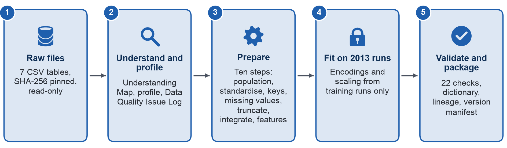

## Phụ lục II – Quy trình chuẩn bị dữ liệu và Gói dữ liệu đã chuẩn bị

Hình A.3 trình bày năm giai đoạn của quy trình chuẩn bị dữ liệu (pipeline), từ các tệp gốc chỉ đọc đến gói dữ liệu đã qua kiểm tra.



Bảng A.7 đối chiếu mười bước chuẩn bị dữ liệu của đề bài với hàm trong `src/prepare_data.py` hoặc script thực hiện từng bước, kèm số dòng mà bước đó tạo ra.

**Bảng A.7. Các bước của pipeline, mã nguồn và kết quả**

| Bước (đề bài) | Mã nguồn | Kết quả |
| :---- | :---- | :---- |
| 1 Nạp tệp gốc, kiểm tra schema | `step1_load_validate` | 7 bảng, SHA-256 trùng với giá trị tham chiếu ghi sẵn, các cột đúng như tài liệu |
| 2 Chọn các lượt đăng ký học được xét | `step2_population` | 32.593 lượt đăng ký học; 28.069 / 28.061 / 27.535 lượt còn hiệu lực tại ngày 13 / 14 / 27 |
| 3 Chuẩn hóa kiểu dữ liệu, nhãn, mã định danh | `step3_standardise` | Sửa 3.516 nhãn "10-20"; 182 bài (TMA, CMA) |
| 4 Xử lý khóa và dòng trùng lặp | `step4_keys` | 10.655.280 dòng lượt nhấp → 1.808.119 bản ghi lượt đăng ký học – ngày |
| 5 Xử lý giá trị thiếu | `step5_missing` | 1.111 nhóm "Missing"; 45, 93, 9 và 1 bản ghi được gắn cờ |
| 6 Xử lý giá trị không hợp lệ | `step6_truncate` | Loại 98.745 lượt nhấp sau khi rút |
| 7 Tích hợp các bảng | `step7_integrate` | 286.898 dòng lượt đăng ký học – bài; 168.953 bài nộp được xếp vào lưới |
| 8 Xây dựng đặc trưng | `cutoff_features` | 28.069 và 27.535 dòng đặc trưng |
| 9 Bảng sẵn sàng cho phân tích | `step9_views` | 6 bảng, trong đó có 1.052.344 dòng lượt đăng ký học – tuần |
| 10 Lưu trữ kèm nhật ký và metadata | `step10_persist`, `fit_transforms.py`, `validate_prepared.py` | 8 tệp Parquet, từ điển dữ liệu, bảng truy vết nguồn gốc dữ liệu, bản tóm tắt kết quả kiểm tra, bản kê phiên bản |

Gói dữ liệu đã chuẩn bị (Prepared Data Package) nộp kèm báo cáo này được bố trí theo khuyến nghị của đề bài: `data/raw/` (đầu vào bất biến), `data/interim/`, `data/processed/`, `data/metadata/`, `notebooks/`, `src/`, `tests/` và `logs/`. Một lệnh duy nhất, chạy từ thư mục của gói, dựng lại toàn bộ gói từ các tệp gốc; khi `data/raw/` trống, lệnh này trước hết tải tệp nén đã công bố và đối chiếu từng bảng với giá trị SHA-256 tham chiếu ghi sẵn:

```
bash src/run_all.sh
```

Bảng A.8 liệt kê tám giai đoạn mà lệnh này chạy; mỗi giai đoạn ghi lệnh, thời gian, đầu ra và trạng thái kết thúc vào `logs/`.

**Bảng A.8. Các giai đoạn của run_all.sh**

| Giai đoạn | Script | Đầu ra |
| :---- | :---- | :---- |
| 00 | `link_raw.py` | Các tệp gốc được tạo liên kết cứng (hard link), SHA-256 được đối chiếu với giá trị tham chiếu của Milestone 2 |
| 01 | `01_understand.py` | Bảng mô tả cấu trúc bộ dữ liệu (Dataset Understanding Map) (Mục 2.1) |
| 02 | `02_profile.py` | Kết quả khảo sát dữ liệu (profiling) và bằng chứng về chất lượng (Mục 3) |
| 03 | `unittest on tests/` | Kiểm thử đơn vị cho các công thức trên bản ghi giả lập |
| 04 | `prepare_data.py` | Mười bước chuẩn bị dữ liệu, các bảng và nhật ký biến đổi dữ liệu (Mục 6) |
| 05 | `fit_transforms.py` | Các phép biến đổi được ước lượng (fit) trên các kỳ mở năm 2013, ma trận sẵn sàng cho mô hình (Mục 6.3) |
| 06 | `validate_prepared.py` | 22 phép kiểm tra, từ điển dữ liệu, bảng truy vết nguồn gốc dữ liệu, bản kê phiên bản (Mục 7) |
| 07 | `build_notebooks.py` | Notebook 02 và 03, đã được chạy |

Nhật ký biến đổi dữ liệu ghi lại mọi thao tác cùng số dòng tương ứng, theo đúng thứ tự pipeline thực hiện; mỗi bảng gốc chỉ được nạp sau khi SHA-256 của bảng khớp giá trị tham chiếu và các cột khớp với tài liệu. Bảng A.9 tái hiện nhật ký này.

**Bảng A.9. Nhật ký biến đổi dữ liệu**

| Bước | Thao tác | Dòng vào | Dòng ra | Ghi chú |
| :---- | :---- | :---- | :---- | :---- |
| 1 nạp | courses.csv |  | 22 |  |
| 1 nạp | assessments.csv |  | 206 |  |
| 1 nạp | vle.csv |  | 6.364 |  |
| 1 nạp | studentInfo.csv |  | 32.593 |  |
| 1 nạp | studentRegistration.csv |  | 32.593 |  |
| 1 nạp | studentAssessment.csv |  | 173.912 |  |
| 1 nạp | studentVle.csv |  | 10.655.280 |  |
| 2 lượt được xét | studentInfo + studentRegistration | 32.593 | 32.593 | nối trái, đủ dòng |
| 2 lượt được xét | + courses (độ dài kỳ mở) | 32.593 | 32.593 | nối trái, đủ dòng |
| 2 lượt được xét | gắn cờ enrolled_d13 | 32.593 | 28.069 | đang đăng ký học vào ngày đó (C09) |
| 2 lượt được xét | gắn cờ enrolled_d14 | 32.593 | 28.061 | đang đăng ký học vào ngày đó (C09) |
| 2 lượt được xét | gắn cờ enrolled_d27 | 32.593 | 27.535 | đang đăng ký học vào ngày đó (C09) |
| 3 chuẩn hóa | nhãn imd_band '10-20' → '10-20%' | 3.516 | 0 |  |
| 3 chuẩn hóa | suy ra year, start_month, completed, non_completion, split | 32.593 | 32.593 |  |
| 3 chuẩn hóa | bài = TMA và CMA (loại bài thi, DQ08) | 206 | 182 |  |
| 4 khóa | dòng studentVle → lượt đăng ký học × ngày (records, clicks, clicks_dedup) | 10.655.280 | 1.808.119 | 39.605.099 lượt nhấp, 38.343.063 sau khi loại trùng |
| 4 khóa | dòng studentVle → lượt đăng ký học × tài nguyên × ngày, không trùng | 10.655.280 | 8.459.320 |  |
| 5 giá trị thiếu | imd_band thiếu → nhóm 'Missing' (không điền giá trị thiếu) | 1.111 | 1.111 |  |
| 5 giá trị thiếu | gắn cờ registration_missing | 32.593 | 45 |  |
| 5 giá trị thiếu | gắn cờ withdrawal_day_missing | 32.593 | 93 |  |
| 5 giá trị thiếu | gắn cờ unregistered_not_withdrawn | 32.593 | 9 |  |
| 5 giá trị thiếu | gắn cờ unregistered_after_run_end | 32.593 | 1 |  |
| 6 cắt | bản ghi lượt nhấp lượt đăng ký học × ngày đến ngày hủy đăng ký | 1.808.119 | 1.802.593 | loại 98.745 lượt nhấp |
| 6 cắt | bản ghi lượt đăng ký học × tài nguyên × ngày đến ngày hủy đăng ký | 8.459.320 | 8.435.429 |  |
| 7 tích hợp | lưới lượt đăng ký học × bài (TMA, CMA của kỳ mở) | 32.593 | 286.898 |  |
| 7 tích hợp | + bài nộp (nếu có) | 286.898 | 286.898 | nối trái, đủ dòng |
| 7 tích hợp | bài nộp TMA/CMA được xếp vào lưới | 168.953 | 168.953 |  |
| 9 bảng | + kết quả bảo lưu | 32.593 | 32.593 | nối trái, đủ dòng |
| 9 bảng | + kỳ mở học cùng lúc | 32.593 | 32.593 | nối trái, đủ dòng |
| 9 bảng | + sinh viên đã xuất hiện trong các kỳ mở huấn luyện | 32.593 | 32.593 | nối trái, đủ dòng |
| 9 bảng | + cờ kỳ mở có kỳ tương ứng năm 2013 | 32.593 | 32.593 | nối trái, đủ dòng |
| 9 bảng | + tuần của bài đầu tiên bị bỏ lỡ | 32.593 | 32.593 | nối trái, đủ dòng |
| 9 bảng | + các bài trong thời gian đăng ký học | 32.593 | 32.593 | nối trái, đủ dòng |
| 9 bảng | + hoạt động trong cả kỳ mở (cắt tại thời điểm rút) | 32.593 | 32.593 | nối trái, đủ dòng |
| 9 bảng | lưới student_week + lượt nhấp mỗi tuần | 1.052.344 | 1.052.344 | nối trái, đủ dòng |
| 9 bảng | + số tài nguyên khác nhau mỗi tuần | 1.052.344 | 1.052.344 | nối trái, đủ dòng |
| 9 bảng | + cờ khoảng trống ghi nhật ký (DQ15) | 1.052.344 | 1.052.344 | nối trái, đủ dòng |
| 9 bảng | dòng student_week (tuần -3 đến hết kỳ mở, cắt tại thời điểm rút) |  | 1.052.344 | lượt nhấp trước tuần -3 không có trong bảng này: 0 |
| 8 đặc trưng d13 | + hoạt động đến thời điểm chốt | 28.069 | 28.069 | nối trái, đủ dòng |
| 8 đặc trưng d13 | + số tài nguyên khác nhau | 28.069 | 28.069 | nối trái, đủ dòng |
| 8 đặc trưng d13 | + các bài đến hạn tính đến hết thời điểm chốt | 28.069 | 28.069 | nối trái, đủ dòng |
| 8 đặc trưng d13 | + điểm CMA đã biết tại thời điểm chốt | 28.069 | 28.069 | nối trái, đủ dòng |
| 8 đặc trưng d13 | + các bài nộp trước ngày đến hạn (đến hạn sau thời điểm chốt) | 28.069 | 28.069 | nối trái, đủ dòng |
| 8 đặc trưng d13 | + trung vị lượt nhấp của kỳ mở đến thời điểm chốt (cùng kỳ mở, không dùng biến kết quả) | 28.069 | 28.069 | nối trái, đủ dòng |
| 8 đặc trưng d13 | đã dựng đặc trưng; ngày sự kiện muộn nhất ≤ thời điểm chốt | 28.069 | 28.069 | early_sign_rule 5.673 |
| 8 đặc trưng d27 | + hoạt động đến thời điểm chốt | 27.535 | 27.535 | nối trái, đủ dòng |
| 8 đặc trưng d27 | + số tài nguyên khác nhau | 27.535 | 27.535 | nối trái, đủ dòng |
| 8 đặc trưng d27 | + các bài đến hạn tính đến hết thời điểm chốt | 27.535 | 27.535 | nối trái, đủ dòng |
| 8 đặc trưng d27 | + điểm CMA đã biết tại thời điểm chốt | 27.535 | 27.535 | nối trái, đủ dòng |
| 8 đặc trưng d27 | + các bài nộp trước ngày đến hạn (đến hạn sau thời điểm chốt) | 27.535 | 27.535 | nối trái, đủ dòng |
| 8 đặc trưng d27 | + trung vị lượt nhấp của kỳ mở đến thời điểm chốt (cùng kỳ mở, không dùng biến kết quả) | 27.535 | 27.535 | nối trái, đủ dòng |
| 8 đặc trưng d27 | đã dựng đặc trưng; ngày sự kiện muộn nhất ≤ thời điểm chốt | 27.535 | 27.535 | early_sign_rule 7.933 |
| 10 lưu trữ | processed/enrolment.parquet |  | 32.593 | 39 cột |
| 10 lưu trữ | processed/assessment_due.parquet |  | 286.898 | 14 cột |
| 10 lưu trữ | processed/student_week.parquet |  | 1.052.344 | 10 cột |
| 10 lưu trữ | processed/features_d13.parquet |  | 28.069 | 50 cột |
| 10 lưu trữ | processed/features_d27.parquet |  | 27.535 | 52 cột |
| 10 lưu trữ | processed/capacity_by_run.parquet |  | 44 | 9 cột |

Các tệp đã chuẩn bị được định danh bằng phiên bản OULAD-N04-prepared-1.0; Bảng A.10 trình bày số dòng và mã băm của các tệp này theo `version_manifest.json`; các mã băm giống hệt nhau qua hai lần chạy từ các tệp gốc.

**Bảng A.10. Các tệp đã chuẩn bị**

| Tệp | Số dòng | SHA-256 (16 ký tự) |
| :---- | :---- | :---- |
| assessment_due.parquet | 286.898 | f67d7916dd95c2ab |
| capacity_by_run.parquet | 44 | 38f6868c2b74fcc7 |
| enrolment.parquet | 32.593 | 1d1e397ac67ce774 |
| features_d13.parquet | 28.069 | c58a44150e8c367c |
| features_d27.parquet | 27.535 | 4bf8a482b9ec7fa4 |
| model_ready_d13.parquet | 28.069 | 773d1e2fa0773564 |
| model_ready_d27.parquet | 27.535 | 3560a51594d4ad97 |
| student_week.parquet | 1.052.344 | 7526872e26e95da7 |

**Các bản ghi được gắn cờ và các bài nộp được xếp vào lưới.** Ở bước 5 của pipeline, bốn nhóm bản ghi được gắn cờ gồm: 45 lượt đăng ký học không có ngày đăng ký; 93 lượt đăng ký học Withdrawn không có ngày rút; 9 lượt đăng ký học Fail lại có ngày này; và một lượt hủy đăng ký vào ngày 444 của một kỳ mở dài 268 ngày. Bước 7 xếp toàn bộ 168.953 bài nộp TMA và CMA vào các dòng lượt đăng ký học – bài, trong đó 1.909 kết quả bảo lưu mang trạng thái "banked"; nhờ đó, các kết quả này được đếm nhưng không bao giờ được dùng để tính thời điểm nộp. Trong tổng số 173.912 dòng bài nộp, 4.959 dòng còn lại là kết quả bài thi, vốn không được tính là bài (TMA, CMA).

**Chi tiết về các biện pháp kiểm soát khi chia dữ liệu.** Các đoạn dưới đây giải thích các biện pháp kiểm soát được tóm tắt ở cuối Mục 6.3.

**Sinh viên có mặt ở cả hai năm.** Trong tập kiểm thử, 1.962 lượt đăng ký học thuộc về sinh viên cũng từng đăng ký một kỳ mở năm 2013. Các lượt này vẫn nằm trong tập kiểm thử chính, vì một kỳ mở về sau của cùng module cũng sẽ có sinh viên học lại; đồng thời, một cờ đánh dấu các lượt này để Milestone 4 có thể lặp lại phép kiểm tra trên những sinh viên chưa từng xuất hiện trong dữ liệu huấn luyện. Khi tinh chỉnh siêu tham số, Milestone 4 dùng các fold (phần chia trong kiểm định chéo) loại trừ từng kỳ mở (leave-one-run-out) trong năm 2013, mỗi lần tách riêng một kỳ mở để đánh giá. Milestone 4 cũng loại khỏi dữ liệu huấn luyện của mỗi fold những sinh viên có mặt trong kỳ mở được tách ra để đánh giá, vì cùng một sinh viên nằm ở cả hai phía của một fold sẽ làm kết quả ước lượng cao hơn thực tế [13].

**Các phép biến đổi có tham số ước lượng từ dữ liệu.** Các phép biến đổi học tham số từ dữ liệu, ví dụ điền giá trị thiếu bằng trung vị hoặc chuẩn hóa thang đo của một biến, chỉ được ước lượng (fit) trên các kỳ mở huấn luyện rồi mới áp dụng cho các kỳ mở của tập kiểm thử [11]. Để kiểm tra, nhóm tác giả ước lượng lại các tham số sau khi thay đổi mọi dòng của tập kiểm thử; các tham số vẫn giữ nguyên, chứng tỏ không dòng của tập kiểm thử nào tham gia vào phép ước lượng. Ngoài ra, kết quả của năm 2014 không được xem trong lúc chuẩn bị dữ liệu: các phép kiểm tra dữ liệu đã chuẩn bị chỉ báo cáo tỷ lệ kết quả của tập kiểm thử dưới dạng số đếm; nhờ đó tập kiểm thử vẫn là một phép kiểm tra độc lập như đề bài yêu cầu [1]. Bên cạnh đó, kết quả trên tập kiểm thử cũng sẽ được báo cáo thêm một lần sau khi bỏ các lượt đăng ký học trong tập kiểm thử có kết quả Withdrawn nhưng không có ngày rút (89 lượt tại ngày 13 và 90 lượt tại ngày 27), vì những sinh viên này có thể đã rời đi trước thời điểm chốt mà không để lại bản ghi.

**Chi tiết về cấu trúc gói dữ liệu.**

Gói dữ liệu được bố trí theo cấu trúc mà đề bài khuyến nghị [1]: `data/raw/` chứa các bảng gốc bất biến; `data/interim/` chứa các kết quả trung gian mà pipeline có thể tạo lại; `data/processed/` chứa các bảng dữ liệu sẵn sàng cho phân tích; `data/metadata/` chứa từ điển dữ liệu, bảng truy vết nguồn gốc dữ liệu, các nhật ký chất lượng và kết quả kiểm tra; `notebooks/` chứa các notebook về hiểu dữ liệu và chuẩn bị dữ liệu; và `src/` chứa các script.
