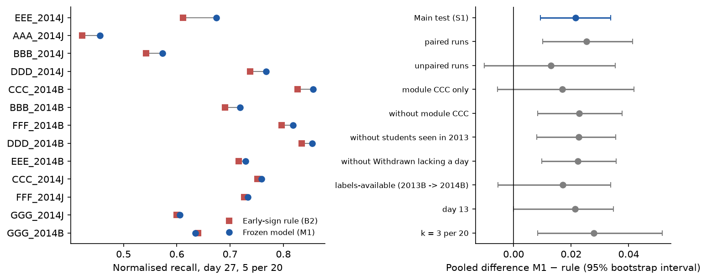
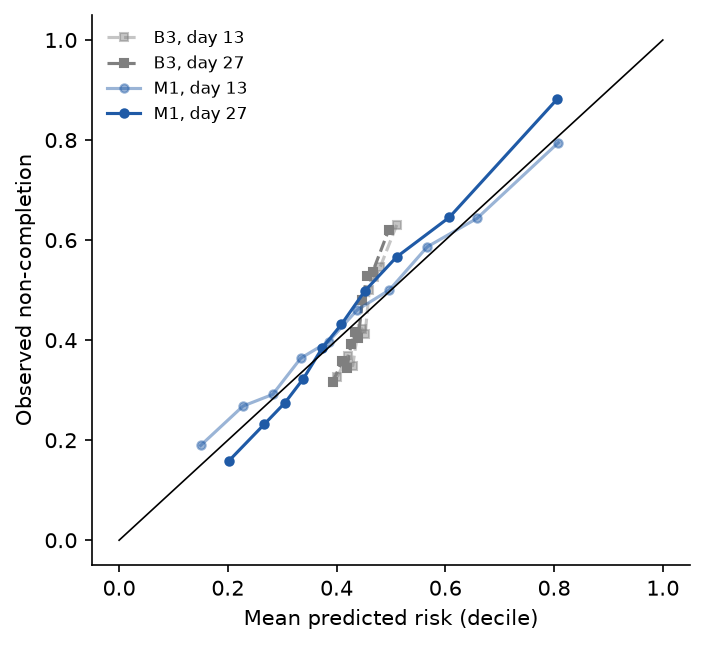
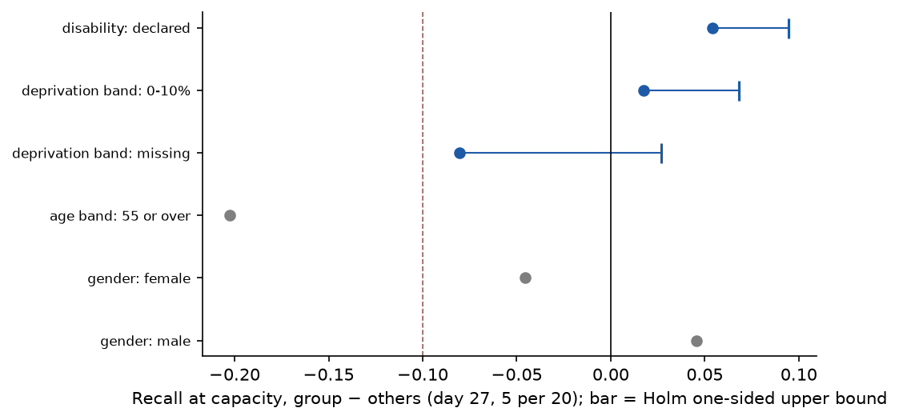
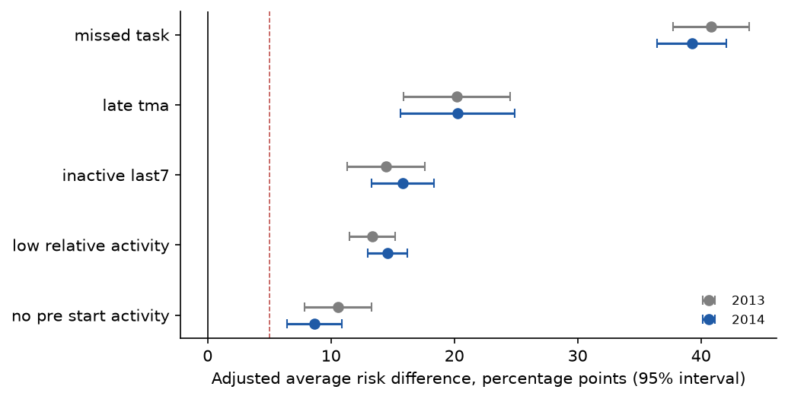

# Prototype report – Milestone 4, Level 2 (team N04)

This report is written by src/12_report.py from the CSV files in results/ alone; every number comes from those files. It covers the eight steps of the prototype protocol: development on the 9 runs of 2013, the second freeze, the single test on the 2014 runs, error and fairness analysis, sensitivity analyses and the AQ2 replication.

## 1. Purpose and frozen protocol

The prototype tests whether the Level 1 choices hold on data the model never saw. The primary model (M1) is a penalised logistic regression on the primary predictor set; it is compared with three baselines (B1 random list, B2 early-sign rule ranked by number of signs, B3 background-only logistic model) and three challengers (M2 logistic, extended set; M3 and M4 gradient-boosted trees on the primary and extended sets). A challenger replaces M1 only with a gain of at least 0.03 in pooled normalised recall at day 27, k = 5 per 20, and a gain in at least 7 of the 9 development folds. Normalised recall is the number of non-completers on a run's list divided by the most a list of that length can hold, min(k, number of non-completers), pooled over runs. The single gate S1 requires M1's pooled normalised recall on the 2014 runs to exceed the rule's, with the 95% paired two-level bootstrap interval of the difference above 0 and a one-sided sign-flip p-value below 0.05.

## 2. Data and populations

The inputs are the Milestone 3 prepared package OULAD-N04-prepared-1.0; every file hash matched its manifest before use. The table gives the development (2013) and test (2014) populations at each cut-off.

| cutoff | dev_enrolments_2013 | dev_noncompleters_2013 | dev_max_attainable_k5 | test_enrolments_2014 | test_noncompleters_2014 |
| :---- | :---- | :---- | :---- | :---- | :---- |
| 13 | 12080 | 5519 | 3032 | 15989 | 7189 |
| 27 | 11811 | 5245 | 2976 | 15724 | 6911 |

In each development fold, training rows of students who also appear in the validation run are removed: 258 rows over the folds at day 13 and 242 at day 27.

## 3. Development results and model choice

The selection rule was applied to the nine leave-one-run-out folds of 2013 (nested leave-one-run-out tuning inside each training set). The table gives each configuration's pooled normalised recall at day 27, k = 5 per 20, its gain over M1 and the folds with a gain.

| config | pooled_normalised_recall_d27_k5 | gain_vs_M1 | folds_with_gain | chosen | reason |
| :---- | :---- | :---- | :---- | :---- | :---- |
| B1 | 0.445 | -0.308 | 0 | no | baseline, not eligible for the choice; gain -0.3079, gain in 0 of 9 folds; |
| B2 | 0.727 | -0.025 | 2 | no | baseline, not eligible for the choice; gain -0.0252, gain in 2 of 9 folds; |
| B3 | 0.571 | -0.182 | 0 | no | baseline, not eligible for the choice; gain -0.1818, gain in 0 of 9 folds; |
| M1 | 0.753 | 0.000 | – | yes | primary model; kept because no challenger met the margin |
| M2 | 0.747 | -0.006 | 2 | no | margin not met (gain -0.0057 < 0.03; gain in 2 of 9 folds < 7) |
| M3 | 0.750 | -0.003 | 4 | no | margin not met (gain -0.0027 < 0.03; gain in 4 of 9 folds < 7) |
| M4 | 0.749 | -0.004 | 2 | no | margin not met (gain -0.0037 < 0.03; gain in 2 of 9 folds < 7) |

The rule chose M1. These fold results serve the choice only and are not an estimate of performance in use.

## 4. The single test

The 2014 outcomes were opened once, at 2026-11-09T17:55:05Z (UTC), after both frozen model files were re-verified against their recorded SHA-256 values; the access time and hashes were written to the experiment log before any 2014 row was read.

The table lists the scored model files and their hashes; B3 was refitted on all 2013 runs with the M1 procedure before the access.

| config | parameter_file | model_sha256 |
| :---- | :---- | :---- |
| M1 | models/frozen_M1_d13.joblib | 5eeb1b3234bee08c6173eb55499c846235092c1cc25e44dac8a2f1b2a82c0fd1 |
| M1 | models/frozen_M1_d27.joblib | 49f462fbeb6d1631ecf233cc46a370da0947365f4be48a18c125aa10a86b9a96 |
| B3 | models/fitted_B3_d13.joblib | a871b9295b4c6a7e414458318cd803b4dab7e520b04efdd8316d265dedcdf8b6 |
| B3 | models/fitted_B3_d27.joblib | 2268df1b239ef2439d0e6a5227d3649d93cf2a274e6929a3712651bbbb5afe31 |

## 5. Success criteria S1–S3

S1, the single gate: on all 13 test runs at day 27, k = 5 per 20, M1's pooled normalised recall is 0.726 against 0.704 for the rule-ranked list, a difference of 0.021 (95% paired two-level bootstrap interval 0.009 to 0.034; one-sided sign-flip p = 2.4e-04). M1 wins 12 runs, ties 0 and loses 1; the unweighted mean of the per-run differences is 0.022. Verdict: S1 met. In counts, M1's lists hold 2871 non-completers and the rule's 2786, out of at most 3955.

M1's list holds fewer non-completers than the rule's in 1 run(s): GGG_2014B.

S2 (reported, not a gate): M1's precision at capacity is 72.6% against a base rate of 44.0% and an attainable maximum of 100.0%.

S3 (condition for showing probabilities): calibration-in-the-large 0.058 (bounds −0.2 to 0.2) and slope 1.311 (bounds 0.8 to 1.2): not met, so tutors see ranks and reasons only.

Unfavourable result: S3 is not met. A slope of 1.311, above 1, means the predicted risks are less extreme than the observed outcomes (too close to the average), which fits the strong shrinkage the tuning chose; the ranking, and so the lists, are unaffected.

Figure 1 shows, for each 2014 run, the normalised recall of M1 and of the rule at the main operating point, and the pooled difference with its interval for the main test and every sensitivity variant.



*Figure 1. Normalised recall by test run (left) and pooled M1 − rule difference with 95% bootstrap interval, main test and sensitivity variants (right)*

## 6. Secondary metrics

The table gives precision at capacity with its base rate and attainable maximum, and the within-run PR-AUC and ROC-AUC averaged over the 13 test runs, per configuration, cut-off and list length.

| config | cutoff | k | precision | base_rate | max_attainable_precision | pr_auc | roc_auc_within_run |
| :---- | :---- | :---- | :---- | :---- | :---- | :---- | :---- |
| B1 | 13 | 3 | 0.451 | 0.450 | 1.000 | – | 0.501 |
| B1 | 13 | 5 | 0.450 | 0.450 | 1.000 | – | 0.501 |
| B2 | 13 | 3 | 0.705 | 0.450 | 1.000 | 0.606 | 0.679 |
| B2 | 13 | 5 | 0.667 | 0.450 | 1.000 | 0.606 | 0.679 |
| B3 | 13 | 3 | 0.608 | 0.450 | 1.000 | 0.530 | 0.605 |
| B3 | 13 | 5 | 0.581 | 0.450 | 1.000 | 0.530 | 0.605 |
| M1 | 13 | 3 | 0.743 | 0.450 | 1.000 | 0.638 | 0.700 |
| M1 | 13 | 5 | 0.688 | 0.450 | 1.000 | 0.638 | 0.700 |
| B1 | 27 | 3 | 0.440 | 0.440 | 1.000 | – | 0.500 |
| B1 | 27 | 5 | 0.440 | 0.440 | 1.000 | – | 0.500 |
| B2 | 27 | 3 | 0.780 | 0.440 | 1.000 | 0.660 | 0.711 |
| B2 | 27 | 5 | 0.704 | 0.440 | 1.000 | 0.660 | 0.711 |
| B3 | 27 | 3 | 0.599 | 0.440 | 1.000 | 0.522 | 0.605 |
| B3 | 27 | 5 | 0.572 | 0.440 | 1.000 | 0.522 | 0.605 |
| M1 | 27 | 3 | 0.807 | 0.440 | 1.000 | 0.686 | 0.732 |
| M1 | 27 | 5 | 0.726 | 0.440 | 1.000 | 0.686 | 0.732 |

Net benefit (context only, results/net_benefit.csv): at day 27, M1 has a higher net benefit than contacting everyone, no one and the rule-flagged students at 17 of 19 thresholds between 0.05 and 0.95; it does not at 0.10, 0.15.

## 7. Calibration

The table gives calibration-in-the-large, calibration slope and Brier score (with the Brier score of predicting the test base rate) for M1 and B3; only M1 at day 27 is judged against S3.

| config | cutoff | citl | slope | s3_verdict | brier | brier_base_rate |
| :---- | :---- | :---- | :---- | :---- | :---- | :---- |
| M1 | 13 | 0.071 | 0.882 | descriptive: met | 0.216 | 0.247 |
| B3 | 13 | -0.006 | 3.093 | descriptive: not met | 0.243 | 0.247 |
| M1 | 27 | 0.058 | 1.311 | S3: not met | 0.205 | 0.246 |
| B3 | 27 | 0.003 | 3.286 | descriptive: not met | 0.242 | 0.246 |

Figure 2 plots observed against predicted risk by decile of predicted risk; points on the diagonal are well calibrated.



*Figure 2. Observed non-completion against mean predicted risk by decile, 2014 test runs*

## 8. Fairness (FR1)

The table gives, at day 27 and k = 5 per 20, each audit group's recall at capacity against the other students, the difference and, for the three confirmatory groups, the Holm-adjusted one-sided 95% upper bound. A group is flagged when the gap is below −10 points and the bound lies below 0.

| group | cutoff | k | n | n_noncompleters | recall_group | recall_others | difference | holm_ci_high | flagged |
| :---- | :---- | :---- | :---- | :---- | :---- | :---- | :---- | :---- | :---- |
| disability: declared | 27 | 5 | 1488 | 803 | 0.463 | 0.409 | 0.054 | 0.095 | no |
| deprivation band: 0-10% | 27 | 5 | 1486 | 787 | 0.431 | 0.413 | 0.017 | 0.068 | no |
| deprivation band: missing | 27 | 5 | 610 | 181 | 0.337 | 0.418 | -0.081 | 0.027 | no |
| age band: 55 or over | 27 | 5 | 118 | 42 | 0.214 | 0.417 | -0.202 | – | insufficient data, not cleared |
| gender: female | 27 | 5 | 6666 | 2750 | 0.388 | 0.434 | -0.046 | – | descriptive |
| gender: male | 27 | 5 | 9058 | 4161 | 0.434 | 0.388 | 0.046 | – | descriptive |

Not flagged but below the other students: deprivation band: missing (-8.1 points, upper bound +2.7 points).

Flagged for review: no confirmatory group. age band: 55 or over: insufficient data, not cleared (point gap -0.202).

Figure 3 shows the recall gap of each audit group at the main operating point.



*Figure 3. Recall gap by audit group with the Holm one-sided upper bound (confirmatory groups); dashed line at −10 points*

## 9. Sensitivity analyses

The table repeats the S1 statistics for each variant; none can change the S1 verdict.

| variant | cutoff | k | pooled_nr_model | pooled_nr_rule | difference | boot_ci_low | boot_ci_high | signflip_p | wins | ties | losses | mean_per_run_difference | verdict | n_runs | n_enrolments |
| :---- | :---- | :---- | :---- | :---- | :---- | :---- | :---- | :---- | :---- | :---- | :---- | :---- | :---- | :---- | :---- |
| paired runs | 27 | 5 | 0.708 | 0.683 | 0.025 | 0.010 | 0.041 | 0.0020 | 9 | 0 | 0 | 0.026 | would meet S1 (sensitivity only) | 9 | 10801 |
| unpaired runs | 27 | 5 | 0.765 | 0.752 | 0.013 | -0.010 | 0.035 | 0.1250 | 3 | 0 | 1 | 0.011 | would not meet S1 (sensitivity only) | 4 | 4923 |
| module CCC only | 27 | 5 | 0.800 | 0.783 | 0.017 | -0.006 | 0.042 | 0.2500 | 2 | 0 | 0 | 0.019 | would not meet S1 (sensitivity only) | 2 | 3521 |
| without module CCC | 27 | 5 | 0.705 | 0.682 | 0.023 | 0.008 | 0.038 | 9.8e-04 | 10 | 0 | 1 | 0.022 | would meet S1 (sensitivity only) | 11 | 12203 |
| without students seen in 2013 | 27 | 5 | 0.704 | 0.681 | 0.023 | 0.008 | 0.035 | 9.8e-04 | 12 | 0 | 1 | 0.023 | would meet S1 (sensitivity only) | 13 | 14138 |
| without Withdrawn lacking a day | 27 | 5 | 0.719 | 0.696 | 0.022 | 0.010 | 0.036 | 2.4e-04 | 12 | 0 | 1 | 0.022 | would meet S1 (sensitivity only) | 13 | 15634 |
| labels-available (2013B -> 2014B) | 27 | 5 | 0.779 | 0.762 | 0.017 | -0.005 | 0.034 | 0.0312 | 5 | 0 | 1 | 0.018 | would not meet S1 (sensitivity only) | 6 | 6510 |
| day 13 | 13 | 5 | 0.688 | 0.667 | 0.021 | 0.000 | 0.035 | 0.0195 | 9 | 1 | 3 | 0.019 | would not meet S1 (sensitivity only) | 13 | 15989 |
| k = 3 per 20 | 27 | 3 | 0.807 | 0.780 | 0.028 | 0.008 | 0.052 | 0.0154 | 10 | 0 | 3 | 0.029 | would meet S1 (sensitivity only) | 13 | 15724 |

Variants whose S1 reading differs from the main test: unpaired runs, module CCC only, labels-available (2013B -> 2014B), day 13.

- without students seen in 2013: lists re-formed on the remaining enrolments
- without Withdrawn lacking a day: lists re-formed on the remaining enrolments
- labels-available (2013B -> 2014B): M1 spec fitted on BBB_2013B, DDD_2013B, FFF_2013B with {'C': 0.1}; scored on the 2014B runs

## 10. AQ4 lists under capacity

The table summarises the M1-ranked lists of the 13 test runs per cut-off and list length, pooled: recall, precision, the C13 check that precision is at least 50%, lift, overlap with the rule's list and the Fail and Withdrawn students among the listed non-completers.

| cutoff | k | n_enrolments | n_noncompleters | list_length | noncompleters_on_list | recall | precision | precision_ge_50 | lift | normalised_recall | max_attainable | overlap_with_rule_list | listed_fail | listed_withdrawn |
| :---- | :---- | :---- | :---- | :---- | :---- | :---- | :---- | :---- | :---- | :---- | :---- | :---- | :---- | :---- |
| 13 | 3 | 15989 | 7189 | 2418 | 1797 | 0.250 | 0.743 | yes | 1.653 | 0.743 | 2418 | 0.688 | 1049 | 748 |
| 13 | 5 | 15989 | 7189 | 4030 | 2772 | 0.386 | 0.688 | yes | 1.530 | 0.688 | 4030 | 0.732 | 1570 | 1202 |
| 27 | 3 | 15724 | 6911 | 2373 | 1916 | 0.277 | 0.807 | yes | 1.837 | 0.807 | 2373 | 0.793 | 1119 | 797 |
| 27 | 5 | 15724 | 6911 | 3955 | 2871 | 0.415 | 0.726 | yes | 1.652 | 0.726 | 3955 | 0.801 | 1652 | 1219 |

Unfavourable result: the C13 limit of 50% precision is not reached in every run.

Runs whose day-27 list of 5 per 20 has precision below 50%: AAA_2014J (45.6%). Each listed student carries up to three contributing predictors (coefficient × standardised value); the per-student lists are in results/aq4_lists/.

## 11. AQ2 replication on 2014

The table compares the adjusted average risk difference (percentage points) of each early sign in 2013 and 2014, re-estimated with the same model only after the AQ3 test (Change Log C14); module-specific estimates, CCC included, are in results/aq2_replication.csv.

| sign | estimate_2013 | ci_2013 | verdict_2013 | estimate_2014 | ci_2014 | verdict_2014 | modules_same_direction_2014 |
| :---- | :---- | :---- | :---- | :---- | :---- | :---- | :---- |
| missed_task | 40.83 | [37.73, 43.93] | consistent association | 39.26 | [36.45, 42.08] | consistent association | 5/5 |
| late_tma | 20.2 | [15.87, 24.52] | consistent association | 20.25 | [15.64, 24.87] | consistent association | 3/4 |
| inactive_last7 | 14.46 | [11.3, 17.62] | consistent association | 15.82 | [13.3, 18.35] | consistent association | 7/7 |
| low_relative_activity | 13.36 | [11.48, 15.23] | consistent association | 14.6 | [12.98, 16.22] | consistent association | 7/7 |
| no_pre_start_activity | 10.56 | [7.84, 13.29] | consistent association | 8.65 | [6.44, 10.87] | consistent association | 7/7 |

Signs whose verdict differs between 2013 and 2014: none.

Figure 4 compares the adjusted risk difference of each sign between the two years.



*Figure 4. Adjusted risk difference of each sign, 2013 and 2014, with 95% intervals; dashed line at 5 points*

## 12. Deviations from the contract

The contract and the Milestone 4 report leave these implementation details open; each was fixed as below.

- Tuning grids: Appendix III step 3 names the tuned settings but no values; grids are C (inverse L2 penalty) in {1e-5,1e-4,0.001,0.01,0.1,1,10,100} and trees depth {2,3} x trees {100,300} x learning rate {0.05,0.1} (depth 2-3 as Appendix I, Table A.2 calls interpretable).
- Tuning criterion: not stated; the inner loop maximises pooled normalised recall at k = 5 per 20 at the fold's cut-off (the S1 metric), ties to the simplest setting (smaller C; shallower, fewer, slower trees).
- Penalty type: 'penalised logistic regression' without a type; L2 (ridge), lbfgs.
- B3 uses the same penalised logistic pipeline and nested tuning as M1, restricted to its 6 predictors.
- Model-score ties and remaining B2 ties (same signs and activity ratio) are broken by ascending id_student (randomised by the provider); not specified in the contract.
- B1: mean over 100 seeded random lists per run (number of draws not specified); noncompleters_on_list and roc_auc_within_run are those means.
- Trees: module and start month enter as native categories of HistGradientBoostingClassifier (levels learnt in the training fold, unseen level -> missing); education as its ordinal code; early stopping off so the number of trees is the tuned value.
- List length for inner (tuning) folds, whose runs lose the rows of students in the outer validation run, uses the capacity_by_run formula per20 x ceil(n/20) on the rows present; outer folds use capacity_by_run itself (equal by construction, asserted).
- freeze.csv has one row per cut-off (one frozen model per cut-off, Section 3.3); the key '-' of the contract is kept and the cut-off is written in the spec column.
- Two challengers may both meet the margin: the one with the higher pooled normalised recall is chosen, ties to the simpler (order M1 < M2 < M3 < M4).
- C grid extended to 1e-5–100 after phase-1 development showed the day-27 optimum on the lower boundary (C=0.001); decided before any 2014 access (results of the first grid kept in results/grid_v1/).
- version_manifest.json carries no hash for predictor_sets.json and data_dictionary.md; their SHA-256 values are recorded in the experiment log instead.
- Bootstrap: 2000 resamples, seeded default_rng([20131, purpose]); percentile intervals (Appendix III fixes neither the number nor the interval type). Sign-flip test: exact over all 2^m sign assignments, statistic = mean of per-run normalised-recall differences, one-sided, p counts ties.
- B3 on the test runs: refitted on all 9 runs of 2013 with the M1 tuning procedure (leave-one-run-out, extended C grid) before the test access; saved as models/fitted_B3_d<cutoff>.joblib with its hash in results/b3_fit.csv.
- Net benefit: thresholds 0.05-0.95 by 0.05, pooled over the test runs; the rule as a policy contacts every flagged student (early_sign_rule); B1 has no probability and is omitted.
- Calibration: statsmodels GLM Binomial on the pooled test rows; CITL with logit(p) as offset, slope from logit(y) ~ 1 + logit(p); S3 is judged on M1 at day 27 only, other rows are descriptive.
- Fairness: recall pooled within run as sum of listed non-completers over sum of non-completers per group; Holm applied to one-sided bootstrap p-values (share of resamples with difference >= 0), each group's upper bound taken at its Holm level; gender and age rows are descriptive.
- Sensitivity 'module CCC apart' is run as two variants: CCC runs only and the runs without CCC.
- AQ2 replication: the copied Milestone 5 model gives a sign x module term only to modules where the sign occurs (no 2014 CCC enrolment has a late TMA, which made the copied model singular); a module without the sign gets the average-module effect. The 2013 estimates still equal the Milestone 5 results exactly (31 of 31).
- Labels-available variant: M1 specification tuned (leave-one-run-out) and fitted on the 3 runs of 2013B only, scored on the 6 runs of 2014B, compared with the rule on the same runs.

## 13. Limitations

- The test rests on 13 runs of 2014; the sign-flip test has at most 2^13 assignments, and the unpaired and CCC-only variants have too few runs for a p-value below 0.05.
- Development fold results served the model choice only; the test estimates are the honest ones.
- Recall and precision count non-completion as recorded; they do not show that a contact changes the outcome, and the order of risk is assumed, not shown, to match the order of need.
- The fairness check covers recall at capacity only; other criteria cannot all hold when base rates differ.
- Reasons per student are linear contributions of the frozen model, not causes.

## 14. Reproduction

```bash
venv/bin/pip install -r reports/milestone-4/package/requirements.txt
bash reports/milestone-4/package/src/run_dev.sh      # phase 1 (refused once the test is accessed)
bash reports/milestone-4/package/src/run_test.sh     # phase 2: 06 --reproduce, 07-12, tests
```
