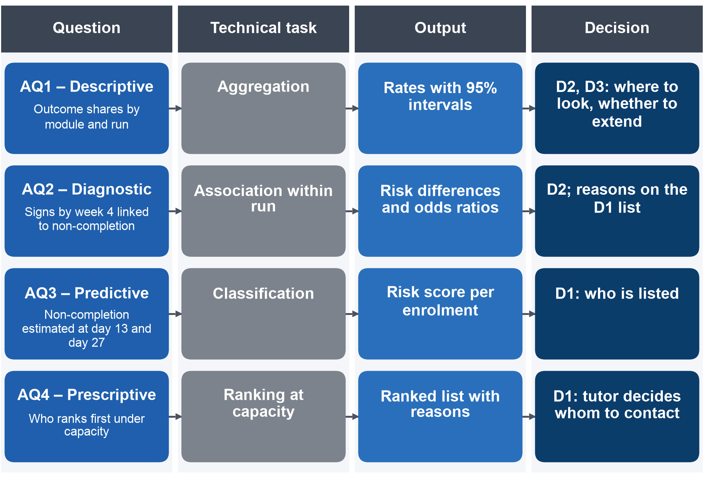

## Appendix I – Modeling Briefs and Candidate Comparison

### 1. AQ Modeling Briefs

Each Modeling Brief records, for one question, the eight attributes that the brief requires before any algorithm is
named; Section 2.1 (Table 2.1) gives the four briefs side by side in short form.

**AQ1.** Table A.1 gives the brief of the descriptive question, which needs counts and rates, not a model.

**Table A.1. Modeling Brief of AQ1**

| Attribute | Content |
| :---- | :---- |
| AQ ID and wording | AQ1: What share of enrolments end in pass, fail or withdrawal, by module, run, start month and year, and in which week non-completers first miss an assessed task? |
| Analytics level | Descriptive |
| Decision supported | D2 (where advisors' time goes) and D3 (whether to extend after the pilot): programme leaders see which modules and runs lose most students and how early the first missed task appears |
| Unit of analysis | Enrolment, restricted to enrolments still registered at day 14 (the KPI population); assessment task for the first missed task |
| Outcome / target | N/A (no supervised task); measures: completion and non-completion rates, outcome shares, week of the first task due and not submitted |
| Input information | Enrolment view (outcome, module, run, start month, year); assessment-due view (task, due day, submission); whole run, because the question describes completed runs |
| Expected output | Rate tables with 95% confidence intervals by module, run, start month and year; distribution of the week of the first missed task by outcome |
| Main constraint | Correct denominator (enrolled at day 14) and per-run task schedules, which differ by module; exam results missing in five modules, so the first missed task counts tutor-marked assessments and CMAs only |

**AQ2.** Table A.2 gives the brief of the diagnostic question, which measures how strongly each sign goes with
non-completion and does not claim that a sign causes it.

**Table A.2. Modeling Brief of AQ2**

| Attribute | Content |
| :---- | :---- |
| AQ ID and wording | AQ2: Which signs recorded by the end of week 4 (missed and late tasks, inactivity, activity against the run's median) go with later non-completion, compared within each module? |
| Analytics level | Diagnostic (association; no causal claim) |
| Decision supported | D2 and the reasons attached to each name on the D1 list: which signs tutors should look at |
| Unit of analysis | Enrolment registered at day 27 |
| Outcome / target | non_completion at the end of the run, used as the outcome of an association model, not as a prediction target |
| Input information | Signs up to day 27: a task missed, a TMA submitted late, no platform activity in the last seven days, activity relative to the run median, activity before the start; adjustment for module run, previous attempts and credits studied |
| Expected output | Risk differences in percentage points with 95% intervals, unadjusted and within module run, odds ratios beside them; direction of each association per module |
| Main constraint | Association only; tasks due by day 27 exist in 16 of 22 runs; correlated signs; estimation on the 9 training runs of 2013 (6 modules) so that the 2014 test outcomes stay unseen |

**AQ3.** Table A.3 gives the brief of the predictive question, whose output is a risk score per enrolment at each
cut-off.

**Table A.3. Modeling Brief of AQ3**

| Attribute | Content |
| :---- | :---- |
| AQ ID and wording | AQ3: How well can non-completion be estimated from the data up to the end of week 2 (day 13) and of week 4 (day 27), compared with the early-sign rule, when a model built on the 2013 runs is applied to the 2014 runs? |
| Analytics level | Predictive |
| Decision supported | D1 (who is listed for contact) |
| Unit of analysis | Enrolment registered at the cut-off |
| Outcome / target | non_completion (Fail or Withdrawn) at the end of the run, known only after the run |
| Input information | The 19 usable primary predictors of the prepared views (the mean CMA score is left out because fewer than 10% of training rows carry it) all dated on or before the cut-off; an extended set of 10 further predictors plus the weekly click counts (2 at day 13, 4 at day 27) as an alternative |
| Expected output | A risk score per enrolment at each cut-off, used as a rank within the run; shown as a probability only if calibration holds |
| Main constraint | Leakage and transfer to a later run; interpretability for tutors; calibration; train on 2013 runs, test once on 2014 runs |

**AQ4.** Table A.4 gives the brief of the ranking question, which turns the AQ3 scores into a list of the length that
staff can follow up.

**Table A.4. Modeling Brief of AQ4**

| Attribute | Content |
| :---- | :---- |
| AQ ID and wording | AQ4: Which enrolments should rank first on a list of an assumed capacity, with what gain over a random list and what recall, overall and by deprivation band and disability? |
| Analytics level | Prescriptive (ranking), as decision support; the choice of contact is deferred |
| Decision supported | D1: tutors receive a ranked list and decide whom to contact |
| Unit of analysis | Enrolment within a module run |
| Outcome / target | Uses the AQ3 target to judge the list; no outcome of contact exists in the data |
| Input information | AQ3 scores and the reasons behind them; list size per run for 3 or 5 contacts per assumed tutor group of 20 students |
| Expected output | A ranked list per run of the size the capacity allows, with the signs behind each name |
| Main constraint | Fixed capacity; risk is not benefit; human decision; fairness across deprivation band and disability; no claim that contact works |

### 2. Predictors and Transforms of AQ3

Section 3.3 chooses a penalised logistic regression on the primary predictors for AQ3, with the extended set as an
alternative.
The primary predictors fall into four groups, all dated on or before the cut-off: background (module, start month,
highest education, previous attempts, credits studied, registration lead, banked results, which are assessment results carried over from an earlier run of the module); activity (clicks before
the start and from the start to the cut-off, active days, resources used, inactivity in the last seven days, activity
relative to the run); assessment tasks (tasks due, missed and late, with late TMAs and late CMAs counted apart); and
the number of CMA marks known by the cut-off. The extended set adds 10 further predictors (a missing-registration
indicator, clicks counted with exactly repeated records taken once, clicks in the 14 days before the start, days since the last click, the trend over the
last week, tasks submitted early and clicks on four kinds of resource) and the weekly click counts, 2 at day 13 and 4 at
day 27; it is tried as an alternative (Table A.3). A logistic model assumes that each predictor shifts the log-odds of
non-completion by a fixed amount per unit, while activity is strongly skewed: per enrolment the median is 602 clicks over
the whole run, and 2,503 enrolments lie beyond the upper interquartile-range fence. The predictors are therefore
transformed before the model reads them: counts enter as the logarithm of one plus the count, missing values are
filled with the training median and marked by a missing-value indicator, and every predictor is standardised with the
training mean and standard deviation, so that the penalty shrinks all coefficients on the same scale. Milestone 3
fitted these transforms on the 2013 runs alone and showed that no test row changes them; here they are refitted inside
each fold (Section 4.2), while gradient-boosted trees read the predictors untransformed.

### 3. From AQ to Technical Task

Figure A.1 maps each question to its technical task, its output and the decision it serves, as Section 2.2 sets
them out.

{width=85%}

### 4. Candidate Comparison by Criterion

The brief asks that each choice be argued against eight criteria: fit to the question, fit to the data, assumptions,
interpretability, complexity against the baseline, robustness and reproducibility, ethics and fairness, and
actionability [1]. AQ1 is a descriptive question answered by grouped rates with confidence intervals, which need no
model, so the comparison applies to AQ2, AQ3 and AQ4. Facts about the data come from the 9 training runs of 2013, which
cover 6 of the 7 modules: 11,811 enrolments with 5,245 non-completers at day 27 and 12,080 with 5,519 at day 13.

Table A.5 compares the candidates for AQ2, whose purpose is association within module rather than prediction, so its
yardstick is the size and precision of each association, not accuracy on new data [3].

**Table A.5. AQ2 candidates against the eight criteria**

| Criterion | Baseline: unadjusted rate difference per sign | Candidate 1: logistic regression with run fixed effects and sign × module terms (primary) | Candidate 2: mixed-effects logistic regression | Supplement: shallow classification tree |
| :---- | :---- | :---- | :---- | :---- |
| Fit to question | Unadjusted rate difference per sign and module | Pooled within-run risk difference per sign, and module-specific differences from the interaction terms | Same, with module effects drawn from a population of modules (random effects) | Shows which combinations of signs separate outcomes |
| Fit to data | 9 runs, 6 modules | Smallest run 369 enrolments and 91 non-completers; task signs only in runs with a task due by day 27 | 6 modules and 9 runs are few for estimating a variance | Many rows, but the splits change between samples |
| Assumptions | None beyond counting | Additive log-odds within module; all runs of these modules observed, not sampled, so fixed effects suit the design [12] | Normal random effects; inference to unseen modules | None parametric; unstable splits |
| Interpretability | Highest | Risk differences in percentage points, with odds ratios beside them | Similar, plus variance terms | High for a depth of 2–3 |
| Complexity vs baseline | – | One model per cut-off with a few interaction terms | Adds a variance component for little gain within the observed modules | Low, but adds no effect size |
| Robustness and reproducibility | Exact | Deterministic; robust standard errors; sensitivity runs; signs correlated with each other checked | Convergence and few-cluster issues | Unstable across samples |
| Ethics and fairness | No sensitive attribute used | Sensitive attributes not used as signs | Same | Same |
| Actionability | Gives tutors the size of each sign's gap | Tells D2 which signs to look at; shown beside the unadjusted gap, because mutually adjusted estimates are partial effects | No extra action | Gives readable rules for tutors |

Section 3.2 shows the mutually adjusted estimates of AQ2 beside the unadjusted gaps. The signs are correlated with each other, so their mutually adjusted estimates are partial effects: each shows the gap linked to one sign when the other signs
are held equal, which is smaller than the gap the sign shows on its own and is not the share of non-completion that the
sign explains. Both are therefore shown side by side.

Table A.6 compares the candidates for AQ3, a predictive question judged by performance on a later run [5],
[6].

**Table A.6. AQ3 candidates against the eight criteria**

| Criterion | Baseline 1: early-sign rule | Baseline 2: background-only logistic model | Candidate 1: penalised logistic regression (primary) | Candidate 2: gradient-boosted trees | Extension: discrete-time survival model |
| :---- | :---- | :---- | :---- | :---- | :---- |
| Fit to question | Flags a task missed, a TMA late or no activity in the last 7 days; ranks by number of signs | Risk from module, start month, previous attempts, credits, education and registration lead only | Risk of non-completion at each cut-off from all primary predictors | Same, with non-linear effects and interactions | Weekly hazard of withdrawal [8] |
| Fit to data | No fitting | Few parameters | 23 parameters against 5,245–5,519 training non-completers, about 230 per parameter; the 11,811–12,080 training enrolments are about seven times the 1,728–1,731 that the minimum sample size criteria require for this set [14] | Suits tabular data of about 10,000 rows [19] | Fail is decided at the end of the run, not at a time; withdrawal timing serves no decision at fixed cut-offs |
| Assumptions | Signs equally weighted | Additive log-odds | Additive log-odds on transformed predictors | Few; tuning of depth, rate and number of trees | Non-informative censoring (a student is censored when follow-up stops before withdrawal is observed, and the reason it stops is assumed unrelated to the risk of withdrawal); a competing-risk or separate model for Fail |
| Interpretability | Highest | High | Coefficients and per-student contributions from the same model that ranks [11] | Post-hoc explanations, which can mislead [11] | Readable, but per week |
| Complexity vs baseline | – | Small | Small step from the rule | Larger; maintenance and entanglement risks, entanglement being the dependence of a system's parts on each other [10] | Moderate; same software as logistic regression [8] |
| Robustness and reproducibility | Exact | Stable | Stable; penalty tuned in grouped folds | More tuning choices; selection bias risk [31] | Stable |
| Ethics and fairness | Equal weights do not give equal error rates; audited like the models | Audit | Audit; proxy check | Same audit; harder to explain a disparity | Same audit |
| Actionability | Directly explainable | Shows what background alone gives | Score plus each student's own largest contributions | Score; reasons only through approximations | Adds timing, which D1 does not use at fixed cut-offs |

The choice of logistic regression rests first on this project's constraints. Tutors must see why a student is listed,
and a transparent model gives each student's reasons from the same equation that ranks them [11]; the 23 parameters
leave about 230 events each, so the training data are large enough for a stable logistic model [14]; and the risk to be
tested is transfer to a later run, which favours a simple, stable model [6]. The literature supports this choice:
a systematic review of 71 clinical prediction comparisons found, as its authors report, no difference in discrimination between logistic regression and machine learning among comparisons at low risk of bias [18].
Gradient-boosted trees stay as the challenger, since a benchmark that removed datasets where logistic regression came within 5% of the best models cannot show that trees beat it [19]; they replace logistic regression only if they beat it by the margin fixed in Appendix III (Table A.13, step 4). Compared with the primary model, the background-only model, which uses no activity, shows how much of the ranking comes from engagement
rather than from module and history. The survival model fits withdrawal timing, whereas the target joins Fail and Withdrawn at the
end of the run, so it stays a later extension.

Table A.7 compares the candidates for AQ4, where the output is a list of fixed length per run.

**Table A.7. AQ4 candidates against the eight criteria**

| Criterion | Baseline 1: random list | Baseline 2: rule-ranked list | Candidate 1: top-k by AQ3 score (primary) | Candidate 2: risk tiers | Rejected: benefit (uplift) ranking |
| :---- | :---- | :---- | :---- | :---- | :---- |
| Fit to question | Chance level | List from the number of signs, ties broken by lower relative activity | The k enrolments with the highest risk per run, k from capacity | First tier the top 3 per 20, second tier the next 2 per 20, both fixed from capacity | Ranks by expected benefit of contact |
| Fit to data | – | Rule known at each cut-off | k = 3 or 5 per 20 enrolled | Same scores | No contact or treatment variable in the data [9] |
| Assumptions | – | Signs equally weighted | Risk order matches need: untested | Same | Randomised or unconfounded treatment [9] |
| Interpretability | – | High | Score and reasons | High | Low |
| Complexity vs baseline | – | – | Uses AQ3 scores only | Same | Needs an experiment first |
| Robustness | – | Exact | As AQ3 | As AQ3 | – |
| Ethics and fairness | Audit | Audit | Confirmatory audit of recall at capacity by group (Appendix IV) | Same | – |
| Actionability | – | Direct | Tutor decides on the list; ranks and reasons, probabilities only if calibrated | Adds a second tier for lighter contact | Not available |

Ranking by risk is not ranking by benefit: in field experiments on customer retention, the customers at highest risk were not the best targets of an intervention [20]. The list therefore supports the tutor's decision, and choosing whom to contact by
expected benefit needs a randomised study first (Section 5.2).
