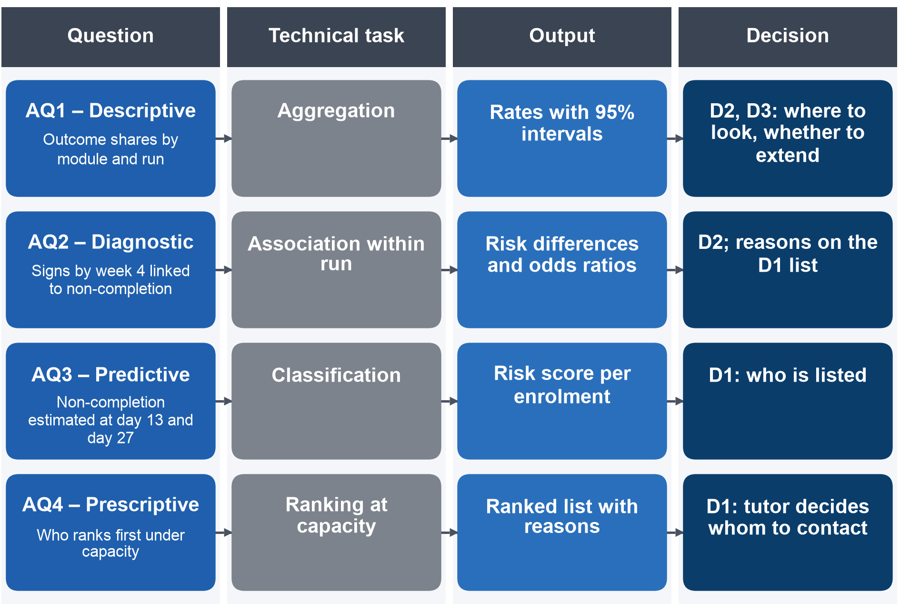

## Phụ lục I – Các Modeling Brief và so sánh các phương pháp ứng viên

### 1. Các AQ Modeling Brief

Mỗi Modeling Brief ghi lại, cho một câu hỏi, tám thuộc tính mà đề bài yêu cầu xác định trước khi nêu tên bất kỳ thuật toán nào; Mục 2.1 (Bảng 2.1) đặt bốn bản mô tả cạnh nhau ở dạng rút gọn.

**AQ1.** Bảng A.1 trình bày bản mô tả của câu hỏi mô tả; câu hỏi này cần số đếm và tỷ lệ chứ không cần mô hình.

**Bảng A.1. Modeling Brief của AQ1**

| Thuộc tính | Nội dung |
| :---- | :---- |
| Mã và nội dung AQ | AQ1: Tỷ lệ lượt đăng ký học kết thúc bằng đạt, không đạt hoặc rút khỏi module là bao nhiêu, theo module, kỳ mở, tháng bắt đầu và năm; sinh viên không hoàn thành lần đầu bỏ lỡ một bài được chấm điểm vào tuần nào? |
| Loại phân tích | Mô tả |
| Quyết định được hỗ trợ | D2 (thời gian của cố vấn học tập được dành vào đâu) và D3 (có mở rộng sau đợt thí điểm hay không): lãnh đạo chương trình đào tạo thấy được module và kỳ mở nào mất nhiều sinh viên nhất và bài bị bỏ lỡ đầu tiên xuất hiện sớm đến mức nào |
| Đơn vị phân tích | Lượt đăng ký học, chỉ gồm các lượt còn hiệu lực tại ngày 14 (đây là nhóm tính KPI). Riêng khi xét bài bị bỏ lỡ đầu tiên, đơn vị phân tích là từng bài được chấm điểm |
| Biến kết quả / biến mục tiêu | Không áp dụng (không có bài toán học có giám sát); các đại lượng đo: tỷ lệ hoàn thành và không hoàn thành, tỷ trọng từng loại kết quả, tuần của bài đầu tiên đến hạn mà chưa nộp |
| Thông tin đầu vào | Bảng lượt đăng ký học (kết quả, module, kỳ mở, tháng bắt đầu, năm); bảng bài đến hạn (bài, ngày đến hạn, bài nộp); toàn bộ kỳ mở, vì câu hỏi mô tả các kỳ mở đã kết thúc |
| Đầu ra mong đợi | Bảng tỷ lệ kèm khoảng tin cậy 95% theo module, kỳ mở, tháng bắt đầu và năm; phân bố tuần có bài bị bỏ lỡ đầu tiên theo từng loại kết quả |
| Ràng buộc chính | Phải dùng đúng mẫu số (lượt đăng ký học còn hiệu lực tại ngày 14) và đúng lịch bài được chấm điểm của từng kỳ mở, vì lịch này khác nhau giữa các module. Ngoài ra, 5 module không có kết quả thi, nên bài bị bỏ lỡ đầu tiên chỉ tính bài do giảng viên hướng dẫn chấm và bài chấm bằng máy |

**AQ2.** Bảng A.2 trình bày bản mô tả của câu hỏi chẩn đoán. Câu hỏi này đo độ mạnh của mối liên hệ giữa từng dấu hiệu và tình trạng không hoàn thành, nhưng không khẳng định rằng dấu hiệu gây ra tình trạng đó.

**Bảng A.2. Modeling Brief của AQ2**

| Thuộc tính | Nội dung |
| :---- | :---- |
| Mã và nội dung AQ | AQ2: Khi so sánh trong từng module, những dấu hiệu nào ghi nhận được tính đến hết tuần 4 (bài bị bỏ lỡ và bài nộp trễ, không hoạt động, mức hoạt động so với trung vị của kỳ mở) đi kèm với việc sinh viên về sau không hoàn thành? |
| Loại phân tích | Chẩn đoán (mối liên hệ; không khẳng định quan hệ nhân quả) |
| Quyết định được hỗ trợ | D2 và lý do đi kèm từng tên trong danh sách của D1: giảng viên hướng dẫn nên chú ý đến những dấu hiệu nào |
| Đơn vị phân tích | Lượt đăng ký học còn hiệu lực tại ngày 27 |
| Biến kết quả / biến mục tiêu | non_completion vào cuối kỳ mở, dùng làm biến kết quả của mô hình đo mối liên hệ chứ không phải biến cần dự đoán |
| Thông tin đầu vào | Các dấu hiệu tính đến hết ngày 27: có bài bị bỏ lỡ, có TMA nộp trễ, không có hoạt động trên nền tảng học tập trong bảy ngày gần nhất, tỷ lệ hoạt động so với trung vị của kỳ mở, hoạt động trước ngày bắt đầu; hiệu chỉnh theo kỳ mở module, số lần học trước và số tín chỉ đang học |
| Đầu ra mong đợi | Chênh lệch nguy cơ tính bằng điểm phần trăm kèm khoảng tin cậy 95%, ở cả dạng chưa hiệu chỉnh và dạng so sánh trong từng kỳ mở module; tỉ số odds (odds ratio) được báo cáo bên cạnh. Ngoài ra, chiều của từng mối liên hệ được nêu cho từng module |
| Ràng buộc chính | Chỉ đo mối liên hệ; bài đến hạn tính đến hết ngày 27 chỉ có ở 16 trên 22 kỳ mở; các dấu hiệu tương quan với nhau; ước lượng trên 9 kỳ mở huấn luyện năm 2013 (6 module) để kết quả của tập kiểm thử năm 2014 vẫn được giữ kín |

**AQ3.** Bảng A.3 trình bày bản mô tả của câu hỏi dự báo; đầu ra của câu hỏi này là điểm rủi ro cho từng lượt đăng ký học tại mỗi thời điểm chốt dữ liệu.

**Bảng A.3. Modeling Brief của AQ3**

| Thuộc tính | Nội dung |
| :---- | :---- |
| Mã và nội dung AQ | AQ3: Khi mô hình xây dựng trên các kỳ mở năm 2013 được áp dụng cho các kỳ mở năm 2014, dữ liệu tính đến hết tuần 2 (ngày 13) và hết tuần 4 (ngày 27) cho phép ước lượng tình trạng không hoàn thành tốt đến đâu so với quy tắc dấu hiệu sớm? |
| Loại phân tích | Dự báo |
| Quyết định được hỗ trợ | D1 (ai có tên trong danh sách liên hệ) |
| Đơn vị phân tích | Lượt đăng ký học còn hiệu lực tại thời điểm chốt dữ liệu |
| Biến kết quả / biến mục tiêu | non_completion (Fail hoặc Withdrawn) vào cuối kỳ mở, chỉ biết được sau khi kỳ mở kết thúc |
| Thông tin đầu vào | 19 biến dự báo chính có thể dùng trong các bảng đặc trưng, tất cả đều ghi nhận tính đến hết thời điểm chốt dữ liệu. Biến điểm trung bình của CMA bị loại, vì dưới 10% số dòng huấn luyện có giá trị này. Ngoài ra, bộ biến dự báo mở rộng được thử làm phương án thay thế: bộ này bổ sung vào các biến dự báo chính 10 biến dự báo khác và số lượt nhấp của từng tuần (2 biến tại ngày 13, 4 biến tại ngày 27) |
| Đầu ra mong đợi | Điểm rủi ro cho từng lượt đăng ký học tại mỗi thời điểm chốt dữ liệu, dùng làm thứ hạng trong kỳ mở; chỉ hiển thị dưới dạng xác suất khi mô hình được hiệu chuẩn tốt |
| Ràng buộc chính | Rò rỉ thông tin và khả năng tổng quát hóa sang kỳ mở diễn ra sau; khả năng diễn giải đối với giảng viên hướng dẫn; hiệu chuẩn; huấn luyện trên các kỳ mở năm 2013, kiểm tra một lần duy nhất trên các kỳ mở năm 2014 |

**AQ4.** Bảng A.4 trình bày bản mô tả của câu hỏi xếp hạng. Câu hỏi này biến điểm rủi ro của AQ3 thành một danh sách có độ dài bằng số sinh viên mà cán bộ liên hệ lại được.

**Bảng A.4. Modeling Brief của AQ4**

| Thuộc tính | Nội dung |
| :---- | :---- |
| Mã và nội dung AQ | AQ4: Với hạn mức liên hệ giả định, những lượt đăng ký học nào nên đứng đầu danh sách; danh sách đó vượt danh sách ngẫu nhiên bao nhiêu và đạt tỷ lệ phát hiện bao nhiêu, xét chung và theo mức khó khăn kinh tế – xã hội của khu vực cư trú và tình trạng khuyết tật? |
| Loại phân tích | Chỉ định (xếp hạng), ở vai trò hỗ trợ ra quyết định; việc chọn hình thức liên hệ được hoãn |
| Quyết định được hỗ trợ | D1: giảng viên hướng dẫn nhận danh sách đã xếp hạng và quyết định liên hệ với ai |
| Đơn vị phân tích | Lượt đăng ký học, xét trong kỳ mở module tương ứng |
| Biến kết quả / biến mục tiêu | Dùng biến mục tiêu của AQ3 để đánh giá danh sách; dữ liệu không có kết quả của việc liên hệ |
| Thông tin đầu vào | Điểm rủi ro của AQ3 và lý do của từng điểm; độ dài danh sách của từng kỳ mở ứng với 3 hoặc 5 sinh viên được liên hệ trên mỗi nhóm hướng dẫn giả định gồm 20 sinh viên |
| Đầu ra mong đợi | Danh sách xếp hạng cho từng kỳ mở, có độ dài theo hạn mức liên hệ, kèm các dấu hiệu giải thích vì sao từng tên có trong danh sách |
| Ràng buộc chính | Hạn mức liên hệ cố định; nguy cơ cao không đồng nghĩa với lợi ích lớn khi được liên hệ; con người ra quyết định; công bằng giữa các mức khó khăn của khu vực cư trú và giữa sinh viên có và không có khuyết tật; không khẳng định việc liên hệ có hiệu quả |

### 2. Biến dự báo và các phép biến đổi của AQ3

Mục 3.3 chọn hồi quy logistic có hiệu chỉnh phạt trên các biến dự báo chính cho AQ3, với bộ biến dự báo mở rộng là phương án thay thế. Các biến dự báo chính chia thành bốn nhóm, tất cả đều ghi nhận tính đến hết thời điểm chốt dữ liệu. Nhóm thứ nhất là đặc điểm cá nhân: module, tháng bắt đầu, trình độ học vấn cao nhất, số lần học trước, số tín chỉ đang học, khoảng cách từ ngày đăng ký đến ngày bắt đầu và kết quả bảo lưu, tức kết quả bài đánh giá được chuyển sang từ một kỳ mở trước của cùng module. Nhóm thứ hai là hoạt động: lượt nhấp trước ngày bắt đầu và từ ngày bắt đầu đến thời điểm chốt dữ liệu, số ngày có hoạt động, số tài nguyên học tập đã dùng, không hoạt động trong bảy ngày gần nhất và tỷ lệ hoạt động so với kỳ mở. Nhóm thứ ba là bài được chấm điểm: số bài đến hạn, bị bỏ lỡ và nộp trễ, trong đó TMA nộp trễ và CMA nộp trễ được đếm riêng. Nhóm thứ tư là số bài CMA đã có điểm tính đến thời điểm chốt dữ liệu.

Ngoài bộ biến dự báo chính, nhóm thử một phương án thay thế là bộ biến dự báo mở rộng (Bảng A.3). Bộ này giữ các biến dự báo chính và bổ sung 10 biến: biến chỉ báo thiếu ngày đăng ký, số lượt nhấp sau khi loại các bản ghi trùng lặp hoàn toàn, lượt nhấp trong 14 ngày trước ngày bắt đầu, số ngày kể từ lượt nhấp cuối, xu hướng hoạt động trong tuần cuối, số bài nộp sớm và lượt nhấp trên bốn loại tài nguyên học tập. Ngoài 10 biến này, bộ mở rộng còn gồm số lượt nhấp của từng tuần: 2 biến tại ngày 13 và 4 biến tại ngày 27. Mô hình logistic giả định rằng khi một biến dự báo tăng một đơn vị, log-odds của biến cố không hoàn thành thay đổi một lượng cố định. Tuy nhiên, hoạt động học tập có phân phối lệch mạnh: trung vị số lượt nhấp của mỗi lượt đăng ký học trong cả kỳ mở là 602, còn 2.503 lượt đăng ký học có số lượt nhấp vượt ngưỡng trên theo khoảng tứ phân vị. Vì vậy, nhóm biến đổi các biến dự báo trước khi đưa vào mô hình: biến đếm được thay bằng logarit của số đếm cộng một; giá trị thiếu được điền bằng trung vị của tập huấn luyện và đánh dấu bằng biến chỉ báo giá trị thiếu; mọi biến dự báo được chuẩn hóa theo trung bình và độ lệch chuẩn của tập huấn luyện. Nhờ bước chuẩn hóa này, hiệu chỉnh phạt co mọi hệ số trên cùng một thang đo. Milestone 3 đã ước lượng các phép biến đổi này chỉ trên các kỳ mở năm 2013 và cho thấy không dòng nào của tập kiểm thử làm thay đổi các phép biến đổi đó. Trong báo cáo này, nhóm ước lượng lại các phép biến đổi trong từng fold (phần chia trong kiểm định chéo, Mục 4.2); riêng cây tăng cường độ dốc (gradient-boosted trees) dùng trực tiếp các biến dự báo chưa biến đổi.

### 3. Từ AQ đến bài toán kỹ thuật

Hình A.1 gắn mỗi câu hỏi với bài toán kỹ thuật, đầu ra và quyết định mà câu hỏi đó phục vụ (Mục 2.2).

{width=85%}

### 4. So sánh các phương pháp ứng viên theo từng tiêu chí

Đề bài yêu cầu lập luận cho mỗi lựa chọn theo tám tiêu chí: mức phù hợp với câu hỏi; mức phù hợp với dữ liệu; các giả định; khả năng diễn giải; độ phức tạp so với phương pháp cơ sở; tính bền vững và khả năng tái lập; đạo đức và tính công bằng; khả năng chuyển thành hành động [1]. AQ1 là câu hỏi mô tả, được trả lời bằng tỷ lệ theo nhóm kèm khoảng tin cậy và không cần mô hình, nên phần so sánh chỉ áp dụng cho AQ2, AQ3 và AQ4. Thông tin về dữ liệu lấy từ 9 kỳ mở huấn luyện năm 2013, bao gồm 6 trong 7 module: tại ngày 27 có 11.811 lượt đăng ký học, trong đó 5.245 sinh viên không hoàn thành; tại ngày 13 có 12.080 lượt, trong đó 5.519 sinh viên không hoàn thành.

Bảng A.5 so sánh các phương pháp ứng viên cho AQ2. Mục đích của AQ2 là đo mối liên hệ trong từng module chứ không phải dự báo, nên thước đo so sánh là độ lớn của từng mối liên hệ và độ hẹp của khoảng tin cậy, không phải chất lượng dự báo trên dữ liệu mới [3].

**Bảng A.5. Các phương pháp ứng viên cho AQ2 theo tám tiêu chí**

| Tiêu chí | Phương pháp cơ sở: chênh lệch tỷ lệ chưa hiệu chỉnh theo từng dấu hiệu | Ứng viên 1: hồi quy logistic có hiệu ứng cố định theo kỳ mở và các số hạng dấu hiệu × module (phương pháp chính) | Ứng viên 2: hồi quy logistic hiệu ứng hỗn hợp | Bổ trợ: cây quyết định nông |
| :---- | :---- | :---- | :---- | :---- |
| Mức phù hợp với câu hỏi | Chênh lệch tỷ lệ chưa hiệu chỉnh theo từng dấu hiệu và module | Chênh lệch nguy cơ của mỗi dấu hiệu, so sánh trong cùng kỳ mở rồi gộp lại, cùng chênh lệch riêng của từng module lấy từ các số hạng tương tác | Như ứng viên 1, nhưng coi các module là một mẫu lấy từ một tổng thể module lớn hơn, nên hiệu ứng của từng module được ước lượng như một hiệu ứng ngẫu nhiên | Cho thấy tổ hợp dấu hiệu nào tách sinh viên hoàn thành với sinh viên không hoàn thành |
| Mức phù hợp với dữ liệu | 9 kỳ mở, 6 module | Kỳ mở nhỏ nhất có 369 lượt đăng ký học và 91 sinh viên không hoàn thành; dấu hiệu về bài chỉ có ở các kỳ mở có bài đến hạn tính đến hết ngày 27 | 6 module và 9 kỳ mở là ít để ước lượng một thành phần phương sai | Nhiều dòng dữ liệu, nhưng cách cây chia nhánh thay đổi giữa các mẫu |
| Giả định | Không có giả định nào ngoài phép đếm | Log-odds cộng tính trong từng module; dữ liệu có đủ mọi kỳ mở của các module này, tức các kỳ mở được quan sát đầy đủ chứ không phải được lấy mẫu, nên hiệu ứng cố định phù hợp với thiết kế [12] | Hiệu ứng ngẫu nhiên có phân phối chuẩn; suy rộng cho các module chưa quan sát | Không có giả định tham số; cách chia nhánh không ổn định |
| Khả năng diễn giải | Cao nhất | Chênh lệch nguy cơ tính bằng điểm phần trăm, kèm tỉ số odds | Tương tự, thêm các thành phần phương sai | Cao khi độ sâu là 2–3 |
| Độ phức tạp so với phương pháp cơ sở | – | Một mô hình cho mỗi thời điểm chốt dữ liệu, với một vài số hạng tương tác | Thêm một thành phần phương sai nhưng lợi ích nhỏ trong phạm vi các module đã quan sát | Thấp, nhưng không cho độ lớn hiệu ứng |
| Tính bền vững và khả năng tái lập | Tính toán chính xác | Kết quả tất định (chạy lại cho cùng kết quả); dùng sai số chuẩn vững; có các lần chạy phân tích độ nhạy; có kiểm tra mức tương quan giữa các dấu hiệu | Dễ gặp vấn đề hội tụ và vấn đề do có ít cụm | Không ổn định giữa các mẫu |
| Đạo đức và tính công bằng | Không dùng thuộc tính nhạy cảm | Không dùng thuộc tính nhạy cảm làm dấu hiệu | Như ứng viên 1 | Như ứng viên 1 |
| Khả năng chuyển thành hành động | Cho giảng viên hướng dẫn biết độ lớn chênh lệch của từng dấu hiệu | Giúp xác định những dấu hiệu cần chú ý cho quyết định D2; được trình bày bên cạnh chênh lệch chưa hiệu chỉnh, vì mỗi ước lượng đã hiệu chỉnh theo các dấu hiệu còn lại chỉ là hiệu ứng riêng phần | Không tạo thêm hành động nào | Cho giảng viên hướng dẫn các quy tắc dễ đọc |

Mục 3.2 trình bày các ước lượng đã hiệu chỉnh của AQ2 cạnh chênh lệch chưa hiệu chỉnh. Các dấu hiệu tương quan với nhau, nên trong mô hình, ước lượng của mỗi dấu hiệu đã được hiệu chỉnh theo các dấu hiệu còn lại. Các ước lượng đã hiệu chỉnh lẫn nhau này gọi là hiệu ứng riêng phần. Mỗi hiệu ứng riêng phần cho thấy chênh lệch gắn với một dấu hiệu khi các dấu hiệu khác được giữ như nhau. Hiệu ứng riêng phần nhỏ hơn chênh lệch đo được khi xét riêng dấu hiệu đó. Ngoài ra, hiệu ứng riêng phần không phải là tỷ trọng của tình trạng không hoàn thành mà dấu hiệu đó giải thích được. Vì vậy, báo cáo trình bày hiệu ứng riêng phần và chênh lệch khi xét riêng từng dấu hiệu cạnh nhau.

Bảng A.6 so sánh các phương pháp ứng viên cho AQ3. Đây là câu hỏi dự báo, được đánh giá bằng hiệu năng trên một kỳ mở về sau [5], [6].

**Bảng A.6. Các phương pháp ứng viên cho AQ3 theo tám tiêu chí**

| Tiêu chí | Phương pháp cơ sở 1: quy tắc dấu hiệu sớm | Phương pháp cơ sở 2: mô hình logistic chỉ dùng đặc điểm cá nhân | Ứng viên 1: hồi quy logistic có hiệu chỉnh phạt (phương pháp chính) | Ứng viên 2: cây tăng cường độ dốc | Mở rộng: mô hình sống sót thời gian rời rạc |
| :---- | :---- | :---- | :---- | :---- | :---- |
| Mức phù hợp với câu hỏi | Đánh dấu sinh viên có bài bị bỏ lỡ, TMA nộp trễ hoặc không có hoạt động trong 7 ngày gần nhất; xếp hạng theo số dấu hiệu | Nguy cơ chỉ tính từ module, tháng bắt đầu, số lần học trước, số tín chỉ, trình độ học vấn và khoảng cách từ ngày đăng ký đến ngày bắt đầu | Nguy cơ không hoàn thành tại mỗi thời điểm chốt dữ liệu, tính từ mọi biến dự báo chính | Như ứng viên 1, có thêm hiệu ứng phi tuyến và tương tác | Nguy cơ rút khỏi module theo từng tuần [8] |
| Mức phù hợp với dữ liệu | Không cần ước lượng | Ít tham số | 23 tham số so với 5.245–5.519 sinh viên không hoàn thành trong tập huấn luyện, tức khoảng 230 sự kiện cho mỗi tham số; 11.811–12.080 lượt đăng ký học huấn luyện gấp khoảng bảy lần mức 1.728–1.731 lượt mà các tiêu chí cỡ mẫu tối thiểu đòi hỏi cho tập biến này [14] | Phù hợp với dữ liệu dạng bảng khoảng 10.000 dòng [19] | Kết quả Fail được xác định vào cuối kỳ mở chứ không gắn với một thời điểm cụ thể; thời điểm rút khỏi module không phục vụ quyết định nào khi thời điểm chốt dữ liệu đã cố định |
| Giả định | Các dấu hiệu có trọng số bằng nhau | Log-odds cộng tính | Log-odds cộng tính trên các biến dự báo đã biến đổi | Ít giả định; cần tinh chỉnh siêu tham số về độ sâu, tốc độ học và số cây | Kiểm duyệt không mang thông tin (non-informative censoring): khi một sinh viên bị kiểm duyệt (censored), tức thời điểm rút khỏi module không được quan sát vì việc theo dõi đã dừng, lý do dừng theo dõi được giả định không liên quan đến nguy cơ rút khỏi module; cần mô hình rủi ro cạnh tranh hoặc một mô hình riêng cho Fail |
| Khả năng diễn giải | Cao nhất | Cao | Hệ số và phần đóng góp của từng sinh viên lấy từ chính mô hình dùng để xếp hạng [11] | Giải thích hậu nghiệm, có thể gây hiểu sai [11] | Dễ đọc, nhưng theo từng tuần |
| Độ phức tạp so với phương pháp cơ sở | – | Nhỏ | Chỉ là bước nhỏ so với quy tắc | Lớn hơn; rủi ro về bảo trì và về sự phụ thuộc lẫn nhau giữa các thành phần của hệ thống (entanglement) [10] | Trung bình; dùng chính phần mềm của hồi quy logistic [8] |
| Tính bền vững và khả năng tái lập | Tính toán chính xác | Ổn định | Ổn định; hệ số phạt được tinh chỉnh trên các fold chia theo nhóm | Nhiều lựa chọn tinh chỉnh hơn; nguy cơ thiên lệch do lựa chọn mô hình [31] | Ổn định |
| Đạo đức và tính công bằng | Trọng số bằng nhau không bảo đảm tỷ lệ lỗi bằng nhau; được kiểm tra công bằng như các mô hình | Kiểm tra công bằng | Kiểm tra công bằng; kiểm tra biến đại diện (proxy check) | Kiểm tra công bằng như trên; khó giải thích chênh lệch hơn | Kiểm tra công bằng như trên |
| Khả năng chuyển thành hành động | Giải thích được trực tiếp | Cho thấy riêng đặc điểm cá nhân đóng góp được bao nhiêu | Điểm rủi ro cùng các phần đóng góp lớn nhất của chính sinh viên đó | Điểm rủi ro; lý do chỉ có qua các phép xấp xỉ | Bổ sung thông tin về thời điểm, nhưng D1 không dùng thông tin này khi thời điểm chốt dữ liệu đã cố định |

Lựa chọn hồi quy logistic trước hết dựa trên các ràng buộc của dự án này. Thứ nhất, giảng viên hướng dẫn phải thấy được lý do một sinh viên có tên trong danh sách; một mô hình minh bạch đáp ứng yêu cầu này, vì mô hình đưa ra lý do của từng sinh viên từ chính phương trình dùng để xếp hạng [11]. Thứ hai, 23 tham số ứng với khoảng 230 sự kiện mỗi tham số, nên dữ liệu huấn luyện đủ lớn cho một mô hình logistic ổn định [14]. Thứ ba, rủi ro cần kiểm tra là khả năng áp dụng mô hình cho một kỳ mở về sau; với rủi ro này, một mô hình đơn giản, ổn định có lợi thế hơn [6]. Các nghiên cứu đã công bố cũng ủng hộ lựa chọn này: một tổng quan có hệ thống về 71 phép so sánh mô hình dự báo lâm sàng, theo báo cáo của chính các tác giả, không tìm thấy khác biệt về khả năng phân biệt giữa hồi quy logistic và học máy ở các phép so sánh có nguy cơ sai lệch thấp [18].
Cây tăng cường độ dốc được giữ làm mô hình đối sánh, vì benchmark được viện dẫn đã loại các bộ dữ liệu mà hồi quy logistic kém mô hình tốt nhất không quá 5%, nên không thể chứng minh rằng cây vượt hồi quy logistic [19]. Cây tăng cường độ dốc chỉ thay thế hồi quy logistic khi vượt mô hình này theo mức chênh lệch đã ấn định ở Phụ lục III (Bảng A.13, bước 4). Khi so với mô hình chính, mô hình chỉ dùng đặc điểm cá nhân (không có dữ liệu hoạt động) cho biết bao nhiêu phần của thứ hạng đến từ mức tham gia học tập, chứ không phải từ module và lịch sử học tập. Mô hình sống sót mô tả thời điểm rút khỏi module, trong khi biến mục tiêu gộp Fail và Withdrawn vào cuối kỳ mở, nên mô hình này được để lại làm hướng mở rộng về sau.

Bảng A.7 so sánh các phương pháp ứng viên cho AQ4, trong đó đầu ra là một danh sách có độ dài cố định cho mỗi kỳ mở.

**Bảng A.7. Các phương pháp ứng viên cho AQ4 theo tám tiêu chí**

| Tiêu chí | Phương pháp cơ sở 1: danh sách ngẫu nhiên | Phương pháp cơ sở 2: danh sách xếp theo quy tắc dấu hiệu sớm | Ứng viên 1: k sinh viên đầu theo điểm rủi ro của AQ3 (phương pháp chính) | Ứng viên 2: nhóm mức nguy cơ | Bị loại: xếp hạng theo lợi ích can thiệp |
| :---- | :---- | :---- | :---- | :---- | :---- |
| Mức phù hợp với câu hỏi | Mức ngẫu nhiên | Xếp theo số dấu hiệu; khi bằng nhau thì ưu tiên sinh viên có tỷ lệ hoạt động thấp hơn | k lượt đăng ký học có nguy cơ cao nhất trong mỗi kỳ mở; k xác định từ hạn mức liên hệ | Nhóm thứ nhất gồm 3 sinh viên đầu trên mỗi 20 sinh viên; nhóm thứ hai gồm 2 sinh viên tiếp theo trên mỗi 20; cả hai nhóm cố định theo hạn mức liên hệ | Xếp hạng theo lợi ích kỳ vọng của việc liên hệ |
| Mức phù hợp với dữ liệu | – | Quy tắc tính được ngay tại mỗi thời điểm chốt dữ liệu | k = 3 hoặc 5 trên 20 lượt đăng ký học còn hiệu lực | Cùng điểm rủi ro | Dữ liệu không có biến liên hệ hay biến can thiệp [9] |
| Giả định | – | Các dấu hiệu có trọng số bằng nhau | Thứ tự nguy cơ trùng với thứ tự nhu cầu hỗ trợ: chưa được kiểm chứng | Như ứng viên 1 | Cần dữ liệu về can thiệp được phân bổ ngẫu nhiên hoặc không bị yếu tố gây nhiễu làm sai lệch [9] |
| Khả năng diễn giải | – | Cao | Điểm rủi ro và lý do | Cao | Thấp |
| Độ phức tạp so với phương pháp cơ sở | – | – | Chỉ dùng điểm rủi ro của AQ3 | Như ứng viên 1 | Cần một thí nghiệm trước |
| Tính bền vững | – | Tính toán chính xác | Như AQ3 | Như AQ3 | – |
| Đạo đức và tính công bằng | Kiểm tra công bằng | Kiểm tra công bằng | Kiểm định khẳng định về tỷ lệ phát hiện trong giới hạn danh sách, theo từng nhóm (Phụ lục IV) | Như ứng viên 1 | – |
| Khả năng chuyển thành hành động | – | Trực tiếp | Giảng viên hướng dẫn quyết định dựa trên danh sách; danh sách hiển thị thứ hạng và lý do, chỉ hiển thị xác suất khi mô hình đã được hiệu chuẩn | Thêm nhóm thứ hai để giảng viên liên hệ ở mức nhẹ hơn | Chưa áp dụng được |

Xếp hạng theo nguy cơ không phải là xếp hạng theo lợi ích: trong các thí nghiệm thực địa về giữ chân khách hàng, những khách hàng có nguy cơ cao nhất không phải là đối tượng can thiệp hiệu quả nhất [20]. Vì vậy, danh sách chỉ hỗ trợ quyết định của giảng viên hướng dẫn; muốn chọn người cần liên hệ theo lợi ích kỳ vọng thì trước hết cần một nghiên cứu ngẫu nhiên hóa (Mục 5.2).
