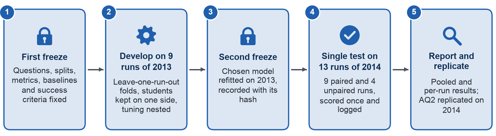

## Appendix III – Validation and Test Protocol

Figure A.2 draws the validation and test protocol of Section 4.2, from the first freeze to the single test on the
2014 runs.

{width=100%}

The protocol separates development from evaluation so that no information from the evaluation runs reaches any choice
about the model, which is how leakage is avoided by design [40], [22]. It follows the two-step freeze proposed for
predictive modeling: the question, splits, metrics and baselines are fixed before training, and the final model is
fixed and test access recorded before testing [26]. Table A.5 lists the steps in order.

**Table A.5. Validation and test protocol**

| Step | Data | What happens | Why |
| :---- | :---- | :---- | :---- |
| 1. First freeze | – | This proposal fixes AQs, populations, predictor sets, the early-sign rule (Change Log entry C10), splits, metrics, baselines and success criteria | Choices cannot follow the results [26] |
| 2. Development folds | 9 runs of 2013 (6 modules) | Leave-one-run-out: each run is the validation fold once; rows of students who also appear in the validation run (121–129 students, 242–258 rows) are removed from that fold's training data, in outer loops (the cross-validation used to evaluate and choose the model) and inner loops (the cross-validation run inside each training fold to tune hyperparameters, step 3) alike | Validation folds must hold only groups absent from training [29]; random folds underestimate error on structured data [28] |
| 3. Fitting inside folds | Training fold only | Imputation, scaling and encoding refitted in each fold; penalty of the logistic regression and depth, learning rate and number of trees of the boosted trees tuned by nested cross-validation, an inner leave-one-run-out loop run on the training runs of each fold; optional logistic recalibration fitted inside development | Preprocessing learnt on training data only [29]; tuning inside each loop keeps the estimate nearly unbiased [30], [31] |
| 4. Model choice | Outer-fold results | Four configurations, penalised logistic regression and gradient-boosted trees each with the primary and with the extended predictor set, compared on pooled normalised recall at day 27, k = 5 per 20, the S1 metric: boosted trees replace logistic regression, and the extended predictor set the primary set, only with a gain of at least 0.03, about 89 more non-completers listed over the 9 runs, and a gain in at least 7 of 9 folds. Fold results serve the choice only and are never reported as expected performance | Ties go to the simpler model [5]; differences within sampling variation have little practical meaning [31], [53] |
| 5. Second freeze | All 2013 runs | The chosen model refitted on all 9 runs; specification, parameters and file hash recorded with the time of the first test access | Final model fixed before testing [26] |
| 6. Single test | 13 runs of 2014 | Scores, lists and all metrics of Appendix II computed once; S1 judged on all 13 runs and all eligible enrolments | Data sharing no run with development [21]; a later run is a temporal validation [27] |
| 7. Sensitivity | 13 runs of 2014 | Paired runs (9, module and start month also run in 2013) and unpaired runs (4); module CCC apart; without test enrolments of students seen in 2013; without the Withdrawn enrolments that lack a withdrawal day; labels-available variant; day 13 and k = 3 per 20. None can change the S1 verdict | Later-run estimates are the honest ones [23]; one declared primary comparison prevents choosing a favourable variant |
| 8. AQ2 replication | 13 runs of 2014 | AQ2 associations re-estimated, CCC included | Opens the test outcomes only after step 6; changes nothing in AQ3 |

Two features of the run structure need explicit rules. Module CCC has no run in 2013, and modules AAA, EEE and GGG have
one 2013 run each, so a fold or a test run can hold a module the training data lack; module terms are therefore coded
as deviations from the average module, and an unseen module receives the average, in development folds and test alike.
In addition, presentations coded B start in February and those coded J in October [2], and the 2013 J runs last 261
to 268 days, so they had not ended when the 2014 B runs reached their cut-offs. The main test follows the year split of
Milestone 3; the labels-available variant scores the 2014 B runs with a model trained only on the 2013 B runs, the only
runs whose outcomes a university would hold at that time.

Uncertainty for S1 comes from a paired two-level bootstrap: runs are resampled, then enrolments within each sampled
run, each run's list is re-formed as the top 25% of its resampled enrolments, and the model–rule difference is computed
on the same resample, because treating nested observations as independent inflates false positives [32]. With only
13 test runs of 348 to 2,021 enrolments, such intervals can be too narrow, so S1 also requires a one-sided sign-flip
permutation test on the 13 per-run differences, and wins, ties and losses are reported with the unweighted mean of the
per-run differences.

Table A.6 gives the sample sizes behind these choices, computed from the prepared views without fitting a model;
outcome counts come from the 2013 runs only, so the 2014 outcomes stay unseen until step 6.

**Table A.6. Sample sizes for development and evaluation**

| Quantity | Day 13 | Day 27 |
| :---- | :---- | :---- |
| Training enrolments (2013, 9 runs, 6 modules) | 12,080 | 11,811 |
| Training non-completers | 5,519 (45.7%) | 5,245 (44.4%) |
| Smallest training run: enrolments / non-completers | 370 / 92 | 369 / 91 |
| Most non-completers a list of 5 per 20 can hold, 9 training runs | 3,032 | 2,976 |
| Parameters, primary set (19 predictors, module and start-month terms) | 23 | 23 |
| Parameters, primary and extended sets with weekly clicks | 35 | 37 |
| Events per parameter, primary set / with extended set and weekly clicks | 240 / 158 | 228 / 142 |
| Minimum development size (Riley criteria), primary set / with extended set and weekly clicks | 1,728 / 2,629 | 1,731 / 2,784 |
| Test enrolments (2014, 13 runs, 7 modules) | 15,989 | 15,724 |
| Test enrolments in the 9 paired / 4 unpaired runs | 10,902 / 5,087 | 10,801 / 4,923 |
| Test enrolments of students seen in 2013 | 1,637 | 1,586 |
| Test enrolments Withdrawn without a withdrawal day | 89 | 90 |
| Test run size, smallest / largest | 350 / 2,079 | 348 / 2,021 |

The minimum development size follows the three criteria of Riley et al.: expected shrinkage of at least 0.9, optimism
in Nagelkerke R² of at most 0.05 and the overall risk estimated within 0.05 [14], under their default of an
anticipated Nagelkerke R² of 0.15 when no prior estimate exists [14]. The training runs hold about seven times the
required size for the primary set, so the number of enrolments does not limit the choice of model. Transfer to a new
run is a different matter: it rests on only 9 training runs, which is why it is tested by the run-level split rather
than inferred from the sample size, and why per-module models remain unattractive, since each module's data are small
and shrinkage does not rescue small samples [17].
