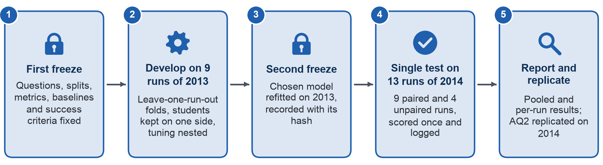

## Phụ lục III – Giao thức kiểm định và kiểm tra

Hình A.2 trình bày giao thức kiểm định và kiểm tra của Mục 4.2, từ lần chốt thứ nhất đến phép kiểm tra một lần duy nhất trên các kỳ mở năm 2014.

{width=100%}

Giao thức này tách giai đoạn phát triển khỏi giai đoạn đánh giá, để không thông tin nào từ các kỳ mở dùng cho đánh giá ảnh hưởng đến lựa chọn về mô hình; nhờ đó, thiết kế phòng tránh rò rỉ thông tin ngay từ đầu [40], [22]. Giao thức áp dụng cơ chế chốt hai lần được đề xuất cho mô hình hóa dự báo. Lần chốt thứ nhất, trước khi huấn luyện, cố định câu hỏi, cách chia dữ liệu, chỉ số và phương pháp cơ sở. Lần chốt thứ hai, trước khi chạy trên tập kiểm thử, cố định mô hình cuối cùng và ghi lại thời điểm truy cập tập kiểm thử [26]. Bảng A.5 liệt kê các bước theo thứ tự.

**Bảng A.5. Giao thức kiểm định và kiểm tra**

| Bước | Dữ liệu | Nội dung | Lý do |
| :---- | :---- | :---- | :---- |
| 1. Chốt lần thứ nhất | – | Bản đề xuất này chốt các AQ, phạm vi dữ liệu, các bộ biến dự báo, quy tắc dấu hiệu sớm (thay đổi C10 trong Nhật ký thay đổi), cách chia dữ liệu, chỉ số, phương pháp cơ sở và tiêu chí thành công | Các lựa chọn không thể điều chỉnh theo kết quả [26] |
| 2. Các fold phát triển | 9 kỳ mở năm 2013 (6 module) | Loại trừ từng kỳ mở: mỗi kỳ mở làm fold kiểm định đúng một lần. Một số sinh viên có mặt cả trong kỳ mở kiểm định lẫn trong các kỳ mở huấn luyện (121–129 sinh viên, 242–258 dòng); các dòng của những sinh viên này bị loại khỏi dữ liệu huấn luyện của fold đó, ở cả vòng ngoài (vòng kiểm định chéo dùng để đánh giá và chọn mô hình) lẫn vòng trong (vòng kiểm định chéo chạy bên trong mỗi fold huấn luyện để tinh chỉnh siêu tham số, bước 3) | Fold kiểm định chỉ được chứa các nhóm không có trong dữ liệu huấn luyện [29]; fold ngẫu nhiên đánh giá thấp sai số trên dữ liệu có cấu trúc [28] |
| 3. Ước lượng trong từng fold | Chỉ fold huấn luyện | Phép điền giá trị thiếu, phép chuẩn hóa thang đo và phép mã hóa được ước lượng lại trong từng fold; hệ số phạt của hồi quy logistic cùng độ sâu, tốc độ học và số cây của cây tăng cường độ dốc được tinh chỉnh bằng kiểm định chéo lồng nhau: bên trong mỗi fold huấn luyện, một vòng loại trừ từng kỳ mở nữa (vòng trong) được chạy trên các kỳ mở huấn luyện của fold đó; bước hiệu chuẩn lại bằng mô hình logistic (tùy chọn) được ước lượng trong giai đoạn phát triển | Bước tiền xử lý chỉ học từ dữ liệu huấn luyện [29]; tinh chỉnh siêu tham số bên trong từng vòng giữ cho ước lượng gần như không chệch [30], [31] |
| 4. Chọn mô hình | Kết quả của các fold vòng ngoài | Bốn cấu hình được so sánh: hồi quy logistic có hiệu chỉnh phạt và cây tăng cường độ dốc, mỗi phương pháp chạy với bộ biến dự báo chính và với bộ biến dự báo mở rộng. Thước đo so sánh là tỷ lệ phát hiện chuẩn hóa gộp tại ngày 27, k = 5 trên 20, cũng là chỉ số của S1. Cây tăng cường độ dốc chỉ thay thế hồi quy logistic (cũng như bộ biến dự báo mở rộng chỉ thay thế bộ biến dự báo chính) khi mức cải thiện đạt ít nhất 0,03 (khoảng 89 sinh viên không hoàn thành được đưa thêm vào danh sách trên 9 kỳ mở) và mức cải thiện xuất hiện ở ít nhất 7 trên 9 fold. Kết quả theo fold chỉ phục vụ việc chọn mô hình và không bao giờ được báo cáo như hiệu năng kỳ vọng | Khi ngang nhau, mô hình đơn giản hơn được chọn [5]; những chênh lệch không vượt quá biến thiên do lấy mẫu thì ít có ý nghĩa thực tế [31], [53] |
| 5. Chốt lần thứ hai | Mọi kỳ mở năm 2013 | Mô hình được chọn được ước lượng lại trên cả 9 kỳ mở; đặc tả, tham số và mã băm của tệp được ghi lại cùng thời điểm truy cập tập kiểm thử lần đầu | Mô hình cuối cùng được chốt trước khi chạy trên tập kiểm thử [26] |
| 6. Kiểm tra một lần duy nhất | 13 kỳ mở năm 2014 | Điểm rủi ro, danh sách và mọi chỉ số của Phụ lục II được tính một lần; S1 được đánh giá trên cả 13 kỳ mở và mọi lượt đăng ký học đủ điều kiện | Dữ liệu không chung kỳ mở nào với giai đoạn phát triển [21]; kỳ mở diễn ra sau là một phép đánh giá theo thời gian (temporal validation) [27] |
| 7. Phân tích độ nhạy | 13 kỳ mở năm 2014 | Các kỳ mở có cặp (9 kỳ mở; module và tháng bắt đầu cũng có ở năm 2013) và các kỳ mở không có cặp (4 kỳ mở); module CCC được xét riêng; bỏ các lượt đăng ký học trong tập kiểm thử của sinh viên đã học năm 2013; bỏ các lượt Withdrawn thiếu ngày rút khỏi module; phương án huấn luyện chỉ trên các kỳ mở tháng 2 năm 2013; ngày 13 và k = 3 trên 20. Không phân tích nào trong số này có thể thay đổi kết luận về S1 | Ước lượng trên kỳ mở diễn ra sau mới là ước lượng trung thực [23]; khai báo trước một phép so sánh chính duy nhất giúp tránh việc chọn biến thể cho kết quả đẹp hơn |
| 8. Lặp lại phân tích AQ2 | 13 kỳ mở năm 2014 | Các mối liên hệ của AQ2 được ước lượng lại, kể cả CCC | Kết quả của tập kiểm thử chỉ được mở sau bước 6; không thay đổi gì ở AQ3 |

Cấu trúc kỳ mở có hai đặc điểm cần quy tắc riêng. Thứ nhất, module CCC không có kỳ mở nào năm 2013, còn các module AAA, EEE và GGG mỗi module chỉ có một kỳ mở năm 2013. Do đó, một fold hoặc một kỳ mở của tập kiểm thử có thể chứa module mà dữ liệu huấn luyện không có. Để xử lý trường hợp này, các số hạng module được mã hóa thành độ lệch so với module trung bình; module không có trong dữ liệu huấn luyện nhận giá trị của module trung bình. Quy tắc này áp dụng ở cả các fold phát triển lẫn tập kiểm thử. Thứ hai, các kỳ mở mã B bắt đầu vào tháng 2 và các kỳ mở mã J bắt đầu vào tháng 10 [2]. Các kỳ mở J năm 2013 kéo dài 261 đến 268 ngày, nên chưa kết thúc khi các kỳ mở B năm 2014 đến thời điểm chốt dữ liệu. Phép kiểm tra chính dùng cách chia theo năm của Milestone 3. Bên cạnh đó, phương án huấn luyện chỉ trên các kỳ mở tháng 2 năm 2013 tính điểm rủi ro cho các kỳ mở B năm 2014 bằng một mô hình chỉ học từ các kỳ mở B năm 2013; đây là những kỳ mở duy nhất mà trường đại học đã biết kết quả vào thời điểm đó.

Độ bất định của S1 được ước lượng bằng bootstrap hai tầng. Ở tầng thứ nhất, các kỳ mở được lấy mẫu lại; ở tầng thứ hai, các lượt đăng ký học được lấy mẫu lại trong từng kỳ mở vừa chọn. Trong mỗi mẫu lấy lại, danh sách của từng kỳ mở được lập lại, gồm 25% số lượt đăng ký học có điểm rủi ro cao nhất; chênh lệch giữa mô hình và quy tắc được tính trên cùng mẫu lấy lại đó. Cách lấy mẫu hai tầng là cần thiết, vì coi các quan sát lồng nhau là độc lập sẽ làm tăng dương tính giả [32]. Do chỉ có 13 kỳ mở của tập kiểm thử, mỗi kỳ mở từ 348 đến 2.021 lượt đăng ký học, các khoảng tin cậy này có thể quá hẹp. Vì vậy, S1 còn yêu cầu kiểm định hoán vị đổi dấu một phía trên 13 chênh lệch theo kỳ mở; ngoài ra, báo cáo nêu số kỳ mở thắng, hòa và thua cùng trung bình không trọng số của các chênh lệch theo kỳ mở.

Bảng A.6 trình bày cỡ mẫu làm căn cứ cho các lựa chọn trên. Các số liệu này được tính từ các bảng dữ liệu đã chuẩn bị mà không cần ước lượng mô hình nào; số liệu về kết quả chỉ lấy từ các kỳ mở năm 2013, nhờ đó kết quả năm 2014 vẫn được giữ kín cho đến bước 6.

**Bảng A.6. Cỡ mẫu cho giai đoạn phát triển và đánh giá**

| Đại lượng | Ngày 13 | Ngày 27 |
| :---- | :---- | :---- |
| Lượt đăng ký học huấn luyện (2013, 9 kỳ mở, 6 module) | 12.080 | 11.811 |
| Sinh viên không hoàn thành trong tập huấn luyện | 5.519 (45,7%) | 5.245 (44,4%) |
| Kỳ mở huấn luyện nhỏ nhất: lượt đăng ký học / sinh viên không hoàn thành | 370 / 92 | 369 / 91 |
| Số sinh viên không hoàn thành tối đa mà danh sách 5 trên 20 có thể chứa, tính trên 9 kỳ mở huấn luyện | 3.032 | 2.976 |
| Số tham số, bộ biến dự báo chính (19 biến, các số hạng module và tháng bắt đầu) | 23 | 23 |
| Số tham số, bộ biến dự báo chính và bộ biến dự báo mở rộng kèm lượt nhấp theo tuần | 35 | 37 |
| Số sự kiện trên mỗi tham số, bộ biến dự báo chính / thêm bộ biến dự báo mở rộng và lượt nhấp theo tuần | 240 / 158 | 228 / 142 |
| Cỡ mẫu phát triển tối thiểu (tiêu chí Riley), bộ biến dự báo chính / thêm bộ biến dự báo mở rộng và lượt nhấp theo tuần | 1.728 / 2.629 | 1.731 / 2.784 |
| Lượt đăng ký học trong tập kiểm thử (2014, 13 kỳ mở, 7 module) | 15.989 | 15.724 |
| Lượt đăng ký học trong tập kiểm thử trong 9 kỳ mở có cặp / 4 kỳ mở không có cặp | 10.902 / 5.087 | 10.801 / 4.923 |
| Lượt đăng ký học trong tập kiểm thử của sinh viên đã xuất hiện năm 2013 | 1.637 | 1.586 |
| Lượt đăng ký học trong tập kiểm thử Withdrawn không có ngày rút khỏi module | 89 | 90 |
| Quy mô kỳ mở của tập kiểm thử, nhỏ nhất / lớn nhất | 350 / 2.079 | 348 / 2.021 |

Cỡ mẫu phát triển tối thiểu được xác định theo ba tiêu chí của Riley và cộng sự: mức co hệ số kỳ vọng ít nhất 0,9; mức lạc quan của R² Nagelkerke không quá 0,05; nguy cơ chung được ước lượng với sai số trong phạm vi 0,05 [14]. Phép tính dùng giả định mặc định của các tác giả này, là R² Nagelkerke dự kiến bằng 0,15 khi chưa có ước lượng trước [14]. Các kỳ mở huấn luyện có số lượt đăng ký học gấp khoảng bảy lần mức cần thiết cho bộ biến dự báo chính, nên số lượt đăng ký học không giới hạn việc chọn mô hình. Khả năng áp dụng mô hình cho một kỳ mở mới là vấn đề khác, vì bằng chứng cho khả năng này chỉ đến từ 9 kỳ mở huấn luyện. Do chỉ có 9 kỳ mở, nhóm tác giả kiểm tra khả năng áp dụng trực tiếp bằng cách chia dữ liệu theo kỳ mở thay vì suy ra từ cỡ mẫu. Cũng vì số kỳ mở ít, mô hình riêng cho từng module không phải lựa chọn tốt: dữ liệu của từng module nhỏ, mà phép co hệ số không khắc phục được mẫu nhỏ [17].
