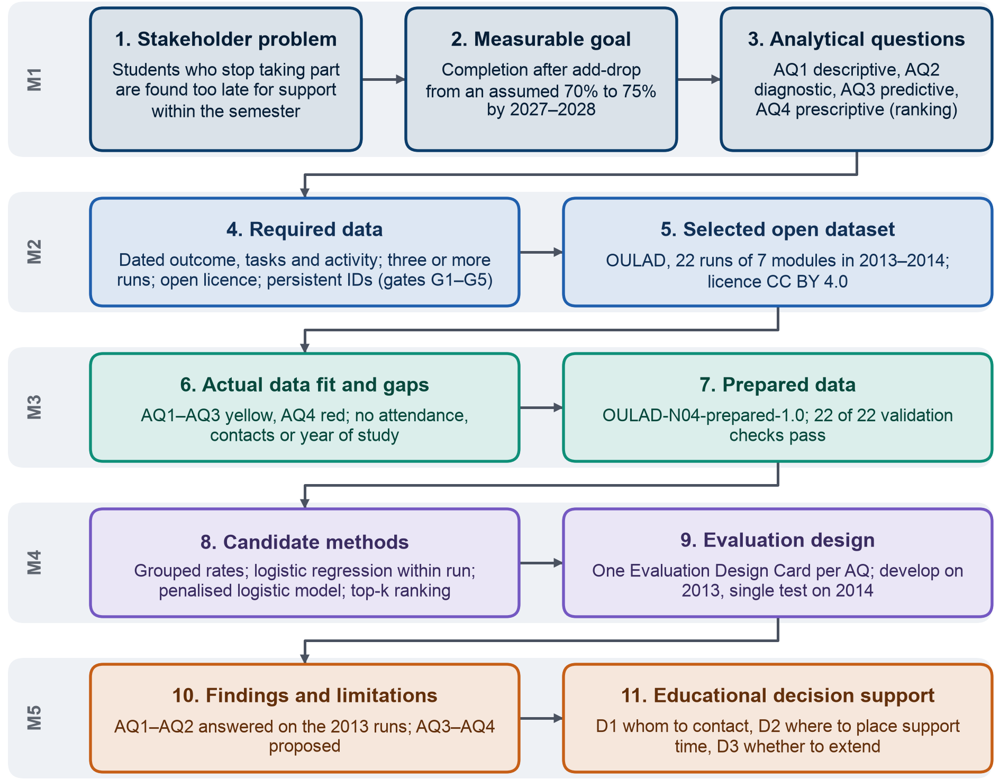

## 1.2. Scope and Project Objective

The stakeholder needs of Section 1.1, a short and timely list for staff and a view of where students are lost for the
program, set the boundaries of the project: what lies inside and outside them, the objective we pursue, the data that
stand in for the university's records, and how far the project has gone.

**Scope in the university.** The project covers students enrolled in the program's online and blended courses after
the add-drop period, the first weeks of a semester in which students may still register for or drop a course;
students who leave during that period are not counted, because their enrolment was never settled. The project works
one semester at a time and covers the decisions that staff can take within a semester: whom to contact, when, by whom
and with which offer of support. Because institutions define retention in different ways, the measures are fixed
before any analysis: course completion means passing the course, and withdrawal follows the definition of Circular
83/2026, which excludes approved leave and transfers.

**Outside the scope.** Five areas lie outside the project, each for a stated reason. Assessment rules are excluded
because a lecturer cannot change them during a semester; admissions and financial aid are university policy; students'
circumstances outside the course are beyond the university's control, so the project addresses only the university's
response to them; the evaluation of lecturers is excluded because it would stop lecturers from using the results; and
any automated decision about a student is excluded, so that every contact remains a decision of a member of staff.

**Project objective.** Our objective is to turn records the university already holds into two things staff do not
have today: a short, timely list of students to contact at each review point, with an observed reason for each name,
and patterns by course and student group that show the program where and when students are lost. These results
support the judgement of the staff who know the students rather than replace it. The objective serves the Business
Goal of Section 2, to improve successful course completion by identifying students who stop taking part early enough
to support them within the semester.

**Data that stand in for the university's records.** No open dataset of Vietnamese university courses records
enrolments, dated tasks and LMS activity together, so the analysis uses the Open University Learning Analytics Dataset
(OULAD), selected in Milestone 2 against requirements derived from the questions (Section 4.1). OULAD stands in for
the university's courses in the analysis, while the university's own records remain the target for the pilot; every
result must be re-checked on those records before it supports a decision. OULAD describes 22 runs of seven
distance-learning modules of the Open University in the United Kingdom in 2013 and 2014 (Section 5). Moving to these
data narrowed how the analytical questions are measured, but it changed neither the Business Goal, the SMART Goal nor
the three decisions; Section 3.2 records each change in the AQ Revision Log.

**How far the project goes.** The four analytical questions of Section 3 run from description to a ranking for
action: AQ1 describes how enrolments end, AQ2 examines which early signs go with non-completion, AQ3 tests how well
non-completion can be predicted early, and AQ4 ranks students on a list of fixed length. Milestone 4 completed the
mandatory Level 1 for all four questions, that is, the modeling strategy, candidate methods, rationale and evaluation
design, and specified a Level 2 experiment as a protocol without running it, a choice of scope explained in Section 10. On this basis we analysed AQ1 and AQ2 on
the 9 module runs of 2013, the development years of the design, following the analysis plan that Milestone 4 fixed
before any result was seen; the 13 runs of 2014 stay unopened, because they form the single test set of AQ3, and the
only 2014 figures used are the outcome counts per run that Milestone 3 had already published. AQ3 and AQ4 are
therefore reported as proposals with their expected outputs, in the proposal tense, and no model metric is reported
for them (Sections 8–11).

**The project as one chain.** Figure 1.1 shows the logic chain of the project in eleven links, from the stakeholder
problem and the measurable goal set in Milestone 1, through the required data and the selected dataset of
Milestone 2, the data fit and the prepared data of Milestone 3, and the candidate methods and evaluation design of
Milestone 4, to the findings and the educational decisions of Milestone 5.

{width=100%}

Each link in Figure 1.1 hands its result to the next, and Sections 2 to 11 follow the same order. Section 2 begins
the chain with the Business Goal, the SMART Goal and the indicators that show whether the goal is being met.
