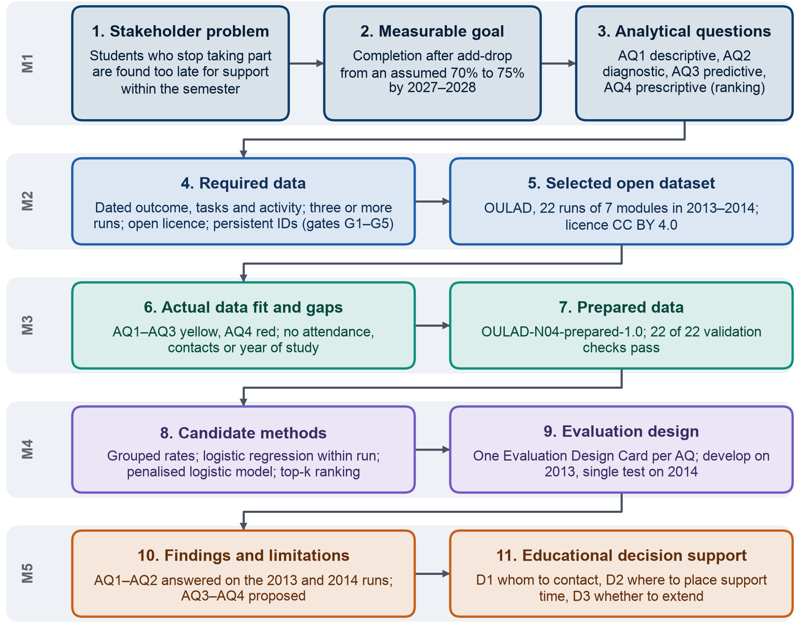

## 1.2. Phạm vi và mục tiêu của dự án

Phạm vi của dự án gồm các sinh viên còn theo học sau thời gian điều chỉnh đăng ký học phần trong các học phần trực tuyến và học
phần kết hợp của chương trình đào tạo, xét theo từng học kỳ, cùng các quyết định mà cán bộ có thể đưa ra trong một học
kỳ. Hoàn thành học phần nghĩa là đạt học phần, còn thôi học được xác định theo Thông tư 83/2026, không tính các trường
hợp tạm ngừng học có phép và chuyển chương trình đào tạo. Quy định về kiểm tra, đánh giá học phần, tuyển sinh và hỗ trợ
tài chính, hoàn cảnh của sinh viên ngoài học phần, việc đánh giá giảng viên và mọi quyết định tự động đều nằm ngoài
phạm vi (Phụ lục I). Mục tiêu của nhóm chúng em là biến dữ liệu sẵn có của trường thành một danh sách ngắn và kịp thời
gồm những sinh viên cần liên hệ ở mỗi đợt lập danh sách, kèm một lý do quan sát được cho mỗi tên, đồng thời rút ra các quy luật giúp chương trình đào tạo thấy sinh viên không hoàn thành học phần ở đâu và vào lúc nào. Vì chưa có bộ dữ liệu mở nào về
các học phần ở Việt Nam, chúng em dùng Bộ dữ liệu phân tích học tập của Đại học Mở Anh (OULAD) làm bộ dữ liệu thay thế
(Mục 4.1); mọi kết quả phải được kiểm chứng lại trên dữ liệu của trường trước khi được dùng làm căn cứ cho một quyết định. AQ1 và AQ2 đã
được trả lời trên toàn bộ 22 kỳ mở module của năm 2013 và năm 2014 (kỳ mở – một lần mở module trong một học kỳ, ví dụ 2013B). AQ3 và AQ4 vẫn là
thiết kế, vì thực nghiệm Level 2 (mức tự chọn của Milestone 4: chạy nguyên mẫu cho AQ3 và AQ4) đã
được đặc tả nhưng chưa được chạy (Mục 10). Hình 1.1 trình bày chuỗi logic gồm mười một mắt xích của dự án, đi
từ vấn đề của các bên liên quan đến các phát hiện và những quyết định mà các phát hiện này hỗ trợ; Mục 2 đến Mục 11
lần lượt đi theo chuỗi này.

{width=85%}
