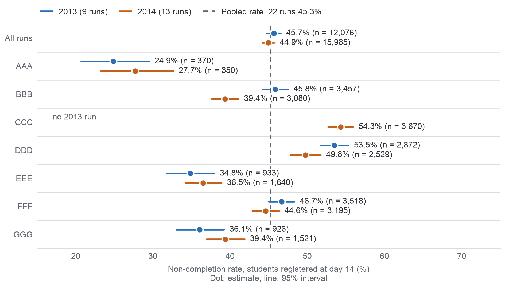

## 11.2. AQ1: Completion and Timing of Non-completion

We computed AQ1 on the 9 runs of 2013 (13,529 enrolments), with the enrolments still registered at day 14 as primary
denominator, Wilson intervals for rates, and the 2014 outcome counts per run that Milestone 3 published for the year comparison, opening no 2014
enrolment (C15). The success criterion is met: the prepared views and the raw tables agree in all 72 outcome cells, and the first
missed week agrees for all 13,529 enrolments (Appendix XII). Of the 12,076 enrolments registered at day 14, 45.7%
(44.8–46.6) did not complete, 26.8% failing and 18.9% withdrawing, and over all enrolments the rate is 51.4% (Table A.29).
Non-completion ranges from 24.9% in module AAA to 53.5% in DDD and is higher in February runs (51.6%) than in October
runs (42.4%) (Table A.30); Appendix XII adds how students leave in each module and the rates by disability and
deprivation band.

The run rates span from 24.9% (AAA 2013J) to 57.5% (DDD 2013B), and the denominator alone moves a run's rate by up to
9.9 points, so the KPI fixes the add-drop rule. Of the non-completers, 78.1% missed a TMA or CMA against 21.9% of
completers, but only 19.6% had missed one by week 4 (Table A.31), so a rule on tasks alone comes too late, which is why
the early-sign rule counts inactivity. Non-completion was 2.3 points higher in 2014 over all enrolments, but −0.2 points
(−1.4 to 0.9) within the six modules that ran in both years (Table A.32). The answer has high confidence for OULAD 2013
and gives D2 a hypothesis on where support time would go first, to be checked on the university's records. Figure 11.1 shows the rate of each 2013 run against the pooled rate.

{width=100%}
