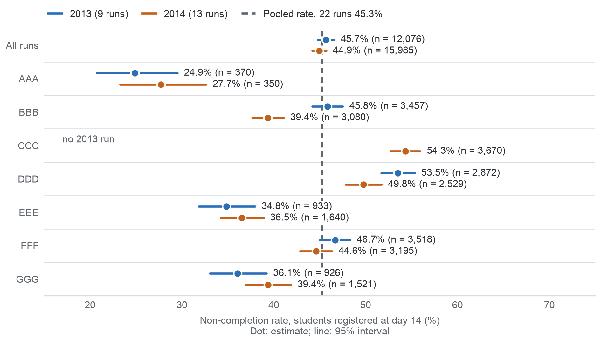

## 11.2. AQ1: Mức hoàn thành và thời điểm không hoàn thành

Nhóm chúng em tính AQ1 trên 9 kỳ mở năm 2013 (13.529 lượt đăng ký học). Mẫu số chính là các lượt đăng ký học của sinh
viên còn đăng ký học (chưa rút) tại ngày 14, tính từ ngày bắt đầu kỳ mở; mỗi tỷ lệ có khoảng tin cậy Wilson. Để so sánh
giữa hai năm, chúng em dùng số đếm kết quả theo từng kỳ mở năm 2014 mà Milestone 3 đã công bố (C15). Đây là các số tổng
hợp ở cấp kỳ mở, nên kết quả của từng lượt đăng ký học năm 2014 vẫn được giữ kín cho lần kiểm tra AQ3. Tiêu chí thành
công được đáp ứng: bảng dữ liệu đã chuẩn bị và các bảng gốc khớp nhau ở cả 72 ô kết quả, còn tuần sinh viên bỏ lỡ bài
đầu tiên khớp ở cả 13.529 lượt đăng ký học (Phụ lục XII). Trong 12.076 lượt đăng ký học chưa rút tại ngày 14, 45,7%
(44,8–46,6) không hoàn thành, gồm 26,8% không đạt và 18,9% rút khỏi module; tính trên mọi lượt đăng ký học, tỷ
lệ này là 51,4% (Bảng A.29). Tỷ lệ không hoàn thành dao động từ 24,9% ở module AAA đến 53,5% ở module DDD và cao hơn ở các kỳ
mở tháng 2 (51,6%) so với các kỳ mở tháng 10 (42,4%) (Bảng A.30). Phụ lục XII trình bày thêm cách sinh viên rời khỏi
từng module, cùng tỷ lệ theo tình trạng khuyết tật và theo mức khó khăn của khu vực.

Tỷ lệ của từng kỳ mở trải từ 24,9% (AAA 2013J) đến 57,5% (DDD 2013B). Chỉ riêng cách chọn mẫu số (chỉ tính các lượt
đăng ký học chưa rút tại ngày 14 hay tính mọi lượt đăng ký học) đã làm tỷ lệ của một kỳ mở thay đổi tới 9,9 điểm phần trăm; vì vậy, định nghĩa
KPI quy định rõ chỉ tính sinh viên còn học sau thời gian điều chỉnh đăng ký học phần. Bỏ lỡ bài được chấm điểm phân biệt
rõ hai nhóm: 78,1% trong số 5.515 sinh viên không hoàn thành đã bỏ lỡ ít nhất một bài TMA hoặc CMA, trong khi ở 6.561
sinh viên hoàn thành, tỷ lệ này chỉ là 21,9%. Tuy nhiên, tính đến hết tuần 4, chỉ 19,6% sinh viên không hoàn thành đã bỏ
lỡ một bài (Bảng A.31). Do đó, một quy tắc chỉ dựa vào các bài được chấm điểm sẽ phát hiện quá muộn; đây là lý do quy
tắc dấu hiệu sớm tính cả tình trạng không có hoạt động. Tính trên mọi lượt đăng ký học, tỷ lệ không hoàn thành năm 2014
cao hơn năm 2013 là 2,3 điểm phần trăm. Tuy nhiên, trong 6 module được mở ở cả hai năm, năm 2014 lại thấp hơn 0,2 điểm
phần trăm (−0,2; khoảng tin cậy −1,4 đến 0,9 chứa 0), tức là không có chênh lệch rõ ràng (Bảng A.32). Câu trả lời có
độ tin cậy cao đối với OULAD năm 2013 và cung cấp cho D2 một giả thuyết về nơi cần ưu tiên thời gian hỗ trợ; giả thuyết
này cần được kiểm chứng lại trên dữ liệu của trường. Hình 11.1 cho thấy tỷ lệ của từng kỳ mở năm 2013 so với tỷ lệ gộp.

{width=100%}
