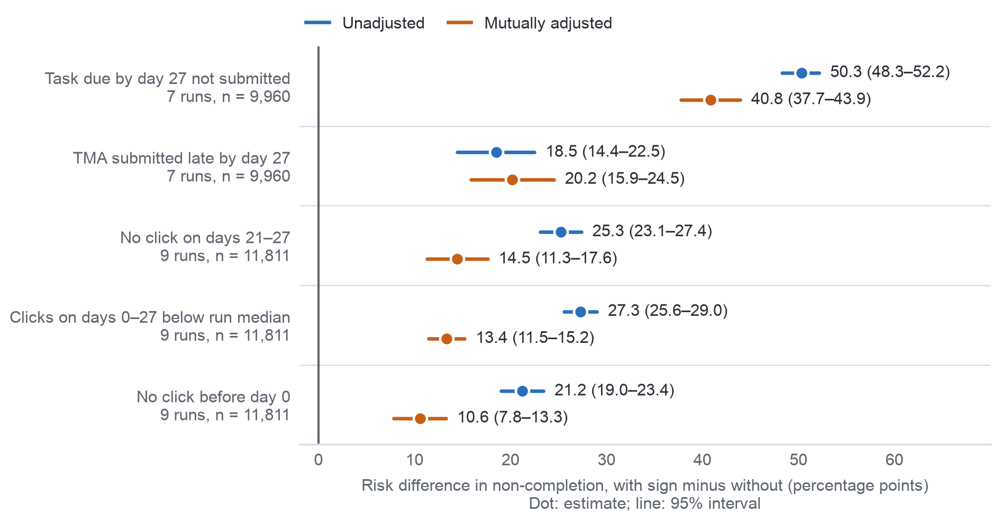

## 11.3. AQ2: Early Signs Associated with Non-completion

We estimated AQ2 on the 11,811 enrolments of 2013 registered at day 27 (44.4% non-completion) with a logistic
regression with run fixed effects and sign × module terms; the two task signs are defined in the 7 runs with a task due
by day 27 (9,960 enrolments). Each estimate is an average risk difference in percentage points, an association and never
an effect of the sign [10] (Appendix XIII).

All five signs meet the criterion of a consistent association (Table A.33): a missed task goes with 40.8 more points of
non-completion (37.7–43.9), a late TMA with 20.2, no click in the last seven days with 14.5, activity below the run
median with 13.4 and no click before the start with 10.6. Each keeps its direction in every module, though five click-sign estimates in AAA and GGG include 0 (Table A.34),
and under six sensitivity runs (Table A.35). The binary click signs miss part of a graded activity gradient (Table A.36);
with clicks added as a continuous adjustment they shrink to 9.3, 5.8 and 8.9 points and still meet the criterion.
Appendix XIII describes the signs within groups of gender, disability and deprivation band, and the replication on 2014
and the several-modules sign wait until after the AQ3 test (Change Log C12, C14).
Confidence is moderate: one year, a known misfit, and associations that unrecorded reasons could explain. The signs give
each name on a D1 list a factual reason, while contact based on them stays an option to test. Figure 11.2 shows the five signs, unadjusted and mutually adjusted.

{width=100%}
