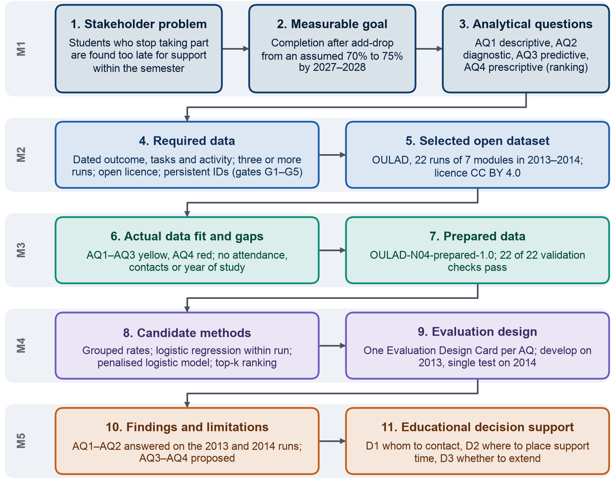

## Appendix I – Educational Context, Stakeholders and Scope

This appendix supports Section 1. It gives the regulatory and published background of the problem, the stakeholders with their needs and decisions, how those needs were established and settled, the areas that lie outside the scope of the project, and the logic chain that the report follows.

**The logic chain of the project.** The project follows one analytics chain from the stakeholder problem to the
decisions that its findings support, and each milestone produced some of its links. Figure A.1 shows this chain in
eleven links, with the milestone that produced each link and one concrete item per link; Sections 2 to 11 follow it in
order.

{width=85%}

**The educational setting.** The project is set in a Vietnamese university that is expanding online and blended
learning. An online course runs entirely on the university's LMS, the web platform on
which lecturers publish materials, quizzes and assignments and students submit their work; a blended course adds
classroom sessions to the LMS. We work with one undergraduate program of about 1,200 students in a faculty of about
4,000; both figures are scenario assumptions, because the university is the scenario of the course brief, and every
figure about it in the report is marked as such. In several of the program's online and blended courses, the
university has observed that students take part less as the semester goes on and that some do not complete the
course. It holds the data that could describe this, namely LMS activity, enrolment and result records in its academic
management system, assignment and quiz results, grades and student surveys, but it has not decided which questions
these data should answer or which decisions analytics should support.

**Regulation raises the stakes.** Online teaching is now a regular part of degree programs in Vietnam: under the
undergraduate training regulation of 2021, a full-time or work-study program may deliver up to 30% of its volume in
online classes, as reported in April 2021 [18]. Withdrawal is in addition a regulated measure of a university's
quality. Circular 01/2024 caps the annual withdrawal rate at 10% and the first-year rate at 15% [1], and a university
whose first-year withdrawal exceeds 15% may not raise its enrolment quota [1]. Circular 83/2026, in force from
15 November 2026, replaces Circular 01/2024 and keeps these thresholds, as reported in October 2026 [2], and it
excludes from withdrawal the students on approved leave and those who transfer to another program or institution
[2]. These three regulations are cited through news reports of the Circulars, which are secondary sources. As a
result, a university needs an exact record of each student's status and has a direct interest in finding students who
are drifting away while they can still be helped.

**What published studies report.** Non-completion in online higher education is a recognised and persistent concern.
A 2024 systematic review of 110 articles published between 2013 and June 2023 treats dropout in online higher
education as a significant concern [19] and finds that several contributors act at once: the quality of the course,
academic preparation, satisfaction, motivation, attributes of the system and support services [19]. A review of 40
studies from 2010 to 2018 reports that retention in online learning is significantly lower than in face-to-face courses
[20], with completion in online courses about 8 to 14 points below face-to-face courses [20]. In Vietnam, a 2024
review puts dropout among university students at about 20–30% [21]. Disengagement also starts early. In
massive open online courses (MOOCs) about half of the enrolled students never show up and the first two weeks are critical for
engagement [22], and in a blended first-year statistics course weeks 5–6 were the best point for an early warning,
because they still left students time to change their study patterns while the prediction stayed reasonably accurate
[23]. Taken together, these studies indicate that the useful moment for support lies in the first weeks of a course,
well before any final result.

**The problem.** Building on this setting, the problem our project addresses is that students who stop taking part
are noticed late, and only some of them are noticed at all. In the simulated stakeholder interviews of Milestone 1, in which AI personas answered for each group of staff (Section 1.1), each group described a different moment of notice: lecturers become sure that a student has gone quiet around week 5 or 6,
the program manager sees pass and withdrawal counts only after the semester has closed, and the student support office
meets most of these students only when they appear on the academic warning list at the end of a semester. In every case the moment of notice comes after the moment at which help would have been easiest. Published work places that moment early as well: in a blended first-year course weeks 5–6 were the best point for an early warning [23], and the window for effective support of a student at risk is short, between two and four weeks [3]. Section 1.1 sets out who is
affected by this delay and what each stakeholder needs, and Section 1.2 turns the problem into a bounded objective.

**Who uses the results.** The course brief requires three stakeholders, the Academic Program Manager, the Course
Lecturer and the Academic Advisor or Student Support Officer, and we added the Student and the Learning Technology and
Data Officer, because the project acts on students and depends on the office that holds the data. In our setting the
third role is an officer of the student support office, the faculty office that advises and supports students, while
the academic advisors of student classes (cố vấn học tập) are lecturers, called lecturer-advisors below. Table A.1
lists each stakeholder with the role in the problem, the need that the project serves and the decision that the
results support; the decisions D1–D3 are classified in Section 2.1.

**Table A.1. Stakeholders, needs and decisions supported**

| Stakeholder | Role in the problem | Need served by the project | Decision supported |
| :---- | :---- | :---- | :---- |
| Program Manager | Owns the program's completion figures and assigns teaching and support staff | A view, during the semester, of which courses and groups lose students and when | D2: where to place the time of the support office and the lecturer-advisors each semester; with the pilot results, D3 |
| Course Lecturer | Runs a course; the first to see who stops submitting work | A short weekly list of students to contact, with a factual reason for each name | D1: whom to contact at each review point |
| Student Support Officer and lecturer-advisors | Contact and support students, with little time for each | Reach students before the academic warning list, within a fixed weekly capacity | D1: whom to contact first, by whom and with which offer |
| Student | Takes the course; the subject of every data use and every contact | Contact from someone known, with a practical offer, and use of data for support only | Whether to accept help, reduce the study load or pause in time |
| Learning Technology and Data Officer | Holds and links LMS and academic records; applies privacy rules | A lawful, stated purpose before any data are linked, and data clean enough to trust | D3: whether to link data routinely, with university leadership and legal staff |

**How the needs were established.** The needs in Table A.1 come from interviews and a validation round carried out in
Milestone 1, in which generative AI took both sides of each conversation: an isolated AI persona answered as the
stakeholder and an AI interviewer asked our questions and follow-ups. We verified every transcript and drew 51 key
statements from the interviews, each labelled as an opinion, an assumption or scenario information. These statements
are simulated stakeholder views. They motivate the design of the project, such as the timing of the lists and the
length that staff can follow up, but they are never used as evidence for a finding; every finding in Section 11 rests
on the data or on published work.

**What the stakeholders need.** Six themes recur across the five stakeholders. Three form the core of the project:
late detection (T1), an early start of disengagement, usually signalled by a missed quiz or assignment (T2), and a
small, fixed capacity for follow-up, which calls for a short list with a reason for each name (T3). A fourth theme
supports the design, namely that contact helps when it comes from someone the student knows and offers something
practical (T4). Two themes act as constraints: trust in the data, which requires linked records, correct status and a
lawful purpose (T5), and use for support only, so that results never label students, affect grades or evaluate
lecturers (T6). The capacity behind theme T3 rests on two stakeholder estimates, not on data: the three officers of the
support office can follow up about 30–40 students a week between them, and each lecturer-advisor can contact three to
five students a week from their own classes.

**How the conflicts were settled.** The stakeholders agreed on the problem but differed on early contact against the
risk of false alarms, on who should make contact, and on program figures against names for staff. We settled these
points in four ways. Contact lists reach staff at two review points, week 3 and week 5; each name carries a factual
reason checked by a member of staff; contact comes from the lecturer or the student's lecturer-advisor, with the
support office taking the harder cases; and no step is automated. The validation round confirmed this core and fixed
three further points: completion means passing the course, the review points avoid registration and examination
weeks, and the target is pursued over a full academic year rather than one semester.

**Published practice points the same way.** Early-semester data help to identify and predict students at risk, and
early intervention is the leading recommendation of a review of online retention [20], which also calls for a
collective effort of several stakeholders [20]. The Open University, the institution that published the dataset we
analyse, runs a predictive tool, OU Analyse, designed to inform teachers about students at risk of not submitting
their next assignment so that the teachers act [3]. In a study of 59 teachers, nine courses and 1,325 students,
teachers who engaged with these predictions were associated with better student performance [3], and the window
for effective support of a student at risk is short, between two and four weeks [3]. At scale, the tool reached
1,159 teachers and 23,180 students in 231 online courses [24], with a weekly traffic-light output that marks students
at risk in red, those with a moderate probability of failing in amber and those likely to succeed in green [24].
Building on this evidence, our project gives the people who already contact students a better-timed list, rather than
a new office or an automated decision, and Section 1.2 sets the scope within which that list is built.

**Scope in the university.** The project covers students enrolled in the program's online and blended courses after
the add-drop period, the first weeks of a semester in which students may still register for or drop a course;
students who leave during that period are not counted, because their enrolment was never settled. The project works
one semester at a time and covers the decisions that staff can take within a semester: whom to contact, when, by whom
and with which offer of support. Because institutions define retention in different ways, the measures are fixed
before any analysis: course completion means passing the course, and withdrawal follows the definition of Circular
83/2026, which excludes approved leave and transfers.

**Outside the scope.** Five areas lie outside the project, each for a stated reason. Assessment rules are excluded
because a lecturer cannot change them during a semester; admissions and financial aid are university policy; students'
circumstances outside the course are beyond the university's control, so the project addresses only the university's
response to them; the evaluation of lecturers is excluded because it would stop lecturers from using the results; and
any automated decision about a student is excluded, so that every contact remains a decision of a member of staff. These results support the judgement of the staff who know the students rather than replace it.

**Data that stand in for the university's records.** No open dataset of Vietnamese university courses records
enrolments, dated tasks and LMS activity together, so the analysis uses OULAD, selected in Milestone 2 against requirements derived from the questions (Section 4.1). OULAD stands in for
the university's courses in the analysis, while the university's own records remain the target for the pilot; every
result must be re-checked on those records before it supports a decision. OULAD describes 22 runs of seven
distance-learning modules of the Open University in the UK in 2013 and 2014 (Section 5). Moving to these
data narrowed how the questions are measured, but it changed neither the Business Goal, the SMART Goal nor
the three decisions; Section 3.2 records each change in the AQ Revision Log.
